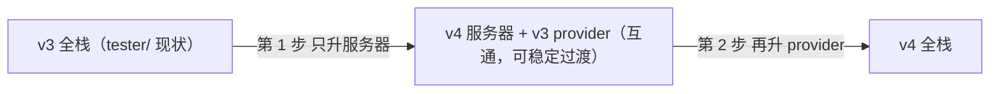

import { Meta } from '@storybook/addon-docs/blocks';

<Meta id="v3-migration" title="进阶/从 v3 迁移" name="Docs" />

# 从 v3 迁移

从 v3 升到 v4 不是全量重写：线协议双向互通，新旧版本可以混跑过渡，破坏性变更集中在一张有限的清单上——服务端的请求对象、钩子 payload、`handleConnection` 接线契约与 SQLite 驱动，加上 provider 仅有的两条类型变化。本课是整套手册的收束课：每条差异都给「v3 写法 → v4 写法 → 处理动作 → 课程入口」，前序课程已展开的细节从入口跳转，不在这里重复。读完你应能预测：升级按什么顺序做、TypeScript 编译器会替你抓住哪些变更、哪些代码与数据能原样保留、v3 客户端接 v4 服务器会不会出问题。

版本基线：Hocuspocus v4（4.7.x，要求 Node 22+）；工作区 `tester/` 锁定 3.4.4，是本课的实战升级对象。全部差异条目均对照官方升级指南、RELEASE_NOTES_V4 与两侧源码核实。



升级要件速查：

| 项目 | v3 | v4 | 升级动作 |
| --- | --- | --- | --- |
| Node.js | 无 22+ 要求 | 要求 22+ | 先升 Node，再升包 |
| `@hocuspocus/*` 包 | `^3.4.4` | `^4`（当前 4.7.x） | 整组一起升，不单独升部分包 |
| SQLite 驱动 | 扩展包内置 `sqlite3` | 扩展包内置 `better-sqlite3` | 随包升级自动换；自定义查询改绑定键（见下文） |
| 线协议 | — | 与 v3 双向互通 | 可先升一端混跑过渡 |
| 存档数据 | Yjs 更新 | 格式未变 | 无需数据迁移 |
| 仓库基础设施 | npm + Rollup | pnpm + Rolldown | 只影响贡献者，应用侧 npm 照旧 |

## 升级决策

### v4 带来什么

按「对升级者有什么用」过一遍 v4 的主要变化，每条都能在前序课程找到完整展开：

- **跨运行时。** `ws` 换成 crossws 后，同一份钩子与扩展配置可跑在 Node、Bun、Deno 与 Cloudflare Workers，见[跨运行时](?path=/docs/runtimes--docs)。
- **泛型 Context。** 钩子与连接全链路的 context 类型可自定义，默认 `any`，不写类型也不破坏行为，见[鉴权与上下文](?path=/docs/auth--docs)。
- **session awareness。** 同一条 WebSocket 上同名文档多开互不干扰，见[共享 WebSocket 连接](?path=/docs/shared-websocket--docs)。
- **有序消息与应用层 Ping/Pong。** 文档更新按到达顺序处理（v3 在异步钩子下可能乱序）；判活消息升级为 `MessageType.Ping`（9）与 `MessageType.Pong`（10），替代部分运行时没有的 WebSocket 层 ping，见[断线与重连](?path=/docs/reconnection--docs)。
- **优雅关闭补落库。** `destroy()` 立即执行所有被 debounce 推迟的 `onStoreDocument`（v3.4.4 源码核实的旧行为：只关连接等文档卸载，不补落库），停服不再丢 debounce 窗口内的编辑，见[生产部署](?path=/docs/production-deploy--docs)。
- **存储链路增强。** `onStoreDocument` 对任何来源的变更触发（v3 只对 WebSocket 来源），`onLoadDocument` 可返回 `Uint8Array`，见[文档生命周期](?path=/docs/document-lifecycle--docs)。

### 互通性与升级时机

RELEASE_NOTES_V4 的结论：v3 provider 可以连 v4 服务器，v4 provider 也可以连 v3 服务器，两个方向都有明确处理——

| 方向 | 互通行为 |
| --- | --- |
| v3 provider → v4 服务器 | 服务器接受纯文档名（无 session 路由键）、不要求 Pong 响应、能处理不带版本串的 auth 消息 |
| v4 provider → v3 服务器 | provider 默认 `sessionAwareness: false` 发纯文档名；auth 消息多出的版本串被 v3 服务器当尾部数据忽略；provider 不要求服务器发 Ping |

唯一要主动守住的例外：v4 provider 显式开 `sessionAwareness: true` 去连 v3 服务器时，组合键（文档名 + 空字符 + sessionId）会被 v3 服务器当字面文档名，创建出意外的文档。连 v3 服务器保持默认 `false`（机制见[共享 WebSocket 连接](?path=/docs/shared-websocket--docs)）。

是否必须立刻升级：不必。互通性允许服务器与客户端分别升级、按自己的节奏过渡；真正的硬门槛只有一个——一旦决定升级，Node 先到 22+。升级的理由按需对号入座：要跨运行时、要 session awareness、要泛型 Context，或想让停服补落库成为默认行为。

## 升级步骤

按序执行，每步都可独立验证：

1. **Node 升到 22+。** 换 Node 大版本后重装依赖，让 `better-sqlite3` 这类原生模块按新 ABI 重新构建。
2. **整组升级包。** 官方指南的基线命令是 `npm install @hocuspocus/server@^4.0.0 @hocuspocus/provider@^4.0.0`；项目里全部 `@hocuspocus/*`（含各扩展包）一起升，进程内不留版本混装。
3. **按需补装 SQLite 驱动与类型。** 扩展包 v4 已内置 `better-sqlite3`；自定义查询要直接打开数据库文件、或需要 TypeScript 类型时再自装：`npm install better-sqlite3` 与 `npm install -D @types/better-sqlite3`。
4. **跑一遍编译，把报错当迁移清单。** `npx tsc --noEmit`，报错逐条对回下文「服务端变更对照」表。
5. **过一遍「行为复核清单」。** 默认值与行为变化不报错，但要逐条确认影响面。
6. **混跑验证。** 先保留 v3 provider 连 v4 服务器跑一轮同步、awareness 与断线重连，再升 provider。

构建与打包注意：v4 仓库从 npm 迁到 pnpm workspaces、从 Rollup 迁到 Rolldown，这两个变化只影响 Hocuspocus 仓库的贡献者；应用项目的 npm 安装与打包配置不需要任何动作。

## 服务端变更对照

下表是服务端差异的完整清单。「处理动作」给最小动作；已在前序课程展开的细节从入口列进入。破坏性条目必须处理，标注（非破坏）的条目只需复核。

| 变更点 | v3 写法 | v4 写法 | 处理动作 | 入口 |
| --- | --- | --- | --- | --- |
| 钩子请求对象（破坏） | `IncomingMessage`、`IncomingHttpHeaders` | web `Request`、`Headers`（`onUpgrade`/`onRequest` 除外） | `requestHeaders['x']` 改 `requestHeaders.get('x')`；IP 改读 `x-forwarded-for` 或 `x-real-ip` | [鉴权与上下文](?path=/docs/auth--docs) |
| `handleConnection` 签名（破坏） | `(WebSocket, IncomingMessage, context)` 返回 void、内部自挂监听 | `(WebSocketLike, Request, context)` 返回 `ClientConnection` | 传 web Request；保存返回值并转发 message 与 close | [接入现有服务器](?path=/docs/custom-server--docs) |
| WebSocket 类型（破坏，仅 TS） | 从 `ws` 包导入 `WebSocket` 类型 | 从 `@hocuspocus/server` 导入 `WebSocketLike`（`send`/`close`/`readyState`） | 替换类型导入 | [跨运行时](?path=/docs/runtimes--docs) |
| `websocketOptions`（破坏） | 构造函数第二参 | 并入 config 对象 | 挪位置 | [Server 配置](?path=/docs/server-config--docs) |
| `onStoreDocument` payload（破坏） | `context`、`transactionOrigin`、`requestHeaders`、`requestParameters`、`socketId` | `lastContext`、`lastTransactionOrigin`，连接专属字段移除 | 字段改名；需要请求信息改在鉴权钩子取好放进 context | [自定义持久化](?path=/docs/custom-persistence--docs) |
| `onAwarenessUpdate` payload（破坏） | `context` 等连接字段铺在顶层 | `transactionOrigin`、可选 `connection`、`awareness` | context 改从 `connection?.context` 取 | [Awareness 在线状态](?path=/docs/awareness--docs) |
| 事务 origin（破坏） | 魔法字符串或 `instanceof Connection` | 结构化 `.source` 加 `isTransactionOrigin()` | 改判断写法（见下文） | [文档生命周期](?path=/docs/document-lifecycle--docs) |
| SQLite 驱动（破坏，仅自定义查询） | `sqlite3`，绑定键 `$name` | `better-sqlite3`，绑定键 `name` | 驱动随包自动换；自定义查询的绑定键去 `$` | [持久化扩展](?path=/docs/persistence-extensions--docs) |
| `onLoadDocument` 返回值（非破坏） | 只支持返回 Y.Doc | 还可返回 `Uint8Array` | 无需动作；自写存储扩展可返回原始 Yjs update | [文档生命周期](?path=/docs/document-lifecycle--docs) |
| `timeout` 默认值（非破坏） | `30000` | `60000` | 依赖旧默认的显式写 `timeout: 30000` | [Server 配置](?path=/docs/server-config--docs) |

### 请求对象与钩子 payload

请求头取值是改动量最大、也最容易漏的一处（升级指南原文对照的压缩版）：

```ts
// v3：请求头是 Node 普通对象，请求是 IncomingMessage
async onAuthenticate({ request, requestHeaders }) {
  const token = requestHeaders['authorization'];
  const ip = requestHeaders['x-forwarded-for'];
}

// v4：全链路 web 标准，取头一律用 get()
async onAuthenticate({ request, requestHeaders }) {
  const token = requestHeaders.get('authorization');
  const ip = requestHeaders.get('x-forwarded-for');
}
```

三条边界：

- 例外是 `onUpgrade` 与 `onRequest`：仍用 Node 类型（它们工作在 WebSocket 升级之前的 HTTP 层），见[接入现有服务器](?path=/docs/custom-server--docs)。
- `request.socket.remoteAddress` 没有了，IP 从反向代理头取；extension-throttle 的取头与回退差异同理（见[限流与日志](?path=/docs/throttle-and-logger--docs)）。
- store 与 awareness 钩子的 payload 收紧了，因为存储与广播的触发来源不再限于连接：

```ts
// onStoreDocument 解构对照（afterStoreDocument 同步改）
// v3: { context, transactionOrigin, requestHeaders, requestParameters, socketId, document, ... }
// v4: { lastContext, lastTransactionOrigin, document, documentName, clientsCount, instance }
```

需要请求头或 query 参数时，在 `onAuthenticate` / `onConnect` 阶段取好放进 context（见[鉴权与上下文](?path=/docs/auth--docs)）。两个连带影响：extension-webhook payload 里的 `requestHeaders` 现在是 `Headers` 实例，直接进请求体只会得到空对象（见[Webhook 事件](?path=/docs/webhooks--docs)）；awareness 钩子改从 `connection?.context` 取 context，`awareness` 实例直接进 payload（见[Awareness 在线状态](?path=/docs/awareness--docs)）。

### handleConnection 接线契约

v3 一行接完的写法在 v4 过不了三关：请求对象、返回值、事件转发。

```ts
// v3（tester/server.js 原文）：Node 请求直传，返回值可忽略，监听内部自挂
app.ws('/', (websocket, request) => {
  hocuspocus.handleConnection(websocket, request, { user_id: 1234 })
})

// v4：请求必须已是 web Request；返回 ClientConnection，转发由调用方接线
const clientConnection = hocuspocus.handleConnection(
  websocket,          // 任何满足 WebSocketLike 三成员的对象
  webRequest,         // web 标准 Request，不能是 IncomingMessage
  { user_id: 1234 },
)
websocket.on('message', (data) =>
  clientConnection.handleMessage(new Uint8Array(data)))
websocket.on('close', (code, reason) =>
  clientConnection.handleClose({ code, reason }))
```

配套两处：

- 代码里引用 `ws` 类型的位置（如 `connection.webSocket` 的标注）全部换成 `WebSocketLike`——它只有 `send`、`close`、`readyState` 三个成员，`ws` 的原生 WebSocket 天然满足，接口全貌见[跨运行时](?path=/docs/runtimes--docs)。
- `websocketOptions` 挪进 config：

```ts
// v3: new Server({ port: 1234 }, { maxPayload: 1024 * 1024 })
// v4:
const server = new Server({
  port: 1234,
  websocketOptions: { maxPayload: 1024 * 1024 },
})
```

### 事务来源与 SQLite 驱动

origin 判断从「猜值的形状」变成「查结构的字段」：

```ts
// v3：魔法字符串与连接对象实例判断
if (transactionOrigin === '__hocuspocus__redis__origin__') { /* 来自 redis */ }
if (transactionOrigin instanceof Connection) { /* 来自客户端连接 */ }

// v4：结构化来源，按 .source 分派
import { isTransactionOrigin } from '@hocuspocus/server'

if (isTransactionOrigin(transactionOrigin)) {
  switch (transactionOrigin.source) {
    case 'redis': break      // extension-redis 中继
    case 'connection': break // 客户端连接，origin.connection 可用
    case 'local': break      // 服务端自身写入，如 DirectConnection
  }
}
```

extension-redis 的实例互滤与落库防循环建立在新的来源结构上，见[水平扩展](?path=/docs/scaling--docs)。

SQLite 换驱动对默认配置零改动——`database` 选项名与库文件格式都不变；影响面只有自定义 schema 与查询。better-sqlite3 的绑定对象键不带 `$` 前缀（SQL 文本里的 `$name` 占位符写法保留，变的只是绑定键）：

```ts
// v3（extension-sqlite v3 内部同款写法）：{ $name: documentName, $data: state }
// v4（extension-sqlite v4 内部同款写法）：{ name: documentName, data: state }
```

驱动差异与三扩展选型见[持久化扩展](?path=/docs/persistence-extensions--docs)。

### 行为复核清单

破坏性清单之外，这组「变了但不报错」的行为要在升级后按需复核：

| 行为变化 | v3 | v4 | 入口 |
| --- | --- | --- | --- |
| 落库触发范围 | 只对 WebSocket 来源的变更安排落库 | 任何来源都触发，`LocalTransactionOrigin` 可用 `skipStoreHooks` 退出 | [文档生命周期](?path=/docs/document-lifecycle--docs) |
| 停服补落库 | `destroy()` 不补落库 | `destroy()` 立即执行待落库的存储 | [生产部署](?path=/docs/production-deploy--docs) |
| 客户端伪造广播 | 收到 opcode 6 直接向房间转发 | 抛错拒绝，payload 不达任何人 | [Stateless 消息](?path=/docs/stateless--docs) |
| 同名多开登记 | 静默覆盖，行为不可预测 | 抛错并提示正确做法 | [共享 WebSocket 连接](?path=/docs/shared-websocket--docs) |
| throttle 取 IP | 回退 `request.socket.remoteAddress` | 只看 `x-real-ip` 与 `x-forwarded-for` | [限流与日志](?path=/docs/throttle-and-logger--docs) |
| Logger 日志前缀 | 扩展自带 `prefix` | 已废弃，改用 Server 的 `name` | [限流与日志](?path=/docs/throttle-and-logger--docs) |
| webhook HTTP 客户端 | axios | 原生 fetch | [Webhook 事件](?path=/docs/webhooks--docs) |

## 客户端变更

provider 侧的破坏性变化只有两条，都在类型层面：

- **CloseEvent 缩减。** `onClose` 事件只剩 `code` 与 `reason`，`target` 与 `type` 被移除——回调里读了这两个字段的地方删掉即可，见[HocuspocusProvider](?path=/docs/provider--docs)。
- **`ws` 类型不再随包分发。** provider 不再 re-export `ws` 的 `Event`、`MessageEvent`、`CloseEvent` 类型；从 `@hocuspocus/common` 导入，或改用 Web 标准类型。

构造参数没有破坏：`url`、`name`、`token` 等 v3 写法原样延续。两处新增要知道：

- `sessionAwareness`（默认 `false`）：连 v4 服务器且需要同名多开才开启；连 v3 服务器必须保持 `false`，原因见上文互通性例外。
- 认证消息附带 provider 版本串：v3 服务器当尾部数据忽略，无需任何动作。

## 升级 tester/

工作区 `tester/` 锁定 `@hocuspocus/*` 3.4.4，跑通的是 express + express-ws 自定义服务器与 SQLite 持久化。它的服务端只有一个文件，适合整文件 before/after 对照。

v3 原文（`tester/server.js`）：

```js
import { Logger } from '@hocuspocus/extension-logger'
import { SQLite } from '@hocuspocus/extension-sqlite'
import { Hocuspocus } from '@hocuspocus/server'
import express from 'express'
import expressWebsockets from 'express-ws'

const hocuspocus = new Hocuspocus({
  name: 'tester',
  timeout: 30000,
  debounce: 5000,
  maxDebounce: 30000,
  quiet: true,
  extensions: [
    new Logger(),
    new SQLite({
      database: 'db.sqlite',
    }),
  ],
})

const { app } = expressWebsockets(express())

app.get('/', (request, response) => {
  response.send('Hello World!')
})

app.ws('/', (websocket, request) => {
  const context = { user_id: 1234 }
  hocuspocus.handleConnection(websocket, request, context)
})

app.listen(5174, () => console.log('Listening on http://127.0.0.1:5174'))
```

v4 改写（依[接入现有服务器](?path=/docs/custom-server--docs)课的官方 express 配方）：

```ts
// server.ts —— tester/server.js 的 v4 改写
// 依赖命令见下文；Node 22+，npx tsx server.ts 启动
import { Logger } from '@hocuspocus/extension-logger';
import { SQLite } from '@hocuspocus/extension-sqlite';
import { Hocuspocus } from '@hocuspocus/server';
import type { WebSocketLike } from '@hocuspocus/server';
import crossws from 'crossws/adapters/node';
import express from 'express';
import { createServer } from 'node:http';

const hocuspocus = new Hocuspocus({
  name: 'tester',
  // timeout: 30000 在 v3 是显式写出的旧默认；v4 默认 60 秒，
  // 跟随新默认就删掉这行，要维持 v3 行为再加回来
  debounce: 5000,
  maxDebounce: 30000,
  quiet: true,
  extensions: [
    new Logger(),
    new SQLite({ database: 'db.sqlite' }), // 配置不变；驱动随包换成 better-sqlite3
  ],
});

const app = express();
app.get('/', (_request, response) => {
  response.send('Hello World!')
});

const server = createServer(app); // 升级事件要挂在 node:http 服务器上（express-ws 原来做的事）

const ws = crossws({
  hooks: {
    open(peer) {
      // 原 app.ws 回调整体搬进 open 钩子：crossws 已把 Node 请求转成 web Request
      const clientConnection = hocuspocus.handleConnection(
        peer.websocket as unknown as WebSocketLike,
        peer.request as Request,
        { user_id: 1234 }, // 原 context 原样保留
      );
      (peer as any)._hocuspocus = clientConnection; // 存到 peer 上，供下面两个钩子取用
      // 与内置 Server 同款：底层 pong 折算为连接活跃，纯空闲连接不被误断
      (peer.raw as any)?.on?.('pong', () => clientConnection.touch());
    },
    message(peer, message) {
      // v3 内部自挂监听，v4 必须自己转发；缺了它内容永不同步
      (peer as any)._hocuspocus?.handleMessage(message.uint8Array());
    },
    close(peer, event) {
      // 缺了它：断开后不落库、连接计数不清零
      (peer as any)._hocuspocus?.handleClose({ code: event.code, reason: event.reason });
    },
  },
});

server.on('upgrade', (request, socket, head) => {
  ws.handleUpgrade(request, socket, head); // crossws 接手升级，之后走 open 钩子
});

server.listen(5174, () => console.log('Listening on http://127.0.0.1:5174'));
```

五处差异，逐条对应上文的对照表：

1. express-ws 换 crossws 加 `createServer`：WebSocket 升级与「Node 请求转 web Request」由适配器代劳（对应 handleConnection 签名行）。
2. `handleConnection` 挪进 open 钩子：请求已是 web Request，返回的 `ClientConnection` 必须保存（对应接线契约）。
3. message 与 close 自己转发：v3 内部自挂监听的行为交还调用方（对应接线契约）。
4. `timeout: 30000` 的取舍：v3 的旧默认被显式写出，v4 跟随新默认 60 秒即可删掉（对应 timeout 行）。
5. SQLite 配置零改动，`db.sqlite` 原样复用（对应 SQLite 驱动行）。

依赖命令：

```bash
npm install @hocuspocus/server@^4 @hocuspocus/provider@^4 \
  @hocuspocus/extension-logger@^4 @hocuspocus/extension-sqlite@^4 \
  better-sqlite3 crossws
npm uninstall express-ws
npm install -D @types/better-sqlite3
```

验证动作（按序，每步都有可观察结果）：

1. `npx tsx server.ts` 启动，控制台出现与 v3 相同的 `Listening on http://127.0.0.1:5174`。
2. 前端暂不动（`@hocuspocus/provider` 仍 3.4.4），直接打开页面编辑——v3 provider 连 v4 服务器是官方保证的互通方向，同步、awareness、stateless 应全部照常。
3. 重启进程后重新打开文档，旧 `db.sqlite` 里的内容还在——数据零迁移的直接证据。
4. 前端依赖升到 `@hocuspocus/provider@^4` 后，再全量回归一轮并清理 `express-ws` 的残留引用。

## 最佳实践

- **一次只动一端。** 先升服务器（v3 provider 继续用），跑稳后再升 provider。互通性是对「服务器与客户端之间」的承诺，出问题时另一半环境是已知变量，定位快得多。
- **同一进程内版本组统一。** server 与全部 `@hocuspocus/extension-*` 一起升到 v4——混装版本会类型错位、行为归属说不清；跨进程混跑（服务器 v4、浏览器 provider v3）才被互通性覆盖。
- **把 TypeScript 编译当迁移清单。** 先升依赖再跑 `npx tsc --noEmit`，报错逐条对回「服务端变更对照」表：payload 改名、请求对象类型、WebSocketLike 几乎都能被编译器抓出来。纯 JavaScript 项目按表格自查一遍钩子解构与接线。

## 常见问题

- 升级后 TypeScript 报错集中爆发在钩子回调
  正常现象，报错点就是迁移清单本身。报错最密的三个位置：`onStoreDocument` 的 `context`/`socketId`/`requestHeaders`、`onAwarenessUpdate` 的连接字段、请求对象类型；逐条对照「服务端变更对照」表改名或改取值路径。
- 钩子里报 `requestHeaders.get is not a function`，或 `requestParameters` 总是空的
  有 Node 的 `IncomingMessage`（含 express 的 Request）被直接当 web `Request` 传进了 `handleConnection`。用内置 Server 时检查是否还残留自定义接线；自定义接线时先转换请求（crossws 适配器或 `toWebRequest`，写法见[接入现有服务器](?path=/docs/custom-server--docs)）。
- 升级后 SQLite 启动报错，或自定义查询写入失败
  两查：项目里有没有直接 import `sqlite3` 的自定义代码（v4 扩展内已换 `better-sqlite3`，引用旧驱动的代码要跟着换）；自定义查询的绑定对象键是否还带 `$` 前缀（去掉即可，SQL 文本占位符不用动）。
- v4 provider 连 v3 服务器后，服务器上出现名字里带空字符的怪文档
  provider 开了 `sessionAwareness: true`，组合键（文档名 + 空字符 + sessionId）被 v3 服务器当成了字面文档名。连 v3 服务器保持默认 `false`，并清掉已误建的文档。
- 旧数据要迁移吗
  不要。Yjs 更新格式未变，v3 写下的 update 与 v4 读的是同一种字节；SQLite 库文件也兼容（升级指南原文：无需数据迁移）。升级后打开旧库验证一轮即可放心。

## 总结回顾

摘要：

v3 到 v4 的升级是「一张有限清单 + 一个硬门槛」：硬门槛是 Node 22+；清单集中在服务端——钩子请求对象换成 web `Request` 与 `Headers`（`onUpgrade`/`onRequest` 例外）、`handleConnection` 改为传 web Request 并返回需自己转发的 `ClientConnection`、`websocketOptions` 并入 config、事务 origin 结构化为 `.source` 加 `isTransactionOrigin()`、store 与 awareness 钩子 payload 改名或移除连接字段、SQLite 驱动换 better-sqlite3（绑定键去 `$`）；provider 侧只有 CloseEvent 缩减与 `ws` 类型不再 re-export 两条。线协议双向互通让升级可以一端一端来：先升服务器混跑，再升 provider；唯一要守住的例外是连 v3 服务器时保持 `sessionAwareness: false`。数据零迁移：Yjs 更新格式未变，旧库文件直接可读。

一句话：

> 升级按「Node → 依赖组 → 编译器报错 → 行为复核 → 混跑验证」推进，互通性保证你永远可以一次只动一端。

知识要点：

- v4 的破坏性变更集中在服务端哪几类？provider 侧有几条？
- v3 provider 连 v4 服务器为什么可以直接工作？唯一的例外前提是什么？
- `handleConnection` 在 v4 有哪三处契约变化？各自的漏接症状是什么？
- `onStoreDocument` 的 payload 哪两个字段改了名、哪些字段被移除、为什么？
- better-sqlite3 迁移影响哪些代码？默认配置的使用者要动什么？
- 哪些数据需要迁移？升级后用哪几步验证？

## 参考资料

- [Upgrade v3 to v4（官方升级指南：破坏性变更逐条 before/after）](https://tiptap.dev/docs/hocuspocus/getting-started/upgrade)
- [RELEASE_NOTES_V4.md（仓库：互通性结论、新特性标注与升级清单原文）](https://github.com/ueberdosis/hocuspocus/blob/main/RELEASE_NOTES_V4.md)
- [Hocuspocus.ts（v4 源码：handleConnection 返回 ClientConnection）](https://github.com/ueberdosis/hocuspocus/blob/main/packages/server/src/Hocuspocus.ts)
- [Hocuspocus.ts（v3.4.4 源码：handleConnection 旧签名，内部自挂监听）](https://github.com/ueberdosis/hocuspocus/blob/v3.4.4/packages/server/src/Hocuspocus.ts)
- [types.ts（v3.4.4 源码：钩子 payload 旧字段名与 IncomingHttpHeaders 类型）](https://github.com/ueberdosis/hocuspocus/blob/v3.4.4/packages/server/src/types.ts)
- [Server.ts（v3.4.4 源码：websocketOptions 第二参、destroy 不补落库）](https://github.com/ueberdosis/hocuspocus/blob/v3.4.4/packages/server/src/Server.ts)
- [SQLite.ts（v4 源码：better-sqlite3 驱动与无 `$` 绑定键）](https://github.com/ueberdosis/hocuspocus/blob/main/packages/extension-sqlite/src/SQLite.ts)
- [SQLite.ts（v3.4.4 源码：sqlite3 驱动与 `$name` 绑定键）](https://github.com/ueberdosis/hocuspocus/blob/v3.4.4/packages/extension-sqlite/src/SQLite.ts)
