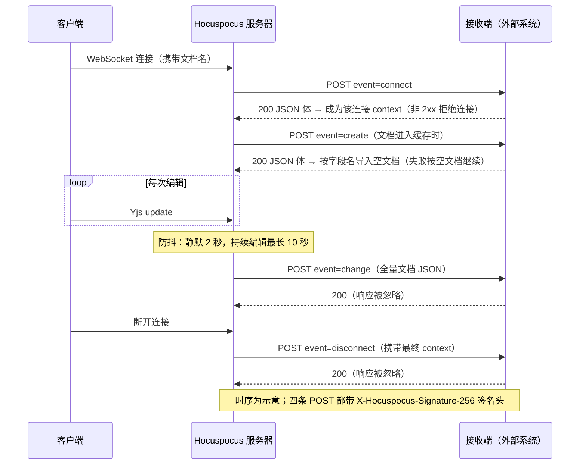

import { Meta } from '@storybook/addon-docs/blocks';

<Meta id="webhooks" title="官方扩展/Webhook 事件" name="Docs" />

# Webhook 事件

extension-webhook 把服务器内部的文档事件转成带 HMAC-SHA256 签名的 HTTP POST，推给你指定的 URL：连接建立、文档加载、文档变更、连接断开四个时机各有一种事件。它和钩子的分工是——onStoreDocument 这类钩子在服务器进程内、同步地改变协同行为，webhook 则是出站 HTTP，把「这里发生了什么」通知协同系统之外的服务（搜索索引、审计日志、下游管道）；与 [Stateless 消息](?path=/docs/stateless--docs) 课的边界一句话：stateless 是房间内连接上的应用层消息，webhook 是服务器到外部系统的出站通知。四个事件分两类：change 与 disconnect 是纯通知（响应被忽略），connect 与 create 是请求-响应式——接收端的 200 JSON 响应体会被拿回来注入连接 context 或导入文档内容。失败不重试，除 connect 外都不影响协同本身。读完你应能预测：编辑一次后最快约 2 秒收到 change 请求、接收端对 connect 返回非 2xx 时用户连不上、接收端挂起时建链和加载会被拖住。

版本基线为 Hocuspocus v4（4.7.x，`@hocuspocus/extension-webhook` 4.7.1）。扩展核心逻辑在 v3 与 v4 之间没有行为差异，仅 HTTP 客户端在 v4 中从 axios 换成原生 fetch；v3 的差异点在正文以一句话标注。



接入只认 6 个配置项，默认值与回查要点如下（均已对照 v4 源码核实）：

| 配置项 | 类型 | 默认值 | 回查要点 |
| --- | --- | --- | --- |
| `url` | string | —（必填） | 接收端地址；缺省时构造函数直接抛 `url is required!` |
| `secret` | string | `""` | 签名密钥；留空仍会发签名，但等于不设防，务必设置 |
| `transformer` | Transformer 或自定义对象 | `TiptapTransformer` | Y.Doc 与编辑器 JSON 互转，决定 change 请求体的 `document` 形状 |
| `events` | Events 数组 | `[Events.onChange]` | 只订阅想收的事件，收到的事件才会触发请求 |
| `debounce` | number / false / null | `2000` | change 的防抖毫秒数；`false` 或 `null` 关闭防抖、逐次发送 |
| `debounceMaxWait` | number | `10000` | 持续编辑时的发送封顶，从本组第一次变更起算 |

事件枚举共四个：`Events.onChange` 对应 `"change"`、`Events.onConnect` 对应 `"connect"`、`Events.onCreate` 对应 `"create"`、`Events.onDisconnect` 对应 `"disconnect"`；请求信封里的 `event` 字段就是这些字符串值。

## 最小接入

扩展挂在 `Server` 的 `extensions` 里，接收端可以是任何能收 POST 的 HTTP 服务。两段代码组成一个可观察闭环：

**1. 服务器挂上 Webhook 扩展。** 新建 `webhook-server.ts`：

```ts
// webhook-server.ts —— 四个事件全订阅，把文档事件推给接收端
// 前置：npm install @hocuspocus/server @hocuspocus/extension-webhook；Node 22+
// 操作：npx tsx webhook-server.ts 启动，再用「第一个协同文档」课的 provider
//       连入 example-doc，编辑一两次，最后关闭页面
import { Server } from '@hocuspocus/server';
import { Events, Webhook } from '@hocuspocus/extension-webhook';

const server = new Server({
  port: 1234,

  extensions: [
    new Webhook({
      url: 'http://localhost:4000/hook',
      secret: 'dev-secret',
      events: [
        Events.onConnect,
        Events.onCreate,
        Events.onChange,
        Events.onDisconnect,
      ],
    }),
  ],
});

server.listen();
```

**2. 起一个最小接收端。** 新建 `webhook-receiver.ts`：

```ts
// webhook-receiver.ts —— 打印事件、验签、按事件给出响应
// 运行：npx tsx webhook-receiver.ts；secret 必须与服务器端一致
import { createHmac, timingSafeEqual } from 'node:crypto';
import { createServer } from 'node:http';

const secret = 'dev-secret';

createServer((req, res) => {
  let body = '';
  req.on('data', (chunk) => (body += chunk));
  req.on('end', () => {
    // 验签：对原始 body 计算 HMAC-SHA256，与签名头比较（算法见「签名校验」）
    const expected = createHmac('sha256', secret).update(body).digest('hex');
    const given = String(req.headers['x-hocuspocus-signature-256'] ?? '')
      .split('=')[1] ?? '';
    const ok =
      given.length === expected.length &&
      timingSafeEqual(Buffer.from(given), Buffer.from(expected));

    const { event, payload } = JSON.parse(body);
    console.log(event.padEnd(10), ok ? '验签通过' : '验签失败');

    // connect 的 200 JSON 体成为连接 context；create 的 200 JSON 体按字段名导入文档
    if (event === 'connect') {
      res.writeHead(200, { 'Content-Type': 'application/json' });
      res.end(JSON.stringify({ user: { id: 'u1', name: '阿珍' } }));
      return;
    }
    if (event === 'create') {
      res.writeHead(200, { 'Content-Type': 'application/json' });
      res.end(JSON.stringify({})); // 空对象表示不导入任何内容
      return;
    }
    // change / disconnect 是纯通知：立刻 2xx，慢活放回自己的队列
    res.writeHead(200).end();
  });
}).listen(4000);
```

连入、编辑、断开后，接收端控制台按序出现四条（时间间隔由操作节奏和防抖决定）：

```text
connect    验签通过
create     验签通过
change     验签通过   ← 最后一次编辑静默约 2 秒后
disconnect 验签通过   ← 关闭客户端页面后
```

两个接入要点：`url` 是唯一必填项，其余配置有默认值；`events` 不订阅的事件完全不产生请求——扩展对每个钩子都会先检查自己是否订阅了对应事件。接下来逐事件看请求什么时候发、长什么样。

## 触发事件与请求体

所有事件共用同一个请求信封：`POST` 到 `url`，`Content-Type: application/json`，请求体是 `{ event, payload }` 两字段的 JSON，签名字段在请求头里。四个事件的差异只在触发时机、payload 字段和响应的用途：

| 事件 | 挂在哪个钩子上 | payload 字段 | 响应的用途 |
| --- | --- | --- | --- |
| `connect` | onConnect | `documentName`、`requestHeaders`、`requestParameters` | 200 JSON 体注入连接 context；失败拒绝连接 |
| `create` | onLoadDocument | `documentName`、`requestHeaders`、`requestParameters` | 200 JSON 体按字段名导入空文档；失败按空文档继续 |
| `change` | onChange | `document`、`documentName`、`context`、`requestHeaders`、`requestParameters` | 忽略 |
| `disconnect` | onDisconnect | `documentName`、`requestHeaders`、`requestParameters`、`context` | 忽略 |

两个公共字段的来源：`requestParameters` 是连接 URL 的查询参数（provider 连 `ws://localhost:1234/example-doc?room=x` 时的查询串），经 `Object.fromEntries` 转成普通对象；`requestHeaders` 在 v4 里是 Web API 的 `Headers` 实例，被直接放进 `JSON.stringify`——而 `Headers` 实例没有可枚举属性，所以请求体里**恒为空对象**。v3 差异：v3 钩子收到的是 Node 请求头普通对象，这个字段能带出真实请求头；v4 需要请求头信息时改用自定义扩展实现同一钩子（写法见 [自定义扩展](?path=/docs/custom-extensions--docs) 课）或走 onAuthenticate（见 [鉴权与上下文](?path=/docs/auth--docs) 课）。

一次 change 请求的完整请求体示例（内容为示意，`document` 的结构由 transformer 决定）：

```json
{
  "event": "change",
  "payload": {
    "document": {
      "default": {
        "type": "doc",
        "content": [
          {
            "type": "paragraph",
            "content": [{ "type": "text", "text": "你好，协同" }]
          }
        ]
      }
    },
    "documentName": "example-doc",
    "context": { "user": { "id": "u1", "name": "阿珍" } },
    "requestHeaders": {},
    "requestParameters": {}
  }
}
```

### change：文档变更，防抖后推全量 JSON

change 订阅自扩展的 onChange 钩子，但**不是每次编辑就发一个请求**：扩展按文档名维护防抖计时器，静默 `debounce`（默认 2000 毫秒）后才发送，持续编辑时由 `debounceMaxWait`（默认 10000 毫秒）封顶——与 onStoreDocument 落库的防抖是同一条节流思路，机制见 [Server 配置](?path=/docs/server-config--docs) 课。设 `debounce: false` 或 `null` 则跳过防抖，每次文档事务立即发送。真正的 HTTP 请求发生在防抖计时器回调里，不在文档事务处理链上，所以接收端再慢也不阻塞编辑与同步。

三个读请求体时最容易误判的点：

- `payload.document` 是 **transformer 转换后的全量文档 JSON**（`TiptapTransformer` 按 `default` 等字段名分组，形状与 Tiptap 的 `getJSON()` 一致），不是增量 update——这点与 onChange 钩子相反，钩子给增量二进制，webhook 给全量 JSON。
- `payload.context` 是触发这次变更的连接的 context，通常就是 connect 响应注入（或 onAuthenticate 补充）的那份。
- 响应整体被忽略：返回什么都影响不了服务器，change 只是通知。

### connect：建连回调，响应注入 context

connect 订阅自 onConnect 钩子，在连接真正建立、文档加载之前触发，服务器**同步等待**接收端的响应：

- 响应为 200 且 `Content-Type` 含 `application/json` 时，响应体成为该连接的 context，随之后的 change、disconnect 请求回传，也供服务器其他钩子读取；非 JSON 的 200 响应按纯文本处理，不会成为结构化 context。
- 请求失败或响应非 2xx 时，扩展抛出 `Forbidden`，服务器向该连接回送 PermissionDenied 消息（reason 为 `Forbidden`），客户端触发 `authenticationFailed` 事件、文档连接不再建立——connect webhook 因此能当拦截器用：接收端返回 403 就等于拒掉这个用户。与认证被拒一样，「被拒」不会断开 WebSocket，判断入口是 `authenticationFailed` 事件（见 [鉴权与上下文](?path=/docs/auth--docs) 课）。
- context 后续还能被 onAuthenticate 钩子补充，端到端传递机制见 [鉴权与上下文](?path=/docs/auth--docs) 课。

### create：文档加载时回调，响应填充空文档

create 订阅自 onLoadDocument 钩子，在文档每次进入缓存、加载内容之前触发——不是「新建一次」的语义：同一文档卸载后再次有人连入，会再次触发。它和 debounce 无关（不防抖）。响应体的用法是把内容导入文档：

- 响应 JSON 按字段名分组（如 `default`），扩展逐字段检查文档对应字段是否为空，**只导入空字段**，已有内容不会被覆盖。
- 需要非 Tiptap 结构时换自定义 transformer（`{ toYdoc, fromYdoc }` 两个函数），导入动作对全部事件生效，互转原理见 [数据转换](?path=/docs/transformer--docs) 课。
- 请求失败或响应为空时只打日志，文档按空文档继续服务——接收端故障不会挡住用户打开文档，但本应导入的内容不会出现。

响应体示例（`default` 字段导入一段文本）：

```json
{
  "default": {
    "type": "doc",
    "content": [
      {
        "type": "paragraph",
        "content": [{ "type": "text", "text": "来自接收端的内容" }]
      }
    ]
  }
}
```

### disconnect：断开通知

disconnect 订阅自 onDisconnect 钩子，每条连接断开时触发一次，payload 带上该连接最终的 `context`，响应被忽略、不防抖、失败只打日志。适合做「谁在什么时候离开了文档」的审计与在线状态对账；文档本身的卸载与补存时序不受它影响（见 [文档生命周期](?path=/docs/document-lifecycle--docs) 课）。

## 签名校验

每个请求都带 `X-Hocuspocus-Signature-256` 请求头，值形如 `sha256=<十六进制摘要>`，算法是 **HMAC-SHA256**：以 `secret` 为密钥，对**原始请求体字符串**（未解析的 JSON 文本）计算摘要。接收端验签的三条规则都源于此：

- 必须对 raw body 计算——先 `JSON.parse` 再重新序列化会因键序与空白差异得到不同字符串；经过改写 body 的网关同样会破坏签名。
- 摘要是十六进制编码，不是 base64；从请求头取 `=` 之后的段落来比较。
- 比较用 `timingSafeEqual` 并先比长度，避免时序侧信道（最小接收端已演示完整写法）。

```ts
import { createHmac, timingSafeEqual } from 'node:crypto';

// body 是原始请求体字符串；secret 与服务器端 Webhook 配置一致
const expected = createHmac('sha256', secret).update(body).digest('hex');
const given = String(req.headers['x-hocuspocus-signature-256'] ?? '').split('=')[1] ?? '';
const ok =
  given.length === expected.length &&
  timingSafeEqual(Buffer.from(given), Buffer.from(expected));
```

`secret` 的类型默认值是空字符串：留空时签名照发，但密钥为空意味着任何知道这套实现的人都能伪造请求，接收端验签形同虚设——部署时必须设置足够随机的 secret。

## 失败处理与可靠性

扩展对失败的处理极简：**一次 fetch，不重试，没有超时配置**。`sendRequest` 在响应非 2xx 或网络失败时抛错，各事件钩子捕获后统一打印 `Caught error in extension-webhook: ...` 到服务器日志，就此结束。逐事件的失败后果：

| 事件 | 失败后果 | 对用户的可见影响 |
| --- | --- | --- |
| `connect` | 扩展抛 `Forbidden` | 客户端收到 PermissionDenied 与 `authenticationFailed`，文档连接不建立 |
| `create` | 记日志，按空文档继续 | 文档能打开，但本应导入的内容缺失 |
| `change` | 记日志，这一拍通知丢失 | 无直接感知；下次变更重新走防抖 |
| `disconnect` | 记日志 | 无 |

「不阻塞协同」要按事件区分着说：change 的请求在防抖计时器回调里发出，完全在文档事务链路之外；disconnect 发生在连接已断开之后；而 connect 与 create 是钩子链上被 `await` 的——接收端不响应，建链和文档加载就一直挂着，客户端表现为长时间转圈直到接收端超时。所以接收端的第一原则是**快速返回 2xx，慢处理异步化**：先应答，再把索引、审计这类重活放进自己的队列。

接收端侧的两条配套建议：

- **按 `event` + `documentName` 设计幂等。** 同一文档的 change 请求由防抖串成一系列，但两个在途请求仍可能并发到达（上一次发送尚未返回时新一次防抖已到点），覆盖式写库时留意乱序；change 带全量 JSON，按 `documentName` 覆盖天然幂等，追加型消费才需要显式去重键。
- **把 connect 当鉴权闸门要慎重。** 它失败即拒连，接收端抖动会直接放大成「全员连不上」；生产环境建议在 onAuthenticate 钩子里做鉴权（见 [鉴权与上下文](?path=/docs/auth--docs) 课），webhook 只承担通知职责。

## 常见问题

- 配了 Webhook 扩展，接收端收不到 change 请求
  依次排查：`events` 数组是否真的包含 `Events.onChange`；防抖是否未到点——默认最后一次编辑静默 2 秒后才发，持续编辑最长拖到 10 秒；服务器日志里有没有 `Caught error in extension-webhook`——URL 写错、DNS、TLS 失败都会在这里出现，且只出现这一条。
- 接收端返回 500，担心触发重试风暴
  不会重试。每次失败只 `console.error` 一条日志：change 的这一拍通知直接丢弃，下次文档变更重新防抖后再发；真正受 5xx 影响的是 connect——接收端持续 5xx 会让所有用户连接被拒。想保证送达要在接收端或业务层自己做补偿（例如对账任务比对文档状态）。
- 验签总是失败，但 secret 确认一致
  检查三处：是否对解析后又重新序列化的 body 计算了签名（必须用原始字符串）；是否取了 `=` 后的十六进制段并用 `timingSafeEqual` 比较；中间是否有网关或框架改写了请求体。算法是 HMAC-SHA256 加十六进制编码，不是 base64。
- 请求体里 `requestHeaders` 永远是空对象
  这是 v4 的已核实行为：钩子 payload 里的 `requestHeaders` 是 Web API `Headers` 实例，直接进 `JSON.stringify` 只会得到空对象（v3 传普通对象，能带出真实请求头）。需要请求头信息时，用自定义扩展实现 onConnect 等钩子自己发请求，或改走 onAuthenticate。
- 编辑频繁，接收端被 change 请求打爆
  调大 `debounce` 与 `debounceMaxWait`，或在接收端侧做合并。另一个方向是承认全量 JSON 太重：change 的请求体随文档体积线性增长，大文档的高频索引场景改用自定义持久化——onStoreDocument / onChange 钩子能拿到增量 update，落库与通知的取舍见 [自定义持久化](?path=/docs/custom-persistence--docs) 课。

## 总结回顾

摘要：

extension-webhook 把服务器的四个文档事件转成带签名的出站 HTTP：`connect` 在建链时同步等待响应、把 200 JSON 体注入连接 context，失败即拒绝连接；`create` 在文档每次进入缓存时触发，把响应 JSON 按字段名导入空文档，失败按空文档继续；`change` 经每文档防抖（默认静默 2 秒、封顶 10 秒）推全量文档 JSON，`disconnect` 在连接断开时带上最终 context——后两者是纯通知，响应被忽略。所有请求 POST `{ event, payload }` 信封，`X-Hocuspocus-Signature-256` 头携带对原始 body 的 HMAC-SHA256 签名。失败处理只有一条路：一次 fetch、不重试、错误打进 `Caught error in extension-webhook` 日志，因此接收端要快速 2xx、异步做重活、按事件与文档名设计幂等。

一句话：

> webhook 是服务器的出站通知通道——change 和 disconnect 告诉外部系统「发生了什么」，connect 和 create 把接收端的响应拿回来注入 context 或导入内容；请求带 HMAC-SHA256 签名，失败从不重试。

知识要点：

- 四个事件分别挂在哪个钩子上？connect 和 create 的响应体会被服务器拿来做什么？
- change 请求体的 `document` 是增量还是全量？它和 onChange 钩子给的 update 有什么区别？
- change 的防抖由哪两个配置控制？防抖计时器和文档事务链路是什么关系？
- 签名的算法、请求头名称、被签内容分别是什么？接收端验签要在哪一步做？
- 哪些事件失败会重试？接收端 500 对四个事件各造成什么后果？
- v4 里 `requestHeaders` 为什么在请求体中是空对象？v3 的行为有什么不同？

## 参考资料

- [Hocuspocus Webhook Extension（官方文档：配置项、四事件 payload、签名验签示例）](https://tiptap.dev/docs/hocuspocus/server/extensions/webhook)
- [extension-webhook README（仓库内：安装、用法、签名与防抖摘要）](https://github.com/ueberdosis/hocuspocus/blob/main/packages/extension-webhook/README.md)
- [extension-webhook 源码 index.ts（v4：Events 枚举、默认配置、防抖实现、sendRequest 与各事件钩子）](https://github.com/ueberdosis/hocuspocus/blob/main/packages/extension-webhook/src/index.ts)
- [CloseEvents.ts（@hocuspocus/common：Forbidden 的 close code 4403）](https://github.com/ueberdosis/hocuspocus/blob/main/packages/common/src/CloseEvents.ts)
- [ClientConnection.ts（v4 源码：onConnect 钩子链、返回值并入 context、Forbidden 拒连）](https://github.com/ueberdosis/hocuspocus/blob/main/packages/server/src/ClientConnection.ts)
- [server types.ts（v4 源码：requestHeaders 为 Headers、requestParameters 为 URLSearchParams 的类型定义）](https://github.com/ueberdosis/hocuspocus/blob/main/packages/server/src/types.ts)
- [TiptapTransformer（transformer 源码：fromYdoc 按字段名输出编辑器 JSON）](https://github.com/ueberdosis/hocuspocus/blob/main/packages/transformer/src/Tiptap.ts)
