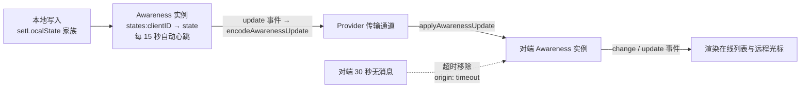

import { Canvas, Controls, Meta } from '@storybook/addon-docs/blocks';
import * as Stories from './awareness.stories';

<Meta of={Stories} name="Docs" />

# Awareness 与在线状态

awareness 是 y-protocols 提供的瞬时状态协议，是 yjs 协同体系里独立于 Y.Doc 文档同步的第二条通道：每个端以「clientID → 任意 JSON 状态」维护一张在线状态表，互相广播自己的那一行——用户名、主题色、光标位置、选中状态。它与文档同步的分工很干脆：**不持久**（刷新即失）、**不保证送达**（丢了靠下一次心跳补回）、**不做跨端合并**（每端只能写自己那行，按逻辑时钟取新）。因此它只承载「丢了也无妨」的 presence 数据，需要持久的内容进 Y.Doc。真实项目里 awareness 实例由 Provider 创建并维护（`provider.awareness`)，本课用页面内双实例加手写中继看清协议本身。

理解本课依次回答四个问题：本地状态怎么写（`setLocalState` 家族）、远端变化怎么看（`states` 与 `update` / `change` 事件）、状态怎样到达对端（`encodeAwarenessUpdate` / `applyAwarenessUpdate` 与 Provider 的接线）、断线怎样被发现（心跳与 30 秒过期）。



| 对象 | 签名 / 默认值 | 回查要点 |
| --- | --- | --- |
| `new Awareness(doc)` | `clientID` 借自 `doc.clientID` | 构造即写入空状态 `{}`，一创建就「在线」;Provider 场景经 `provider.awareness` 取用，不必自建 |
| `awareness.setLocalState(state)` | `state` 必须 JSON 可编码 | 全量替换本端状态；传 `null` 标记自己离线 |
| `awareness.getLocalState()` | 离线时返回 `null` | 初始为 `{}` |
| `awareness.setLocalStateField(field, value)` | 单字段合并 | 本地状态为 `null` 时静默无效 |
| `awareness.getStates()` | `Map<clientID, state>`，含本端 | 键是每次会话随机的 clientID，不是用户身份 |
| `'update'` 事件 | `({added, updated, removed}, origin)` | 每次写入或收到消息都触发，含心跳 |
| `'change'` 事件 | 同上载荷 | 仅状态内容经深比较真变时触发 |
| `outdatedTimeout` | `30000`(ms，模块常量） | 30 秒无消息判离线；15 秒自动心跳续期；检查循环每 3 秒一轮；不可配置 |
| `encodeAwarenessUpdate(aw, clients)` | 返回 `Uint8Array` | 全量编码指定客户端；离线客户端编码为 `null` |
| `applyAwarenessUpdate(aw, update, origin)` | 逻辑时钟去重，幂等 | `origin` 透传给事件回调 |
| `removeAwarenessStates(aw, clients, origin)` | 显式移除客户端 | 触发 `change` + `update`;Provider 断线时用它清理 |

## 本地状态：setLocalState 家族

awareness 状态表以 clientID（借自 `doc.clientID`）为键，每端只能写自己的那一行。构造实例时协议自动写入 `{}`，所以实例一创建就处于「在线」。状态必须 JSON 可编码——传输时走 `JSON.stringify`。

```ts
import * as Y from 'yjs';
import { Awareness } from 'y-protocols/awareness';

const doc = new Y.Doc();
// 真实项目里由 Provider 创建:const awareness = provider.awareness;
const awareness = new Awareness(doc);

awareness.setLocalState({
  user: { name: '阿宁', color: '#4f7cff' },
  cursor: { x: 120 },
});

// 只改一个字段:展开复制旧状态、覆盖该字段后整体写回
awareness.setLocalStateField('cursor', { x: 240 });

awareness.getLocalState(); // { user: {...}, cursor: { x: 240 } }

// 标记自己离线:本端条目从 states 删除,中继把 removed 编码为 null 帧送达对端
awareness.setLocalState(null);
```

边界：

- `setLocalState` 是**全量替换**不是合并；`setLocalStateField` 内部就是「展开旧状态 + 覆盖单字段」再调 `setLocalState`。
- 本地状态为 `null`（已标记离线或实例已销毁）时，`setLocalStateField` 静默无效，不抛错。
- 每次 `setLocalState` 都推进内部逻辑时钟 `clock` 并触发 `update` 事件——哪怕内容与之前完全相同。心跳续期靠的正是这个机制。

## 观察变化：states 与 update / change 事件

`getStates()` 返回含本端在内的全表，界面直接按它渲染。两个事件载荷相同——`{ added, updated, removed }` 三个 clientID 数组，第二参是 origin：本地写入为 `'local'`，超时移除为 `'timeout'`，其余由 `applyAwarenessUpdate` 的第三参透传。分工不同（y-protocols 1.0.7 源码核实）:

- `update`：每次状态写入或收到远端消息都触发，**包括内容没变的心跳续期**——转发消息要听它。
- `change`：仅当状态内容经深比较真的变化（或新增、移除）才触发——界面渲染听它，省掉心跳引起的无效重绘。

```ts
awareness.on('change', ({ added, updated, removed }, origin) => {
  // states 已是全表最新值;removed 里的客户端此时已被删除
  renderPresence(awareness.getStates());
});
```

下面实例把两个 Awareness 实例放在同一页面，用协议自身的 `encode` / `apply` 函数手写中继（Show code 可见，正是 y-websocket 内部的模式）。读者操控客户端 B,A 端的变化全部来自真实协议事件：

<Canvas of={Stories.Presence} />
<Controls of={Stories.Presence} />

| 读者操作 | 可观察证据 |
| --- | --- |
| 修改「B 的用户名」或「B 的主题色」 | 两端在线列表同步变化；最近事件 `updated=[B]`,update 与 change 计数同步 +1 |
| 拖动「B 的光标位置」 | 两个视图编辑区里 B 的彩色光标随 `cursor.x` 移动 |
| 关闭「B 在线」 | B 从两端列表消失、光标消失；最近事件 `removed=[B]` |
| 重新开启「B 在线」 | B 以 `added=[B]` 回到列表 |
| 停留约 15 秒不动控件 | 「A 端 update」计数超过「change」——两端的自动心跳续期只触发 update、不触发 change |

边界：

- `removed` 的客户端在事件触发时已经从 `states` 里删除；要展示「谁离开了」，只能用事件载荷里的 ID 对照之前渲染的列表。
- `states` 的键是每次会话随机的 clientID，刷新页面即更换；用户身份要放进状态内容里（见最佳实践）。

## 状态同步：encode / apply 与 Provider

awareness 的同步比文档同步简单：没有 state vector、没有增量——每条消息全量携带指定客户端的状态与单调递增的 `clock`。接收端只接受 `clock` 更新的消息，重复投递被忽略，因此幂等且容忍乱序；丢了一条，下一条心跳或重连后的全量交换会补回来。

手写中继（本课实例即此模式，也是 y-websocket `_awarenessUpdateHandler` 的做法）:

```ts
import { applyAwarenessUpdate, encodeAwarenessUpdate } from 'y-protocols/awareness';

awareness.on('update', ({ added, updated, removed }, origin) => {
  if (origin === 'relay') return; // 跳过中继回来的消息,防回声
  const changed = added.concat(updated, removed);
  const message = encodeAwarenessUpdate(awareness, changed);
  sendToPeer(message); // 对端:applyAwarenessUpdate(peerAwareness, message, 'relay')
});
```

要点：**`removed` 里的客户端必须一起编码**。`encodeAwarenessUpdate` 对 `states` 里已不存在的客户端编码为 `null`——「我下线了」正是靠这条 null 帧送达对端的；只编码 `getStates()` 里还存在的键会把它漏掉（本课实测复现过这个坑，见常见问题）。

真实项目不写这段：y-websocket / y-webrtc 创建并维护 awareness 实例，`provider.awareness` 直接取用；连接建立时互发 queryAwareness 消息做全量对答，断开时广播本端 null 状态并把其余客户端全部移除。这部分接线连同消息协议在 [y-websocket](?path=/docs/y-websocket--docs) 展开。

边界：需要在转发前改写状态内容（如中心服务端防止冒名身份）时，用 y-protocols 导出的 `modifyAwarenessUpdate(update, modify)`，本课不展开。

## 心跳与过期：30 秒判离线

awareness 没有连接概念，「在线」完全由「最近有没有收到消息」推断。机制以 y-protocols 1.0.7 源码为准，`outdatedTimeout` 是模块常量 `30000`（毫秒）,**不可配置**:

- 每个实例每 3 秒（`outdatedTimeout / 10`）跑一轮检查；
- 本端状态距上次广播 ≥15 秒（`outdatedTimeout / 2`)→ 自动 `setLocalState` 续期并广播心跳（内容不变，对端只触发 `update` 不触发 `change`);
- 对端状态 ≥30 秒无消息 → 由检查循环 `removeAwarenessStates(awareness, [clientID], 'timeout')` 移除。

下面实例拨回协议内部的 `lastUpdated` 时间戳来快进等待，但续期与移除动作仍由协议自身的检查循环执行——读数里的 origin（`local` / `manual-relay` / `timeout`）可证：

<Canvas of={Stories.Heartbeat} />
<Controls of={Stories.Heartbeat} />

| 读者操作 | 可观察证据 |
| --- | --- |
| 「B 距上次心跳」拖到 16 | 数秒内 B 自动续期：「B 已发心跳」+1,「A 端 update」+1 而 change 不变（心跳内容不变） |
| 「A 未收到 B 消息」拖到 31 | 数秒内 B 从 A 面板消失，最近事件 `removed=[B] (origin: timeout)` |
| 上一步之后保持中继开启、静候 | 最迟约 15 秒，B 的真实心跳把它重新带回（`added=[B]`)——超时移除不是永久判决 |
| 先关「中继连接」再把沉默拖到 31 | B 被移除后不再回来——断网期间心跳到不了 A;重开中继后由心跳自愈回归 |
| 「A 未收到 B 消息」停在 25 并等待 | 约 5 秒后 B 自然超时——30 秒是累计阈值，不是一次性快进 |

边界：

- 超时移除只删 `states`，不删 `meta`（逻辑时钟保留），所以 B 的心跳再来时按更新的时钟重新加入。
- 浏览器标签页休眠会节流定时器：心跳可能晚发、对端可能提前判离线，恢复后自愈。不要把 30 秒当成精确 SLA。
- awareness 离线 ≠ 文档同步中断：两条通道互相独立，文档更新不受 awareness 状态影响。
- 显式清理三件套：主动离开用 `setLocalState(null)`；销毁实例用 `awareness.destroy()`（内部即置 null 并停掉检查循环；`doc.destroy()` 会连带触发）；服务端或网关掉线兜底用 `removeAwarenessStates(aw, clients, origin)`。页面崩溃来不及发 null 帧时，30 秒超时就是兜底。

## 典型应用

- **在线列表**：本课两个实例就是最小实现——按 `states` 全表渲染，`change` 事件驱动刷新。
- **远程光标与选中**：把光标位置写进 `cursor` 字段广播；位置要锚定到文档内容而非裸索引时用相对位置（见[相对位置](?path=/docs/relative-positions--docs))。y-prosemirror、y-codemirror 等编辑器绑定接收 `provider.awareness` 自动渲染远程光标与选区，绑定侧用法见路线第 5 章，本课不展开。
- **输入中提示、临时高亮**等即时性 UI：丢了无碍、几秒后自动过期，正合 awareness 语义。

## 最佳实践

- 渲染听 `change`、转发听 `update`：界面重绘只需要内容真变；心跳与下线 null 帧只在 `update` 里出现，转发漏听 `update` 会让对端永远收不到续期与下线通知（y-websocket 正是监听 `update` 转发）。
- 高频字段拆开并节流：光标这类随鼠标移动高频变化的字段用 `setLocalStateField('cursor', …)` 局部更新，并在业务侧节流（如每 50ms 至多一次），避免每个 mousemove 都广播；`user` 等低频字段正常写。
- 状态里放稳定的用户 ID:clientID 每次会话随机，不能当用户身份；列表去重、@提及等都应基于状态内容里的业务 ID。
- 只放「丢了也无妨」的数据：在线状态、光标、选中、输入中提示。已读标记、草稿、权限这类需要持久或必须送达的数据进 Y.Doc，走文档同步通道。

## 常见问题

- 刷新页面后，在线列表里短暂出现「两个我」。
  clientID 每次会话随机生成，刷新前后是两个客户端；旧 clientID 的状态要等对端 30 秒超时才移除。这是协议固有行为——列表去重与身份识别要用状态里自己的用户 ID 字段，不要用 clientID。
- 调用 `setLocalStateField` 后对端没收到变化。
  本地状态为 `null` 时该方法静默无效（源码直接跳过）。常见于 `setLocalState(null)` 标记离线后又只更新单字段；先 `getLocalState()` 确认非 `null`，或改用 `setLocalState` 全量写入。
- 自己写中继时对端收不到「我下线了」。
  `encodeAwarenessUpdate(aw, [...aw.getStates().keys()])` 只覆盖仍在线的客户端；已移除客户端的 null 帧要把它的 clientID 显式放进第二参（编码结果为 `null` 状态）。照「监听 `update`、编码 `added + updated + removed`」的模式写就不会漏。
- 把「消息已读」「未保存草稿」放进 awareness，重启或丢消息后对不上。
  awareness 不持久、不保证送达，只适合丢了也无妨的瞬时状态。这类数据应写入 Y.Doc，由文档同步协议保证收敛。

## 总结回顾

摘要：

awareness(y-protocols 提供）是独立于 Y.Doc 同步的瞬时状态通道：每端以 `doc.clientID` 为键写自己的状态（`setLocalState` 全量替换、`setLocalStateField` 单字段合并），经 `encodeAwarenessUpdate` / `applyAwarenessUpdate` 全量互发，逻辑时钟去重保证幂等；Provider 创建维护实例并监听 `update` 事件转发，业务代码经 `provider.awareness` 取用。观察侧按 `states` 全表渲染，事件载荷 `{ added, updated, removed }` 携带 origin:`update` 恒触发（含心跳）,`change` 仅内容真变——渲染听 `change`，转发听 `update`。存活靠「15 秒自动心跳 + 30 秒无消息超时移除（origin `'timeout'`)」维持,`outdatedTimeout = 30000` 为模块常量不可配置；超时移除可被下一次心跳自愈。协议不持久、不保证送达，只承载在线状态、光标、选中等「丢了也无妨」的数据，需要持久的一律进 Y.Doc。

一句话：

> awareness 是「丢了也无妨」的瞬时状态通道：在线与否不看连接，看 30 秒内有没有收到心跳；只放 presence，持久数据进 Y.Doc。

知识要点：

- `setLocalState` 与 `setLocalStateField` 的差别是什么？为什么本地状态为 `null` 时后者静默无效？
- `states` 的键是什么？为什么刷新页面后旧状态会残留约 30 秒？
- `update` 与 `change` 两个事件如何分工？渲染和转发各该听哪个？
- `encodeAwarenessUpdate` 对离线客户端编码成什么？为什么中继必须编码 `removed` 列表？
- 心跳间隔、过期阈值、检查周期各是多少？`outdatedTimeout` 能否配置？
- 超时移除的事件 origin 是什么？被超时移除的客户端怎样重新回到在线列表？
- 哪些数据适合放 awareness，哪些必须进 Y.Doc?

## 参考资料

- [Awareness API - Yjs 官方文档](https://docs.yjs.dev/api/about-awareness)
- [Adding Awareness - Yjs 官方文档](https://docs.yjs.dev/getting-started/adding-awareness)
- [y-protocols 官方仓库(awareness 协议源码)](https://github.com/yjs/y-protocols)
- [y-websocket 官方仓库(Provider 的 awareness 接线)](https://github.com/yjs/y-websocket)
