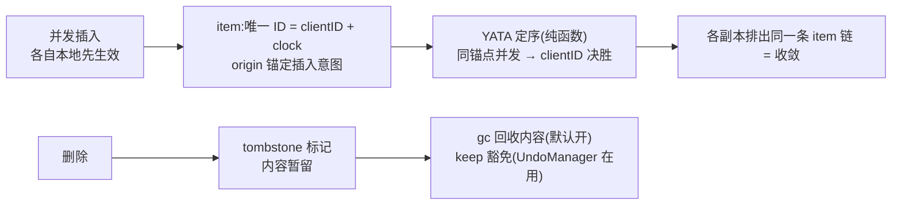

import { Canvas, Controls, Meta } from '@storybook/addon-docs/blocks';
import * as Stories from './crdt-internals.stories';

<Meta of={Stories} name="Docs" />

# CRDT 与 YATA 原理

两个客户端互不知情地同时编辑,没有中心服务器裁决,每个副本最后却一字不差——本课讲清这个保证从哪来:yjs 把每次插入记成带全局唯一 ID 的 item,所有副本用同一条确定性定序规则(YATA)把 item 排成一条链;删除不搬走内容,只打 tombstone 标记,再由垃圾回收(gc)把不再需要的内容收走。读完本课,你能亲手推出任意并发插入的最终顺序,也能判断 gc 与 tombstone 对内存和 undo 的实际影响。

先认识全程出场的角色。它们不是新 API,而是你用过的每个 `Y.Doc` 背后一直在运转的机制:



| 概念 | 默认值 / 取值 | 回查要点 |
| --- | --- | --- |
| `clientID` | 创建 `Y.Doc` 时随机生成(uint32),每会话唯一 | item ID 的前半;定序决胜用它;复用会损坏文档 |
| `clock` | 从 0 起,按插入内容长度推进;删除不推进 | item ID 的后半;state vector 里存的是「下一期望 clock」 |
| `ID` | `(clientID, clock)` | 每个 item 的全局唯一标识,update 里的引用都指向它 |
| `origin` / `rightOrigin` | 插在文档头尾时为 `null` | 左 / 右锚点 item 的 ID,合起来就是插入意图 |
| tombstone | 已删 item 的状态,不是选项 | 删除只置 deleted 标记;内容去留由 gc 决定 |
| `gc` | `true`(`new Y.Doc({ gc: false })` 关闭) | 事务清理时把已删 item 的内容换成只剩长度 |
| `gcFilter` | `() => true` | 逐 item 决定豁免,返回 `false` 跳过 |
| `keep` | item 上的标志位,默认 `false` | UndoManager 用它挡住 gc,让删除可撤销 |

## CRDT 与收敛三要素

CRDT(conflict-free replicated data type)的核心承诺:副本之间不需要互相协调,各自按固定规则合并,最终状态必然一致。实现路径分两支:

- **CmRDT(操作式)**:只广播操作本身。要求传输层把每个操作按因果序、恰好一次地送达每个副本——对网络的要求非常苛刻。
- **CvRDT(状态式)**:合并的是状态。只要合并满足三要素——**交换**(谁先谁后结果相同)、**结合**(怎么分组结果相同)、**幂等**(重复合并不叠加)——任何网络形态都能收敛。

yjs 各取所长:操作用全局唯一 ID 标记(item 之间可以互相引用、可以去重),传播与合并按状态式三要素执行——[文档更新与同步协议](?path=/docs/document-updates--docs)已实测:乱序、重复 apply 都安全收敛。所以它的传输层可以是任意不可靠管道,同步章节各 Provider 换的只是管道。

收敛为什么是「必然」而不只是「通常」:把文档状态看作纯函数 `f(item 集合)`——定序规则只读 item 自身的字段(clientID、clock、origin……),不读时钟、不读网络状态。各副本最终持有的 item 集合相同(靠 ID 去重),相同的输入进入相同的 f,输出必然是同一条链。时序、顺序、丢包重发都进不了这个函数。

## item:文档的最小单元

文档里每一次插入都落成一条 **item**:内容加定序元数据。它的 ID 是 `(clientID, clock)`:

- `clientID` 创建文档时随机生成。官方 FAQ 特别强调:每会话新建 clientID 就是为了避免冲突——**两个副本用同一个 clientID,文档可能永久损坏且无法恢复**;确需固定(比如测试)必须自己保证全局唯一。
- `clock` 从 0 起,**按插入内容的长度推进**:一次插入 `'hello'` 占用 clock 0–4,该客户端的下一可用 clock 是 5。删除不推进 clock——实测插入 hello 后 state vector 是 `[[1, 5]]`,删除其中两个字符后仍是 5。

用 `Y.decodeUpdate` 把 update 解开,能看到 item 的真身:

```ts
import * as Y from 'yjs';

const doc = new Y.Doc();
doc.clientID = 1;
doc.getText('t').insert(0, 'hello');
Y.decodeUpdate(Y.encodeStateAsUpdate(doc)).structs;
// [{ id: { client: 1, clock: 0 }, length: 5, content: 'hello',
//    origin: null, rightOrigin: null, ... }]
// 控制台调试可用 Y.logUpdate(update) 直接打印结构
```

实测两个结构特征,正对应官方 README 的「结构共享」优化:

- **连续插入合并**:分别插入 `'a'`、`'b'`、`'c'`,解码全量 update 只有一条 item(clock 0,长度 3)——顺序写正文通常只产生极少的 item。
- **中间插入拆分**:在 `'ab'` 中间插入时,老 item 在插入点拆成两条(clock 各自保留),新 item 排进中间。

| 字段 | 含义 |
| --- | --- |
| `id` | `(clientID, clock)`,全局唯一 |
| `origin` / `rightOrigin` | 插入时左 / 右邻居的 ID——插入意图,合并时用它找落点 |
| `left` / `right` | 当前链上的前驱 / 后继(文档序双向链表) |
| `parent` / `parentSub` | 挂在哪个类型上;`parentSub` 是 Y.Map 的键名 |
| `content` | 实际内容(字符串、JSON 值、嵌套类型引用等) |
| `info` 位 | `deleted`(tombstone)、`keep`(挡 gc)、`countable`、`marker`(索引标记) |

`Y.Map` 的每个键也是一条这样的链(`parentSub` 相同的 item 串成一串),同键并发写收敛到 clientID 大者——[共享类型](?path=/docs/shared-types--docs)已实测过结果,机制正是这条链的定序规则。

## YATA:并发插入如何定序

yjs 实现的定序算法叫 **YATA**(Yet Another Transformation Approach,论文《Near Real-Time Peer-to-Peer Shared Editing on Extensible Data Types》)。它不做 OT 那样的位置变换,而是**把插入意图记进 item,合并时按意图放回**:

- `origin`:插入时左边 item 的 ID(下界锚);
- `rightOrigin`:插入时右边 item 的 ID(上界锚)。

合并(把远端 item 集成进本地链)只有三步,源码就在 `Item#integrate`,总共几十行:

1. **找锚点**:按 `origin` / `rightOrigin` 把 item 放进意图区间;
2. **同锚点决胜(case 1)**:区间里已有 item 与我的 origin 相同——真·同位并发——**clientID 小者在前**;
3. **给先占位者让路(case 2)**:区间里 item 的 origin 指向我已越过的 item,说明它先占了位置;让它留在原地,我继续右移找空位。

下面实例完整推演最常见的冲突:两个客户端从共同基线 `'ab'` 分叉,都在 `a|b` 之间并发插入。链上每个方块是一条 item,标注内容与 `(clientID, clock)`:

<Canvas of={Stories.YataOrdering} />
<Controls of={Stories.YataOrdering} />

| 读者操作 | 可观察证据 |
| --- | --- |
| 看两条「离线插入」链 | X、Y 的方块下各标 `origin→(1,0)`——两者的 origin 都指向 `(1,0)`、rightOrigin 都指向 `(1,1)`,插入意图完全相同 |
| 看「互换 update 后」的链 | 两副本排出同一条链;同锚点的 X、Y 按 clientID 升序就座 |
| 打开「交换 clientID」 | 链上顺序随之反转,但两副本仍然一致 |
| 打开 Show code | 看到 `yata-ordering.ts` 用真实 Y.Doc 跑分叉与合并,再沿 `_start` 链读出文档序 |

锚点不同时根本不需要决胜,origin 各自把 item 带回原位——实测,即便插错方 clientID 更大也改变不了落点:

```ts
// 共同基线 'ab';A(clientID 100)在 a|b 之间插 'A1',B(clientID 5)在 b 之后插 'B2'
// 互换后合并结果:'aA1bB2' —— 各就各位,与 clientID 大小无关
```

case 2 的让位同样可推:第三方见过 `X` 之后在 `X|b` 之间插 `Z`,与没见过 X 的 `Y` 并发——实测三方收敛到 `'aXZYb'`:`Z` 紧跟 `X`,`Y` 让到 `Z` 右侧。规则的每一步都只读 item 字段,所以任何副本、任何合并顺序,结论唯一。官方 README 还提到:lean-yjs 项目已用 Lean 定理证明器形式化验证了 YATA 的保持性与交换性(论文里的伪代码有笔误,算法本身是对的)。

边界:clientID 随机生成,顺序**确定但不可预知**。列表、看板这类顺序敏感的数据,展示顺序应使用自设的排序键(见[协同数据建模](?path=/docs/data-modeling--docs)),把 CRDT 定序只当作不丢数据的兜底。

## 删除与 tombstone

插入需要定序,删除不需要——所有副本只要对「哪些 ID 被删了」达成一致即可。`delete` 不移除 item,只做两件事:

1. 把 item 的 `deleted` 位置 1——这就是 **tombstone**(墓碑);
2. 把 `(clientID, clock, length)` 记入 **delete set**;update 里 delete set 独立成段,与 item 内容分开编码。

实测:对 `'hello'` 删除前两个字符,解码 update 得到的 delete set 是 `[[1, [{ clock: 0, len: 2 }]]]`——只有一段 ID 区间,没有任何内容;同时 state vector 纹丝不动。

为什么不物理删除?并发的后续插入可能正以它为锚(origin 引用悬空就无法定序);undo、相对位置([相对位置](?path=/docs/relative-positions--docs))与快照也都要求内容还在。tombstone 是「删除也要收敛」的代价:内容对用户不可见,元数据必须留。

## 垃圾回收:gc、keep 与内存

tombstone 的内容什么时候可以安全扔掉?每个事务清理时,yjs 对本次 delete set 涉及的已删 item 执行 **GC**:

- 默认(`gc: true`):item 与 ID 保留在链上,**内容被换成只剩长度**(源码中的 `ContentDeleted`);若父类型整个被删,连 item 都换成只有长度的 `GC` 结构。
- `gc: false`:内容原样保留,undo、历史与快照可以继续引用。
- `gcFilter(item)`:逐 item 决定豁免,返回 `false` 跳过。

下面实例删掉一段文本,对照两种 gc 下链的形态与 update 编码体积:

<Canvas of={Stories.TombstoneGc} />
<Controls of={Stories.TombstoneGc} />

| 读者操作 | 可观察证据 |
| --- | --- |
| 把「从开头删除」调大 | 链上 tombstone 变长;「update 编码体积」两档差距拉大 |
| 切换「开启垃圾回收」 | gc 开:被删方块只剩「len N 已回收」;gc 关:删除内容带删除线留在链上 |
| 调整「初始文本」 | 剩余文本与两档编码体积同步变化 |
| 打开 Show code | 看到 `tombstone-gc.ts` 用 `new Y.Doc({ gc })` 重建同一场景的两种形态 |

量化感受(实测:插入 200 字符再全部删除):gc 开,update 编码 **16 B**;gc 关,**216 B**——差值就是 tombstone 内容的体积。反过来说,这也是 `Y.mergeUpdates` 压不动历史体积的原因:它不做 GC(见[文档更新与同步协议](?path=/docs/document-updates--docs)),真正瘦身必须把 update 过一遍 Y.Doc 再编码。

gc 有一个重要豁免标志 **keep**:UndoManager 会给作用域内、还在栈上的被删 item 打 keep,挡住 GC——实测 gc 开着的文档里,undo 一次删除照样恢复出 `'hello'`;栈项弹出后 keep 撤除,内容才重新可能被回收。捕获窗口之外的删除(创建 UndoManager 之前发生的事务)早已被 gc,事后撤销无内容可还。undo 的用法见[撤销与重做](?path=/docs/undo-manager--docs)。

## 与 OT、Automerge 的取舍

把本课的机制放进坐标系,选型时知道自己在选什么:

| | OT | yjs(YATA) | Automerge(RGA) |
| --- | --- | --- | --- |
| 中心服务器 | 传统方案需要权威服务器定序 | 不需要 | 不需要 |
| 并发合并 | 变换操作的位置参数 | 唯一 ID + 确定性定序 | 唯一 ID + 确定性定序(RGA 家族) |
| 传输要求 | 高:去中心化 OT 的簿记复杂到不可行(官方 README 结论) | 低:乱序、重复投递安全 | 低:同为状态合并 |
| 离线编辑 | 受限 | 天然支持 | 天然支持 |

yjs 与 Automerge 同属 CRDT,行为目标一致——并发插入都保留、所有副本同一顺序——差别在定序家族(YATA 与 RGA)以及随之而来的结构、编码与运行时性能取舍。两者的实测对比数据在 crdt-benchmarks,由[性能与基准](?path=/docs/performance--docs)承载;text-crdt-compare 可以逐字符对比两种文本 CRDT 的合并差异。

## 最佳实践

- **顺序敏感的数据自带排序键。** 同位并发的先后由随机 clientID 决定,确定但不可预知;列表、看板的展示顺序用 fractional indexing 等自设键,CRDT 定序只作不丢内容的兜底(做法见[协同数据建模](?path=/docs/data-modeling--docs))。
- **让大删除真正瘦身:过一遍文档。** 只存 update 的服务端定期 `mergeUpdates` 只能去重,去不掉 tombstone 内容;把历史加载进 Y.Doc(触发 gc)再 `encodeStateAsUpdate`,才能得到紧凑编码。
- **需要撤销很久前的删除时,靠 keep 而不是全局 `gc: false`。** UndoManager 常驻编辑会话,自动给作用域内的删除打 keep;全局关 gc 会让每个 tombstone 的内容永生,内存随编辑量线性增长。

## 常见问题

- 并发插入的顺序为什么和直觉不一致,换个设备重试结果又不一样?
  这是正常行为:同位并发的先后由 clientID(随机)决胜,yjs 只保证所有副本一致,不保证符合业务直觉。给排序敏感的数据设计自己的排序键;不要把 clientID 当业务字段。
- 文档越用越大,删除之后内存不降?
  删除只是 tombstone:默认 gc 清掉内容,但 item 结构与 ID 留在链上,编辑历史越长链越长。体积压不下去时,先确认是否只做了 `mergeUpdates`(它不做 GC);把内容加载进 Y.Doc 再 `encodeStateAsUpdate` 一次即可瘦身。
- 两个副本的 clientID 相同会怎样?
  官方 FAQ 明确:文档可能永久损坏,且无法恢复。yjs 每次会话自动生成新 clientID 就是为了避免这一点;测试中确需固定 clientID 时,确保同一份文档的所有副本中它是唯一的。
- undo 恢复不出比较久之前删除的内容?
  删除一旦被 gc(没有 UndoManager 的 keep 挡着),内容就物理消失了,undo 只能在捕获窗口内工作。让 UndoManager 常驻编辑会话;跨会话的历史恢复交给服务端持久化与快照(入口见[撤销与重做](?path=/docs/undo-manager--docs))。

## 总结回顾

摘要:

本课把「必然收敛」拆成三层机制。CRDT 层:yjs 用全局唯一 ID 标记操作、按状态式三要素(交换、结合、幂等)合并;定序是只读 item 字段的纯函数,相同的 item 集合必然排出同一条链。item 层:每次插入是一条带 `(clientID, clock)` 的 item,`origin` / `rightOrigin` 记录插入意图,连续插入合并、中间插入拆分;YATA 合并时同锚点并发按 clientID 升序决胜,先占位者优先。删除层:`delete` 只置 tombstone 标记并写 delete set;`gc`(默认开)在事务清理时把内容回收成只剩长度,`keep` 标志(UndoManager 在用)可以豁免。与 OT 相比省掉了中心服务器与位置变换;与 Automerge 的差别在定序家族与编码取舍。

一句话:

> 收敛不靠网络靠结构——每个修改带唯一 ID,所有副本用同一条确定性规则排出同一条链;删除只是墓碑,gc 负责把不再被引用的内容收走。

知识要点:

- CRDT 分哪两类,收敛三要素是什么,yjs 各取了哪边?
- item 的 ID 如何构成,clock 何时推进、何时不动?
- `origin` / `rightOrigin` 记录什么?同位并发插入的先后由什么决定?
- 什么情况下并发插入不需要决胜?
- 删除到底改了什么?为什么不能物理删除?
- `gc` / `gc: false` / `gcFilter` / `keep` 各控制什么?
- 与 OT、Automerge 的关键差异分别是什么?

## 参考资料

- [论文:Near Real-Time Peer-to-Peer Shared Editing on Extensible Data Types(YATA)](https://www.researchgate.net/publication/310212186_Near_Real-Time_Peer-to-Peer_Shared_Editing_on_Extensible_Data_Types)
- [Yjs 官方文档:Internals](https://docs.yjs.dev/api/internals)
- [yjs 仓库:INTERNALS.md(内部数据结构)](https://github.com/yjs/yjs/blob/main/INTERNALS.md)
- [yjs 仓库:README 的「Yjs CRDT Algorithm」部分](https://github.com/yjs/yjs#yjs-crdt-algorithm)
- [Yjs 官方文档:FAQ(clientID)](https://docs.yjs.dev/api/faq)
- [text-crdt-compare(Yjs/YATA 与 Automerge/RGA 的文本合并对比)](https://text-crdt-compare.surge.sh/)
- [crdt-benchmarks](https://github.com/dmonad/crdt-benchmarks)
