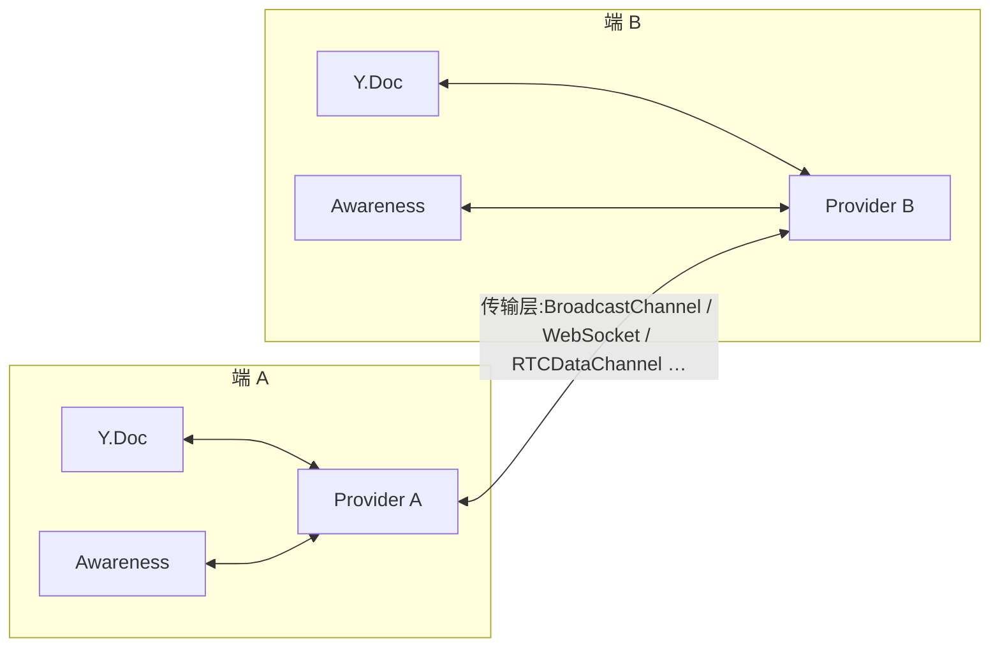

import { Canvas, Controls, Meta } from '@storybook/addon-docs/blocks';
import * as Stories from './custom-provider.stories';

<Meta of={Stories} name="Docs" />

# 自定义 Provider

Provider 是把 Y.Doc 的 update 搬上某条传输层（或落进存储）的粘合层：yjs 本身不依赖任何网络库，[文档更新与同步协议](?path=/docs/document-updates--docs) 的三原语（update 事件、state vector、applyUpdate）加上 [awareness](?path=/docs/awareness--docs) 的编解码，就是一个网络 Provider 所需的全部协议内容。想换一条官方没覆盖的传输（WebTransport、RTCDataChannel、postMessage、企业内网网关），或要在传输上定制鉴权、加密、压缩，就要按 y-protocols 规范自己写一个。

一个网络 Provider 必须做四件事，做完即合格：

1. **广播本地编辑**：监听 `doc.on('update')`，把增量编码成协议帧发出去；
2. **合入远端消息**：收到帧后交给 `readSyncMessage` / `applyAwarenessUpdate`，回执原路发回；
3. **接入握手**：接入通道时发起 SyncStep1 握手，并应答对方的握手；
4. **awareness 转发与下线清理**：转发本端 awareness 状态，断开时广播 null 帧。

本课用 BroadcastChannel 手写一个最小 Provider：同源标签页之间直达、零网络、离线可运行，且每条协议帧的方向、类型与字节数都能逐帧观察。同一套协议代码，把「发字节 / 收字节」两处换掉就是任何传输层的 Provider——[y-websocket](?path=/docs/y-websocket--docs) 的帧格式与本课逐字节相同。



四件事与 y-protocols API 的对照（回查入口）：

| 职责 | 时机 | y-protocols / yjs API | 帧 |
| --- | --- | --- | --- |
| ① 广播本地编辑 | 每个非空事务提交后 | `doc.on('update')` → `sync.writeUpdate` | `[0, 2, update]` |
| ② 合入远端消息 | 每收到一条帧 | `sync.readSyncMessage` / `applyAwarenessUpdate` | 回执 `[0, 1, diff]` 或无回执 |
| ③ 接入握手 | 接入通道时一次 | `writeSyncStep1` / `writeSyncStep2` | `[0, 0, sv]`、`[0, 1, update]` |
| ④ awareness 转发 | awareness `update` 事件 | `encodeAwarenessUpdate` | `[1, awarenessUpdate]` |
| ④ 下线清理 | 断开前 | `encodeAwarenessUpdate(aw, [id], new Map())` | `[1, null 帧]` |

## 消息格式

每条协议帧是「外层 varUint 消息类型 + payload」。外层类型是 y-websocket 一层的约定（其源码定义 `messageSync = 0`、`messageAwareness = 1`、`messageAuth = 2`、`messageQueryAwareness = 3`）；sync 帧的 payload 内层再嵌一个 varUint 子类型，由 y-protocols/sync 定义：

| 层 | 值 | 含义 | 编码 |
| --- | --- | --- | --- |
| 外层 | 0 | sync | 内层 sync 帧 |
| 外层 | 1 | awareness | `varBuffer(awarenessUpdate)` |
| 外层 | 2 | auth | 服务器通知权限拒绝（见扩展点） |
| 外层 | 3 | queryAwareness | 空 payload，请求全量在线状态 |
| 内层 | 0 | SyncStep1 | `varBuffer(stateVector)` |
| 内层 | 1 | SyncStep2 | `varBuffer(差量 update)` |
| 内层 | 2 | Update | `varBuffer(增量 update)` |

编解码只需 lib0 的八个函数：

| lib0 API | 用途 |
| --- | --- |
| `encoding.createEncoder()` / `encoding.toUint8Array(enc)` | 新建编码器 / 取出字节 |
| `encoding.writeVarUint(enc, n)` / `encoding.writeVarUint8Array(enc, bytes)` | 写类型号 / 写带长度前缀的字节块 |
| `encoding.length(enc)` | 已写字节数；判回执是否为空靠它 |
| `decoding.createDecoder(bytes)` | 从字节新建解码器 |
| `decoding.readVarUint(dec)` / `decoding.readVarUint8Array(dec)` | 读类型号 / 读字节块 |

实测帧大小（node,yjs 13.6.33 + y-protocols 1.0.7)：空文档的 SyncStep1 帧 4 B、SyncStep2 帧 5 B、QueryAwareness 帧 1 B、空状态 awareness 帧 12 B；插入一个字符的 Update 帧 23 B（其中 update 载荷 20 B)。sv 只随客户端数量增长，见 [文档更新与同步协议](?path=/docs/document-updates--docs)。

边界：**消息体不含房间名**——y-protocols 原话是房间名"必须由上层协议处理"。房间由传输层寻址：y-websocket 用连接 URL，本课用 BroadcastChannel 通道名。

## 广播本地编辑

职责①只有一个监听加一个编码，加上一条不能省的过滤：

```ts
this.doc.on('update', (update: Uint8Array, origin: unknown) => {
  // 回声防护:远端 update 合入时会以本 Provider 为 origin 再触发 update 事件,
  // 不过滤会把同一条 update 又发回去。
  if (origin === this) return;
  const encoder = encoding.createEncoder();
  encoding.writeVarUint(encoder, MESSAGE_SYNC);   // 外层 0
  syncProtocol.writeUpdate(encoder, update);       // 内层 2 + 载荷
  this.send(encoding.toUint8Array(encoder));
});
```

不过滤也不会死循环：update 幂等，回声发一圈、对端合入已知内容时静默跳过，循环自然终止——但每条编辑多一条来回的帧。实测（本课实现，node)：一次编辑，开过滤 1 条 Update 帧，关过滤 2 条。实例里「回声过滤」开关可实时复现。

对照之下，awareness 通道**不需要** origin 过滤：接收端按「时钟严格更新才接受」去重，回声帧时钟不更新、合入时不触发事件，传播自然终止。y-websocket 的 awareness 转发也确实不滤 origin——所以每条 awareness 变更实测是 2 帧（去程 + 一圈即停的回声），属正常行为。

## 合入远端消息

职责②是拆帧分发。sync 分支的活几乎全部委托给 `readSyncMessage`：它读内层类型，收到 SyncStep1 就按对方 sv 编码 SyncStep2 写进回执 encoder，收到 SyncStep2 / Update 就以指定 origin 合入（这里传 `this`，正是上面回声过滤的依据）：

```ts
private receive(data: Uint8Array) {
  const decoder = decoding.createDecoder(data);
  const encoder = encoding.createEncoder();
  switch (decoding.readVarUint(decoder)) {
    case MESSAGE_SYNC: {
      encoding.writeVarUint(encoder, MESSAGE_SYNC); // 回执预写外层类型
      const syncType = syncProtocol.readSyncMessage(decoder, encoder, this.doc, this);
      if (syncType === syncProtocol.messageYjsSyncStep2) {
        this.synced = true; // 收到 SyncStep2:对方已把我缺的补齐
      }
      break;
    }
    case MESSAGE_AWARENESS:
      awarenessProtocol.applyAwarenessUpdate(
        this.awareness, decoding.readVarUint8Array(decoder), this,
      );
      break;
    case MESSAGE_QUERY_AWARENESS:
      encoding.writeVarUint(encoder, MESSAGE_AWARENESS);
      encoding.writeVarUint8Array(encoder, awarenessProtocol.encodeAwarenessUpdate(
        this.awareness, Array.from(this.awareness.getStates().keys()),
      ));
      break;
    default:
      return; // 未知类型忽略:协议预留的扩展点
  }
  // encoder 只有 1 字节类型头 = 无回执,不发(y-websocket 同一判据)
  if (encoding.length(encoder) > 1) {
    this.send(encoding.toUint8Array(encoder));
  }
}
```

要点：

- `readSyncMessage` 返回内层类型，供置 `synced`；`synced` 只表示「与某个对端完成过一次内容握手」，多 peer 拓扑里不代表全局一致。
- SyncStep1 的应答（SyncStep2）不是手写握手代码，而是 `readSyncMessage` 顺手写好的——收到 SS1 时 encoder 长度大于 1，统一在出口发回。
- awareness 帧与 queryAwareness 应答都不经过 `readSyncMessage`，直接调 awareness 协议的编解码函数。

## 接入握手

职责③发生在 `connect()`。对称广播通道上，接入方连发四条（与 y-websocket 的 `connectBc` 逐条对应），随后应答自动生成：

```ts
connect() {
  // …打开通道、订阅消息…

  const step1 = encoding.createEncoder();
  encoding.writeVarUint(step1, MESSAGE_SYNC);      // 外层 0
  syncProtocol.writeSyncStep1(step1, this.doc);    // 内层 0 + 我的 state vector
  this.send(encoding.toUint8Array(step1));         // ① 请对方按我的 sv 回差量

  const step2 = encoding.createEncoder();
  encoding.writeVarUint(step2, MESSAGE_SYNC);
  syncProtocol.writeSyncStep2(step2, this.doc);    // 内层 1 + 全量 update(不传 sv)
  this.send(encoding.toUint8Array(step2));         // ② 把我的状态推给对方(幂等合入)

  const query = encoding.createEncoder();
  encoding.writeVarUint(query, MESSAGE_QUERY_AWARENESS);
  this.send(encoding.toUint8Array(query));         // ③ 索要全量在线状态

  // ④ 续期并广播自己的 awareness(为什么必须「续期」,见 awareness 一节)
  this.awareness.setLocalState(this.awareness.getLocalState());
}
```

四条各有分工：SyncStep1 拉回我缺的差量；全量 SyncStep2 把我的状态推给对方（幂等，对方无损合入）;QueryAwareness 与第④条一起完成在线状态的双向交换。实测 B 接入已在通道的 A(yjs 13.6.33,node):

```text
B→A SyncStep1 4B → B→A SyncStep2 5B → B→A QueryAwareness 1B → B→A Awareness 12B
A→B SyncStep2 5B(应答,空差量) → A→B Awareness 12B(应答,全量在线状态)
```

A 有内容时，应答的 SyncStep2 就是真实差量（实测装 12 个字符的文本为 33 B)；两端同时接入也收敛（各自宣告 4 条 + 互相应答 2 条，共 10 条，实测不循环）。

为什么接入方要「推全量」而不是只发 SyncStep1 等应答？看 y-protocols 注释里给出的 client-server 模型就明白了：客户端发 SyncStep1，服务器回 SyncStep2 + 自己的 SyncStep1，客户端再回 SyncStep2——服务器**不主动发起**握手，靠双段应答覆盖两个方向。对称通道没有「服务器」，全量 SyncStep2 宣告是更省事的等价物；带宽敏感的广域网 Provider 通常只发 SyncStep1，等对方回 SS1 后再算差量，代价是多等一个往返。

**断线重连 = 重新握手**，因此天然是差量追平：实测断开后 A 写 3 次、B 写 2 次，重连时 B 的 SyncStep1(10 B）换来 A 应答的 SyncStep2(32 B，恰好是 B 缺的 3 次编辑）,B 的全量宣告（27 B）把 2 次编辑推给 A,6 条消息两端收敛。Provider 不需要离线队列——握手覆盖断档期的全部缺口。

## awareness 转发与下线

职责④的发出方向：监听 awareness 的 `update` 事件（不是 `change`——心跳续期与 null 帧只在 `update` 出现，见 [Awareness 与在线状态](?path=/docs/awareness--docs))，把变化的客户端全量编码：

```ts
this.awareness.on('update', ({ added, updated, removed }: AwarenessDelta) => {
  // removed 必须一起编码:states 里已无其条目,编码结果为 null 帧——
  // 「某端下线了」正是靠 null 帧送达其他端。
  const changed = added.concat(updated, removed);
  const encoder = encoding.createEncoder();
  encoding.writeVarUint(encoder, MESSAGE_AWARENESS);
  encoding.writeVarUint8Array(
    encoder,
    awarenessProtocol.encodeAwarenessUpdate(this.awareness, changed),
  );
  this.send(encoding.toUint8Array(encoder));
});
```

下线清理在 `disconnect()`：先广播自己的 null 帧，再关通道。`encodeAwarenessUpdate` 第三参传空 `Map`，自己的条目查不到即编码为 null:

```ts
disconnect() {
  const encoder = encoding.createEncoder();
  encoding.writeVarUint(encoder, MESSAGE_AWARENESS);
  encoding.writeVarUint8Array(
    encoder,
    // 第三参传空 Map:states 查不到自己的条目,即编码为 null
    awarenessProtocol.encodeAwarenessUpdate(this.awareness, [this.doc.clientID], new Map()),
  );
  this.send(encoding.toUint8Array(encoder));
  // …关闭通道…
}
```

对端收到 null 帧立即把自己从在线列表移除（实测约 14 B 一条）;null 帧丢了也有 30 秒心跳过期兜底。注意两个方向的不对称：被下线的一方（如本课实例的 B）收不到自己发出的 null 帧，它视角里的对端状态要等 30 秒超时才移除——实例里断开 B 后，B 面板里 A 的彩点会停留一段时间，属协议固有行为。

一个从源码里挖出来的坑：对端按「时钟严格更新才接受」去重（`applyAwarenessUpdate` 的 `currClock < clock` 判据），下线时收到的 null 帧已记下当前时钟——重连时若**原样宣告**，时钟没有推进，宣告会被静默忽略，要等最长 15 秒心跳才自愈（实测复现：y-websocket 式原样宣告，重连后对端看不到本端）。所以本课 `connect()` 的第④条用 `setLocalState(getLocalState())` 续期：时钟推进后走正常转发路径广播，对端立即重新看到本端（实测验证）。

## 逐帧观察协议消息

下面实例把四件事组装成完整的 `BroadcastChannelProvider`(Show code 上半部分可直接搬走），两个 `Y.Doc` 各挂一个实例经 BroadcastChannel 互通；中间一栏逐条显示协议帧的方向、类型与真实字节数：

<Canvas of={Stories.ProtocolTraffic} />
<Controls of={Stories.ProtocolTraffic} />

| 读者操作 | 可观察证据 |
| --- | --- |
| 加载后默认状态 | 消息流水依次出现 A 的 4 条宣告（发到空通道，无应答）、B 的 4 条宣告与 A 的 2 条应答，随后 1 条 `A→B Update` 把初始文本带给 B;「B 通道」显示 `已接入 · synced=true` |
| 修改「文档 A 内容」 | 新增 1 条 `A→B Update` 帧（约 20–30 B),B 面板同步变化 |
| 关闭「回声过滤」后再修改 | 每次编辑出现方向相反的 2 条 Update 帧——回声被幂等性拦停，内容仍一致 |
| 关闭「B 接入通道」后修改 A | B 面板停帧、两端分叉；A 的 Update 帧照发（通道无人收） |
| 重新打开「B 接入通道」 | 出现 6 条握手消息，B 差量追平，「两端一致」恢复「是」 |
| 修改「B 的用户名」 | 出现 2 条 Awareness 帧（去程 + 时钟去重拦停的回声）；两端面板在线列表里的名字同步变化 |
| 关闭「B 接入通道」 | 最后一条是 `B→A Awareness` null 帧（约 14 B);A 面板里 B 的彩点立即消失 |
| 停留约 15 秒不动控件 | awareness 心跳帧周期性出现—— awareness 通道的保活流量 |
| 打开 Show code | 看到 `broadcast-channel-provider.ts`：上半是本课交付的 Provider 类，下半是演示装配 |

## 扩展点

- **鉴权**：凭据传输是传输层自己的事（WS 的 URL query、子协议、HTTP 头）;y-protocols/auth 提供 `messageAuth = 2` 帧供服务器通知拒绝（`writePermissionDenied` / `readAuthMessage`),y-websocket 收到后只 `console.warn`，是否重连由关闭码策略决定。服务器想做只读强制时，可以不解码直接按帧头分类：`00` 是 SyncStep1（放行）,`00 01` / `00 02` 是 SyncStep2 / Update（拒收）,`01` 是 awareness(PROTOCOL.md 的读强制一节）。
- **加密与压缩**：协议帧对上层是透明字节串——`send` 前整体加密 / 压缩，接收侧先还原再进 `receive`，协议层无感知；注意每条帧独立变换，不要跨帧共享状态。
- **换传输层**：本课 Provider 与传输的耦合只有两处——`send`（发字节）与 `connect` 里的订阅（收字节）。换成 WebSocket、RTCDataChannel、WebTransport、postMessage 或 HTTP 轮询，协议代码原样复用；BroadcastChannel 本身只限同源页面。
- **注册新消息类型**：本课用 switch 分发；y-websocket 用 `messageHandlers` 数组把类型映射到 handler，每个 Provider 持有独立副本——新增消息类型时注册一项即可，不改分发代码。
- **服务端也是一种 Provider**：星型拓扑的服务端就是「收帧、按房间转发、可选落盘」的另一个协议端；只想存 update 字节不愿加载文档时用 `mergeUpdates` 等无文档工具（见 [文档更新与同步协议](?path=/docs/document-updates--docs))。生产级服务端实现由路线第 4 章承载（[y-websocket 服务端](?path=/docs/y-websocket-server--docs) 等）。

## 最佳实践

- 优先用现成 Provider；自定义的正当理由：私有传输、定制鉴权 / 加密 / 压缩、嵌入既有基础设施。自己实现时直接对照 y-websocket 的接线写（本课实现即其 BroadcastChannel 通道的简化版），少踩协议细节的坑。
- 传输层只需保证字节完整：update 幂等、可交换、可结合，乱序、重复、重发都安全，不可靠传输也能用。但别把 `Uint8Array` 塞进 JSON 文本通道（`JSON.stringify` 会得到 `{}`)——走二进制通道或 base64。
- 每个 Provider 用固定 origin（自身实例）合入远端消息并过滤回声；awareness 通道靠时钟去重即可，不用滤。
- 对称局域通道（BC、postMessage）可以用全量 SyncStep2 宣告换省事；广域网 Provider 只发 SyncStep1，把差量留给应答路径。
- 断线期间的编辑不用自己排队：重连重新握手即差量追平；要离线编辑能力，叠加 [y-indexeddb 离线](?path=/docs/y-indexeddb--docs) 这类持久化 Provider。

## 常见问题

- 收到帧就抛 `Unknown message type` 或 `Unexpected end of array`?
  帧字节损坏或被拆分拼接。两类高频原因：把 `Uint8Array` 当 JSON 文本传输（得到 `{}`)；把多条协议帧首尾相接塞进一条传输消息——varUint 帧没有自描述边界，一条传输消息必须恰好装一条协议帧。生产实现给 `receive` 加 try/catch，解码失败后重新握手对齐。
- 新端接入了，旧端的内容却没过来？
  按顺序查三件事：新端有没有发 SyncStep1；旧端有没有把 `readSyncMessage` 写好的回执发回去（`encoding.length(encoder) > 1` 才需要发）；两端是不是在同一条通道——房间名拼写、URL query 是否参与通道名，任何差异都让两端互不可见。
- 每条编辑都出现两条方向相反的 Update 帧？
  回声：`applyUpdate` / `readSyncMessage` 没传固定 origin，或 `update` 监听没跳过它。幂等性保证回声一圈就停、不会死循环，但流量翻倍。
- 重连后在线列表里看不到回来的端，过十几秒又自己出现？
  awareness 的时钟去重：下线 null 帧已记下当前时钟，原样宣告时钟没推进会被忽略。`connect()` 里先 `setLocalState(getLocalState())` 续期再宣告即可立即恢复；什么都不做，最长 15 秒心跳自愈。
- 对端下线了，在线列表里还挂着？
  `disconnect()` 要先广播 null 帧再关通道，且 `removed` 的客户端必须参与编码（`encodeAwarenessUpdate` 对查不到条目的客户端编码 null)。实在来不及发（进程崩溃），对端靠 30 秒无消息超时兜底移除。
- BroadcastChannel 在另一个浏览器 / 设备上收不到？
  它只限同源页面。跨网络把 `send` 与订阅两处换成 WebSocket 或 RTCDataChannel，协议代码不动。

## 总结回顾

摘要：

本课按 y-protocols 规范手写了一个最小网络 Provider。帧格式分两层：外层 varUint 消息类型（0=sync、1=awareness、2=auth、3=queryAwareness),sync 帧内层再嵌 0=SyncStep1（装 state vector)/ 1=SyncStep2（装差量 update)/ 2=Update（装增量 update)；消息体不含房间名，房间由传输层寻址。在此之上，一个 Provider 做四件事：`doc.on('update')` 编码广播（以自身为 origin 过滤回声）;`readSyncMessage` 一站式合入远端 sync 帧并顺手写好 SyncStep2 回执，awareness 帧直接 `applyAwarenessUpdate`；接入时连发 SyncStep1 + 全量 SyncStep2 + QueryAwareness + awareness 四连宣告，断线重连就是重新握手、天然差量追平，不需要离线队列；awareness 监听 `update` 事件转发、removed 客户端编码为 null 帧，断开时先广播自己的 null 帧再关通道。awareness 通道不靠 origin 过滤而靠时钟去重终止回声——代价是重连时原样宣告会被忽略，需要接入时主动续期时钟。鉴权、加密、压缩、更换传输层都是帧外扩展点；服务端本质上是另一个协议端。

一句话：

> 自定义 Provider 的全部工作：把本地 update 编码成协议帧发出去，把收到的帧交给 `readSyncMessage` 合入，接入时用 SyncStep1 握手对齐，顺手转发 awareness 并在下线时发 null 帧——传输层随便换，这四件事不变。

知识要点：

- 一个网络 Provider 必须做哪四件事？各自对应 y-protocols 的哪些函数？
- 外层帧与 sync 内层帧的类型值各是什么？SyncStep1 帧里装的是什么？
- 回声怎么产生、怎么用 origin 防？为什么 awareness 通道不需要 origin 过滤？
- 对称通道接入时连发哪四条消息，各自解决什么？client-server 模型的握手顺序有何不同？
- 为什么说断线重连天然是差量追平，不需要离线队列？
- `readSyncMessage` 的回执怎么产生、怎么判断该不该发回？
- 下线清理为什么要发 null 帧？重连后 awareness 宣告为什么可能被忽略、怎么修？
- 鉴权、加密、压缩、换传输层各自落在协议的哪一层？

## 参考资料

- [Yjs 官方教程：Creating a Custom Provider](https://docs.yjs.dev/tutorials/creating-a-custom-provider)（官方定位说明，正文尚待补全）
- [y-protocols PROTOCOL.md(协议字节级规范)](https://github.com/yjs/y-protocols/blob/master/PROTOCOL.md)
- [y-protocols 官方仓库(sync / awareness 协议源码与 API)](https://github.com/yjs/y-protocols)
- [y-websocket 官方仓库(Provider 接线范本:messageHandlers、connectBc 四连宣告)](https://github.com/yjs/y-websocket)
- [Yjs 官方文档：Document Updates](https://docs.yjs.dev/api/document-updates)
