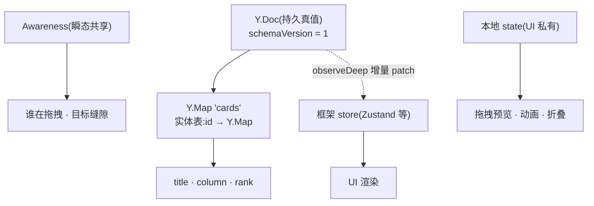
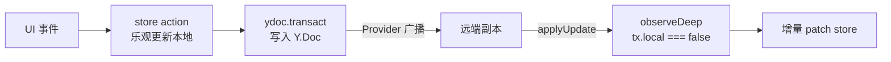

import { Canvas, Controls, Meta } from '@storybook/addon-docs/blocks';
import * as Stories from './data-modeling.stories';

<Meta of={Stories} name="Docs" />

# 协同数据建模

前五课的零件——共享类型、事务与事件、CRDT 定序、awareness——在这一课组装成一份应用的数据模型。贯穿场景是一块看板:两列(待办 / 已完成)、若干卡片、随时拖拽排序,两个客户端可以并发操作。建模要回答四个问题:**结构**(实体和关系放进哪种共享类型)、**顺序**(列表怎么存才能并发拖拽不打架)、**状态**(哪些要被所有协作者看见)、**演进**(旧文档怎么长出新字段);最后补一条边界:Y.Doc 与 React/Zustand 这类框架 store 怎么分工。

看完开场图和三方案表,你应该能预测正文首个实验的结果:两个人同时把不同卡片拖到同一个缝隙,两副本最终给出完全相同的顺序——并发被压缩成「两张同 rank 卡片谁在前」的小问题,由排序比较器一句话裁决。



| 排序方案 | 顺序存在哪 | 并发拖拽行为 | 适用场景 |
| --- | --- | --- | --- |
| `Y.Array` 移动(`delete` + `insert`) | 数组结构本身 | 收敛,但同一张卡被两端同时移动会出现两份 | 只追加、极少重排的流(消息、日志) |
| fractional-indexing(本课主线) | 每个实体的 `rank` 字符串键 | 收敛;同缝隙并发得到同一个 rank,由 tiebreak 决先后 | 看板、任务列表等频繁拖拽重排 |
| 整数 rank | 每个实体的整数键 | 收敛;缝隙耗尽要整列重编号 | 顺序稳定、重排稀疏的简单列表 |

## 结构:实体表与 ID 引用

共同模型一句话:**实体进表、顺序进键、关系进字段**。所有卡片放进一个顶层 `Y.Map`,以自己的 id 为键;「属于哪列」「排第几」不藏在数组位置里,而是卡片实体的两个字段。这样每次交互最多改一个实体的少量键,`Y.Map` 按键合并的粒度([共享类型](?path=/docs/shared-types--docs))正好对齐业务意图——两个人改不同字段互不干扰,改同一字段收敛到同一个值。

```ts
import * as Y from 'yjs';

const ydoc = new Y.Doc();
const cards = ydoc.getMap<Y.Map<unknown>>('cards');

// 增:新卡进实体表;rank 取列尾的下一个键(见顺序一节)
ydoc.transact(() => {
  const card = new Y.Map<unknown>();
  card.set('title', '写发布说明');
  card.set('column', 'todo');
  card.set('rank', 'a3');
  cards.set('c-9f2', card);
});

// 改:只写目标字段,协同合并粒度 = 键
cards.get('c-9f2')?.set('title', '写发布说明 v2');

// 移:跨列拖拽 = 一个事务改两个字段,永不搬动实体本身
ydoc.transact(() => {
  const card = cards.get('c-9f2');
  card?.set('column', 'done');
  card?.set('rank', 'a1');
});

// 删:从实体表移除;id 不复用
cards.delete('c-9f2');
```

与它相对的是嵌套写法:每个列是一个实体,列里嵌 `Y.Array`,数组里直接放卡片。读取时不需要 join,更直观,但为直观付出三个代价:

| | ID 引用(实体表 + 排序键) | 嵌套(列内嵌 `Y.Array`) |
| --- | --- | --- |
| 移动 | 改 `column` / `rank` 两个字段 | 从一列 `delete` + 往另一列 `insert`,卡片变成新 item |
| 身份 | id 永久稳定,可直接做 React key、动画锚点 | 身份跟着 item 走,搬列 / 重排后是「另一张卡」 |
| 并发移动 | 单键覆盖,永不复制同一张卡 | 同一张卡被两端同时移动会出现两份(下一节实测) |
| 读取 | 自己按列过滤 + 排序 | 直接遍历 |

判断:凡是被拖拽、移动、重排的数据,用 ID 引用;嵌套留给跟父实体同生命周期、从不搬家的子结构。另外两个硬规则:实体表的值必须是共享类型(每张卡一个 `Y.Map`),`set` 进去普通对象就没法按字段合并了;列本身(哪几列、谁在前)很少变,一个 `Y.Array` 存列 id 就够,不值得为它再设计排序键。

## 顺序:三个方案与并发拖拽

yjs 对「谁在前谁在后」只提供兜底:同位置并发插入按 clientID 定序——确定,但不可预知([CRDT 与 YATA 原理](?path=/docs/crdt-internals--docs)实测过)。看板这种顺序敏感的数据,展示顺序必须自己设计。三个方案回答同一个问题:**把顺序从「结构」降级成「数据」,降到什么程度**。选型看三点:并发拖拽时谁说了算、卡片会不会被复制、排序键会不会膨胀。

### fractional-indexing:顺序存为 rank 键

每张卡带一个字符串 `rank`,列内按字典序排列。`generateKeyBetween(a, b)` 生成落在两者之间的新键,`a` / `b` 传 `null` 表示开头 / 结尾:

```ts
import { generateKeyBetween, generateNKeysBetween } from 'fractional-indexing';

generateKeyBetween(null, null);      // 'a0'   第一张卡
generateKeyBetween('a0', null);      // 'a1'   追加到列尾
generateKeyBetween(null, 'a0');      // 'Zz'   插到最前
generateKeyBetween('a0', 'a1');      // 'a0V'  插到中间
generateNKeysBetween('a0', 'a1', 3); // ['a0G', 'a0V', 'a0l']  一次补三张
```

拖拽落点只有三步,也是 tester/ 看板项目的实际算法:按当前顺序算出拖拽后的新序列 → 取新位置的前后邻居 → 只写被拖卡片的 `rank`:

```ts
// reordered 是 arrayMove 之后的新序列,finalIndex 是被拖卡的新位置
const prev = reordered[finalIndex - 1]?.rank ?? null;
const next = reordered[finalIndex + 1]?.rank ?? null;
onUpdate(activeId, { rank: generateKeyBetween(prev, next) });
```

并发拖拽在这套设计里退化成两个简单情形。**不同卡片拖到同一个缝隙**:两端基于相同的邻居 rank,算出**同一个**新键——冲突不是「顺序分叉」,而是「两张卡同 rank 谁在前」,排序比较器用 `(rank, id)` 一句话裁决。**同一张卡拖到两个地方**:被拖卡片的 `rank` 是它实体上的一个键,并发写收敛到 clientID 较大的一方,一次拖拽胜出、另一次被覆盖。两种情形两副本都必然一致。

<Canvas of={Stories.KanbanRank} />
<Controls of={Stories.KanbanRank} />

| 读者操作 | 可观察证据 |
| --- | --- |
| 保持默认(A 拖「开发」到待办末尾,B 拖「设计」到待办末尾) | 两端算出同一个 rank `a3`;读数给出两副本一致的顺序,底部标出同键冲突与 tiebreak 裁决 |
| B 切到「测试 → 待办最前」 | rank 为 `Zz` 的卡排到最前;两副本仍然一致 |
| A 切到「测试 → 设计与开发之间」,B 切到「测试 → 待办最前」 | 同一张卡被两端拖动,`rank` 键按 clientID 大者覆盖 |
| A 切到「开发 → 已完成末尾」,B 切到「测试 → 已完成末尾」 | 跨列移动改 `column` + `rank` 两个字段;同缝隙撞键发生在已完成列 |
| 打开 Show code | 两副本从同一基线克隆、各自离线拖拽、互换 update 的完整模拟 |

边界:

- `rank` 会随连续的中间插入变长,但很慢——实测在 `a0` 与 `a1` 之间反复插入,得到 `a0V → a0l → a0t → a0x`。Figma 的选择是**永不重排**——键长度由使用强度自然封顶;介意长度可以在超过阈值(比如 32)时整列重编号,一个事务完成。
- 比较必须用字节序(`<` / `>`),不能用 `localeCompare`——实测 `['Zz', 'a0', 'a0V', 'a1']` 用 `localeCompare` 会把头插产生的 `Zz` 排到最后,顺序整个错掉。
- 两端同缝隙撞键的概率可以用抖动 key 降低(rocicorp 的 jittered-fractional-indexing,给键加随机后缀),代价是键更长。
- `generateKeyBetween` 的默认字符集是 base-62,整数部分头字符默认来自 base-52;自定义字母表必须单字节且按码点升序,一般不需要碰。

### Y.Array 移动:顺序即结构

yjs 13.x 的 `Y.Array` 没有 `move` 方法,移动一张卡 = `delete` + `insert`——两个操作,产生一个新 item。并发的语义(见 [CRDT 与 YATA 原理](?path=/docs/crdt-internals--docs)):两端的删除各自命中,两个插入都保留。数组里应该存卡片 id(引用实体表)而不是实体本身——但即便如此,同一个 id 也会被复制成两份:

```ts
const order = ydoc.getArray<string>('order'); // ['t1', 't2', 't3']
ydoc.transact(() => {
  order.delete(1, 1); // 拿走 t2
  order.push(['t2']); // 放到末尾:两个操作、一个新 item
});
```

<Canvas of={Stories.ArrayMoveConflict} />
<Controls of={Stories.ArrayMoveConflict} />

| 读者操作 | 可观察证据 |
| --- | --- |
| 场景保持「两端同时移动同一张卡」 | 「开发」在每个副本出现两次,红框标出;读数列出重复项 |
| 场景切到「两端把不同卡移到同一位置」 | 两副本收敛,但最终顺序未必符合任何一方的直觉 |
| 打开 Show code | 两副本 `delete` + `insert` 与互换 update 的完整模拟 |

边界:这个方案适合「只追加、极少重排」的流(聊天消息、操作日志),它的顺序天然长在结构上,追加语义下并发表现良好;一旦有频繁拖拽,复制与乱序的善后成本高于 rank 方案。想要移动语义又不复制,只能把「移动」建模成实体的字段——回到上一节。

### 整数 rank:最简单的妥协

`rank` 用整数,列内按数值排序。插入取中点向下取整;tiebreak 仍然必须带 id:

```ts
cards.sort((a, b) => a.rank - b.rank || (a.id < b.id ? -1 : 1));
const rank = Math.floor((prevRank + nextRank) / 2); // 插到 1 和 4 之间得 2
```

退化路径清晰可算:整数中点有限,在 1 和 2 之间反复插入,两三轮后无隙可插;两端同时插进同一缝隙会得到相同整数,并发语义退化成 tiebreak。补救是整列重编号——比如按 1024 的间隔给全列重新赋值,一个 `transact` 完成,所有副本都会收到这批写入([性能与基准](?path=/docs/performance--docs)的事务粒度一节)。

结论:原型、内部工具、几乎不拖拽的列表,整数 rank 够用且最好懂;预期频繁拖拽的产品直接上 fractional-indexing,免得日后做数据迁移。

## 状态:Y.Doc、awareness 与本地

一份看板数据同时活在三种地方,放错的代价是「该持久的不持久」或「瞬态写进了历史」。判断入口只有一条:**这个状态需要所有协作者一致吗?需要持久吗?**

| 状态 | 放哪 | 判断依据 |
| --- | --- | --- |
| 卡片 `title` / `column` / `rank`、列顺序、`schemaVersion` | `Y.Doc` | 持久真值:所有协作者可见,离线编辑后仍要合并 |
| 谁选中了哪张卡、谁正在拖、悬停在哪个缝隙 | awareness | 瞬态共享:心跳过期自动清理,不进文档历史 |
| 拖拽中的浮层位置、动画参数、面板折叠 | 本地 state | 只对本地用户有意义,写进共享层只是噪音 |

拖拽状态写进 awareness 只需要一个字段(Provider 接线见 [Awareness 与在线状态](?path=/docs/awareness--docs)):

```ts
provider.awareness.setLocalStateField('drag', {
  cardId: 'c-9f2',
  column: 'todo', // 悬停在哪列
  position: 2,    // 悬停在哪个缝隙前
}); // 拖动中持续更新;drop 之后置 null

provider.awareness.getStates(); // Map<clientID, state>,读出他人的 drag 渲染指示
```

边界:**drop 之前不要把 rank 写进 `Y.Doc`**。拖拽是高频连续动作,每次悬停都落库,等于让所有副本的排序跟着你的鼠标抖动;共享层只保留「落点」这一个事实,过程留给 awareness。

## 版本:schema 演进

文档活得比代码久:老版本代码创建的文档没有新字段,新版本代码要能读它们。三个动作:

1. **顶层带版本字段**:`board.set('schemaVersion', 1)`;
2. **防御性读取**:任何 `get` 都可能拿到 `undefined` 或旧形态;
3. **只加不改**:新字段新增,不复用旧字段的名字装新含义。

```ts
const board = ydoc.getMap('board');
const version = (board.get('schemaVersion') as number | undefined) ?? 1;

function readCard(entity: unknown): { title: string; rank: string } | null {
  if (!(entity instanceof Y.Map)) return null; // 旧数据 / 异常数据兜底
  return {
    title: (entity.get('title') as string | undefined) ?? '未命名',
    rank: (entity.get('rank') as string | undefined) ?? 'a0',
  };
}

// 懒迁移:新版本客户端首次打开旧文档时,补齐字段并抬版本号
ydoc.transact(() => {
  cards.forEach((entity) => {
    if (!entity.has('rank')) entity.set('rank', generateKeyBetween(null, null));
  });
  board.set('schemaVersion', 2);
});
```

边界:yjs 没有内建 schema,以上是应用层约定。迁移要不要回写,按「老客户端还会不会打开」决定:会,就只加字段不改读法(读端兼容两套);不会,才允许重构字段。版本字段不是给 yjs 看的,是给你的下一个版本看的。

## 框架集成:Y.Doc 是唯一真值

tester/(React + Zustand + y-sweet)的形态就是最小模式,与框架无关:store 只做**渲染缓存**,事实单向流动。



两条规则,代码取自 tester 的 `useYjsSync` / `todoStore`(简化):

```ts
// 本地动作:改 store,再把同一事实写进 Y.Doc(一个事务)
subscribeToDelta((delta) => {
  if (delta.origin !== 'local') return;
  ydoc.transact(() => {
    /* 按 delta 类型写 ycards:增 / 删在顶层表,改字段在实体上 */
  });
});

// 远端事实:observeDeep 过滤本地事务,按事件增量 patch store
ytodos.observeDeep((events, tx) => {
  if (tx.local) return;
  events.forEach((event) => {
    /* event.target === 顶层表 → event.keys 管增删;
       嵌套变更 → event.path 定位到具体卡片 */
  });
});
```

边界:

- Y.Doc 是唯一真值,store 是缓存;两处各写各的必然分叉。本地乐观更新必须紧跟着同一个事实的 `transact`,谁先谁后无所谓,事实要一致。
- 远端更新在 `applyUpdate` 时**同步**到达,事件回调里直接 patch 框架状态即可;列表大时把「过滤 + 排序」的派生计算留给渲染层 memo,不在 observe 里做全量 `toJSON`(见常见问题)。
- dnd-kit 拖拽、`useSortable` 这些组件层细节不属于本课;上面的模式不依赖 React,Vue / Svelte 同样适用。

## 最佳实践

- **排序比较器 = 字节序 + id tiebreak**:`(a, b) => (a.rank < b.rank ? -1 : 1) || (a.id < b.id ? -1 : 1)`。tiebreak 不是可选项:同一 rank 的两张卡,先后取决于各副本 `Y.Map` 的遍历序——并发新增两张同 rank 卡片时,两个副本的遍历序可以不同,不带 tiebreak 就会排出两种顺序。
- **ID 本地生成、永不复用**:`crypto.randomUUID()` 或 nanoid,免协调;`Date.now() + Math.random()` 可用但碰撞域更大。id 的唯一职责是身份,不要编码时间、序号等业务含义,删除后也不再启用。
- **rank 超阈值整列重编号**:一个事务按固定间隔(如 base-62 下重排为 `a0, a1, …`)重赋全列,顺手消除碎片;日常拖拽不需要主动重排。
- **批量写进一个事务**:初始化导入、整列重编号、跨列移动都包 `transact`,一次回调、一条 update。
- **从第一版就写 `schemaVersion`**:字段只加不改;迁移走懒迁移,不等「停机窗口」。

## 常见问题

- 远端排序一到,列表闪一下、拖拽动画丢失?
  先保证渲染列表的 key 是实体 id(不是数组下标);动画交给 transform(FLIP,或 dnd-kit 这类位移动画库),让排序变化只改 transform 而不重建 DOM;再过滤本地回声——自己事务触发的 observe(`tx.local === true`)不要重复 patch store。拖拽过程用 awareness 做预览、drop 才写 rank,远端就只在落点收到一次变化。
- 两个人同时把不同卡片拖到同一个缝隙,先后顺序「不对」?
  这是设计的正常行为:两端算出同一个 rank,顺序由 `(rank, id)` tiebreak 决出——确定,但不等于任何一方的意图。可以接受(下次拖拽即修正),或改用抖动 key 降低撞键概率;不要试图让 yjs「按时间先后」裁决,那需要中心服务器定序。
- 用 `Y.Array` 存卡片顺序,两个人同时移动同一张卡,卡片出现两份?
  `delete + insert` 的两端插入都保留,删除各自命中,于是同一个 id 出现两次。渲染层可以按 id 去重兜底并上报;根治是把顺序改成实体上的 rank 字段,移动从「两个结构操作」变成「一个字段写入」。
- `observeDeep` 里每次 `toJSON()` 全量刷新,卡片一多就卡?
  全量序列化是 O(全部实体),每次远端事务都跑一遍。按事件 patch:事件目标是顶层表时看 `event.keys`(增删),嵌套变更用 `event.path` 定位到具体卡片(事件结构见[事务与变更事件](?path=/docs/transactions-and-events--docs));tester 的 deepObserver 就是「顶层管增删、深层管字段」的两分支写法。
- 卡片 id 用 `Date.now() + Math.random()` 够吗?
  能用但不建议:两副本在同一毫秒生成、随机位数不足时会撞车,而 id 撞车在实体表里意味着「两张卡合成一张」。`crypto.randomUUID()` 一行解决且无需协调;yjs 的 clientID 是随机分配的内部值([CRDT 与 YATA 原理](?path=/docs/crdt-internals--docs)),不要拿它当业务 id。

## 总结回顾

摘要:

本课把前几课的机制组装成一份数据模型方法论。结构上,实体收进以 id 为键的 `Y.Map` 实体表,归属与顺序降级为实体字段:ID 引用让卡片身份稳定,移动只是改字段,永不复制;`Y.Array` 嵌套读取直观,但并发移动会让同一张卡出现两份。顺序上,三个方案按「从结构降级为数据的程度」排列:`Y.Array` 移动收敛但会复制;fractional-indexing 把顺序存成 rank 字符串,拖拽落点只写被拖卡一个字段,同缝隙并发被压缩成同 rank 冲突,由 `(rank, id)` tiebreak 裁决;整数 rank 最好懂,缝隙耗尽要整列重编号。状态上,持久真值进 `Y.Doc`,瞬态共享进 awareness,UI 私有留本地,拖拽过程走 awareness、落点才写 rank。演进靠顶层 `schemaVersion`、防御性读取与只加不改;框架集成守住「Y.Doc 是唯一真值、store 是渲染缓存」的单向流,远端事件按 `event.keys` / `event.path` 增量 patch。

一句话:

> 看板这类频繁重排的数据,把实体收进 ID 引用的实体表、把顺序降级成每个实体上的排序键——并发拖拽就从「结构合并」退化成「单键覆盖加 tiebreak」,可预测、可复制、不丢卡。

知识要点:

- 实体表 + ID 引用相比 `Y.Array` 嵌套,在移动、身份与并发上各差在哪?
- 三个排序方案的并发行为分别是什么?同缝隙并发拖拽各自发生什么?
- fractional-indexing 的 rank 怎么取值(头、尾、中、批量)?拖拽落点算法有哪三步?
- 为什么排序比较器必须用字节序加 id tiebreak?`localeCompare` 错在哪?
- 哪些状态进 `Y.Doc`、哪些进 awareness、哪些留本地?判断依据是什么?
- schema 演进的三个动作是什么?懒迁移在什么时机执行?
- 框架集成的单向流是什么?`observeDeep` 里该做全量刷新还是增量 patch?

## 参考资料

- [fractional-indexing(rocicorp)README](https://github.com/rocicorp/fractional-indexing)
- [Implementing Fractional Indexing — David Greenspan](https://observablehq.com/@dgreensp/implementing-fractional-indexing)
- [Realtime Editing of Ordered Sequences — Figma 工程博客](https://www.figma.com/blog/realtime-editing-of-ordered-sequences/)
- [jittered-fractional-indexing(rocicorp)](https://github.com/rocicorp/jittered-fractional-indexing)
- [Yjs 官方文档:Working with Shared Types](https://docs.yjs.dev/getting-started/working-with-shared-types)
- [Awareness API - Yjs 官方文档](https://docs.yjs.dev/api/about-awareness)
