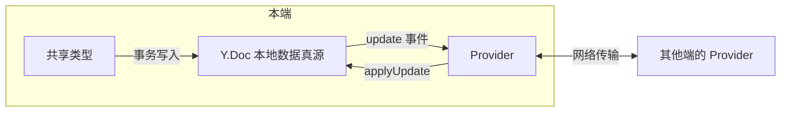

import { Canvas, Controls, Meta } from '@storybook/addon-docs/blocks';
import * as GettingStarted from './getting-started.stories';

<Meta of={GettingStarted} name="Docs" />

# 安装与第一个协同文档

Yjs 是一个 CRDT 协同库：每个端在本地持有完整的文档副本，编辑先落本地、再异步同步，并发冲突由算法自动合并，不需要中心服务器裁决。本课从零安装 yjs 与 y-websocket，跑通「两个浏览器上下文实时同步同一份文档」的最小闭环。

所有 yjs 协同代码都由三个角色组成，搞清楚分工，后面的 API 都有处可放：

- **Y.Doc**：协同文档本体，本地数据真源，没有网络也照样可读可写。
- **共享类型**（Y.Text、Y.Map、Y.Array……）：挂在 Y.Doc 上的读写入口，所有修改都通过它们进入文档。
- **Provider**：传输管道，把本地产生的 update 搬到其他端，把收到的 update 应用到本地。管道可替换、可叠加，文档内容与传输方式解耦。



| 对象 | 默认值 / 取值 | 回查要点 |
| --- | --- | --- |
| `new Y.Doc()` | `guid` 随机生成、`gc: true` | `clientID` 每次会话唯一，不可复用 |
| `doc.getText(name)` 等取型入口 | 同名返回同一实例 | 首次调用创建，之后返回既有类型 |
| `new WebsocketProvider(url, room, doc)` | `connect: true` | 创建即自动连接 |
| 官方公共 demo 服务器 | `wss://demos.yjs.dev/ws` | 仅供体验，禁止用于生产 |
| `disableBc` 选项 | `false` | 同浏览器标签页默认经 BroadcastChannel 直接互通 |

## 快速上手

目标：两个浏览器标签页打开同一页面，一边输入、另一边实时出现。需要本机已装 Node.js 20+，且能访问外网（公共 demo 服务器在公网上）。

**1. 创建环境并安装依赖。**

```bash
mkdir yjs-hello && cd yjs-hello
npm init -y
npm install yjs y-websocket
npm install --save-dev vite
```

**2. 新建 `index.html`。**

```html
<!doctype html>
<html>
  <body>
    <input id="editor" placeholder="在这里输入" style="width: 24em" />
    <script type="module" src="/main.ts"></script>
  </body>
</html>
```

**3. 新建 `main.ts`。**

```ts
import * as Y from 'yjs';
import { WebsocketProvider } from 'y-websocket';

// 1. 创建文档：本地数据真源
const doc = new Y.Doc();

// 2. 取出共享类型：协同数据按名字挂在文档上
const ytext = doc.getText('shared');

// 3. 连接 Provider：服务器地址 + 房间名定位一份共享文档
//    wss://demos.yjs.dev/ws 是官方公共 demo 服务器，仅供体验
const provider = new WebsocketProvider(
  'wss://demos.yjs.dev/ws',
  'yjs-hello-请换个独特名字',
  doc,
);
provider.on('status', ({ status }) => console.log(`连接状态：${status}`));

// 4. 本地输入写入共享类型；远端同步到达时更新输入框
const input = document.querySelector<HTMLInputElement>('#editor')!;
input.addEventListener('input', () => {
  doc.transact(() => {
    ytext.delete(0, ytext.length);
    ytext.insert(0, input.value);
  });
});
ytext.observe(() => {
  if (input.value !== ytext.toString()) {
    input.value = ytext.toString();
  }
});
```

**4. 运行验证。**

```bash
npx vite
```

用两个标签页（或两个不同的浏览器）打开终端输出的地址，在一边输入，另一边同步出现；控制台能看到 `连接状态：connected`。真实编辑器不要这样直接双向绑定 `<input>`——光标保持、中文输入法等细节由编辑器绑定库处理，见路线第 5 章；这里只为跑通最小闭环。

## Y.Doc

Y.Doc 是一份协同文档的本地真源：共享类型挂在它上面，Provider 以它为同步对象。它是 offline-first 的——所有读写都是本地操作，网络只负责事后搬运变更。

| 入口 | 用途 |
| --- | --- |
| `doc.getText(name)` / `doc.getMap(name)` / `doc.getArray(name)` / `doc.getXmlFragment(name)` | 按名字取共享类型，同名同实例 |
| `doc.transact(fn)` | 把多次修改合并为一个事务，只对外产生一条 update |
| `doc.on('update', fn)` | 每次事务提交后触发，回调拿到 `(update, origin, doc, transaction)` |
| `doc.clientID` | 本会话唯一的客户端标识，只读 |
| `doc.destroy()` | 销毁文档及其上的监听与绑定 |

`update` 事件是整个同步体系的地基：每次本地修改提交后，yjs 把这次变更编码成一个 `Uint8Array` 交给监听者；谁拿到它、对另一份文档执行 `Y.applyUpdate(docB, update)`，谁就完成了一次同步。持久化（写入本地数据库）监听的也是这个事件。本文 Provider 一节的内嵌实例演示的正是这条链路；增量编码与合并规则见[文档更新与同步协议](?path=/docs/document-updates--docs)，事务的批量语义与 `beforeTransaction` 等其余文档事件见[事务与变更事件](?path=/docs/transactions-and-events--docs)。

构造选项里的 `autoLoad`、`shouldLoad`、`collectionid` 仅服务子文档场景，见[子文档](?path=/docs/subdocuments--docs)。

## 共享类型

共享类型是协同数据的读写入口，本课只用 Y.Text 跑通闭环：

```ts
const ytext = doc.getText('shared');

ytext.insert(0, '你好');    // 在位置 0 插入
ytext.delete(0, 2);         // 从位置 0 删除 2 个字符
ytext.toString();           // 读取当前内容
ytext.observe((event) => {  // 本地和远端的修改都会触发
  console.log(event.delta); // 本次变更的结构化描述
});
```

关键性质：**本地写入和远端同步走同一条路径**。`observe` 不关心变更来自你的代码还是 Provider 的 `applyUpdate`，界面只要监听 `observe` 就能同时响应两者——快速上手里输入框能同时跟随本地输入和远端同步，靠的就是这一点。

Y.Text 之外还有 Y.Map、Y.Array、Y.Xml 家族，各自适合不同的数据形态，选型与嵌套组合见[共享类型](?path=/docs/shared-types--docs)。

## Provider

Provider 的职责只有一件：把本地产生的 update 送到其他端，把收到的 update 应用到本地。它不持有数据，换掉管道（WebSocket、WebRTC、自定义传输）不影响文档内容，多个 Provider 还可以叠加到同一份文档上。

`WebsocketProvider` 用「服务器地址 + 房间名」定位一份共享文档：同一台服务器上，房间名相同的所有端互相同步，房间名不同则互不相干。

```ts
const provider = new WebsocketProvider('wss://demos.yjs.dev/ws', 'my-room', doc, {
  connect: true,        // 默认创建即连接；false 时手动 provider.connect()
  params: {},           // 附加到服务器地址的 query 参数，如 { auth: 'token' }
  disableBc: false,     // 默认开启同浏览器跨标签页同步
  maxBackoffTime: 2500, // 断线重连的退避上限（毫秒）
});
```

| 成员 | 用途 |
| --- | --- |
| `provider.on('status', fn)` | 连接状态变化，`fn({ status })`，取值为 `connected` / `disconnected` |
| `provider.on('sync', fn)` | 与服务器完成内容对齐，`fn(isSynced: boolean)` |
| `provider.synced` | 当前是否已完成同步 |
| `provider.connect()` / `disconnect()` | 手动连接 / 断开，本地文档不受影响 |
| `provider.destroy()` | 销毁管道并断开，文档数据保留 |

其余选项（`awareness`、`WebSocketPolyfill`、`resyncInterval` 等）服务在线状态、Node 环境等场景，连同消息协议、重连策略与 `connection-close` 等事件在 [y-websocket](?path=/docs/y-websocket--docs) 一课展开。

公共 demo 服务器 `wss://demos.yjs.dev/ws` 所有人共享、随时可能清库，只能用于体验。本地开发可自托管官方参考服务端：

```bash
npm install --save-dev @y/websocket-server
HOST=localhost PORT=1234 npx y-websocket   # 客户端改连 ws://localhost:1234
```

服务端的持久化与部署见 [y-websocket 服务端](?path=/docs/y-websocket-server--docs)。

**拆开 Provider 看。** 它内部做的事可以手工复现：监听本地 `update` → 传输 → 对端 `applyUpdate`。下面的实例不连任何网络，在同一页面里创建两个互不知情的 Y.Doc，用代码扮演这条管道——左侧写入、右侧同步：

<Canvas of={GettingStarted.ManualSync} />
<Controls of={GettingStarted.ManualSync} />

| 读者操作 | 可观察证据 |
| --- | --- |
| 修改「文档 A 内容」 | 文档 B 同步为相同文本；读数「已转发 update」计数 +1 |
| 关闭「同步中继」后修改文本 | 中间连线变灰显示「已断开」，文档 B 停在旧内容，「两端一致」变为「否」 |
| 重新开启「同步中继」 | 文档 B 通过一条差量 update 追平文档 A，「两端一致」恢复「是」 |
| 打开 Show code | 看到 `two-doc-sync.ts` 实际执行的手动同步：update 监听、origin 防回声、`encodeStateAsUpdate` 差量对齐 |

两个值得记住的细节：转发时用 `origin` 标记区分「本地修改」与「同步来的修改」，否则 A→B 的同步会再触发 B→A，形成无限回声；重连后不需要传全量内容，`Y.encodeStateAsUpdate(docA, Y.encodeStateVector(docB))` 只编码「B 还缺的部分」。真实 Provider 做的正是这两件事，只是把传输层换成了网络。

## 常见问题

- 断网后，同一浏览器的两个标签页居然还在同步？
  这不是 WebSocket 的功劳：y-websocket 默认经 BroadcastChannel 在同浏览器、同「地址 + 房间名」的标签页之间直接同步（`disableBc` 默认 `false`），不经过服务器。验证真实网络同步请换两个不同的浏览器或两台设备；需要关闭该行为时传 `{ disableBc: true }`。

- 明明显示 connected，两端内容却不一致？
  逐字符核对两边的服务器地址和房间名——「地址 + 房间名」共同定位一份文档，差一个字符就是两份互不相干的数据。公共 demo 服务器上房间名是全局命名空间，换一个足够独特的名字，也能避免陌生人撞进你的文档。

## 总结回顾

摘要：

本课装好了 yjs 与 y-websocket，并用三个角色搭出第一个协同文档：Y.Doc 持有本地数据真源，共享类型是挂在文档上的读写入口，Provider 按「服务器地址 + 房间名」把 update 同步到其他端。本地编辑永远先落本地文档，网络只负责事后搬运；页面内的双文档实例证明，哪怕手工监听 `update` 事件、手工 `applyUpdate`，两端也能收敛到一致——Provider 内部做的正是这件事。

一句话：

> Y.Doc 是本地数据真源，共享类型是操作入口，Provider 只是可替换的传输管道：协同 = 本地写入产生 update，管道把它送到对端 apply。

知识要点：

- Y.Doc、共享类型、Provider 各自负责什么？
- 怎样让两个浏览器上下文同步同一份文档？
- 同名多次调用 `doc.getText('shared')` 返回什么关系？
- 为什么断网时同一浏览器的两个标签页还在同步？
- 为什么说 `update` 事件是同步与持久化的地基？

## 参考资料

- [Yjs 官方文档：A Collaborative Editor](https://docs.yjs.dev/getting-started/a-collaborative-editor)
- [Yjs 官方文档：Y.Doc API](https://docs.yjs.dev/api/y.doc)
- [Yjs 官方文档：y-websocket Provider](https://docs.yjs.dev/ecosystem/connection-provider/y-websocket)
- [y-websocket 官方仓库](https://github.com/yjs/y-websocket)
