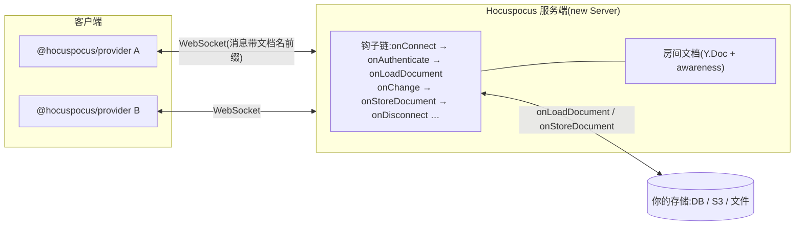

import { Meta } from '@storybook/addon-docs/blocks';

<Meta id="hocuspocus" title="服务端/Hocuspocus" name="Docs" />

# Hocuspocus

Hocuspocus 是 Tiptap 团队的插件化 yjs 服务端框架（`@hocuspocus/server`，本课以工作区安装的 4.7.1 为准）。[y-websocket 服务端](?path=/docs/y-websocket-server--docs) 里要手写的东西——房间管理、鉴权位置、落盘钩子、优雅退出——在这里全部变成配置项和钩子：起服务只剩 `new Server({...})` 加 `listen()`，业务逻辑全部挂进钩子链或打成扩展（extension）复用。本课讲快速启动、连接与钩子模型、鉴权、持久化、官方扩展生态，以及嵌入 Express/Koa 的方式。

先建立三个能预测全文的事实：

- **服务端 = 配置 + 钩子链**：`new Server({...})` 的全部业务行为都是钩子（`onAuthenticate`、`onLoadDocument`、`onStoreDocument`……），配置对象里写的钩子和 `extensions` 数组里的扩展跑同一条 Promise 链，throw 即中断。
- **文档生命周期是托管的**：首条认证连接触发 `onLoadDocument` 建房间，变更经防抖汇总到 `onStoreDocument`，末连接断开立即落盘并卸载——4.1 课手写的 `bindState` / `writeState` 时机语义在这里是现成机制。
- **线协议不是 y-websocket**：4.x 每条消息带文档名前缀（一条 WebSocket 复用多文档），且每个文档必须先过一条 Auth 握手消息。推论：浏览器端要用 `@hocuspocus/provider`，y-websocket 的 `WebsocketProvider` 连不上（实测见常见问题）。



以下默认值逐条核对自 `@hocuspocus/server@4.7.1` 源码（`defaultConfiguration` / `defaultServerConfiguration`）：

| 项 | 默认值 | 回查要点 |
| --- | --- | --- |
| 起服务 | `new Server(config)` + `await server.listen()` | 4.x 没有 2.x 教程里的 `Server.configure()`；`server.hocuspocus` 拿到核心实例 |
| `port` | `80` | 本课范例显式用 `1234` |
| `address` | 未设（监听全部接口） | 生产显式绑定；本课范例绑 `127.0.0.1` |
| `timeout` | `60000` | 空闲判定周期（毫秒），超时以 4408 关闭；v4 从 30 秒提到 60 秒，awareness 心跳与 pong 都算活动 |
| `debounce` / `maxDebounce` | `2000` / `10000` | `onStoreDocument` 的防抖与最长延迟（毫秒） |
| `unloadImmediately` | `true` | 末连接断开时立即执行待落盘并卸载；`false` 则等防抖计时（防限流存储被反复连断打爆） |
| `stopOnSignals` | `true` | SIGINT/SIGQUIT/SIGTERM → `destroy()`，冲刷全部未落盘的防抖任务 |
| `yDocOptions` | `{ gc: true, gcFilter: () => true }` | 透传给每个房间文档 |
| `quiet` | `false` | `true` 关闭启动横幅 |
| `websocketOptions` | `{}` | 透传底层 ws 配置，如 `{ maxPayload }` |
| 未认证缓冲上限 | 5MiB / 1000 条 / 100 个文档 | 鉴权通过前的单连接排队上限（`maxUnauthenticatedQueueSize` / `maxUnauthenticatedQueueMessages` / `maxPendingDocuments`），超限即断连 |
| `flushDelay` / `flushMaxBytes` | `0` / 1MiB | 下行广播合批：`0` 合并同一事件循环回合的广播，`false` 退回逐条同步发送 |
| 客户端 | `@hocuspocus/provider` | 线协议与 y-websocket 不兼容；Tiptap 的 TiptapCollabProvider 就是它的子类 |

## 快速上手

本课目录的 `server.js` 是完整可运行服务端（令牌鉴权 + 文件落盘 + 生命周期日志），`check-sync.js` 内置一个最小 Hocuspocus 协议客户端做验证（工作区未安装 `@hocuspocus/provider`，且最小客户端能把协议帧暴露出来）。

**1. 起服务（终端 1）：**

```bash
node cheatsheets/hocuspocus/server.js
```

**2. 验证（终端 2）**，一条命令跑三个阶段——双客户端互同步、错误令牌被拒、只读令牌写入被拒收：

```bash
node cheatsheets/hocuspocus/check-sync.js
```

实测输出：

```text
── 阶段 1:双客户端互同步 ──
房间:ws://127.0.0.1:1234/probe-735k9b
A 事件:open → authenticated:read-write → synced → sync-status:true → sync-status:true
B 事件:open → authenticated:read-write → synced → sync-status:true → sync-status:true
两端一致:true
最终内容:你好,Hocuspocus! —— 来自 B 的追加
── 阶段 2:错误令牌 ──
事件序列:open → permission-denied:permission-denied → close:1005
被拒后文档内容为空:是
── 阶段 3:只读令牌 ──
Bob 事件:open → authenticated:readonly → synced → sync-status:true → sync-status:false
读写端是否看到 Bob 的写入:false
RESULT: OK
```

同一时刻服务端的日志就是钩子生命周期的直接证据（节选）：

```text
[鉴权] Alice 进入 probe-735k9b(读写)
[连接] Alice 已接入 probe-735k9b(socket 9ea4e04e…)
[变更] probe-735k9b +37 字节(来自 Alice,在线 2)
[断开] Alice 离开 probe-735k9b(剩余 0)
[落盘] 房间 probe-735k9b 写入 78 字节 → …/cheatsheets/hocuspocus/data/probe-735k9b.yjs
[卸载] 房间 probe-735k9b 已从内存移除
[鉴权] 拒绝文档 probe-735k9b-deny:令牌无效
```

**3. 验证持久化**：上面的写入已落在课程目录的 `data/` 下。`Ctrl+C` 停掉终端 1 再重启，然后用 EXPECT 模式核对恢复：

```bash
# 终端 2(先用固定房间写入)
ROOM=persist-demo node cheatsheets/hocuspocus/check-sync.js
# 终端 1:Ctrl+C,重新 node cheatsheets/hocuspocus/server.js
# 终端 2(断言重启前的内容还在)
ROOM=persist-demo EXPECT='你好,Hocuspocus' node cheatsheets/hocuspocus/check-sync.js
```

实测：重启后服务端日志出现 `[加载] 房间 persist-demo 从磁盘恢复 78 字节`，客户端打印恢复内容与 `RESULT: OK`。环境变量：`PORT` / `HOST` 改监听，`STORAGE_DIR` 改落盘目录（`=off` 关闭持久化）。

浏览器端的对应物是 `@hocuspocus/provider`：`new HocuspocusProvider({ url, name, document, token })`，token 会作为 Auth 消息发出——就是 `server.js` 里 `onAuthenticate` 收到的那个。

## 连接与钩子模型

一条 WebSocket 从打开到销毁，钩子按固定顺序触发。**注意 4.x 的多路复用语义：一条 socket 可以承载多个文档，`onConnect` / `onAuthenticate` 按「连接 × 文档」各触发一次**，由客户端为每个文档发出的 Auth 消息驱动：

```mermaid
sequenceDiagram
  participant C as 客户端 Provider
  participant S as Hocuspocus
  Note over C: WebSocket 打开(此时尚未触发任何文档钩子)
  C->>S: Auth 消息(文档名 + token)
  Note over S: onConnect → onAuthenticate<br/>任一 throw → 回 PermissionDenied
  S->>C: Authenticated(read-write / readonly)
  Note over S: 该文档首次访问:onCreateDocument → onLoadDocument → afterLoadDocument<br/>随后 connected
  C->>S: SyncStep1(state vector)
  S->>C: SyncStep2 + SyncStep1
  C->>S: SyncStep2(服务端回 SyncStatus 回执)
  Note over C,S: 在线期间 Update / Awareness 双向流动<br/>onChange 每次变更触发,onStoreDocument 防抖合并
  C->>S: 断开
  Note over S: onDisconnect;末连接 → 待落盘立即执行<br/>→ beforeUnloadDocument → afterUnloadDocument
```

钩子链的三条规则（源码 `Hocuspocus.configure` / `hooks` 核对）：

- **顺序**：`extensions` 按 `priority` 降序跑（默认 100），配置对象里的钩子相当于最后追加的一个扩展——扩展先跑、配置最后跑。
- **throw 中断链**：后果按钩子不同——鉴权/连接钩子里 throw，客户端收 PermissionDenied；`beforeHandleMessage` 里 throw，连接被关闭；`onStoreDocument` 里 throw，服务端记日志且**文档留在内存不卸载**（防丢设计）。抛 `{ reason: '...' }` 形状的错误可自定义给客户端的拒绝原因。
- **return 有语义**：`onConnect` / `onAuthenticate` / `onTokenSync` 返回的对象并入 `context` 供后续钩子读取；`onLoadDocument` 返回 `Y.Doc` 或 `Uint8Array`（4.x 新增）会被合入房间文档；`onCreateDocument` 返回的对象并入该文档的 `yDocOptions`。其余钩子的返回值无意义。

25 个钩子全表（4.7.1 类型定义核对），按生命周期分组；载荷共同字段为 `instance`、`documentName`、`requestHeaders`（`Headers`）、`requestParameters`（`URLSearchParams`，即 URL query）、`socketId`、`context`，差异字段单列：

| 钩子 | 时机 | 差异载荷与要点 |
| --- | --- | --- |
| `onConfigure` | 实例配置完成（构造时即触发） | `configuration`、`version` |
| `onListen` | `listen()` 完成 | `port` |
| `onDestroy` | `destroy()` 之后 | 只有 `instance` |
| `onRequest` | 每个普通 HTTP 请求 | Node 的 `request` / `response`；reject 则由你接管响应（挂载自有路由的出口） |
| `onUpgrade` | WS 升级前 | Node 的 `request` / `socket` / `head`；reject 则由你接管——cookie 级鉴权可放这里 |
| `onConnect` | 收到某文档的 Auth 消息时 | return 并入 `context`；此刻还没有用户信息 |
| `onAuthenticate` | 紧跟 `onConnect` | 增加 `token`；throw 即拒绝；`connectionConfig.readOnly = true` 只读降级 |
| `connected` | 文档就绪、连接登记后 | 增加 `connection`；`context` 已含用户信息 |
| `onTokenSync` | 运行期收到新令牌 | 增加 `token`、`connection`；provider 刷新 token 时的再校验点 |
| `onCreateDocument` | 房间文档创建前 | return 并入该文档的 `yDocOptions`（如按房间关 GC） |
| `onLoadDocument` | 文档首次加载 | return `Y.Doc` 或 `Uint8Array` 即被合入；什么都不返回 = 空文档 |
| `afterLoadDocument` | 加载完成后 | 适合补初始内容、挂监听 |
| `beforeHandleMessage` | 每条消息应用前 | 增加 `update`（原始帧）；throw 关闭连接，可用 `{ code, reason }` 指定关闭码 |
| `beforeSync` | 每个 sync 子消息前 | `type`：0=SyncStep1 / 1=SyncStep2 / 2=Update；`payload` 为原始字节 |
| `afterHandleMessage` | 消息应用后（无论成败） | `beforeHandleMessage` 拒绝的不触发 |
| `onChange` | 文档每次变更 | 增加 `update`、`clientsCount`、`transactionOrigin`、`connection` |
| `beforeHandleAwareness` | awareness 应用前 | `states` 是可改写的 `Map`、`removedClients` 是可改写的 `Set`（4.x 新增，可过滤/改写在线状态） |
| `onAwarenessUpdate` | awareness 变更后 | `added` / `updated` / `removed` / `states` |
| `onStoreDocument` | 变更防抖后 / 末连接断开 / `destroy()` 冲刷 | **载荷是 `lastContext` / `lastTransactionOrigin`，没有 `context`** |
| `afterStoreDocument` | 落盘成功后 | 同上 |
| `beforeUnloadDocument` | 文档卸载前 | 可 throw 阻止卸载 |
| `afterUnloadDocument` | 文档卸载后 | 只有 `instance` + `documentName` |
| `onStateless` | 收到 stateless 消息 | `payload` 字符串；配合 `document.broadcastStateless()` 做轻量信令 |
| `beforeBroadcastStateless` | 服务端广播 stateless 前 | `payload` |
| `onDisconnect` | 连接断开 | `clientsCount` 是该文档剩余连接数 |

落盘与卸载的防抖语义：`onStoreDocument` 按文档防抖（`debounce` 毫秒，从最近一次变更算起），但 `maxDebounce` 兜底必触发；末连接断开时若有待落盘则立即执行（`unloadImmediately`），没有则直接卸载——所以「改完没立刻落盘」是特性不是故障（实测：连接存续期间最后一次写入约 2 秒后落盘）。

## 鉴权

`onAuthenticate` 的 `token` 来自客户端的 **Auth 消息**（`@hocuspocus/provider` 的 `token` 选项，可为字符串或异步函数），不是 URL query——query 参数走 `requestParameters`，适合放辅助信息。校验通过时 return 的对象并入 `context`，之后的 `connected`、`onChange`、`onDisconnect` 都能读到。本课 `server.js` 的做法：

```js
async onAuthenticate({ token, documentName, connectionConfig }) {
  const account = TOKENS[token];           // 生产环境:查库或验 JWT
  if (!account) throw new Error('invalid token'); // throw 即拒绝
  if (!account.write) {
    connectionConfig.readOnly = true;      // 只读降级:能收不能写
  }
  return { user: account.user };           // 并入 context
}
```

三种结果的客户端表现（`check-sync.js` 阶段 2/3 实测）：

- **拒绝**：客户端收到 PermissionDenied 消息（原因默认 `permission-denied`，`throw { reason: 'token-expired' }` 可自定义），该文档协商终止，socket 保持——同一条连接上的其他文档不受影响。
- **通过**：收到 `authenticated:read-write`，进入正常同步。
- **只读降级**：收到 `authenticated:readonly`；此后它的每个 update 都被服务端回 `SyncStatus(false)` 且不应用、不转发（实测：同房间读写端看不到 Bob 的写入；阶段 3 输出里第一个 `sync-status:true` 是握手阶段空 SyncStep2 的回执，不是写入被接受）。注意**只读客户端的本地文档仍会应用自己的写入**——它的本地状态就此与服务端分叉，正式产品里客户端要监听 SyncStatus 回执处理。

令牌轮换：provider 的 `token` 传函数可在重连时取新值；运行期服务端可 `connection.requestToken()` 主动索取，客户端回的新令牌触发 `onTokenSync` 再校验。

## 持久化

两个钩子构成完整契约（对照 4.1 课的 `bindState` / `writeState`）：

```js
// onLoadDocument:首条认证连接创建文档时触发;4.x 可直接返回 Uint8Array
async onLoadDocument({ documentName }) {
  const data = await readFile(fileFor(documentName)).catch(() => null);
  return data ? new Uint8Array(data) : undefined; // 合入房间文档
},

// onStoreDocument:防抖后触发;document 就是房间文档(extends Y.Doc)
async onStoreDocument({ documentName, document }) {
  await writeFile(fileFor(documentName), Y.encodeStateAsUpdate(document));
},
```

时机语义（全部实测或源码核对）：

- 变更后按 `debounce`（默认 2 秒）防抖合并落盘，`maxDebounce`（默认 10 秒）兜底——连续打字最多 10 秒落一次。
- 末连接断开：有待落盘立即执行再卸载；无待落盘直接卸载（重启验证时只见 `[加载]` 不见 `[落盘]` 就是这个原因）。
- 优雅退出：`destroy()`（`stopOnSignals` 默认把它挂在 SIGINT/SIGQUIT/SIGTERM 上）冲刷全部未落盘的防抖任务。
- `onStoreDocument` 抛错：服务端记日志、**文档留在内存不卸载**（防丢），下一次防抖仍会尝试。

验证步骤与实测输出见本文快速上手第 3 步。生产落库把文件读写换成数据库即可，官方扩展（下节）已覆盖 SQLite / S3 / 通用数据库。

## 官方扩展与自定义扩展

扩展就是把一组钩子打包成可复用的类。官方扩展（均为独立 npm 包，`@hocuspocus/extension-*`）：

| 扩展 | 干什么 | 要点 |
| --- | --- | --- |
| `extension-logger` | 打印连接与文档日志 | 本课 server.js 的手写日志钩子就是它的小号替代 |
| `extension-database` | 通用数据库持久化 | 实现 `fetch` / `store` 两个方法适配任意库 |
| `extension-sqlite` | SQLite 落盘 | 零配置演示用 |
| `extension-s3` | S3 兼容对象存储 | 大文档、无状态服务实例组合 |
| `extension-redis` | 多实例水平扩展 | **是同步总线不是存储**：跨实例转发 update 与 awareness；所有消息仍在所有实例处理，不降 CPU；落盘另配 database 扩展 |
| `extension-throttle` | 按 IP 限流 | 防连接风暴 |
| `extension-webhook` | 变更回调自有 API | 见下 |

webhook 扩展是把「文档事件通知业务后端」做成现成配置：按事件（`onConnect` / `onCreate` / `onChange` / `onDisconnect`，默认只 `onChange`）向 `url` 发 POST，`secret` 生成 `X-Hocuspocus-Signature-256` HMAC 签名供接收方校验，`transformer`（如 `@hocuspocus/transformer` 的 TiptapTransformer）负责 Y.Doc ↔ 业务 JSON 的互转，`debounce` / `debounceMaxWait`（默认 2000/10000）控制频率。`onConnect` 事件的响应体会成为后续钩子的 `context`，`onCreate` 的响应体可灌入初始文档——鉴权回源和「首次打开时从业务库导入」都可以不写钩子、纯配置完成。

自定义扩展 = 实现 `Extension` 接口的类（任选钩子、全部 async），可设 `priority` 控制链上顺序：

```js
class AuditLog {
  extensionName = 'audit-log';
  async onStoreDocument({ documentName, document }) {
    console.log(`审计:${documentName} 已落盘 ${Y.encodeStateAsUpdate(document).length} 字节`);
  }
}

const server = new Server({ extensions: [new AuditLog()] });
```

## 嵌入 Express / Koa

`Server` 类自带的 HTTP 服务够用大多数场景；要并进自有框架时，改用核心类 `Hocuspocus`（不管 socket），把 crossws 的 Node 适配器挂到自有服务的 `upgrade` 事件上（与 `Server` 内部做法相同）：

```js
import { Hocuspocus } from '@hocuspocus/server';
import crossws from 'crossws/adapters/node';
import { createServer } from 'node:http';
import express from 'express';

const hocuspocus = new Hocuspocus({ /* 配置与钩子相同 */ });
const app = express();                 // 你的普通路由照常
const server = createServer(app);

const ws = crossws({
  hooks: {
    open(peer) {
      // 第三个参数可给 context 设默认值(如网关注入的用户 id)
      peer._hp = hocuspocus.handleConnection(peer.websocket, peer.request);
    },
    message: (peer, msg) => peer._hp?.handleMessage(msg.uint8Array()),
    close: (peer, event) => peer._hp?.handleClose({ code: event.code, reason: event.reason }),
  },
});
server.on('upgrade', (req, socket, head) => ws.handleUpgrade(req, socket, head));
server.listen(1234);
```

代价：`onRequest` / `onUpgrade` / `onListen` 三个钩子在此模式**不会触发**（HTTP 层已是你的框架），鉴权与文档钩子不受影响。Koa 只差 `createServer(app.callback())`。

## 服务端直写文档

服务端要主动改文档（定时任务、Webhook 接收方回写）时，不必伪造客户端：`hocuspocus.openDirectConnection(name, context)` 拿到直连接口，`transact()` 里直接改，变更照常广播给在线客户端并参与落盘防抖：

```js
const conn = await server.hocuspocus.openDirectConnection('notice', { user: { name: '系统' } });
await conn.transact((doc) => doc.getText('shared').insert(0, '系统公告:'));
await conn.disconnect(); // 默认立即落盘并卸载;{ unloadImmediately: false } 则保温防抖
```

直写的事务 origin 是 `{ source: 'local', context }`，`onChange` 里可据此区分客户端来源与服务端来源。

## 最佳实践

- **选型边界**：需要业务集成（鉴权回源、落库、webhook、和 Tiptap 生态同栈）选 Hocuspocus；只要一个透明可改的转发实现、逻辑都想自己写，用 [y-websocket 服务端](?path=/docs/y-websocket-server--docs) 更轻；纯水平扩展、不需要服务端业务钩子的 yjs 栈选 [y-redis 水平扩展](?path=/docs/y-redis--docs)（Hocuspocus 跨实例则用 `extension-redis`）；不想运维选托管服务（y-sweet、yhub 或 Tiptap Cloud，路线后续节点）。
- 鉴权结论放 `onAuthenticate`：token 直达、拒绝即 PermissionDenied，且发生在任何文档内容流出之前；需要回源校验就在钩子内 fetch 自有 API（`requestHeaders` 带 cookie）。
- `onChange` 里不做重活：它每次 update 都触发。落库走 `onStoreDocument`（已防抖），通知业务后端用 webhook 扩展（已防抖 + 签名），`onChange` 只适合计数、采样这类便宜操作。
- 生产部署：显式绑 `address`；保持 `stopOnSignals` 开启（退出落盘兜底）；按存储承压调 `debounce` / `maxDebounce`；反向代理照常要转发 `Upgrade` 头。
- 能用只读降级就别硬拒：`connectionConfig.readOnly = true` 让访客看内容但不能改，体验好于直接断开。

## 常见问题

- y-websocket 的 `WebsocketProvider` 连 Hocuspocus，显示 connected 却永远 `synced=false`、内容不流动？
  两者线协议不兼容：4.x 每条消息以文档名前缀开头（一条 socket 复用多文档），且每个文档必须先发 Auth 握手消息——`WebsocketProvider` 两者都不做。实测：连上 5 秒内 `synced` 始终 `false`、服务端无任何钩子日志（消息全堆在鉴权前队列里，约 60 秒后被服务端以 4408 关闭）。浏览器端改用 `@hocuspocus/provider`；Tiptap 用户走官方 TiptapCollabProvider 即可，它就是 hocuspocus provider 的子类。
- 照着网上教程写 `Server.configure({...}).listen()` 或 `data.connection.readOnly = true`，报错的报错、不生效的不生效？
  那是 2.x 写法。4.x 直接 `new Server({...})`；只读字段在 `connectionConfig.readOnly`（本课 4.7.1 实测生效）；另外 `onStoreDocument` 的载荷里用户上下文叫 `lastContext` 不是 `context`。
- 改了内容，落盘文件却没立刻更新？
  `onStoreDocument` 默认防抖 2 秒（`debounce`），连续变更最长 10 秒（`maxDebounce`）必落一次；末连接断开与优雅退出都会立即冲刷。这是特性；验证时看「断开连接后」或调小 `debounce`。
- 进程被 `kill -9` 后丢了多少数据？
  `stopOnSignals` 只兜得住 SIGINT/SIGQUIT/SIGTERM 的优雅退出；`kill -9` 丢失的是最后一个防抖窗口（最多 `maxDebounce` 秒的变更）。丢失敏感就把 `debounce` 调小，或在 `onChange` 里追加增量写。
- 只读用户明明看到「自己写进去了」，刷新后却没了？
  只读拒收发生在服务端：客户端本地文档先应用了自己的写入，服务端回 `SyncStatus(false)` 且不转发，本地状态就此分叉。客户端要监听 SyncStatus 回执（或 provider 的对应事件）来回滚或提示。

## 总结回顾

摘要：

Hocuspocus 把 yjs 服务端做成「配置 + 钩子链」：`new Server({...})` 起服务，`extensions` 与配置钩子在一条按 priority 排序的 Promise 链上执行，throw 中断、return 按钩子各有语义（context 合并、文档合入、yDocOptions 覆盖）。一条 socket 按「连接 × 文档」复用，每个文档先过 Auth 握手：`onConnect → onAuthenticate（throw 即 PermissionDenied，connectionConfig.readOnly 只读降级，return 并入 context）→ connected`；文档首次访问触发 `onLoadDocument`（可返回 `Y.Doc` 或 `Uint8Array`），变更经 `onChange` 与防抖的 `onStoreDocument` 落盘，末连接断开立即冲刷并卸载，`destroy()` 兜底优雅退出。官方扩展覆盖日志、数据库、SQLite、S3、Redis（同步总线非存储）、限流与 webhook；嵌入 Express/Koa 用核心类 `Hocuspocus` 加 crossws 适配器，代价是失去三个 HTTP 层钩子。线协议与 y-websocket 不兼容，客户端用 `@hocuspocus/provider`。

一句话：

> Hocuspocus = 把 4.1 课要手写的房间管理、鉴权与落盘全部变成钩子链上的注入点——`onAuthenticate` 管「谁能进、能读还是能写」，`onLoadDocument` / `onStoreDocument` 管「内容从哪来、到哪去」，其余业务集成都是扩展。

知识要点：

- 4.x 起服务的方式是什么，与 2.x 教程的 `Server.configure()` 有何区别？
- 客户端建连后钩子按什么顺序触发？为什么 `onConnect` 时还没有用户信息？
- `onAuthenticate` 的 token 从哪来（不是 query）？怎样把用户带进后续钩子，怎样做只读降级？
- `onStoreDocument` 的三个触发时机与 `debounce` / `maxDebounce` / `unloadImmediately` 各自的角色？
- `onLoadDocument` 在 4.x 可以返回哪两种形态？返回后如何进入房间文档？
- 为什么 y-websocket 客户端连不上 Hocuspocus 4.x？该用什么客户端？
- 嵌入 Express/Koa 用哪个类、失去哪三个钩子？
- `extension-redis` 解决什么、不解决什么？它与 y-redis、托管服务的选型边界？

## 参考资料

- [Hocuspocus 官方文档(tiptap.dev)](https://tiptap.dev/docs/hocuspocus)
- [官方文档:Server 钩子全表](https://tiptap.dev/docs/hocuspocus/server/hooks)
- [官方文档:Server 配置项](https://tiptap.dev/docs/hocuspocus/server/configuration)
- [官方指南:鉴权](https://tiptap.dev/docs/hocuspocus/guides/authentication)
- [官方指南:自定义扩展](https://tiptap.dev/docs/hocuspocus/guides/custom-extensions)
- [官方文档:Webhook 扩展](https://tiptap.dev/docs/hocuspocus/server/extensions/webhook)
- [hocuspocus 官方仓库(源码与发布)](https://github.com/ueberdosis/hocuspocus)
