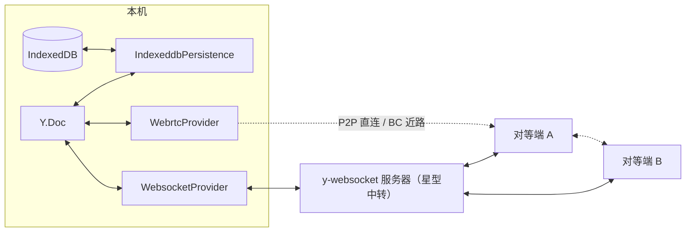

import { Canvas, Controls, Meta } from '@storybook/addon-docs/blocks';
import * as Stories from './meshing-providers.stories';

<Meta of={Stories} name="Docs" />

# Provider 组合

Provider 是正交通道：同一个 `Y.Doc` 可以同时挂任意多个 Provider——同步类的 y-websocket、y-webrtc，持久化类的 y-indexeddb——它们互不感知地读写同一份文档，由 CRDT 收敛保证一致。官方教程把这种做法称为 meshing providers；典型组合是 y-indexeddb（冷启动）+ y-websocket（中心同步）+ y-webrtc（局域网 / P2P 加速）。各 Provider 自身的选项细节由 [y-websocket](?path=/docs/y-websocket--docs)、[y-webrtc](?path=/docs/y-webrtc--docs)、[y-indexeddb 离线](?path=/docs/y-indexeddb--docs) 承载，本课只讲组合的拓扑与取舍。

先建立三个能预测全文的事实：

- **Provider 只有耳朵和嘴**：听 `doc` 的 `update` 事件转发出去，把收到的 update 用 `applyUpdate` 合入；同步类再加一条 awareness 转发。Provider 之间从不互相调用。
- **加通道不改变文档语义**：只改变拓扑与可用性。同一 update 可能经多条通道到达同一端，[文档更新与同步协议](?path=/docs/document-updates--docs) 讲过的幂等性让重复合入静默跳过——这是组合成立的前提。
- **awareness 跟着同步通道走**：每个同步 Provider 各自转发 awareness 状态；共享一个 `Awareness` 实例才有统一的在线视图；持久化通道不过问在线状态。



三条通道的角色速查（默认值与选项回查归各自课程）：

| 通道 | 类型 | 构造签名 | 组合中的定位 |
| --- | --- | --- | --- |
| [y-websocket](?path=/docs/y-websocket--docs) | 同步（星型） | `new WebsocketProvider(serverUrl, roomname, doc, opts?)` | 跨广域网的中心同步；服务器按房间转发 |
| [y-webrtc](?path=/docs/y-webrtc--docs) | 同步（网状） | `new WebrtcProvider(roomName, doc, opts?)` | 同房间端点 P2P 直连加速；同源标签页走 BroadcastChannel 近路 |
| [y-indexeddb](?path=/docs/y-indexeddb--docs) | 持久化 | `new IndexeddbPersistence(dbName, doc)` | 冷启动恢复、离线编辑；不碰网络 |

## 快速上手

照做即得「刷新不丢 + 多端同步 + 同房间直连加速」的最小组合：

```ts
import * as Y from 'yjs';
import { IndexeddbPersistence } from 'y-indexeddb';
import { WebsocketProvider } from 'y-websocket';
import { WebrtcProvider } from 'y-webrtc';
import { Awareness } from 'y-protocols/awareness';

const doc = new Y.Doc();

// 持久化通道：立即开始从 IndexedDB 恢复历史，此后每条 update 逐条落库
const idb = new IndexeddbPersistence('my-doc', doc);

// 两个同步 Provider 共享同一个 Awareness，在线状态才有统一视图（理由见下文）
const awareness = new Awareness(doc);

// 星型同步：经服务器与房间内所有端对齐；断线自动退避重连
const ws = new WebsocketProvider('wss://demos.yjs.dev/ws', 'my-room', doc, { awareness });

// 网状同步：同房间端点 P2P 直连；同源标签页之间走 BroadcastChannel 近路
const rtc = new WebrtcProvider('my-room', doc, { awareness });
```

三条构造语句互不等待、互不感知：idb 恢复的历史若先于 ws 握手到达，会作为「我已有」的部分参与差量交换；谁先就绪都不影响最终一致。

## 组合为什么成立

每个 Provider 的全部输入是 `doc.on('update')`（同步类再加 `awareness.on('update')`），全部输出是 `applyUpdate` / `applyAwarenessUpdate`。叠加不需要任何总线——文档本身就是总线。环路终止靠幂等：已合入的内容再 apply 静默跳过、不触发 `update` 事件，回声发一圈就停。

三家 Provider 的出站策略并不相同（以下逐条核对自 y-websocket 3.1.0、y-webrtc 10.3.0、y-indexeddb 9.0.12 源码）：

| Provider | 监听 | 出站过滤 | 设计含义 |
| --- | --- | --- | --- |
| y-websocket | `_updateHandler` | 过滤 `origin !== this` | 不转发自己刚合入的内容——星型里服务器负责分发，客户端接力只会放大流量 |
| y-webrtc | `_docUpdateHandler` | **不过滤** | 网状里这是故意的接力转发（relay）：peer 把收到的更新再发给自己的其他连接，更新才能越过直连范围扩散；终止同样靠幂等 |
| y-indexeddb | `_storeUpdate` | 过滤 `origin !== this` | 自己恢复历史时不重复落库；来自网络通道的远端 update 照常落库 |

由此得到本课的中心判断：**多挂一条通道改变的是拓扑与可用性，不改变文档语义**——CRDT 收敛负责把多路到达合并成同一结果，幂等负责让环路和重复静默终止。

## 叠加后的同步拓扑

星型与网状并存时，同房间两端可能同时经 ws（服务器中转）与 webrtc（P2P 直连）相连：同一 update 走两条路，先到的合入、后到的静默丢弃。两条 BroadcastChannel 近路各自独立、互不冲突：ws 的 BC 通道名是 `serverUrl + '/' + roomname`，webrtc 的 BC 通道名就是房间名本身。

一条硬边界：y-webrtc 的房间注册表是进程级的，**同一进程内同名房间只允许一个 WebrtcProvider**，第二个直接抛 `A Yjs Doc connected to room "..." already exists!`——所以下面实例的对照端 B 不挂 WebRTC，它的同伴在你打开的第二个本页标签页里。

下面实例中，文档 A 同时挂三条通道（IndexedDB 固定库名、WebSocket 连公共 demo 服的每页随机房间、WebRTC 房间名存 localStorage 供同浏览器的标签页共享，两个同步 Provider 共享一个 Awareness）；文档 B 只挂 WebSocket 作对照。A、B 的 WebSocket 都设了 `disableBc: true`，保证 A↔B 的一致性只能来自服务器往返：

<Canvas of={Stories.MeshingDemo} />
<Controls of={Stories.MeshingDemo} />

| 读者操作 | 可观察证据 |
| --- | --- |
| 加载后默认（ws、rtc 开） | A 面板头部 IDB / WS / RTC 三枚徽标点亮；ws 连线由虚转实；读数「IndexedDB 持久化」从「恢复中…」变「已恢复」 |
| 修改「文档 A 内容」 | 「A 本地 update」+1、「IndexedDB 持久化」的落库计数 +1，「B 经服务器收到」随即 +1；画布底部保持「两端一致」——一份编辑被三条通道各自独立消费 |
| 关闭「WebSocket 通道」后修改文本 | ws 连线与徽标变灰，B 停在旧内容；idb 与 rtc 读数不受影响 |
| 重新打开「WebSocket 通道」 | 差量握手后 B 自动追平，画布标语恢复「两端一致」 |
| rtc 开着时再打开一个本页标签页 | 两边「WebRTC 通道」的同伴计数 +1；在另一标签页编辑，本页「A 经 WebRTC 收到」+1（WS 房间每页随机，跨页同步只能来自这条 BC 近路） |
| 刷新页面 | A 立即恢复刷新前的内容（IndexedDB），ws 连上后 B 经握手追平 |
| 打开 Show code | 看到 `meshing-demo.ts`：同一 doc 挂三个 Provider、共享 Awareness、按 origin 分通道计数 |

外网依赖与降级：ws 需要公共 demo 服 `wss://demos.yjs.dev/ws` 可达（官方标注禁止生产，随机房间名避免与其他读者同房）；rtc 的 RTC 连线需要默认信令 `wss://y-webrtc-eu.fly.dev` 可达，但其 BroadcastChannel 近路完全离线可用。离线时 ws 停在 `connecting` / `disconnected` 并持续退避重连——这不影响其余两条通道，本身就是「正交」的直接证据。

## 多 Provider 下的 Awareness

默认行为是个坑：不显式传入时，**每个同步 Provider 各自 `new Awareness(doc)`**——同一 doc 上挂了两个 Awareness 实例，各自只认识自己通道上的成员，本地状态互不可见，在线名单按通道分裂。组合两个及以上同步 Provider 时，构造一个实例分别传入（见快速上手）。

共享实例之后的行为（核对自源码）：

- **各自转发**：本地状态每次变化、以及约 15 秒一次的续期心跳，两个 Provider 各自编码转发到自己的通道——y-websocket 与 y-webrtc 的 `_awarenessUpdateHandler` 都不过滤 origin。
- **接力宣告**：远端状态经任一通道合入共享实例后，另一通道的监听会接力转发。上面实例里开着 rtc 再打开第二个标签页，只挂了 ws 的 B 也能看到新标签页的成员（「在线成员 B 视角」+1）——A 的 ws 把经 rtc 认识的成员转发给了服务器房间。回声不会无限循环：`applyAwarenessUpdate` 只在有实际增删改时才触发事件。
- **断开的不对称**：ws 的 `disconnect()` 只向自己的通道广播「本地离线」，共享实例里的本地状态原样保留；rtc 的 `disconnect()`（`Room.disconnect`）则直接从共享实例移除本地状态（clientID 置 null）并触发广播——其他端立刻看到你离线，且续期心跳只在本地状态非 null 时运行，所以在重新 `setLocalState` 之前，你在所有通道上都保持离线。实例里关闭「WebRTC 通道」即可看到「在线成员」读数掉线。
- awareness 是易失状态，不进持久化通道：idb 只存文档 update；刷新后在线名单重新宣告。机制细节见 [Awareness 与在线状态](?path=/docs/awareness--docs)。

## 持久化通道的角色

y-indexeddb 在组合里只做两件事：启动时 `fetchUpdates` 把本地历史包在一个事务里合入（origin 是它自己，完成后发 `synced` 事件、解决 `whenSynced`）；此后监听 `doc.on('update')` 逐条落库（过滤自身 origin）。

- **冷启动无顺序要求**：idb 恢复与 ws 握手谁先谁后都行——恢复出的历史会计入 state vector，ws 握手时只补差量；CRDT 合并不是覆盖，是补齐离线期间别人写的部分。
- **自动覆盖远端内容**：ws / rtc 合入的远端 update 同样触发 doc 的 `update` 事件，随即被 idb 落库——持久化不需要知道网络的存在。
- **db 名是独立命名空间**，与房间名同名只是官方惯例（README 原话：多数场景你会用与连接 Provider 房间名相同的标识），不是强制。
- **没有开关**：idb 没有 `connect()` / `disconnect()`，停用只能 `destroy()`（一次性）；`clearData` 与 `PREFERRED_TRIM_SIZE` 合并压缩等细节由 [y-indexeddb 离线](?path=/docs/y-indexeddb--docs) 承载。

## 最佳实践

- 按缺口加通道，不为「堆叠」而堆叠：刷新不丢 / 离线编辑 → y-indexeddb；跨设备广域网同步 → y-websocket；同房间低延迟、给服务器减负、同源多标签页零配置互通 → 加 y-webrtc。大规模房间慎用 webrtc 网状（默认 `maxConns` 20 + 随机，取舍见 [y-webrtc](?path=/docs/y-webrtc--docs)）。
- 两个及以上同步 Provider 就共享一个 `Awareness` 实例：构造时传入，一行成本，避免在线名单按通道分裂。
- 记住组合不免费：每条同步通道各自搬运每条 update 与每次 awareness 心跳——ws 占服务器连接数，rtc 占本机 RTC 连接数，awareness 心跳随通道数翻倍。不需要的通道不要挂。
- 公共服务器与公共信令上的房间名都是全局命名空间：demo 用随机后缀隔离，生产自托管并加鉴权。

## 常见问题

- 挂了 ws + rtc，在线列表 / 光标却只有一条通道的成员？
  两个 Provider 各自新建了 Awareness。构造时传同一个实例即可；统一之后，各端已宣告的状态随下次状态变化（最迟 15 秒续期心跳）重新对齐。
- 同一 update 经两条通道到达对端，会不会重复应用？
  会收到多份，但 `applyUpdate` 幂等：第二次起静默跳过、不触发 `update` 事件。实例里「A 本地 update」+1 时「B 经服务器收到」+1，不会再被 rtc 通道重复计数。
- 关闭 WebRTC 通道后，对端立刻显示我离线，重新打开也没恢复？
  y-webrtc 的 `disconnect()` 会把（共享）Awareness 的本地状态置 null 并广播，且续期心跳只在本地状态非 null 时运行；rtc 重连时重发的也是 null。处理：`rtc.connect()` 之后补一句 `awareness.setLocalState(原状态)`；或断开前由应用层备份状态、重连后恢复。
- 刷新后内容立刻出现，随后内容又变了？
  先是 IndexedDB 恢复的本地历史，随后 ws 握手合入差量——这不是被覆盖，而是离线期间别人的编辑被补齐。
- 同页第二个 `WebrtcProvider` 同名房间直接抛错？
  房间注册表是进程级的：同名房间一个进程只能有一个 Provider。需要同页对照端时让它挂别的通道，或改用不同房间名。
- IndexedDB 通道能像 ws 一样临时断开吗？
  不能，它没有 `connect` / `disconnect`；`destroy()` 是一次性的。要「停用后恢复」，只能在需要时以同一 db 名重建实例，历史还在。

## 总结回顾

摘要：

Provider 是正交通道：输入只有 `doc.on('update')`（同步类再加 awareness 事件），输出只有 `applyUpdate` / `applyAwarenessUpdate`，彼此从不通信，所以同一文档可以任意叠加。出站策略因拓扑而异——y-websocket 过滤自身 origin（星型靠服务器分发），y-webrtc 不过滤（网状靠接力扩散），y-indexeddb 只写不发；环路终止与多路去重都靠 update 幂等。叠加后星型与网状并存、两条 BroadcastChannel 近路各自独立；awareness 默认按 Provider 分裂，共享一个实例才有统一在线视图，且远端成员会经共享实例接力宣告到所有通道；rtc 的 `disconnect()` 会把共享实例的本地状态置 null，需要重新 `setLocalState` 恢复。y-indexeddb 只承担冷启动恢复与逐条落库，无开关、无顺序要求，与同步通道互不感知。

一句话：

> 多挂一条 Provider 只是给同一个文档多开一扇门——它们互不感知、各自搬运，update 幂等让多路到达静默收敛；真正要操心的是拓扑（星型 / 网状 / 本地）、每条通道的成本，以及同步通道之间共享那一个 Awareness。

知识要点：

- 为什么说 Provider 之间互不感知？它们各自的输入与输出是什么？
- y-websocket 与 y-webrtc 的出站过滤策略有何不同，各自靠什么终止环路？
- 同一 doc 挂 ws + rtc 时，同一 update 经两条路到达对端会怎样？
- 多个同步 Provider 为什么应共享一个 Awareness 实例？不共享会看到什么？
- rtc 与 ws 的 `disconnect()` 对共享 Awareness 本地状态的影响有何不同，怎么恢复？
- y-indexeddb 在组合中承担什么角色？它的 `synced` 与 ws 的 `synced` 语义有何区别？
- 面对一个场景，按什么缺口决定加哪条通道？

## 参考资料

- [y-websocket 官方仓库（README 与源码）](https://github.com/yjs/y-websocket)
- [y-webrtc 官方仓库（README 与源码）](https://github.com/yjs/y-webrtc)
- [y-indexeddb 官方仓库（README 与源码）](https://github.com/yjs/y-indexeddb)
- [y-protocols 官方仓库（sync 与 awareness 消息协议）](https://github.com/yjs/y-protocols)
- [yjs-demos 官方示例集合（Provider 组合范例）](https://github.com/yjs/yjs-demos)
