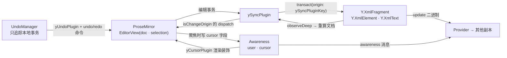

import { Canvas, Controls, Meta } from '@storybook/addon-docs/blocks';
import * as Stories from './prosemirror-tiptap.stories';

<Meta of={Stories} name="Docs" />

# ProseMirror 与 Tiptap

ProseMirror 把文档表达成一棵带 schema 的节点树,Tiptap 是它之上的扩展封装。编辑器绑定的任务是把这棵树和 Yjs 接成同一份状态:y-prosemirror 把 `Y.XmlFragment` 映射为 ProseMirror 文档——节点对应 `Y.XmlElement`、连续文本对应 `Y.XmlText`、marks 与节点属性对应格式属性与节点属性——编辑器继续只管编辑交互,Yjs 继续只管合并与同步。绑定由三个插件分工:`ySyncPlugin` 做文档树双向同步,`yCursorPlugin` 经 awareness 渲染远程光标与选区,`yUndoPlugin` 加 `undo` / `redo` 命令提供「只撤自己」的协作撤销。Tiptap v3 的 `Collaboration` / `CollaborationCaret` 扩展内部装配的正是同一套插件(经 `@tiptap/y-tiptap`,y-prosemirror 的 Tiptap 专用 fork),所以本课的映射、光标与撤销语义在两个生态里通用。编辑器自身的 schema 设计、命令扩展属于编辑器主题,本课只讲 yjs 侧。

本课用同一页面上的两个真实编辑器(客户端 A「阿宁」与 B「小柏」)互为副本:直接在编辑器里打字观察双向同步与 XML 序列化变化,切换两条中继模拟断线与「没接 awareness」,按 Ctrl/Cmd+Z 验证协作撤销。



| 对象 / 函数 | 签名要点 | 回查要点 |
| --- | --- | --- |
| `ySyncPlugin(type, opts?)` | `type: Y.XmlFragment` | 必装;双向同步;本地编辑事务的 origin 固定为 `ySyncPluginKey`;`opts.mapping` 接 `initProseMirrorDoc` 的映射 |
| `yCursorPlugin(awareness, opts?, field?)` | 第一参传 `provider.awareness` | 渲染远程光标/选区装饰;读各端 `cursor`(相对位置)与 `user`(`name`、`color`);`field` 默认 `'cursor'` |
| `yUndoPlugin(opts?)` | `trackedOrigins` 默认 `[ySyncPluginKey]` | 自动建 UndoManager,只撤本地;`protectedNodes` 默认保护 `paragraph` 不被撤销删除 |
| `undo` / `redo` | ProseMirror Command | 配进 `keymap` 的 `Mod-z` / `Mod-y` / `Shift-Mod-z`,代替 prosemirror-history |
| `undoCommand` / `redoCommand` | ProseMirror Command | 干跑(dispatch 为空)时返回 `canUndo()` / `canRedo()`,适合驱动按钮禁用态 |
| `initProseMirrorDoc(type, schema)` | 返回 `{ doc, mapping }` | 从 Yjs 构建初始文档与映射;mapping 再传回 `ySyncPlugin` |
| `prosemirrorJSONToYXmlFragment` / `yXmlFragmentToProsemirrorJSON` | JSON ↔ Y.XmlFragment | 既有内容一次性导入/导出;JSON 不含协同历史,持久化仍存二进制 update |
| `absolutePositionToRelativePosition` / `relativePositionToAbsolutePosition` | 绝对位置 ↔ RelativePosition | 批注、@提醒等跨端锚点;并发编辑下不漂移 |
| Tiptap `Collaboration` | `document` / `field`(默认 `'default'`) / `fragment` / `provider` / `onFirstRender` / `ySyncOptions` / `yUndoOptions` | 内部装配 ySyncPlugin + yUndoPlugin;自带 `undo()` / `redo()` 命令与 Mod-z 快捷键;与 `undoRedo` 扩展互斥 |
| Tiptap `CollaborationCaret` | `provider` / `user` / `render` / `selectionRender` | 光标扩展(v3 取代 v2 的 CollaborationCursor);`updateUser` 命令;`editor.storage.collaborationCaret.users` 是在线用户表 |

## 快速上手

```bash
npm install y-prosemirror yjs y-protocols
```

```ts
import * as Y from 'yjs';
import { EditorState } from 'prosemirror-state';
import { EditorView } from 'prosemirror-view';
import { keymap } from 'prosemirror-keymap';
import { schema } from 'prosemirror-schema-basic';
import {
  initProseMirrorDoc,
  yCursorPlugin,
  ySyncPlugin,
  yUndoPlugin,
  undo,
  redo,
} from 'y-prosemirror';

const ydoc = new Y.Doc(); // 真实项目由 Provider 建联:ydoc = provider.doc
const type = ydoc.getXmlFragment('prosemirror');
const { doc, mapping } = initProseMirrorDoc(type, schema);

const view = new EditorView(document.querySelector('#editor'), {
  state: EditorState.create({
    doc, // 初始内容来自 Yjs,而不是本地 JSON
    schema,
    plugins: [
      ySyncPlugin(type, { mapping }),
      yCursorPlugin(provider.awareness), // awareness 由 Provider 创建并维护
      yUndoPlugin(),
      keymap({ 'Mod-z': undo, 'Mod-y': redo, 'Shift-Mod-z': redo }),
    ],
  }),
});
```

四个槽位各就各位:`ySyncPlugin` 绑文档、`yCursorPlugin` 绑 awareness、`yUndoPlugin` 建撤销栈、`keymap` 把撤销快捷键指到 y-prosemirror 的命令。把 `ydoc` / `provider.awareness` 换成任一 Provider 的实例(见 [y-websocket](?path=/docs/y-websocket--docs)),两个浏览器上下文打开同一房间即完成协同。

## 数据映射:schema 节点 ↔ Y.Xml

绑定不发明新格式:ProseMirror 文档树直接落在 `Y.XmlFragment` 上(结构见[共享类型](?path=/docs/shared-types--docs))。对照规则:

| ProseMirror | Yjs | 说明 |
| --- | --- | --- |
| `doc` | `Y.XmlFragment` | 顶层容器,按名字从 Y.Doc 取出 |
| 块/内联节点(`paragraph`、`heading`…) | `Y.XmlElement` | `nodeName` 就是 `type.name`;节点 attrs 逐键同步为元素属性,置 `null` 即删除 |
| 一段连续文本(可含多种 marks) | `Y.XmlText` | 相邻文本节点合并为一个 XmlText;mark 成为它的格式属性段,属性名是 mark 名 |
| mark attrs | 格式属性的值 | 整个 `mark.attrs` 对象原样存储(含为 `null` 的键) |

```ts
import { prosemirrorJSONToYDoc, yXmlFragmentToProsemirrorJSON } from 'y-prosemirror';
import { schema } from 'prosemirror-schema-basic';

const ydoc = prosemirrorJSONToYDoc(schema, {
  type: 'doc',
  content: [
    {
      type: 'paragraph',
      content: [
        { type: 'text', text: '协同' },
        { type: 'text', text: '正文', marks: [{ type: 'strong' }] },
      ],
    },
    { type: 'heading', attrs: { level: 2 }, content: [{ type: 'text', text: '标题' }] },
  ],
});
ydoc.getXmlFragment('prosemirror').toString();
// => '<paragraph>协同<strong>正文</strong></paragraph><heading level="2">标题</heading>'

yXmlFragmentToProsemirrorJSON(ydoc.getXmlFragment('prosemirror'));
// => roundtrip 回等价的 ProseMirror JSON(已实测)
```

要点与边界:

- **初始内容永远来自 Yjs。** `initProseMirrorDoc` 从 fragment 构建初始 `doc` 与 `mapping`;`mapping` 是「Y 类型 → PM 节点」的对照表,必须传回 `ySyncPlugin`,后续增量同步靠它做最小更新。
- **JSON 转换只做一次性导入/导出**(存量文档迁移、服务端预览),不应在协作开始后用 JSON 回灌——JSON 不含协同历史,持久化仍以二进制 update 为准(见[文档更新与同步协议](?path=/docs/document-updates--docs))。
- **schema 不认识的节点会被删除。** 渲染时 `schema.node(nodeName, …)` 抛错,y-prosemirror 1.3.7 会把这个 Y 类型从事务(origin 为 `ySyncPluginKey`)里删掉——删除会同步给所有副本(已实测)。两端扩展集合必须一致;Tiptap v3 可开 `enableContentCheck` 捕获 `contentError` 并停用协作而不是静默删数据。

## 同步绑定:ySyncPlugin

`ySyncPlugin` 把两股变化焊在一起:编辑器一侧,每个 PM transaction 后把整棵文档与 Yjs 对账(最小化地改写 fragment),事务 origin 固定为 `ySyncPluginKey`;Yjs 一侧,`observeDeep` 监听 fragment 变化(本端事务或远端 update),重算出新的 PM 文档后以 `isChangeOrigin` 标记 dispatch,并按 RelativePosition 恢复选区。正因 origin 有归属,`pluginState.isChangeOrigin` 能区分「远端来的重渲染」、`isUndoRedoOperation` 能识别撤销事务,`tr.setMeta('addToHistory', false)` 能让程序化改动不进撤销栈。

下面实例就是本课开头的双编辑器:A、B 两个 `Y.Doc` 互为副本,文档 update 与 awareness 消息由手写中继转发(正是 y-websocket 内部的模式)。直接点进任一编辑器打字、选中:

<Canvas of={Stories.TwinEditors} />
<Controls of={Stories.TwinEditors} />

| 读者操作 | 可观察证据 |
| --- | --- |
| 在 A(或 B)里打字 | 另一侧编辑器实时出现同样内容;「两端内容一致」保持「一致」;「送达 update 字节」只在一侧增长 |
| 观察左下角「A 端 Y.XmlFragment」 | 打出的每个字以 `<paragraph>`/`<strong>` 的 XML 形式实时出现在序列化里——映射规则的直接证据 |
| 关「文档中继」再打字 | 对端不再更新,「两端内容一致」翻为「不一致」,对端方向字节数冻结(模拟断线) |
| 重新打开「文档中继」 | 按 state vector 互补差量,字节数跳增后两端重新一致(模拟 Provider 重连补齐) |

边界:绑定是「整文档对账」而不是逐字符转发,本地一次 PM 事务产生的 Yjs 更新通常是一条;映射由 binding 内部的 mutex 串行化,不会出现编辑器与 Yjs 互相覆盖的抖动。

## 远程光标:yCursorPlugin

`yCursorPlugin(awareness)` 把 awareness 变成装饰源:其他端在 `cursor` 字段(默认名,第三参可改)广播 `{ anchor, head }` 两个相对位置(结构见[相对位置](?path=/docs/relative-positions--docs)),插件把它们解析成绝对位置,渲染成光标 widget(带 `user.name` 标签)与选区 inline 装饰(背景色取 `user.color`)。远端并发插入不改变相对位置的锚定,所以光标不会因为别人打字而漂移。本端则在编辑器**持有焦点时**把自己的选区写入 awareness,失焦即清空 `cursor` 字段——对端的光标随之消失,这是设计行为而非丢包。

```ts
import { yCursorPlugin } from 'y-prosemirror';

// user 字段是远程光标的数据源;color 必须是 #RRGGBB 六位十六进制,
// 其他格式只会收到 console.warn 并回落橙色。
provider.awareness.setLocalStateField('user', { name: '阿宁', color: '#4f7cff' });

plugins: [
  yCursorPlugin(provider.awareness, {
    // awarenessStateFilter: (currentId, userId, user) => boolean,过滤要渲染的客户端
    // cursorBuilder: (user, clientId) => HTMLElement,自定义光标 DOM
    // selectionBuilder: (user, clientId) => DecorationAttrs,自定义选区样式
  }),
];
```

光标 widget 需要少量 CSS(模板出自 y-prosemirror README,`.ProseMirror-yjs-cursor` 是默认类名):

```css
.ProseMirror-yjs-cursor {
  position: relative;
  margin-left: -1px;
  margin-right: -1px;
  border-left: 1px solid;
  border-right: 1px solid;
  border-color: orange;
  pointer-events: none;
}
.ProseMirror-yjs-cursor > div {
  position: absolute;
  top: -1.05em;
  left: -1px;
  padding: 0 2px;
  color: #fff;
  font-size: 11px;
  white-space: nowrap;
  user-select: none;
}
```

回到主实例:「B 光标在 A 端位置」读数把 B 广播的 head 解析成 A 端绝对位置。

| 读者操作 | 可观察证据 |
| --- | --- |
| 点进 B 打字 | A 的编辑区出现带「小柏」标签的光标,读数显示解析后的 `pos n`;切走焦点后 B 的光标从两端消失(失焦清空) |
| 关「光标中继(awareness)」再移动 B 的光标 | 读数冻结在旧位置——光标数据没人转发,这正是「没接 awareness」的故障形态 |
| 重新打开「光标中继」 | 全量对答一次 awareness,B 的最新位置立刻出现在 A |

awareness 实例本身由 Provider 创建与转发(协议细节见 [Awareness 与在线状态](?path=/docs/awareness--docs));绑定侧只需要把它交给 `yCursorPlugin` 并写好 `user` 字段。

## 协作撤销:yUndoPlugin

`yUndoPlugin()` 在初始化时创建一个 `Y.UndoManager`,配置全部代劳(语义细节见[撤销与重做](?path=/docs/undo-manager--docs)):

- 作用域是绑定的 `Y.XmlFragment`,`trackedOrigins` 默认 `new Set([ySyncPluginKey])`——只有本编辑器产生的事务进栈,远端更新(Provider 的 origin)天然不进栈,所以撤销只回滚自己的输入;
- `deleteFilter` 默认保护 `paragraph` 等骨架节点,撤销不会把段落结构删穿;
- `captureTransaction` 尊重 `addToHistory` 元信息,`tr.setMeta('addToHistory', false)` 的程序化改动不进栈;
- 撤销/重做时把 `stackItem.meta` 里存的上次选区恢复回来,撤销后光标回到编辑位置。

快捷键必须指向 y-prosemirror 的命令,而不是 prosemirror-history 的默认绑定:

```ts
import { undo, redo, undoCommand, redoCommand, yUndoPlugin } from 'y-prosemirror';

plugins: [
  yUndoPlugin(),
  keymap({
    'Mod-z': undo,
    'Mod-y': redo,
    'Shift-Mod-z': redo,
  }),
];

// 需要自管撤销栈时(如自定义 trackedOrigins)直接注入:
yUndoPlugin({ undoManager: myUndoManager });
```

主实例的读数给两端各配了一个撤销栈计数。

| 读者操作 | 可观察证据 |
| --- | --- |
| 在 A 输入「甲」,再到 B 输入「乙」 | 两端文本一致;「撤销栈步数」显示 `1 / 1`——各端只记了自己的输入 |
| 回到 A 按 Ctrl/Cmd+Z | 只撤掉「甲」,B 的「乙」原样保留;撤销经同步到达 B,两端依旧一致 |
| 再按 Ctrl/Cmd+Shift+Z | 「甲」重做回来;期间 B 的栈深度始终为 1 |

## Tiptap:Collaboration 与 CollaborationCaret

Tiptap 没有另起炉灶:它的 yjs 绑定入口是 `@tiptap/y-tiptap`(y-prosemirror 的 fork,补了 Tiptap 特有的修复,如并发编辑产生非法 schema 时的恢复),`Collaboration` 扩展内部装配的就是 `ySyncPlugin` 与 `yUndoPlugin`,`CollaborationCaret` 包装的是 `yCursorPlugin`。因此 Tiptap v3 的最小接入只剩声明式配置:

```ts
import * as Y from 'yjs';
import { Editor } from '@tiptap/core';
import StarterKit from '@tiptap/starter-kit';
import { Collaboration } from '@tiptap/extension-collaboration';
import { CollaborationCaret } from '@tiptap/extension-collaboration-caret';
import { WebsocketProvider } from 'y-websocket';

const ydoc = new Y.Doc();
const provider = new WebsocketProvider('ws://localhost:1234', 'demo-room', ydoc);

const editor = new Editor({
  element: document.querySelector('#editor')!,
  extensions: [
    // 协同撤销由 Collaboration 接管,必须关掉 StarterKit 自带的 undoRedo
    // (否则 Collaboration 会在 console 警告两套历史不兼容)。
    StarterKit.configure({ undoRedo: false }),
    Collaboration.configure({
      document: ydoc, // 或 fragment: ydoc.getXmlFragment('body') 直接给类型
      field: 'default', // 默认字段名;一个 ydoc 服务多个编辑框时按 field 区分
    }),
    CollaborationCaret.configure({
      provider, // 只为取 provider.awareness
      user: { name: '阿宁', color: '#4f7cff' },
    }),
  ],
});

editor.commands.undo(); // 走 y-tiptap 的 undo,只撤自己
editor.commands.updateUser({ name: '新名字', color: '#008833' }); // 写 awareness 的 user 字段
editor.storage.collaborationCaret.users; // 在线用户表(clientId + user 字段),驱动在线列表
```

| 选项 / 入口 | 说明 |
| --- | --- |
| `Collaboration.fragment` | 直接传 `Y.XmlFragment`,优先于 `document` + `field` |
| `Collaboration.onFirstRender` | Yjs 内容首次渲染进编辑器后的回调(如做滚动定位) |
| `Collaboration.ySyncOptions` / `yUndoOptions` | 透传给 ySyncPlugin / yUndoPlugin(如自定义 `trackedOrigins`) |
| `CollaborationCaret.render` / `selectionRender` | 自定义光标/选区 DOM;样式需自带,默认只输出 `collaboration-carets__*` 类名 |
| `editor.commands.updateUser(attributes)` | 合并写入 `awareness` 的 `user` 字段 |

两个生态的取舍:已有自建 ProseMirror 工程、需要精确控制插件顺序与事务流,直连 y-prosemirror;用 Tiptap 快速搭编辑器,或要用 Tiptap 生态的节点扩展与托管协同,走 `Collaboration` 扩展——两者共享同一个 `Y.XmlFragment` 数据模型,服务端与持久化层完全通用。

## 常见问题

- 看不到别人的光标和选区。
  依次检查:`yCursorPlugin(provider.awareness)` 是否装配、provider 的 awareness 通道是否在转发(关掉主实例的「光标中继」可复现同款现象)、各端是否写过 `user` 字段。`color` 必须是 `#RRGGBB` 六位十六进制,否则只收到警告且回落橙色;另外光标只在编辑器持有焦点时广播,失焦后对端不显示是正常行为。
- 撤销会把远端内容回滚,或撤销行为与预期不符。
  撤销快捷键接到了 prosemirror-history(如 `prosemirror-example-setup` 的默认配置)而不是 y-prosemirror 的 `undo` / `redo`。前者按「编辑器步骤」回滚,会把远端渲染的变化一并算进去;改用 `keymap({ 'Mod-z': undo, 'Mod-y': redo, 'Shift-Mod-z': redo })`。Tiptap 侧对应的是忘关 StarterKit 的 `undoRedo`,配 `undoRedo: false` 即可。
- 打开的编辑器是空的,或初始内容不是预期的。
  绑定以 Yjs 为唯一事实源:fragment 为空就渲染空文档。初始内容要么已在服务端持久化的 update 里,要么在协作开始前用 `prosemirrorJSONToYXmlFragment(schema, json, type)` 一次性导入;任何端都不该再从本地 JSON 灌内容。
- 远端发来的自定义节点(如某端才有的扩展)在文档里消失了。
  本端 schema 不认识该节点名,y-prosemirror 渲染失败后会把对应的 Y 类型从共享文档删除,且删除会同步给所有人(已实测)。保持两端扩展集合一致是硬前提;Tiptap v3 可开 `enableContentCheck`,让非法内容触发 `contentError` 并停用协作,而不是静默删数据。
- 存下来的批注位置、@提醒在并发编辑后指错了地方。
  ProseMirror 绝对位置只在本端事务里经 `tr.mapping` 维护,跨副本必须用相对位置:`absolutePositionToRelativePosition` 存,`relativePositionToAbsolutePosition` 取——`yCursorPlugin` 内部正是这么做的(见[相对位置](?path=/docs/relative-positions--docs))。

## 总结回顾

摘要:

编辑器绑定把 `Y.XmlFragment` 与 ProseMirror 文档树接成同一份状态:节点对应 `Y.XmlElement`、连续文本对应 `Y.XmlText`、marks 与属性对应格式属性和元素属性,初始内容只来自 Yjs。`ySyncPlugin` 承担双向同步,本地编辑事务固定打上 `ySyncPluginKey` origin,远端重渲染以 `isChangeOrigin` 标记;`yCursorPlugin` 用 awareness 的 `cursor` 字段(相对位置)渲染远程光标与选区,聚焦写入、失焦清空;`yUndoPlugin` 内建只追踪本地事务的 UndoManager,`undo` / `redo` 命令配进 keymap 后,协作场景下每人只撤自己的输入。Tiptap v3 经 `@tiptap/y-tiptap` 复用同一套实现:`Collaboration` 接管文档与撤销(需关 StarterKit 的 `undoRedo`),`CollaborationCaret` 接管光标,数据模型与服务端与直连 y-prosemirror 完全通用。schema 不一致会导致远端未知节点被删除,跨端锚点一律用相对位置。

一句话:

> 编辑器绑定不是新的同步机制,而是把编辑器的文档树、选区、撤销栈分别接到 Yjs 的 XmlFragment、RelativePosition 与 UndoManager 上——三个插件各接一根线,线接对了协同就是免费的。

知识要点:

- ProseMirror 的节点、文本、marks、attrs 各映射到哪个 Yjs 类型?JSON 转换工具适合什么时机用?
- `ySyncPlugin` 怎样区分本地编辑、远端重渲染与撤销重做?`addToHistory` 元信息控制什么?
- 远程光标的数据从哪来、锚定用什么位置?为什么失焦后对端光标会消失?
- `yUndoPlugin` 内建的 UndoManager 用什么 `trackedOrigins`?这如何保证撤销只回滚自己的内容?
- 撤销快捷键为什么不能用 prosemirror-history 的默认绑定?Tiptap 侧对应的配置是什么?
- Tiptap v3 里 `Collaboration` 与 `CollaborationCaret` 各自包装了哪些插件?`field` / `fragment` 如何服务多字段文档?
- schema 不一致时会发生什么?批注、@提醒这类锚点该存什么位置?

## 参考资料

- [y-prosemirror 官方仓库与 README(1.3.x)](https://github.com/yjs/y-prosemirror)
- [Yjs 官方文档:ProseMirror 编辑器绑定](https://docs.yjs.dev/ecosystem/editor-bindings/prosemirror)
- [Yjs 官方文档:Tiptap 编辑器绑定](https://docs.yjs.dev/ecosystem/editor-bindings/tiptap2)
- [Tiptap 官方文档:Collaboration 扩展](https://tiptap.dev/docs/editor/extensions/functionality/collaboration)
- [Tiptap 官方文档:CollaborationCaret 扩展](https://tiptap.dev/docs/editor/extensions/functionality/collaboration-caret)
- [@tiptap/y-tiptap 官方仓库](https://github.com/ueberdosis/y-tiptap)
- [ProseMirror 官方参考文档(EditorState / Decoration / keymap)](https://prosemirror.net/docs/ref/)
