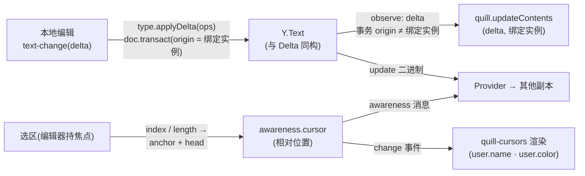

import { Canvas, Controls, Meta } from '@storybook/addon-docs/blocks';
import * as Stories from './quill-and-more.stories';

<Meta of={Stories} name="Docs" />

# Quill 与其他绑定

y-quill 把 Quill 2 编辑器接进 yjs,是所有绑定里映射最直接的一种:Quill 的文档模型 Delta(`insert` / `retain` / `delete` + `attributes`)正是 `Y.Text` 的 `applyDelta` / `toDelta` 使用的格式(见[共享类型](?path=/docs/shared-types--docs)),绑定因此几乎零转换——本地编辑经 text-change 事件把 delta 原样 `applyDelta` 进 `Y.Text`(事务 origin 是绑定实例),远端变化经 observe 原样 `updateContents` 回灌编辑器。远程光标不由绑定自己渲染,而是委托给 quill-cursors 模块:选区转成相对位置写进 awareness 的 `cursor` 字段,对端解析回绝对位置后由 quill-cursors 画出来。Quill 自身的主题、扩展与 API 不属本课;本课行为均按 y-quill 1.0.0、quill 2.0.3、quill-cursors 4.3.0 的源码与浏览器实测核对。

本课用同一页面上的两个真实 Quill 编辑器(客户端 A「阿宁」与 B「小柏」)互为副本:直接打字、加粗、设标题观察双向同步与 delta 变化,切换两条中继模拟断线与「没接 awareness」,用 Ctrl/Cmd+Z 与 history 模式开关对照协作撤销的两种做法,最后用一张对比表给出六个官方绑定的选型判断。



| 对象 / 成员 | 签名 / 默认值 | 回查要点 |
| --- | --- | --- |
| `QuillBinding(type, quill, awareness?)` | npm 1.0.0 为三参 | 构造即 `quill.setContents(type.toDelta())`,初始内容来自 Yjs;双向同步的 origin 都是绑定实例;`destroy()` 解除观察 |
| `Quill.register('modules/cursors', QuillCursors)` | 创建编辑器前调用一次 | 远程光标的前置;再配 `modules: { cursors: true }` 启用,缺任一光标通道整体不工作 |
| `awareness.setLocalStateField('user', …)` | `{ name, color }` | 远程光标的标签与配色;缺省 `User: <clientID>` / `#ffa500`(源码) |
| `awareness.cursor` | `{ anchor, head }` 相对位置 | 绑定自动写入(持焦点)与清空(失焦);业务侧一般不直接操作 |
| Quill `history` 模块默认值 | `userOnly: false`、`delay: 1000`、`maxStack: 100` | 默认把远端变更也记入撤销栈;协作配 `userOnly: true` 或自建 UndoManager |
| `normQuillDelta(delta)` | 纯函数 | 去掉 delta 末尾无属性的 `'\n'`,手工比对两端内容时用 |
| 样式引入 | `quill/dist/quill.snow.css` + `quill-cursors/css` | 主题与远程光标样式各引一份 |

## 快速上手

```bash
npm install y-quill quill quill-cursors yjs y-protocols
```

```ts
import * as Y from 'yjs';
import Quill from 'quill';
import QuillCursors from 'quill-cursors';
import { QuillBinding } from 'y-quill';
import 'quill/dist/quill.snow.css';
import 'quill-cursors/css';

Quill.register('modules/cursors', QuillCursors); // 必须在创建编辑器之前注册

const ydoc = new Y.Doc(); // 真实项目由 Provider 建联:ydoc = provider.doc
const ytext = ydoc.getText('quill');

const editor = new Quill('#editor', {
  modules: { cursors: true, toolbar: [['bold', 'italic']] },
  theme: 'snow',
});
// awareness 由 Provider 创建并维护(见 y-websocket)
const binding = new QuillBinding(ytext, editor, provider.awareness);

provider.awareness.setLocalStateField('user', { name: '阿宁', color: '#4f7cff' });
```

注册模块、启用模块、传入 awareness、写入 `user` 字段——四个动作就位后,编辑器里打字即写 `Y.Text`,对端更新即回灌编辑器,远程光标自动渲染。下面按机制展开。

## 数据映射:Delta 就是 Y.Text 的格式

`Y.Text` 的 `applyDelta` / `toDelta` 用的就是 Quill 发明的 Delta 格式:`insert` 携带文本与可选 `attributes`,`retain` 跳过若干字符(可带 `attributes` 表示改格式),`delete` 删除若干字符。绑定两侧都是原样搬运:本地 Quill 的 text-change delta 直接 `applyDelta` 进 `Y.Text`,包在 `doc.transact` 里、origin 是绑定实例;`Y.Text` 的 observe delta 在事务 origin 不是绑定实例时(即来自 Provider 或对端),直接 `updateContents` 回灌编辑器。防回环靠同一个判断——两条通道都以「事务 origin 是不是绑定实例」分流。

格式对应规则:内联格式(加粗、斜体)是字符区间上的属性;Quill 的块级格式(标题、列表、代码块)是 `'\n'` 换行符上的属性——一个标题行在 delta 里是 `…, { insert: '\n', attributes: { header: 2 } }`,与 `ytext.format(index, length, format)` 的表达一致(格式语义见[共享类型](?path=/docs/shared-types--docs))。

下面实例就是本课开头的双编辑器:两个 `Y.Doc` 互为副本,文档 update 与 awareness 消息由手写中继转发(正是 y-websocket 内部的模式)。直接点进任一编辑器打字、加粗、设标题:

<Canvas of={Stories.TwinEditors} />
<Controls of={Stories.TwinEditors} />

| 读者操作 | 可观察证据 |
| --- | --- |
| 在 A(或 B)里打字 | 另一侧实时出现同样内容;「两端内容一致」保持「一致」;「送达 update 字节」只在一侧增长 |
| 用工具栏加粗几个字 | 「A 端 Y.Text delta」里出现 `"attributes":{"bold":true}` 的分段——Quill 属性原样落进 Y.Text |
| 关「文档中继」再打字 | 对端不再更新,「两端内容一致」翻为「不一致」,对端方向字节数冻结(模拟断线) |
| 重新打开「文档中继」 | 按 state vector 互补差量,字节数跳增后两端重新一致(模拟 Provider 重连补齐) |
| 打开 Show code | 看到该 Canvas 实际执行的 `quill-twin-editors.ts`:中继与 QuillBinding 接线 |

要点与边界:

- **初始内容永远来自 Yjs。** `QuillBinding` 构造里执行 `quill.setContents(type.toDelta())`;传入的 `ytext` 必须已集成进 Y.Doc(用 `doc.getText()` 获得)。协作开始后不要再从本地字符串灌内容(持久化与初始同步见[文档更新与同步协议](?path=/docs/document-updates--docs))。
- **远端插入会被显式补上「否定格式」。** y-quill 记录编辑器用过的全部格式,把远端纯文本插入改写成 `{ insert: '…', attributes: { bold: false, … } }`——防止 Quill 让插入文本继承插入点已有的格式(实测:用过加粗的编辑器收到的远端插入带 `bold:false`)。因此到达 Quill 的 delta 不是 Y.Text delta 的逐字镜像,别把它当同步日志。
- **embeds 是原样透传。** y-quill 1.0.0 对图片等 embed 不做结构化映射:embed 以 Delta 的对象形式进出 `Y.Text`,Quill 侧自行注册对应 blot。GitHub README(main 分支)已记载第四参 `{ embeds }` 与 `tableEmbed` 方案(把 embed 存成 `Y.XmlElement`),尚未发布到 npm。

## 远程光标:quill-cursors 与 awareness

绑定不自己渲染光标。y-quill 源码把整条光标通道包在一个条件里:`if (awareness && quillCursors)`——`QuillBinding` 第三参传了 awareness、`Quill.register` 注册了 cursors 模块、编辑器配置了 `modules: { cursors: true }`,三者缺一,通道**静默不工作**(不报错、不警告)。

两条方向各自独立:

- **写**:每次 editor-change 读 `quill.getSelection()`,编辑器持焦点时把选区 index/length 转成一对相对位置写进本端 `cursor` 字段;失去焦点时写 `null`,对端光标随之消失——设计行为而非丢包。
- **读**:对端在 awareness `change` 事件里解析其他客户端的 `cursor`:名字与颜色取 `user.name` / `user.color`(缺省 `User: <clientID>` / `#ffa500`),相对位置还原成绝对位置后调 `quillCursors.moveCursor(id, { index, length })`;解析失败或 `anchor.type` 不是绑定的 `Y.Text` 时不移动,光标停在旧位置。

```ts
// user 字段是远程光标的数据源;color 是任意合法 CSS 颜色,
// 不像 y-prosemirror 那样强制 #RRGGBB
provider.awareness.setLocalStateField('user', { name: '小柏', color: '#e25c5c' });
```

主实例同样承担证据:「B 光标在 A 端位置」读数把 B 广播的相对位置解析成 A 端的 `anchor–head` 绝对位置。

| 读者操作 | 可观察证据 |
| --- | --- |
| 点进 B 打字 | A 的编辑区出现带「小柏」标签的光标;读数显示解析后的位置区间 |
| 把焦点切走 | B 的光标从两端消失(`cursor` 字段被写为 `null`) |
| 关「光标中继」再移动 B 的光标 | 读数冻结在旧位置——光标数据没人转发,这正是「没接 awareness」的故障形态 |
| 重新打开「光标中继」 | 全量对答一次 awareness,B 的最新位置立刻出现在 A |

awareness 实例由 Provider 创建与转发(协议细节见 [Awareness 与在线状态](?path=/docs/awareness--docs));绑定侧只需要把它交给 `QuillBinding` 并写好 `user` 字段。光标锚在相对位置上,并发插入不漂移(见[相对位置](?path=/docs/relative-positions--docs))。与其他绑定的差异:y-codemirror 失焦后对端保留最后位置,y-quill 与 y-prosemirror 失焦即清空。

## 撤销:Quill 自带 history 在协作里的行为

y-quill 没有撤销件——对比 y-prosemirror 的 `yUndoPlugin`、y-codemirror 的 `undoManager` 选项,`QuillBinding` 完全不碰撤销。编辑器自带的 history 模块默认 `userOnly: false`:远端 `updateContents` 产生的变更同样记入本端撤销栈,`Ctrl/Cmd+Z` 撤的是「最近一条变更」,在协作里可能正是别人刚写的字,而撤销又作为新编辑经绑定写回 `Y.Text` 同步给所有人(实测:A、B 各输入一字后 A 撤销,撤掉的是 B 的字)。`delay: 1000` 毫秒内的连续变更还会合并为一条栈项——快速连续输入会一次撤光。

主实例读数「撤销栈深度(A / B)」直接暴露这一行为:

| 读者操作 | 可观察证据 |
| --- | --- |
| A、B 各输入一字 | 「撤销栈深度(A / B)」变成 `2 / 2`——远端变更也进了本端撤销栈 |
| A 按 Ctrl/Cmd+Z | A 撤掉的是 B 刚写的字,并同步到 B,两端依旧一致 |
| 「history 模式」切到 userOnly 后重做同样操作 | 两端各只记自己的输入(`1 / 1`);A 撤销只回滚自己的字(切换会重建编辑器,栈清零) |

两种做法:

```ts
// 做法 1:让 Quill history 只记本端变更(轻量,仍是 Quill 自己的 Delta 历史)
const editor = new Quill(mount, {
  modules: { history: { userOnly: true } },
});

// 做法 2:自建 Y.UndoManager,把绑定实例加入追踪集合(语义见撤销与重做课);
// 撤销经 Y.Text → observe → updateContents 回灌编辑器并同步对端(实测)
const undoManager = new Y.UndoManager(ytext);
undoManager.trackedOrigins.add(binding); // 绑定的事务 origin 是 QuillBinding 实例
undoManager.undo();
```

边界:`Y.UndoManager` 默认 `trackedOrigins` 只含 `null`,不加绑定实例则栈永远是空的(实测)——这是 QuillBinding 与其他绑定的一个不同点:origin 是绑定实例本身,而不是固定 key。走做法 2 时,编辑器侧不要再让快捷键落到 Quill history 上,避免两套历史并存(同 [CodeMirror 绑定](?path=/docs/y-codemirror--docs)的教训)。

## 版本与安装边界

版本组合由 y-quill 的 peerDependencies 决定(npm 1.0.0 核实):

| 依赖 | 要求 | 说明 |
| --- | --- | --- |
| `quill` | `^2.0.0` | 只支持 Quill 2;Quill 1.x 用 y-quill 0.x。Quill 2 自带 ESM 入口与 TypeScript 类型,无需 @types |
| `quill-cursors` | `^4.0.2` | peer 依赖,忘装时绑定照常工作、只有光标静默缺失 |
| `yjs` | `^13.6.14` | 本工作区 13.6.33 |

- npm 上的 y-quill 1.0.0 构造器是三参 `(type, quill, awareness?)`;GitHub README(main 分支)已记载第四参 `{ embeds }`,属于未发布的主分支代码——照 README 写第四参在 npm 版上是无效参数。
- Quill 2 相比 1.x 的破坏性变化(API、样式类名)属于 Quill 主题,不在本课展开。

## 选型对比:六个绑定怎么选

官方文档收录的编辑器绑定见下表,数据模型分两族:ProseMirror 系(Tiptap、Remirror、Milkdown)共享 `Y.XmlFragment` 上的文档树,文本流族(CodeMirror、Monaco、Quill)共享 `Y.Text`(类型语义见[共享类型](?path=/docs/shared-types--docs))。

| 绑定包 | 编辑器 | 共享类型 | 文档模型 | 适用场景 |
| --- | --- | --- | --- | --- |
| y-prosemirror([5.1](?path=/docs/prosemirror-tiptap--docs)) | ProseMirror | `Y.XmlFragment` | schema 节点树 | 结构化富文档:自定义节点、批注、表格 |
| @tiptap/y-tiptap([5.1](?path=/docs/prosemirror-tiptap--docs)) | Tiptap v3 | `Y.XmlFragment` | 同上 | 用 Tiptap 生态与扩展市场快速搭建 |
| y-codemirror.next([5.2](?path=/docs/y-codemirror--docs)) | CodeMirror 6 | `Y.Text` | 纯文本 | 代码、纯文本协作,含撤销/光标开箱即用 |
| y-monaco([5.3](?path=/docs/y-monaco--docs)) | Monaco | `Y.Text` | 代码 | IDE 级编辑器场景 |
| y-quill(本课) | Quill 2 | `Y.Text` | Delta 扁平富文本 | 评论框、轻量富文本;格式即属性,绑定代码最少 |
| @remirror/extension-collaboration | Remirror | `Y.XmlFragment` | 官方定位:适配 y-prosemirror 的封装 | 已选定 Remirror 的工程 |
| @milkdown/plugin-collab | Milkdown | `Y.XmlFragment` | peer 依赖 y-prosemirror | Markdown 所见即得 |

判断入口:

- **同族可互通**:ProseMirror 系的数据层都是 `Y.XmlFragment`,服务端与持久化完全通用,换绑定不换数据;Quill 的 `Y.Text` 与之类型不同,切换意味着数据迁移。
- **结构化需求选 ProseMirror 系**:嵌套节点、schema 约束、批注锚点都是文档树的能力;**扁平富文本选 Quill**:聊天、评论、简单正文,Delta 直映 `Y.Text`,学习与接线成本最低。
- Remirror 与 Milkdown 未安装于本工作区,不展开 API:官方文档分别将其描述为「适配 y-prosemirror 的 ProseMirror 编辑器」与「基于 ProseMirror 的插件化 Markdown 编辑器,以 Yjs 做协同」(后者 collab 插件经 npm 核实以 y-prosemirror 为 peer 依赖),用法以各自官方文档为准。

## 最佳实践

- **组装顺序**:注册 cursors 模块 → 内容写进 `Y.Text`(种子以 `'\n'` 结尾)→ 创建 Quill(带 `cursors: true` 与 history 配置)→ `new QuillBinding` → 写 `user` 字段。初始内容必须在绑定构造前就位,构造时 `setContents` 一次对齐;协作开始后任何端都不该再灌本地内容。
- **协作撤销二选一**:轻量用 `history: { userOnly: true }`;要与全站撤销语义统一就自建 `Y.UndoManager` 并 `trackedOrigins.add(binding)`。不要裸用默认 history(见常见问题)。
- **清理**:销毁时 `binding.destroy()` 解除 Y.Text 观察与 Quill 事件;Quill 实例本身没有 destroy,连同容器 DOM 一起移除;awareness / Y.Doc 生命周期见 [Awareness 与在线状态](?path=/docs/awareness--docs)。
- **格式即属性名**:自定义格式两端协商好属性名即可经 `Y.Text` 存取(Yjs 不校验属性名);分清内联属性与挂在 `'\n'` 上的块级属性,别混用。

## 常见问题

- 看不到别人的光标。
  依次检查:`Quill.register('modules/cursors', …)` 是否在创建编辑器前调用、配置里是否有 `cursors: true`、`QuillBinding` 第三参是否传了 awareness——y-quill 源码把光标通道包在 `if (awareness && quillCursors)` 里,缺任一项都静默不工作。另外光标只在编辑器持焦点时广播,失焦后对端不显示是设计行为;`user` 字段缺省也有光标,影响的是标签与颜色。
- `Ctrl/Cmd+Z` 撤掉了别人刚写的字,或一次撤销回滚了很多步。
  Quill history 默认 `userOnly: false`,远端变更也进本端撤销栈;`delay: 1000` 毫秒内的连续变更合并为一条栈项,快速输入会一次撤光。配 `modules: { history: { userOnly: true } }`,或自建 `Y.UndoManager` 并 `trackedOrigins.add(binding)`(默认追踪集合只有 `null`,不加则栈永远为空)。
- 对唯一一段文字设标题/列表后,对端末尾多出一个空行。
  Quill 文档恒以一个「虚拟结尾换行」收尾(比 `Y.Text` 长 1)。当 `Y.Text` 没有真实结尾 `'\n'` 时,作用于最后一行的块级格式会 retain 到这个虚拟换行,在 `Y.Text` 里越界、被转成「插入带属性的 `'\n'`」;接收端编辑器把它当真实插入,于是多出一行(实测)。数据无损——两端 `Y.Text` 仍一致;多行文档不触发,种子内容以 `'\n'` 结尾即可避开。
- 对端光标停在旧位置不再更新。
  光标锚定的内容被并发删除时,相对位置解析为 `null`,y-quill 不再调用 `moveCursor`,光标停留在旧位置(源码行为);该端重新聚焦、选区变化后会重新广播恢复。
- 升级 Quill 2 后 y-quill 行为异常,或构造函数参数对不上。
  检查版本组合:y-quill 1.0.0 只支持 Quill 2(peerDependencies 要求 `^2.0.0`),Quill 1.x 用 y-quill 0.x;npm 上的 1.0.0 构造器是三参,README 里的第四参 `{ embeds }` 属于未发布的主分支代码。

## 总结回顾

摘要:

y-quill 把 Quill 2 的 Delta 文档与 `Y.Text` 直接连通:两种格式同构,本地编辑与远端更新各自原样搬运,双向事务都以绑定实例为 origin 防回环,初始内容在构造时经 `setContents(type.toDelta())` 来自 Yjs。内联格式是字符区间属性、块级格式是换行符属性,远端插入会被显式补上否定格式以防 Quill 的格式继承。远程光标三件套——注册 cursors 模块、`cursors: true`、传 awareness——缺一即静默失效;选区以相对位置写进 `cursor` 字段,持焦点写入、失焦清空,渲染由 quill-cursors 完成。绑定不管撤销:Quill 自带 history 默认把远端变更也记入本地栈,协作里要用 `userOnly: true` 或自建 UndoManager 并把绑定实例加进 `trackedOrigins`。版本上 y-quill 1.0.0 只配 Quill 2 与 quill-cursors 4;六个官方绑定分 `Y.XmlFragment`(ProseMirror 系)与 `Y.Text`(文本流)两族数据模型,选型按结构化需求与生态归属决定。

一句话:

> Quill 的 Delta 与 Y.Text 本是同一种格式,y-quill 只做原样搬运——绑定代码最少,但光标三件套与 history 默认值各有一个静默陷阱,接对线协同才是免费的。

知识要点:

- Quill 的 Delta 与 `Y.Text` 的哪两个方法共享格式?绑定怎样区分本地编辑与远端更新?
- 内联格式与块级格式各存在哪里?远端插入为什么会被改写进否定格式?
- 远程光标需要哪三件套?`user` / `cursor` 字段各承载什么,失焦后对端看到什么?
- Quill 自带 history 在协作里为什么会撤掉别人的字?两种修正做法分别怎么配?
- 为什么自建 UndoManager 必须把绑定实例加入 `trackedOrigins`?
- y-quill 1.0.0 与哪些版本组合?构造器第四参 `{ embeds }` 的现状是什么?
- 六个官方绑定分哪两族数据模型?结构化需求与扁平富文本各该选哪一族?

## 参考资料

- [y-quill 官方仓库(README 与源码,本课行为按 npm 1.0.0 核对)](https://github.com/yjs/y-quill)
- [Yjs 官方文档:Quill 编辑器绑定](https://docs.yjs.dev/ecosystem/editor-bindings/quill)
- [Yjs 官方文档:Editor Bindings 总览](https://docs.yjs.dev/ecosystem/editor-bindings)
- [Yjs 官方文档:Remirror 编辑器绑定](https://docs.yjs.dev/ecosystem/editor-bindings/remirror)
- [Yjs 官方文档:Milkdown 编辑器绑定](https://docs.yjs.dev/ecosystem/editor-bindings/milkdown)
- [Quill 官方文档:Delta 格式定义](https://quilljs.com/docs/delta/)
- [quill-cursors 官方仓库](https://github.com/reedsy/quill-cursors)
