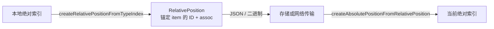

import { Canvas, Controls, Meta } from '@storybook/addon-docs/blocks';
import * as Stories from './relative-positions.stories';

<Meta of={Stories} name="Docs" />

# 相对位置

绝对索引（`index`）描述的是「第几个位置」，不描述「哪个内容」：远端在索引前方插入内容后，同一个索引就指向了别的字符。相对位置（`Y.RelativePosition`）改为锚定在具体的 item（字符、数组元素）上——文档怎么改，item 的身份不变，解析时重算它当前的偏移即可。协同光标、选区、批注锚点这类「跟着内容走」的位置，都应存成相对位置，只在创建和渲染两个瞬间与绝对索引互转。

一个相对位置的生命周期只有三步：从本地索引创建，序列化后存储或传输，在任意已同步的 doc 上解析回当前索引。



| API | 用途 | 关键行为 |
| --- | --- | --- |
| `createRelativePositionFromTypeIndex(type, index, assoc = 0)` | 把绝对索引转成相对位置 | 作用于 Y.Text / Y.Array / Y.Xml 等序列类型；`index` 越界时钳到末尾 |
| `createAbsolutePositionFromRelativePosition(rpos, doc, followUndoneDeletions = true)` | 在指定 doc 上解析回 `{ type, index, assoc }` | 锚点所属类型被删、或锚点尚未同步到该 doc 时返回 `null` |
| `createRelativePositionFromJSON(json)` | JSON 传输与持久化（配合 `JSON.stringify`) | 保留全部字段，往返后与原对象判等 |
| `encodeRelativePosition(rpos)` / `decodeRelativePosition(bin)` | 二进制传输 | 更紧凑（本例实测 8 字节 vs JSON 73 字符）；只保留定位字段 |
| `compareRelativePositions(a, b)` | 判等 | 逐字段严格比较；跨编码来源判等不可靠，见序列化一节 |

## 并发插入下的索引漂移

把光标存成数字 `5`，远端在前方插入 6 个字符后，数字 `5` 不动，却落进了别人插入的内容里——这就是索引漂移。相对位置不会漂移，因为它记录的不是数字，而是 Yjs 内部 item 的 ID（`client` + `clock`）：YATA 结构中 item 的身份恒定，解析时沿结构重算它的当前偏移。官方保证所有客户端同步后解析出同一索引，不需要 OT 式的位置变换。

```ts
import * as Y from 'yjs';

const doc = new Y.Doc();
const text = doc.getText('content');
text.insert(0, '协同编辑');

// 光标停在「编」之前:绝对索引 2
const relPos = Y.createRelativePositionFromTypeIndex(text, 2);

// 期间远端在开头并发插入(此处用本地 insert 模拟其效果)
text.insert(0, '远程输入');

const abs = Y.createAbsolutePositionFromRelativePosition(relPos, doc);
abs?.index; // 6 —— 仍指向「编」之前
// 而裸存的数字 2 此时落在「输」上,已经漂移
```

下面实例用两个真实客户端跑完整并发流程：A 在同一位置留下裸索引和相对位置两种记号，B 并发插入，双向同步后各自重新定位：

<Canvas of={Stories.ConcurrentInsert} />
<Controls of={Stories.ConcurrentInsert} />

| 读者操作 | 可观察证据 |
| --- | --- |
| 「并发插入字符数」从 0 调到 6（插入位置保持「锚点前方」） | 红色「绝对索引」标线不动并落入黄色插入区，绿色「相对位置」标线随锚点字符「文」右移 6 格；读数给出两者各自落点 |
| 「插入位置」切到「锚点后方」 | 两条标线重合在锚点字符之前，读数显示两者一致——只有前方插入才造成漂移 |
| 打开 Show code | `anchor-drift.ts` 中两客户端并发与同步的完整模拟 |

边界：

- 锚定字符本身被删除，相对位置依然能解析：删除只是给 item 打上墓碑标记，结构仍在，位置落在删除缺口处。
- 解析返回 `null` 的两种情况：锚点所属类型（或其父链）被整体删除，例如 `map.delete('note')`；目标 doc 从未同步过锚点 item，比如拿着别人广播来的光标在空 doc 上解析。
- 创建时 `index` 超出当前长度会被钳到末尾锚点，不抛错。
- 演示里两个客户端的双向同步用的是 `encodeStateAsUpdate` / `applyUpdate`，协议本身见[文档更新与同步协议](?path=/docs/document-updates--docs)。

## 吸附方向 assoc

位置落在两个字符之间，`assoc` 决定钉在哪一侧：`assoc >= 0`（默认 `0`）钉在位置**之后**的字符上，`assoc < 0`（常用 `-1`）钉在位置**之前**的字符上。只按符号判断，`0` 与 `1` 行为相同。

平时看不出差别——锚点前方、后方的插入对两种 assoc 一视同仁。只有恰好插在锚点处时才显现：

- `assoc = 0`：插入内容落在锚点之前，锚点随原字符右移。自己键入时光标跟随后移，就是这个行为。
- `assoc = -1`：锚点钉在前一个字符之后，停在插入内容之前，插入再多也推不动。

<Canvas of={Stories.AssocChoice} />
<Controls of={Stories.AssocChoice} />

| 读者操作 | 可观察证据 |
| --- | --- |
| 「吸附方向 assoc」从 0 切到 -1 | 绿色标线从插入块右端移到左端；读数从「后为『文』」变为「前为『让』」 |
| 「并发插入字符数」调到 0 | 无插入时两种 assoc 解析结果相同——差别只在锚点处有插入时显现 |

边界锚点：

- `index = 0` 且 `assoc = -1`：钉在类型起点，前方插入不移动。y-prosemirror 对空类型的 0 号位置就是这么处理的，保证类型后来被填充时光标仍留在开头。
- `index = length`：钉在类型末尾，追加内容时始终跟随末尾。
- 这两个锚点不引用具体 item，序列化后 `item` 字段为 `null`，只有类型引用。

选择建议：协同光标、选区、普通批注锚点用默认 `0`；需要「钉住不被同位置插入推开」时用 `-1`，例如固定起点，或不希望被左侧插入推走的范围左边界。

## 序列化与传输

相对位置是普通对象，两种编码按需选择：

```ts
// JSON:保留全部字段,可读、可直接进 awareness 状态或数据库
const json = JSON.stringify(relPos);
// {"type":null,"tname":"content","item":{"client":...,"clock":...},"assoc":0}
const fromJson = Y.createRelativePositionFromJSON(JSON.parse(json));
Y.compareRelativePositions(relPos, fromJson); // true

// 二进制:只保留定位所需的 item 或类型引用,更紧凑
const bin = Y.encodeRelativePosition(relPos);
const fromBin = Y.decodeRelativePosition(bin);
Y.compareRelativePositions(relPos, fromBin); // false(tname 等冗余字段未保留)
// 但两者在同一 doc 上解析出的绝对位置相同
```

选型：进 awareness、持久化存储或需要人读时用 JSON；高频网络传输、体积敏感时用二进制。

边界：二进制往返后 `compareRelativePositions` 判等为 `false` 是正常现象，编码只保留定位字段。要判断两个来源不同的相对位置「是否指向同一处」，比较两者解析出的绝对位置，不要直接判等。

## 最佳实践

- 光标与选区：本地 `selectionchange` 时创建相对位置，JSON 化后写进 awareness 广播（见 [Awareness 与在线状态](?path=/docs/awareness--docs)），远端在自己已同步的 doc 上解析后渲染。y-prosemirror 的 cursor-plugin 正是这个模式，并用 `compareRelativePositions` 跳过没有变化的重复广播。
- 批注锚点：创建批注时把首尾两个相对位置存进 `Y.Map` 随文档持久化；展示时解析，返回 `null` 说明目标内容已被整体删除，按「批注失效」降级（灰显或归档），不要把 `null` 当成索引 `0` 处理。
- 与 UndoManager 同用：解析的第三参 `followUndoneDeletions` 默认 `true`，会让执行撤销的客户端得到「跟随被撤销删除」的更优结果，但其他客户端算不出这个位置。相对位置要广播给其他用户时，解析端应显式传 `false` 保证各端一致（背景见 yjs#638）。

## 常见问题

- `createAbsolutePositionFromRelativePosition` 返回了 `null`。
  先区分两种原因：锚点所属类型被整体删除（内容确实没了，做失效降级）；或当前 doc 还没同步到锚点 item（等同步完成再解析）。不要默认回退到索引 `0`，那会把光标甩到开头。
- 二进制解码后再 `compareRelativePositions` 判等失败。
  正常。二进制编码只保留定位字段，`tname` 等冗余字段丢失导致逐字段比较不相等，但两者解析出的绝对位置相同。判等只在同一编码来源下可靠。
- 听说有新版 `StickyIndex` API，要不要迁移？
  截至本课核对时，`StickyIndex` 未出现在 yjs 13.6.33、v14 预发布线（14.0.0-16）及官方文档中，官方「Relative Positions」文档仍以本课讲的 API 为准。本课全部结论基于 13.6.33 实测；后续如官方发布替代 API，以官方文档为准。

## 总结回顾

摘要：

绝对索引在并发插入下会漂移，相对位置通过锚定 item 的 ID 保持指向稳定：用 `createRelativePositionFromTypeIndex` 从本地索引创建，经 JSON 或二进制序列化后存储传输，再在任意已同步的 doc 上用 `createAbsolutePositionFromRelativePosition` 解析回当前索引，各端结果一致。`assoc` 决定锚点钉在位置之后（`>= 0`，默认）还是之前（`< 0`）的字符，差别只在锚点处恰好有插入时显现；起点与末尾锚点不引用具体 item。锚定字符被删仍可解析，类型被整体删除或锚点未同步则返回 `null`，需要降级处理。

一句话：

> 需要「跟着内容走」的位置就存相对位置；绝对索引只在创建与渲染两个瞬间存在。

知识要点：

- 为什么绝对索引在并发插入下会漂移，相对位置为什么不会？
- 创建、序列化、解析各用哪几个 API？`assoc` 的符号各是什么含义？
- 解析返回 `null` 的两种情况是什么，分别怎么处理？
- JSON 与二进制两种编码如何取舍？为什么二进制往返后判等失败是正常现象？
- 广播给其他用户的相对位置，解析时为什么要把 `followUndoneDeletions` 设为 `false`？

## 参考资料

- [Relative Positions - Yjs 官方文档](https://docs.yjs.dev/api/relative-positions)
- [yjs 源码：RelativePosition.js](https://github.com/yjs/yjs/blob/main/src/utils/RelativePosition.js)
- [yjs issue #638：followUndoneDeletions 与撤销删除的跨端一致性](https://github.com/yjs/yjs/issues/638)
- [y-prosemirror：相对位置在编辑器光标中的实际用法](https://github.com/yjs/y-prosemirror)
