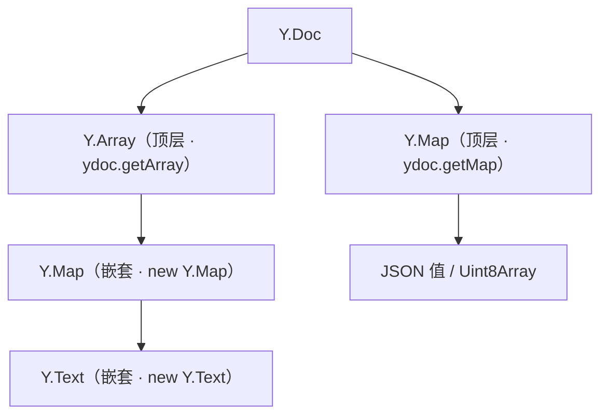

import { Canvas, Controls, Meta } from '@storybook/addon-docs/blocks';
import * as Stories from './shared-types.stories';

<Meta of={Stories} name="Docs" />

# 共享类型

Yjs 用一组共享类型承载协同文档里的全部数据：`Y.Map`、`Y.Array`、`Y.Text`、`Y.XmlFragment`、`Y.XmlElement`、`Y.XmlText`。它们长得像 JS 的 `Map`、`Array` 和字符串，但多了三条普通数据结构没有的能力：

- 修改自动编码成更新，经 Provider 同步给所有副本，并按 CRDT 规则确定性合并，不需要中心服务器裁决。
- 可以被观察：任何副本的修改到达时本地同步触发事件，事件带精确的变更载荷。
- 可以自由嵌套：共享类型可以作为值放进另一个共享类型，组成任意深的文档树。

本课先建立六个成员共用的共同模型（获得方式、嵌套规则、观察与事务、并发合并），再逐个展开成员的最小表达与合并证据。正文每个 Canvas 都在本地模拟两个「离线编辑后合并」的客户端，调节控件就能看到合并结果与事件载荷随之变化。



| 成员 | 数据形态 | 顶层获取 | 事件载荷 | 并发合并粒度 |
| --- | --- | --- | --- | --- |
| `Y.Map` | 键值对：属性包、配置、记录 | `ydoc.getMap(name)` | `changes.keys`（键级 action/oldValue） | 按键：同键并发写收敛到 clientID 大者 |
| `Y.Array` | 有序列表：条目、步骤、行 | `ydoc.getArray(name)` | `changes.delta`（retain/insert/delete） | 按位置：并发插入都保留，块间按 clientID 排序 |
| `Y.Text` | 字符串加格式：正文、备注 | `ydoc.getText(name)` | delta 中 `insert` 是字符串 | 按字符位置：逐字合并 |
| `Y.XmlFragment` | XML 节点容器 | `ydoc.getXmlFragment(name)` | `childListChanged` 加 delta | 按节点位置 |
| `Y.XmlElement` | 带标签与属性的节点 | `ydoc.get(name, Y.XmlElement)` | 加 `attributesChanged` | 属性按键、子节点按位置 |
| `Y.XmlText` | 树内文本节点 | `ydoc.get(name, Y.XmlText)` | 同 `Y.Text` | 按字符位置 |

## 共同模型

六个成员共享同一套规则；先掌握这部分，后面每个成员只剩「数据形态加合并粒度」的差异。

**获得方式有两种。** 顶层类型从 `Y.Doc` 上按名字取出：`ydoc.getMap('card')`、`ydoc.getArray('list')`、`ydoc.getText('body')`、`ydoc.getXmlFragment('doc')`，XmlElement 与 XmlText 用 `ydoc.get(name, Y.XmlElement)` / `ydoc.get(name, Y.XmlText)`。同名同型永远返回同一实例，这个名字也是同步时的寻址键。嵌套类型用构造器创建——`new Y.Map()`、`new Y.Array()`、`new Y.Text()`（可带初始字符串）、`new Y.XmlElement('div')`、`new Y.XmlText()`——再作为值插入已挂载的类型。每个类型都能读两个追溯属性：`doc`（所属文档，未集成时为 `null`）与 `parent`（父类型，顶层类型为 `null`）。

**值域。** `set` / `insert` 接受：JSON 可编码值、`Uint8Array`、以及其他共享类型（嵌套）。

**嵌套三条硬规则：**

1. 一个共享类型实例在文档中只能存在一处；把它插入第二处会抛错，需要副本时先 `clone()`。
2. 集成进文档之前可写不可读：`new Y.Array([1, 2, 3]).length === 0`，读取会得到空结果并伴随警告。
3. 不要直接改 `get` 出来的 JSON 对象——Yjs 不克隆它，绕开 `set` 的修改不产生事件、不会同步，还可能让文档不再收敛。

**观察：observe 只看本层，observeDeep 看整棵子树。** `observe(fn)` 只在类型本身被修改时触发（Map 的键、Array/Text 的内容、Xml 的属性与直接子节点）；嵌套子类型的修改不触发父级 `observe`。`observeDeep(fn)` 则对类型及其后代的修改都触发，回调收到事件数组，用 `event.target` 找到实际变更的类型，用 `event.path` 从被观察的类型一路定位到它。事件在事务提交后同步触发。

<Canvas of={Stories.NestedObserveDeep} />
<Controls of={Stories.NestedObserveDeep} />

| 读者操作 | 可观察证据 |
| --- | --- |
| 操作切到「顶层插入卡片」 | `observe` 与 `observeDeep` 各触发 1 次，事件来源是 `YArray` |
| 操作切到「改嵌套卡片标题」 | `observe` 触发 0 次，`observeDeep` 触发 1 次，事件来源 `YMap`、`path` 为 `[0]` |
| 打开 Show code | 看到 `nested-observe-deep.ts`：Array 嵌套 Map 的完整结构与两种观察的挂法 |

**事务：把多次修改合并为一次通知。** 每次顶层修改自动包一层隐式事务；`doc.transact(fn, origin)` 显式合并：fn 内的全部修改只产生一次 `observe` 回调（载荷合并为一份）、一条 `doc` 的 `update` 消息（一次网络发送）。`origin` 是任意值，随事务传给回调的 `tx.origin`，用来区分修改来源；经 Provider 应用的远端更新 `tx.local` 为 `false`。

<Canvas of={Stories.TransactionBatch} />
<Controls of={Stories.TransactionBatch} />

| 读者操作 | 可观察证据 |
| --- | --- |
| 调大「修改次数」 | 包事务时回调与 update 始终各 1 次；裸写时随次数增长 |
| 关掉「包在一个事务里」 | 同样 3 次写入变成 3 次回调、3 条 update，事件载荷拆成 3 份 |

**并发合并总述。** 两个副本各自离线修改后互换更新，无论按什么顺序收到，最终状态完全一致（确定性收敛）。差别只在粒度：Map 按键合并、Array 与 Text 按位置合并、Xml 属性按键加子节点按位置合并。同位置的并发插入（Array/Text）双方内容都保留，块间顺序按 clientID 排列，小者在前——结果确定但不可预知，排序敏感的业务应自行设计排序键。同键并发写入（Map/Xml 属性）只保留一份，clientID 较大者胜出。

### Y.Map

协同键值对，API 对齐 JS `Map`。典型用途：实体的属性包（一张卡片的标题与状态）、文档级配置、需要按键寻址的记录表。

```ts
import * as Y from 'yjs';

const ydoc = new Y.Doc();
const ymap = ydoc.getMap('card');

ymap.set('title', '写共享类型课');
ymap.set('done', false);
ymap.get('title'); // => '写共享类型课'
ymap.has('done'); // => true
ymap.toJSON(); // => { title: '写共享类型课', done: false }

ymap.observe((event, tx) => {
  event.keysChanged; // Set<string>：本事务触碰过的键
  event.changes.keys; // Map<键, { action: 'add' | 'update' | 'delete', oldValue }>
  tx.origin; // 触发本次事务的 origin
});

ydoc.transact(() => {
  ymap.set('done', true); // action 'update'，oldValue 为 false
  ymap.delete('title'); // action 'delete'，oldValue 为旧值
}); // 两次修改合并为一次回调
```

注意 `keysChanged` 与 `changes.keys` 的差别：同事务内先 `set` 再 `delete` 同一个键时，键仍出现在 `keysChanged` 里，但净变化为空，`changes.keys` 不含它。

并发合并：不同键的并发写入都保留；同一个键的并发写入收敛到 clientID 较大一方的值（yjs 13.x 的确定性裁决，真实应用中 clientID 随机分配，不要依赖谁赢）。

<Canvas of={Stories.MapKeyConflict} />
<Controls of={Stories.MapKeyConflict} />

| 读者操作 | 可观察证据 |
| --- | --- |
| 改「客户端 A / B 写入」 | 合并后两副本的值始终一致，且等于 clientID 较大一方的写入 |
| 打开「交换 clientID」 | 胜者随之反转，两副本仍然一致 |
| 看读数「A / B 侧合并事件」 | 值被改写的一侧收到 `update` 加 `oldValue`；胜出的一侧 `changes.keys` 为空 |

回查表：

| 方法 / 属性 | 说明 |
| --- | --- |
| `set(key, value)` | 写入；值为 JSON 可编码值、`Uint8Array` 或共享类型 |
| `get(key)` / `has(key)` / `delete(key)` | 读、存在性、删除；删除后 `get` 返回 `undefined` |
| `clear()` / `size` | 清空；键数 |
| `keys()` / `values()` / `entries()` / `forEach` | 与 JS `Map` 一致的遍历 |
| `toJSON()` | 导出为普通对象，嵌套共享类型递归展开 |
| `clone()` | 复制为一个可重新集成的新实例 |
| `observe` / `unobserve` / `observeDeep` / `unobserveDeep` | 本层观察与深层观察 |

### Y.Array

协同有序序列。典型用途：列表、队列、表格行、任何顺序有意义的集合。

```ts
const yarray = ydoc.getArray('list');

yarray.insert(0, ['a', 'b', 'c']); // content 永远是数组
yarray.push(['d']); // 等价于 insert(yarray.length, …)
yarray.delete(1, 1); // 从索引 1 删 1 个
yarray.toArray(); // => ['a', 'c', 'd']

yarray.observe((event) => {
  event.changes.delta; // 位置级变更：[{ retain }, { insert }, { delete }]
});
yarray.delete(0, 1); // => [{ delete: 1 }]
yarray.insert(1, ['x']); // => [{ retain: 1 }, { insert: ['x'] }, { retain: 2 }]
```

并发合并：同位置的并发插入双方内容都保留，每个插入块内部顺序不变，块间顺序按 clientID 排列（小者在前），所有副本收敛到同一结果。

<Canvas of={Stories.ArrayConcurrentInsert} />
<Controls of={Stories.ArrayConcurrentInsert} />

| 读者操作 | 可观察证据 |
| --- | --- |
| 改「客户端 A / B 插入」 | 合并数组中两段条目都完整保留，着色块标出来源 |
| 打开「交换 clientID」 | 块间顺序反转（clientID 小者在前），两副本仍一致 |
| 看读数「A 侧合并 delta」 | 远端块以 `[{ insert: [...] }]` 的形式并入 |

回查表：

| 方法 / 属性 | 说明 |
| --- | --- |
| `insert(index, content)` | 在索引处插入；`content` 永远是数组 |
| `delete(index, length)` | 从索引起删 `length` 个 |
| `push(content)` / `unshift(content)` | 尾部追加 / 头部插入 |
| `get(index)` / `length` | 读第 n 个；长度 |
| `slice([start [, end]])` | 区间复制，支持负索引 |
| `toArray()` / `toJSON()` | 复制为普通数组；JSON 表示（嵌套类型递归展开） |
| `map` / `forEach` / 迭代器 | 与数组一致的遍历 |
| `Y.Array.from(array)` | 用现有内容构造可集成的实例 |
| `clone()` / `observe` 系 | 复制；观察 |

### Y.Text

协同富文本：一段字符串加其上区间的格式属性。典型用途：正文、备注、任何需要并发逐字合并的文本——纯文本也建议用它而不是 `Y.Map` 单键（后者并发写会整值覆盖）。

```ts
const ytext = ydoc.getText('body');

ytext.insert(0, 'hello world');
ytext.format(6, 5, { bold: true });
ytext.toString(); // => 'hello world'（纯文本，不含格式）
ytext.toDelta(); // => [{ insert: 'hello ' }, { insert: 'world', attributes: { bold: true } }]
ytext.insert(0, 'Say: '); // 不传 format 时继承插入点前一位的格式
```

`toDelta()` / `applyDelta(delta)` 与事件的 `changes.delta` 使用 Quill 编辑器定义的 Delta 格式（出处见参考资料）：`insert` 携带内容与可选 `attributes`，`retain` 跳过若干字符（可带 `attributes` 表示改格式），`delete` 删除若干字符。`Y.Text` 的 delta 里 `insert` 值是字符串；`Y.Array` 与 `Y.XmlFragment` 的 delta 里 `insert` 值是数组。`length` 按 UTF-16 码元计，与 JS 字符串一致。

并发合并：不同位置的并发插入都保留并落在正确位置；同位置并发插入按 clientID 收敛。逐字合并意味着两个人同时改同一句话也很少整句丢失。

<Canvas of={Stories.TextConcurrentEdit} />
<Controls of={Stories.TextConcurrentEdit} />

| 读者操作 | 可观察证据 |
| --- | --- |
| 改「A 在开头插入」「B 在结尾插入」 | 合并文本为 A 的插入加初始文本加 B 的插入，着色分段对应来源 |
| 改「初始文本」 | 合并位置随初始长度变化，两副本始终一致 |
| 看读数「A 侧合并 delta」 | B 的插入以 `[{ retain: 前缀长度 }, { insert: '…' }]` 形式并入 |

边界：光标映射、编辑器 schema 绑定与远程选区属于编辑器集成，由编辑器绑定课程承载（如 `?path=/docs/prosemirror-tiptap--docs`、`?path=/docs/y-codemirror--docs`）；`applyDelta` 主要服务 Quill 这类以 delta 为变更语言的绑定。

回查表：

| 方法 / 属性 | 说明 |
| --- | --- |
| `insert(index, content [, format])` | 插入字符串；`format` 省略时继承前一位格式 |
| `delete(index, length)` | 删除字符 |
| `format(index, length, format)` | 给区间赋格式属性 |
| `applyDelta(delta)` | 整体应用一份 Delta |
| `toString()` / `toDelta()` / `toJSON()` | 纯文本；Delta 表示；同 `toString()` |
| `length` | 字符数（UTF-16 码元） |
| `clone()` / `observe` 系 | 复制；观察（`changes.delta` 中 `insert` 为字符串） |

### Y.XmlFragment 与 Xml 家族

把文档表达成一棵 XML 节点树，是 ProseMirror、Tiptap 这类编辑器绑定的映射目标；不接这类编辑器时一般用不到它。三个成员按继承分工：

- `Y.XmlFragment`：纯容器，管理一排 `Y.XmlElement` / `Y.XmlText` 子节点，列表 API 与 `Y.Array` 对齐（`insert` / `delete` / `push` / `get` / `slice`，content 永远是数组）。
- `Y.XmlElement` extends `Y.XmlFragment`：多一个 `nodeName` 与一组属性（`setAttribute` / `removeAttribute` / `getAttribute` / `getAttributes`）。
- `Y.XmlText` extends `Y.Text`：多 `prevSibling` / `nextSibling`；`toString()` / `toJSON()` 序列化为 XML 字符串，格式属性渲染成标签。

```ts
const fragment = ydoc.getXmlFragment('doc');

const div = new Y.XmlElement('div');
div.setAttribute('class', 'card');
const text = new Y.XmlText();
text.insert(0, '标题', { b: true });
div.insert(0, [text]);
fragment.push([div]);

fragment.toJSON(); // => '<div class="card"><b>标题</b></div>'
// 遍历所有后代节点：
for (const node of fragment.createTreeWalker((n) => n.nodeName === 'p')) { /* … */ }
```

事件是 `Y.XmlEvent`：属性变更进 `attributesChanged`（Set）与 `changes.keys`，子节点变更进 `childListChanged`（Boolean）与 `changes.delta`；嵌套后代的修改同样走 `observeDeep` 加 `event.path` 定位。多根节点的 `toJSON()` 只是字符串拼接，要得到合法 XML 需自行包一层根标签。

<Canvas of={Stories.XmlTreeEvents} />
<Controls of={Stories.XmlTreeEvents} />

| 读者操作 | 可观察证据 |
| --- | --- |
| 操作切到「给 div 设属性」 | 事件目标 `YXmlElement`，`attributesChanged` 含该键，`childListChanged` 为 false |
| 操作切到「追加 span 子节点」 | `childListChanged` 为 true，树与 XML 序列化同步多出节点 |
| 操作切到「修改树内文本」 | 事件目标变为 `YXmlText`，`path` 为 `[0,0]`（从 div 定位到文本节点） |

回查表：

| 方法 / 属性 | 说明 |
| --- | --- |
| `insert(index, content)` / `insertAfter(ref, content)` | 插入子节点；`ref` 为 null 时插到最前 |
| `delete(index, length)` / `push` / `unshift` / `get` / `slice` | 与 `Y.Array` 对齐 |
| `firstChild` / `length` | 第一个子节点；子节点数 |
| `createTreeWalker(filter)` | 遍历全部后代，按 filter 收集 |
| `toJSON()` / `toDOM()` | XML 字符串；DOM 节点 |
| `nodeName` / `prevSibling` / `nextSibling` | XmlElement 与 XmlText 的树信息 |
| `clone()` / `observe` 系 | 复制；观察 |

## 常见问题

- 改了嵌套的 Map / Array / Text，外层类型的 `observe` 没触发
  `observe` 只看本层。观察整棵子树改用 `observeDeep`，并用 `event.path` 定位变更来源；只关心某一层时，把观察直接挂在那个嵌套类型上。
- `new Y.Array([1, 2, 3])` 之后立刻读，`length` 是 0
  共享类型集成进文档前可写不可读。先把它 `insert` / `set` 进已挂载的类型（或直接用顶层类型），再读取。
- 把同一个共享类型实例插入第二处，抛 `Cannot read properties of null`
  一个实例只能集成到文档中的一个位置。需要同样的内容出现在两处时，用 `clone()` 或新建实例分别集成。
- 两个客户端同时写 `Y.Map` 的同一个键，到底谁赢
  所有副本确定性收敛到 clientID 较大一方的写入；但 clientID 是随机分配的，业务上不要依赖谁赢。会竞争的字段拆成不同的键，或改用 `Y.Array` / `Y.Text`。
- 直接修改 `get()` 出来的对象，其他副本没收到
  `get` 返回的是 Yjs 内部持有的同一个引用，绕开 `set` 的修改不产生事件也不会同步。改完必须 `set` 回去；需要持续观察的嵌套数据直接用嵌套共享类型。

## 总结回顾

摘要：

六个共享类型共用同一套模型：顶层类型从 `Y.Doc` 按名字获得，嵌套类型用 `new` 构造后集成，且一个实例只能集成一处；`observe` 看本层、`observeDeep` 看子树并用 `event.path` 定位；`doc.transact` 把多次修改合并为一次回调与一条更新消息；并发修改在所有副本上确定性收敛，差别只在合并粒度——Map 按键、Array 与 Text 按位置、Xml 属性按键加子节点按位置。

一句话：

> 按数据形态与合并意图选型：键值进 `Y.Map`、有序集合进 `Y.Array`、文本进 `Y.Text`、编辑器文档树进 `Y.Xml` 家族；它们共用同一套嵌套、事务与观察模型，并发修改永远确定性收敛，类型决定的是合并粒度。

知识要点：

- 顶层类型与嵌套类型的获得方式有何不同，为什么同一实例不能集成两次？
- `observe` 与 `observeDeep` 的触发边界分别在哪里，`event.path` 解决什么问题？
- `doc.transact` 把多次修改合并成什么，`origin` 与 `tx.local` 能区分什么？
- `Y.Map` / `Y.Array` / `Y.Text` 的并发冲突各按什么粒度合并，事件载荷分别是什么？
- 一份数据该选哪个共享类型，判断依据是什么？
- `Y.Text` 的 Delta 格式出自哪里，三种操作各表达什么？

## 参考资料

- [Yjs 官方文档：Working with Shared Types](https://docs.yjs.dev/getting-started/working-with-shared-types)
- [Yjs 官方文档：Shared Types](https://docs.yjs.dev/api/shared-types)
- [Yjs 官方文档：Y.Map](https://docs.yjs.dev/api/shared-types/y.map)
- [Yjs 官方文档：Y.Array](https://docs.yjs.dev/api/shared-types/y.array)
- [Yjs 官方文档：Y.Text](https://docs.yjs.dev/api/shared-types/y.text)
- [Yjs 官方文档：Y.XmlFragment](https://docs.yjs.dev/api/shared-types/y.xmlfragment)
- [Yjs 官方文档：Y.XmlElement](https://docs.yjs.dev/api/shared-types/y.xmlelement)
- [Yjs 官方文档：Y.XmlText](https://docs.yjs.dev/api/shared-types/y.xmltext)
- [Yjs 官方文档：Y.Event](https://docs.yjs.dev/api/y.event)
- [Quill 官方文档：Delta 格式定义](https://quilljs.com/docs/delta/)
- [yjs/yjs 官方仓库](https://github.com/yjs/yjs)
