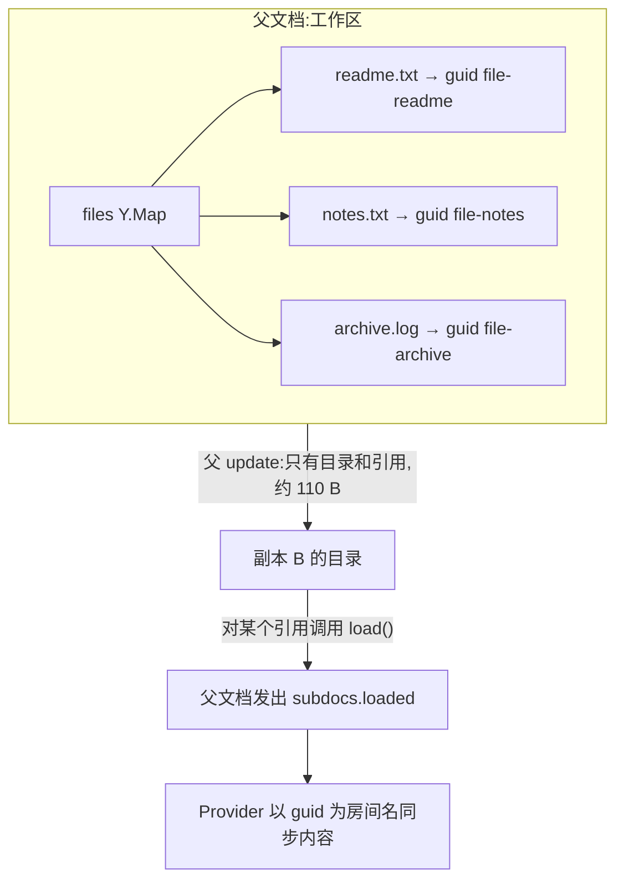

import { Canvas, Controls, Meta } from '@storybook/addon-docs/blocks';
import * as Stories from './subdocuments.stories';

<Meta of={Stories} name="Docs" />

# 子文档

一个知识库有几百篇笔记、一个项目有几十个文件——每篇都是独立的协同文档。全塞进一个 Y.Doc，任何端都得加载全部内容；每篇各开一个协同房间，「目录里有哪些文档」本身又没法协同。子文档（Subdocuments）是 yjs 对这个组织问题的答案：**把 Y.Doc 当作值放进另一个 Y.Doc 的共享类型里**——父文档携带目录与引用，子文档的内容按需加载、按需同步。

理解子文档只要抓住三个分工：

- **引用即目录**：`ymap.set('readme.txt', new Y.Doc({ guid }))` 存进父文档的只是 guid 加少量选项，不含内容——同步父文档就是同步目录。
- **懒加载**：对端收到引用时子文档是空壳；调用 `load()` 表达「我要内容」，父文档随即发出 `subdocs` 事件的 `loaded` 集合。
- **独立同步**：子文档内容走自己的通道——Provider 以 `subdoc.guid` 为房间名单独同步，与父文档互不携带。



| `new Y.Doc(opts)` 选项 | 默认值 | 回查要点 |
| --- | --- | --- |
| `guid` | 随机 UUIDv4 | 全局唯一标识；同 guid 的文档互为副本，同步时以 guid 为房间名 |
| `autoLoad` | `false` | `true` 时对端收到引用即自动加载，无需手动 `load()` |
| `shouldLoad` | `true` | 「本端想要内容」的标记；对端物化出的引用为 `false`，`load()` 把它翻成 `true` |
| `collectionid` | `null` | 集合名；子文档未自设时继承父文档，仅对有集合概念的 Provider 有意义 |
| `meta` | `null` | 随引用一起同步的任意元信息，对端不加载内容也能读 |
| `gc` | `true` | 垃圾回收开关，保持默认即可 |

| 方法 / 事件 | 签名 | 用途 |
| --- | --- | --- |
| `doc.getSubdocs()` / `doc.getSubdocGuids()` | 返回 `Set<Y.Doc>` / `Set<string>` | 当前已知的子文档及其 guid 集合 |
| `subdoc.load()` | 无参数，可重复调用 | 请求加载内容：翻 `shouldLoad` 并让父文档发出 `subdocs.loaded` |
| `subdoc.destroy()` | 无参数 | 销毁本端实例；子文档会在父结构里留下同 guid 的空壳 |
| `doc.on('subdocs', f)` | `f({ loaded, added, removed }, doc, transaction)` | 子文档的增、删、加载请求都从这里出来 |

## 引用模型

子文档的「挂载」就是一次普通的共享类型写入：

```ts
import * as Y from 'yjs';

const workspace = new Y.Doc();
const files = workspace.getMap<Y.Doc>('files');

// guid 用稳定的业务主键,方便和持久化、服务端房间对齐
const readme = new Y.Doc({ guid: 'file-readme', meta: { title: '使用说明' } });
readme.getText('content').insert(0, '……');

files.set('readme.txt', readme);
```

读取侧拿到的就是一个 Y.Doc 实例：

```ts
const subdoc = workspace.getMap<Y.Doc>('files').get('readme.txt');
```

三个由源码与实测支撑的关键事实（yjs 13.6.33)：

- **引用与内容分离。** 子文档在父文档里序列化时只写 guid 和选项（源码 `ContentDoc.write`)。实测：三个子文档（正文 64 / 150 / 1600 字符）的父 update 只有约 110 B，而仅 archive.log 的内容全量编码就约 1.6 KB。同步父文档 = 同步目录，内容一个字节都不跟着走。
- **`meta` 随引用走。** 对端不加载内容就能读到 meta——列表页要的标题、图标、修改时间放这里。
- **同 guid 即同一文档。** 两份 Y.Doc 只要 guid 相同，`applyUpdate` 直接互通；子文档挂载时还会继承父文档的 `clientID`，未自设 `collectionid` 时同样继承。

子文档里还能再挂子文档，形成任意深度的文档树，每一层的引用与懒加载规则完全相同。边界：一个 Y.Doc 实例只能挂载一次，重复挂载的处理见常见问题。

## 懒加载

对端同步父文档后，子文档只是空壳引用：

```ts
const subdoc = docB.getMap<Y.Doc>('files').get('readme.txt')!;
subdoc.shouldLoad;                    // false —— 物化出的引用默认「不想要内容」
subdoc.getText('content').toString(); // '' —— 内容为空
subdoc.load();                        // 表达需求:shouldLoad → true,父文档发出 subdocs.loaded
```

`load()` 本身不搬数据，它只做两件事：把 `shouldLoad` 翻成 `true`，并让**父文档**发出 `subdocs` 事件的 `loaded` 集合——正在监听的 Provider 因此知道「该去取这份文档了」。内容的搬运见下一节的 Provider 接线。`load()` 可安全重复调用（实测重复调用不重复触发事件）；想让对端收到引用就自动加载，创建时传 `autoLoad: true`，对端物化引用时 `shouldLoad` 直接为 `true`,`loaded` 事件随引用一起到达。

两个状态标记供回查：`doc.on('load', …)` / `isLoaded` / `whenLoaded` 由持久化 Provider（如 y-indexeddb）在内容从本地库读出后触发与置位；`doc.on('sync', …)` / `isSynced` / `whenSynced` 由连接 Provider 在与后端对齐后触发与置位——并非所有 Provider 都实现，官方也提醒子文档的 synced 时机难以界定，确认内容到达应 `observe` 共享类型而不是等事件。

下面的实例把整条链路压缩到一屏：副本 A 是挂有三个子文档的工作区（archive.log 正文 1600 字符），副本 B 是一台新设备：

<Canvas of={Stories.LazyLoad} />
<Controls of={Stories.LazyLoad} />

| 读者操作 | 可观察证据 |
| --- | --- |
| 默认画面（已同步父文档、未 load) | B 端列出三个文件的 guid 短码，内容全部「未加载」；读数「父文档 update」约 110 B,「子文档内容通道」0 B |
| 「B 端手动 load()」选「仅 readme.txt」 | readme.txt 行变绿「已加载」并出现内容预览；「subdocs 事件 added / loaded」变为 3 / 1,「子文档内容通道」约 150 B |
| 选「全部加载」 | 三行全部已加载；「B 端累计接收」与「全量直连对照」持平（约 2.3 KB)——全打开时懒加载不省流量，省的是「没打开就不传」 |
| 开启「archive.log 用 autoLoad 创建」 | archive.log 无需手动选择即显示蓝色「自动加载」，内容直接到达；loaded 计数自动 +1 |
| 关闭「同步父文档」 | B 端面板空白：父 update 都没收到时，对端连「有哪些子文档」都不知道 |
| 打开 Show code | 看到 `subdoc-lazy-load.ts` 实际执行的链路：`applyUpdate` 同步父文档、`load()` 翻转 `shouldLoad`、按 guid 用 `encodeStateAsUpdate` / `applyUpdate` 扮演内容通道 |

结论：**父文档同步给的是目录，`load()` 给的是意图，内容永远走子文档自己的通道。**

## subdocs 事件与 Provider 接线

父文档的 `subdocs` 事件是子文档生命周期的总出口，三个集合分工明确：

| 集合 | 什么时候出现 |
| --- | --- |
| `added` | 本地把子文档 set 进共享类型；对端 `applyUpdate` 收到新引用 |
| `loaded` | 创建者侧 set（本地 `shouldLoad` 默认 `true`，与 `added` 同时出现）；任何端调用 `load()`;`autoLoad` 引用物化 |
| `removed` | 存放引用的键被删除；子文档实例被 `destroy()`（旧实例移出集合） |

官方推荐的 Provider 接线模式——`loaded` 时按 guid 建连接，`removed` 时销毁：

```ts
import * as Y from 'yjs';
import { WebsocketProvider } from 'y-websocket';

const rootDoc = new Y.Doc();
new WebsocketProvider('wss://example.com', 'workspace-42', rootDoc);

const subProviders = new Map<string, WebsocketProvider>();

rootDoc.on('subdocs', ({ loaded, removed }) => {
  loaded.forEach((subdoc) => {
    if (!subProviders.has(subdoc.guid)) {
      // guid 即房间名:同一 guid 的子文档内容自动收敛
      subProviders.set(
        subdoc.guid,
        new WebsocketProvider('wss://example.com', subdoc.guid, subdoc),
      );
    }
  });
  removed.forEach((subdoc) => {
    subProviders.get(subdoc.guid)?.destroy();
    subProviders.delete(subdoc.guid);
  });
});

// 用户打开某个文件时调用 load(),loaded 事件随即触发上面的接线
rootDoc.getMap<Y.Doc>('files').get('notes.txt')?.load();
```

边界的两侧要分清：

- **Y.Doc 侧机制（本课）**：引用、懒加载、事件，与传输层无关，换任何 Provider 都一样。
- **Provider 侧（路线 3.x / 4.x）**：官方 Provider 把子文档当独立文档处理，不自动接管——实测 y-websocket 3.1.0、y-webrtc 10.3.0、y-indexeddb 9.0.12 的源码均无 subdocs 处理，上面的手动接线就是官方文档的示范写法；本地持久化同理（`new IndexeddbPersistence(subdoc.guid, subdoc)`)。每个子文档是独立房间，连接参数（如 `params` 里的鉴权 token）可以按子文档分别携带；房间模型、鉴权与服务端存储的细节见 [y-websocket](?path=/docs/y-websocket--docs) 一课与服务端章节。

文档树有多层时，每层父文档各自监听自己的 `subdocs` 事件并接线。

## 移除与销毁

三个动作语义不同，别混用：

- **从父结构删除**(`files.delete('notes.txt')`)：目录条目消失，父文档发出 `removed`，且**父文档在事务收尾时自动销毁该子文档实例**——实测删除后 `subdoc.isDestroyed === true`、`getSubdocs()` 同步移除。这是「删掉一个文件」的做法。
- **`subdoc.destroy()`**：只释放本端实例（内存与绑定）,**目录条目还在**。父结构里的值被替换成同 guid、`shouldLoad: false` 的全新空实例；之后 `files.get('notes.txt')` 拿到的是新实例，对它 `load()` 即可重新走懒加载流程。不要再持有旧实例。
- **父文档 `destroy()`**：级联销毁所有后代子文档——实测子、孙文档的 `isDestroyed` 均为 `true`。

## 最佳实践

- **guid 用稳定业务主键**（文件 id、笔记 id)，不要用随机值：guid 同时是同步房间名与持久化键，稳定主键让子文档能和服务端存储一一对账。
- **列表页信息放 `meta`**：标题、修改时间随引用同步，渲染目录不必加载任何子文档内容。
- **Provider 生命周期跟着事件走**:`loaded` 建、`removed` 销；用户关闭文件时可销毁对应 Provider 并 `destroy()` 子文档释放内存——目录条目不受影响，下次 `load()` 重新来。
- **移除用删除键，不用 `destroy()`**：后者只清本端内存，其他端照旧看到目录条目。

## 常见问题

- 父文档明明显示已同步，子文档内容为什么是空字符串？
  这是懒加载的预期行为：同步父文档只带来引用。对子文档调用 `load()`，并确认有 Provider（或持久化）按 guid 接通了内容通道——两者缺一不可。
- `files.delete(key)` 之后继续往旧子文档实例写入，修改去哪了？
  静默丢失。删除键时父文档已自动销毁该实例（`isDestroyed === true`)，往已销毁的文档写入不会产生任何同步。写之前先检查 `isDestroyed`，或始终以 `files.get(key)` 现取现用。
- 想把同一个子文档实例挂到两个键（或两个父文档）下？
  不要这样做：yjs 会在控制台报「This document was already integrated as a sub-document」，实例的内部引用仍指向第一个挂载点。应为同一 guid 创建第二个 Y.Doc 实例再挂载——同 guid 的文档内容天然互通。

## 总结回顾

摘要：

子文档把 Y.Doc 变成共享类型的值，多文档工作区因此可以整体协同：父文档只携带目录与引用（guid + 选项，实测三个引用约 110 B)，引用与内容分离。对端收到引用时是空壳（`shouldLoad: false`),`load()` 表达需求并触发父文档的 `subdocs.loaded` 事件，`autoLoad` 让这一步自动发生；Provider 以 guid 为房间名为每个已加载子文档单独建通道，`loaded` 建、`removed` 销。`subdocs` 事件的 added / loaded / removed 覆盖新增、加载请求与移除；删除目录键会自动销毁实例，`destroy()` 则留下同 guid 的空壳等下次 `load()`。guid 用稳定业务主键、列表信息放 meta，是这套机制的两条落地纪律。

一句话：

> 子文档 = 父文档里的一条 guid 引用：同步父文档得到目录，`load()` 表达需求，内容沿 guid 自己的通道按需到达。

知识要点：

- 父文档的 update 里关于子文档装了什么、没装什么？
- 对端收到引用后，拿到内容需要哪两步（意图 + 通道）?
- `subdocs` 事件的 added / loaded / removed 各自在什么时候出现？
- `autoLoad` 与 `shouldLoad` 的含义与默认值各是什么？
- 删除目录键、`destroy()` 子文档、`destroy()` 父文档分别会发生什么？
- 为什么 guid 要用稳定业务主键？meta 适合放什么？

## 参考资料

- [Yjs 官方文档：Subdocuments](https://docs.yjs.dev/api/subdocuments)
- [Yjs 官方文档：Y.Doc API](https://docs.yjs.dev/api/y.doc)
- [yjs 官方仓库](https://github.com/yjs/yjs)（本课行为按 13.6.33 源码 `ContentDoc` / `Doc` / `Transaction` 核对）
