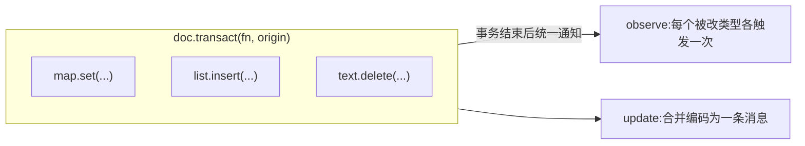

import { Canvas, Controls, Meta } from '@storybook/addon-docs/blocks';
import * as Stories from './transactions-and-events.stories';

<Meta of={Stories} name="Docs" />

# 事务与变更事件

yjs 的所有修改都发生在事务（transaction）中。不显式包裹时，每次 `map.set`、`array.insert` 各自开启一个事务；用 `doc.transact(fn)` 把一组修改包进一个事务后，事务结束才统一通知：每个被改类型的 `observe` 只触发一次，文档的 `update` 只发出一条。事务还能携带一个 `origin` 来源标签，事件回调靠事件对象（Y.Event）知道「改了什么、改在哪里」，靠 `origin` 知道「是谁发起的」。

理解本课依次回答四个问题：怎样合并多次修改（transact）、事件回调能读到什么（keys / delta / path）、怎样标记变更来源（origin）、一次事务里事件按什么顺序触发（Y.Doc 生命周期）。



| 对象 | 签名 / 默认值 | 回查要点 |
| --- | --- | --- |
| `doc.transact(f, origin?)` | 返回 `f` 的返回值；`origin` 默认 `undefined` | 嵌套调用并入外层事务 |
| `type.observe(f)` | `f: (event, transaction) => void` | 事务结束后触发；只看直接修改 |
| `type.observeDeep(f)` | `f: (events, transaction) => void` | 自身与所有后代类型的事件数组 |
| `event.keys` | `Map<key, { action, oldValue }>`，`action` 为 `'add' \| 'update' \| 'delete'` | Y.Map 与 Y.Xml 属性的变化 |
| `event.delta` | `Array<{ retain? / insert? / delete? }>` | Y.Array 与 Y.Text 的变化 |
| `event.target` / `event.currentTarget` | 被改类型 / 挂回调的类型 | `observe` 时二者相同 |
| `event.path` | `Array<string \| number>` | 从挂回调类型到被改类型的路径 |
| `transaction.origin` | `transact` 第二参，默认 `undefined` | `observe` 与 `update` 回调都能读到 |
| `transaction.local` | 本地修改恒为 `true` | `applyUpdate` 产生的事务为 `false` |
| `doc.on('update', f)` | `f: (update, origin, doc, transaction) => void` | 同步协议的增量编码出口 |

## 事务：合并多次修改

每次修改共享类型都会开启一个事务。事务合并的价值在通知侧：一个事务内无论改多少处，每个被直接修改类型的 `observe` 只在事务结束后触发一次，`doc` 的 `update` 事件也只发出一条合并后的增量编码。修改越集中，渲染回调和网络消息越少。

```ts
import * as Y from 'yjs';

const doc = new Y.Doc();
const map = doc.getMap('form');

map.observe(() => console.log('observe 触发'));
doc.on('update', () => console.log('update 发出'));

doc.transact(() => {
  map.set('title', '周报');
  map.set('done', false);
  map.set('owner', 'alice');
});
// 三次 set,observe 与 update 各只触发一次
```

下面实例按输入重放对同一个 Y.Map 的连续修改，统计两类通知的触发次数：

<Canvas of={Stories.Batching} />
<Controls of={Stories.Batching} />

| 读者操作 | 可观察证据 |
| --- | --- |
| 「修改次数」调到 5，保持「合并为一个事务」开启 | 修改泳道 5 个方块，`observe` 与 `update` 泳道各 1 个圆点 |
| 关闭「合并为一个事务」 | `observe` 与 `update` 泳道变为 5 个圆点，与修改一一对应 |

边界：

- 嵌套 `transact` 不会开新事务：内层修改并入外层，事件仍只触发一轮。
- 空事务（`fn` 里没有实际修改）不触发 `observe` 与 `update`，但 `beforeTransaction` / `afterTransaction` 仍会触发（见事务生命周期）。
- 一个事务改了多个类型：每个被改类型的 `observe` 各触发一次，合并以「类型 × 事务」为单位。
- `transact` 返回 `fn` 的返回值，可直接取出事务内计算的结果。

## 变更事件：Y.Event

事务结束后，yjs 为每个被直接修改的类型创建一个事件对象，传给该类型的 `observe` 回调，签名是 `(event, transaction)`。`event` 回答「这个类型改了什么」：Y.Map（及 Y.Xml 的属性）用 `event.keys`，Y.Array 与 Y.Text 用 `event.delta`；定位信息对所有类型通用——`target` 是被改类型，`currentTarget` 是挂回调的类型，`transaction` 指向所在事务。

### Y.Map:keys

`event.keys` 是一个 Map，键是被改的属性名，值是 `{ action, oldValue }`：

- `action: 'add'`：新增键，`oldValue` 为 `undefined`
- `action: 'update'`：覆盖已有键，`oldValue` 是事务开始前的值
- `action: 'delete'`：删除键，`oldValue` 是被删掉的值

同事务同一键写多次，`keys` 里只有一条记录，`oldValue` 取事务开始前的值，不是中间值：

```ts
const doc = new Y.Doc();
const map = doc.getMap('task');
map.set('title', 'v0');

map.observe((event) => {
  event.keys.forEach((change, key) => {
    console.log(key, change.action, change.oldValue);
  });
});

doc.transact(() => {
  map.set('title', 'v1');
  map.set('title', 'v2');
});
// 只打印一行:title update v0
```

只关心「哪些键变了」时，`YMapEvent` 上的 `keysChanged: Set<string>` 比遍历 `keys` 更便宜。

### Y.Array 与 Y.Text:delta

`event.delta` 用 delta 格式描述列表变化：`retain` 跳过、`insert` 插入、`delete` 删除，按顺序回放即可把旧状态改成新状态：

```ts
const doc = new Y.Doc();
const list = doc.getArray('tags');
list.insert(0, ['A', 'B', 'C']);

list.observe((event) => console.log(event.delta));

doc.transact(() => {
  list.delete(1, 1);          // 删掉 'B'
  list.insert(1, ['X', 'Y']); // 原位插入 'X'、'Y'
});
// [{ retain: 1 }, { insert: ['X', 'Y'] }, { delete: 1 }]
```

Y.Text 事件的 `delta` 格式相同，`insert` 换成字符串，例如 `text.delete(5, 6)` 产生 `[{ retain: 5 }, { delete: 6 }]`。

边界：

- `event.changes` 一次给出 `{ added, deleted, keys, delta }`；其中 `added` / `deleted` 是内部 Item 集合，日常只用 `keys` / `delta`。
- `delta`、`keys`、`changes` 都是计算属性，只在事件回调期间保证算对。要在回调外使用，回调里先把值取出来存普通对象，不要存 `event` 或 `transaction` 本身。

### 嵌套类型：observeDeep 与 path

`observe` 只看本类型的直接修改；改嵌套的子类型时，在父类型上挂 `observeDeep`，回调收到自身与所有后代类型的事件数组 `(events, transaction)`。此时用三个定位属性区分「改在哪」：

- `event.target`：真正被改的类型
- `event.currentTarget`：挂着 `observeDeep` 的类型
- `event.path`：从 `currentTarget` 到 `target` 的键 / 下标序列，沿它逐层 `get` 正好走到 `target`

```ts
const doc = new Y.Doc();
const root = doc.getMap('root');
const child = new Y.Map<string>();
root.set('child', child);

root.observeDeep((events) => {
  events.forEach((event) => {
    console.log(event.path, event.target === child, event.currentTarget === root);
  });
});

child.set('title', 'hello');
// ['child'] true true
```

挂在 `root` 上的普通 `observe` 收不到这条事件——只有 `root` 自己的键被增删改时才触发。

## origin：标记变更来源

`doc.transact(fn, origin)` 的第二参存到 `transaction.origin`，随事务传递：`observe` 回调的第二参 `transaction.origin`、`update` 事件的第二参 `origin` 都能读到。origin 可以是任意值，实践中用语义化字符串常量。

它的典型用途是识别「这次变更来自谁」：本地多个入口（编辑器、工具栏、快捷键）改同一份数据时，回调据此跳过自己发起的回声更新。yjs 生态也按此约定协作——Provider 应用远程更新时带固定 origin，UndoManager 用 `trackedOrigins` 圈定哪些事务进撤销栈。

```ts
doc.transact(() => map.set('title', '来自工具栏'), 'toolbar');

map.observe((event, transaction) => {
  console.log(transaction.origin); // 'toolbar'
});
doc.on('update', (update, origin) => {
  console.log(origin); // 'toolbar'
});
```

远程更新的 origin 由接收方指定：`Y.applyUpdate(doc, update, origin)` 的第三参成为该事务的 origin，且 `transaction.local` 为 `false`（本地修改恒为 `true`）。同步协议本身见[文档更新与同步协议](?path=/docs/document-updates--docs)，撤销作用域见[撤销与重做](?path=/docs/undo-manager--docs)，本课不展开。

下面实例在预置数据上重放所选操作，观察最近一次事件的载荷与 origin：

<Canvas of={Stories.Payload} />
<Controls of={Stories.Payload} />

| 读者操作 | 可观察证据 |
| --- | --- |
| 切换「操作」为「更新已有键」 | 右侧 `keys` 显示 `title → update`,`oldValue` 是事务前的 `'项目草稿'` |
| 切换「操作」为「新增键」/「删除键」 | `keys` 的 `action` 相应变为 `add` / `delete` |
| 切换「操作」为「同事务同键写两次」 | `keys` 仍只有一条 `title` 记录，`oldValue` 仍是事务前的值 |
| 切换「操作」为「编辑数组」 | 载荷变为 `delta`,`retain` / `insert` / `delete` 三项按序排列 |
| 切换「origin 标签」 | `origin` 读数跟随变化；选「（不传）」时显示 `undefined` |

## 事务生命周期

一次事务在 Y.Doc 上触发的事件有固定顺序，已按 yjs 13.6 核实：


| 事件 | 回调签名 | 时机与用途 |
| --- | --- | --- |
| `beforeAllTransactions` | `(doc)` | 一轮事务清理开始前；一轮可包含多个事务 |
| `beforeTransaction` | `(transaction, doc)` | `fn` 执行之前 |
| `beforeObserverCalls` | `(transaction, doc)` | `fn` 执行完、`observe` 回调之前 |
| `afterTransaction` | `(transaction, doc)` | `observe` 回调之后；UndoManager 在此收集撤销项 |
| `afterTransactionCleanup` | `(transaction, doc)` | 内部清理之后、update 编码之前 |
| `update` | `(update, origin, doc, transaction)` | 事务的增量编码，Provider 据此广播 |
| `updateV2` | 同 `update` | 实验性编码格式，官方建议勿用于生产 |
| `afterAllTransactions` | `(doc, transactions)` | 一轮事务全部结束 |

要点：

- `beforeAllTransactions` / `afterAllTransactions` 包的是「一轮」：一次 `transact` 若触发级联清理，一轮里可跑多个事务。
- 空事务仍触发 `beforeTransaction` / `afterTransaction`，但不产生 `observe` 与 `update`。
- `update` 的载荷 `Uint8Array` 是同步协议的主角，本课只需记住「一个事务一条 update」。

## 最佳实践

- 能合并就合并：表单多字段保存、批量导入、拖动结束后的落库，把相关修改放进一个 `transact`,UI 重渲染和 `update` 消息都只做一次。
- origin 约定一组常量：团队内固定 `'editor'` / `'toolbar'` 之类的标签，回调只用它判断「谁发起」，不要在 origin 上挂复杂业务分支。
- `observe` 回调只做派生：刷新界面、写日志、上报。不要回写文档（见常见问题第一条）。

## 常见问题

- `observe` 回调里又修改了文档，回调被反复触发甚至死循环。
  回调里的修改会在当前事务结束后另开新事务，新事务又触发回调。先把修改移出回调；确需级联修改时给本入口的 `transact` 传固定 origin，回调开头判断 `transaction.origin` 是自己的就直接返回。
- 把 `event` 存起来稍后再读 `delta`，结果对不上。
  `delta` / `keys` / `changes` 是计算属性，只在事件回调期间保证正确。回调里先取出 `event.delta` 存普通对象；不要存 `event` 或 `transaction` 本身。
- 调了 `transact` 但 `observe` / `update` 都没触发。
  `fn` 里没有实际修改时是空事务，不产生 `observe` 与 `update`；但 `beforeTransaction` / `afterTransaction` 仍会触发，可用后者区分「没执行」和「执行了但没改动」。

## 总结回顾

摘要：

事务是 yjs 变更的通知单位。不显式包裹时每次修改 API 各成一个事务；`doc.transact` 把一组修改合并，事务结束后每个被改类型的 `observe` 只触发一次、文档的 `update` 只发一条；嵌套 `transact` 并入外层，空事务不触发回调。事件对象描述改了什么：Y.Map 用 `keys`（每个被改键一条 `action` + 事务前的 `oldValue`),Y.Array / Y.Text 用 `delta`(`retain` / `insert` / `delete`)；嵌套结构在父类型上挂 `observeDeep` 拿事件数组，用 `path` / `target` / `currentTarget` 定位。`origin` 是随事务传递的来源标签，`observe` 与 `update` 都读得到，是 Provider 与 UndoManager 识别自己事务的约定机制。Y.Doc 还暴露从 `beforeTransaction` 到 `afterAllTransactions` 的完整生命周期，`update` 在其中承担同步出口。

一句话：

> 相关修改放进一个事务，通知与网络消息就合并成一次；事件回调靠 `keys` / `delta` 知道改了什么，靠 `origin` 知道是谁改的。

知识要点：

- 一个事务里修改 N 次，`observe` 触发几次？分 N 个事务呢？
- 嵌套调用 `transact` 会开几个事务？空事务会触发 `observe` 吗？
- Y.Map 事件的 `keys` 里 `action` 有哪几种？`oldValue` 是哪个时刻的值？
- 同事务同一键写多次，`keys` 里能看到几条记录？
- Y.Array / Y.Text 事件的 `delta` 各项含义是什么？为什么不能把 `event` 存到回调外再读？
- `observeDeep` 回调里怎么判断事件发生在哪个子类型上？
- `origin` 在哪里设置、在哪些回调里能读到？`applyUpdate` 产生的事务 `origin` 与 `local` 是什么？
- 一次事务中 Y.Doc 事件按什么顺序触发？`update` 事件的载荷是什么？

## 参考资料

- [Y.Event API - Yjs 官方文档](https://docs.yjs.dev/api/y.event)
- [Y.Doc API - Yjs 官方文档](https://docs.yjs.dev/api/y.doc)
- [yjs 官方仓库](https://github.com/yjs/yjs)
