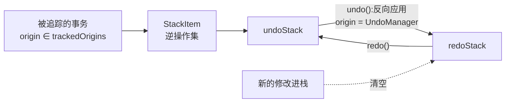

import { Canvas, Controls, Meta } from '@storybook/addon-docs/blocks';
import * as Stories from './undo-manager.stories';

<Meta of={Stories} name="Docs" />

# 撤销与重做

Y.UndoManager 给共享类型提供撤销/重做能力。它挂在 Y.Doc 的事务流上（`afterTransaction`)，把每个「被追踪的事务」的逆操作压成一个 StackItem 存进撤销栈：`undo()` 弹出栈顶、反向应用（删掉当时插入的、恢复当时删除的），逆操作再进重做栈，`redo()` 反之。撤销本身也是一个事务——它的 origin 是 UndoManager 实例，因此会触发 `observe`、产生 `update` 同步给其他客户端。

协作场景的关键设计在 `trackedOrigins`：默认只追踪没有 origin 的本地事务（远端更新经 Provider 应用时带固定 origin，天然不进栈），所以默认配置下撤销只回滚自己的改动。理解本课依次回答五个问题：撤销以什么为单位记录（StackItem 与两条栈）、一次撤销撤回多少（captureTimeout 与 stopCapturing）、哪些事务进栈（trackedOrigins 与 captureTransaction）、协作时怎样只撤自己的改动（origin 配方与远端保护）、怎样监听栈变化（事件与 StackItem.meta)。



| 构造选项 | 默认值 | 回查要点 |
| --- | --- | --- |
| `typeScope`（第一参） | 必填 | 类型 / 类型数组 / `Y.Doc`；只捕获作用域内（含子类型）的变更 |
| `captureTimeout` | `500` | 间隔小于该毫秒数的连续修改合并为一步；`0` 表示每步独立 |
| `trackedOrigins` | `new Set([null])` | 只追踪集合内 origin 的事务；构造器自动把 UndoManager 自身加入集合 |
| `captureTransaction` | `() => true` | 返回 `false` 的事务整个不捕获，按事务过滤 |
| `deleteFilter` | `(item) => true` | undo/redo 时返回 `false` 的 Item 不被删除；按内部 Item 粒度判断，相邻同客户端 Item 可能被 yjs 合并 |
| `ignoreRemoteMapChanges` | `false` | 实验性；开启后撤销可覆盖远端对同一键（Y.Map / Xml 属性）的修改 |
| `doc` | 从 `typeScope` 推断 | 仅当 `typeScope` 为空数组时必须显式传 |

| 方法 / 属性 | 签名 | 回查要点 |
| --- | --- | --- |
| `undo()` / `redo()` | `() => StackItem \| null` | 返回被应用的栈项；栈空或变更已不可应用时返回 `null` |
| `canUndo()` / `canRedo()` | `() => boolean` | 两条栈是否非空 |
| `stopCapturing()` | `() => void` | 切断合并：下一次修改必开新的 StackItem |
| `clear()` | `() => void` | 清空两条栈，触发 `stack-cleared` |
| `addToScope(types)` | 类型 / 类型数组 | 运行期扩展作用域 |
| `addTrackedOrigin(o)` / `removeTrackedOrigin(o)` | origin 任意值 | 运行期调整追踪集合 |
| `undoStack` / `redoStack` | `Array<StackItem>` | 只读使用；`StackItem.meta` 是个 Map，可挂元数据 |
| `undoing` / `redoing` | `boolean` | 是否正在执行 undo/redo |
| `destroy()` | `() => void` | 解绑监听；`doc` 销毁时自动调用 |

## 快速上手

```ts
import * as Y from 'yjs';

const doc = new Y.Doc();
const text = doc.getText('note');
const undoManager = new Y.UndoManager(text);

text.insert(0, 'hello');
undoManager.stopCapturing(); // 切段:下一次输入成为独立一步
text.insert(5, ' world');

undoManager.undo();
console.log(text.toString()); // 'hello'
undoManager.redo();
console.log(text.toString()); // 'hello world'
```

两次插入若不在中间调 `stopCapturing()`，默认会因捕获窗口合并成一步，一次 `undo()` 全部撤回。合并规则见下文「撤销粒度」。

## 撤销栈：StackItem 与 undo/redo

每个被追踪的事务产生一个 StackItem：它记录该事务插入内容的 DeleteSet 与删除内容的 DeleteSet，撤销就是「删掉当时插入的 + 恢复当时删除的」。两条栈的行为：

- `undo()` 弹出 `undoStack` 栈顶，反向应用后把逆操作压入 `redoStack`;`redo()` 反之。
- undo/redo 在一个 origin 为 UndoManager 实例自身的事务中执行，所以撤销会触发 `observe`、会经 `update` 同步给远端；回调里用 `transaction.origin === undoManager` 即可识别撤销事务。
- 任何新的被追踪修改进栈时，`redoStack` 被清空（与浏览器「新输入清掉前进历史」同理）。

```ts
const popped = undoManager.undo();
if (popped === null) {
  // 栈空,或栈顶变更已被远端覆盖/删除,没有可应用的内容
}

doc.on('update', (update, origin) => {
  console.log(origin === undoManager); // undo/redo 产生的 update,origin 是 UndoManager 实例
});
```

边界：

- 撤销不会复活已被远端删除的内容，也不覆盖远端对同一键写入的新值——此时 `undo()` 返回 `null`（详见「协作撤销」)。
- 连续两次 `undo()` 不会合并：undo 结束时内部自动切段，每次 undo 恰好弹出一项。
- `undoStack` / `redoStack` 可读取做界面状态（如禁用按钮），不要直接改。

## 撤销粒度：captureTimeout 与 stopCapturing

一次撤销撤回多少内容，由捕获窗口决定：上一笔被捕获的修改结束后，间隔小于 `captureTimeout`（默认 500ms）的下一笔修改并入栈顶 StackItem（触发 `stack-item-updated`)，否则开出新的 StackItem（触发 `stack-item-added`)。两个调参手段：

- `captureTimeout`：构造时设定。调大让长时间连续输入仍算一步；设为 `0` 则每个事务各成一步。
- `stopCapturing()`：运行期手动切段，下一次修改必开新的一步。光标移动、失焦、保存之后是典型时机。

```ts
ytext.insert(0, 'a');
undoManager.stopCapturing(); // 拿掉这行,undo 一次会连 'a' 一起撤掉
ytext.insert(1, 'b');
undoManager.undo();
ytext.toString(); // => 'a'
```

下面实例逐字符模拟连续输入，用 `stack-item-added` / `stack-item-updated` 事件给每个字符标注它落入的撤销步，再执行一次 undo:

<Canvas of={Stories.Grouping} />
<Controls of={Stories.Grouping} />

| 读者操作 | 可观察证据 |
| --- | --- |
| 「captureTimeout」选 500ms（默认），输入 4 字 | 4 个字符同色，撤销栈 1 步；undo 一次撤回全部 4 字 |
| 「captureTimeout」选 0ms | 4 个字符 4 种颜色，撤销栈 4 步；undo 一次只撤最后一字 |
| 500ms 下开启「中途 stopCapturing」 | 前后两段不同色，撤销栈 2 步；undo 一次只撤后半段 |

边界：

- 合并按真实墙钟时间判定，不是事务个数；调试时用 `stopCapturing()` 切段比等待超时可靠。
- `captureTimeout: 0` 时 `stopCapturing()` 没有额外效果——每笔本来就各成一步。

## 追踪范围：trackedOrigins 与 captureTransaction

`trackedOrigins` 决定哪些事务进栈，匹配规则是「事务的 origin 等于集合成员，或 origin 是集合中某个类的实例」。默认 `new Set([null])`：裸调用（`map.set`、`doc.transact(fn)` 不传第二参）的事务 origin 为 `null`，被追踪；一旦修改带了 origin（如 `doc.transact(fn, 'editor')`)，就必须把该 origin 显式放进集合，否则不进栈。

```ts
const undoManager = new Y.UndoManager(text, {
  trackedOrigins: new Set(['editor', null]), // 两类本地入口都追踪
});

doc.transact(() => text.insert(0, '来自编辑器'), 'editor'); // 进栈
doc.transact(() => text.insert(0, '来自系统'), 'system');   // 不进栈

undoManager.addTrackedOrigin('toolbar');    // 运行期追加
undoManager.removeTrackedOrigin('toolbar'); // 运行期移除
```

要点：

- 构造器会把 UndoManager 实例自身加入集合（所以 undo/redo 的逆操作也能进对侧栈）;`origin` 是任意值，编辑器绑定常把绑定类的实例或类本身放进去。
- `captureTransaction: (transaction) => boolean` 是函数级过滤：返回 `false` 的事务整个不捕获，适合按事务内容或时机排除（如批量导入、初始化回填）。
- 已实测：默认配置下 `doc.transact(fn, 'editor')` 不进栈；自定义集合后 `null`（无 origin 的裸修改）也不再进栈，除非显式加入。

## 协作撤销：只回滚自己的改动

远端更新经 `Y.applyUpdate(doc, update, origin)` 应用，Provider 会带固定 origin(y-websocket 用 provider 实例），与本地事务天然可区分(origin 机制本身见[事务与变更事件](?path=/docs/transactions-and-events--docs))。默认 `trackedOrigins` 只含 `null`，远端事务不进栈——这就是「撤销只回滚自己改动」的机制来源。反之，把远端 origin 加进 `trackedOrigins`，撤销就会回滚别人的内容：

<Canvas of={Stories.Collaborative} />
<Controls of={Stories.Collaborative} />

| 读者操作 | 可观察证据 |
| --- | --- |
| 关闭「trackedOrigins 含 'remote'」（默认） | A 撤销栈深度 1（只有 A 的「甲」);undo 后双方文本为「乙」,B 的输入原样保留 |
| 开启「trackedOrigins 含 'remote'」 | 栈深度 2,B 的「乙」在栈顶；A 的一次 undo 回滚了 B 刚写的「乙」，双方文本为「甲」 |

协作场景的推荐配方：本地编辑入口统一打 origin（编辑器绑定通常自动使用绑定类实例）,`trackedOrigins` 只配本地入口的 origin，绝不含 Provider 的 origin:

```ts
const undoManager = new Y.UndoManager(text, {
  trackedOrigins: new Set(['editor']), // 只追踪本地编辑入口
});
doc.transact(() => text.insert(0, '本地输入'), 'editor');
```

远端保护（已按 yjs 13.6 实测）:

- 远端覆盖了同一 Y.Map 键：undo 不覆盖远端新值，返回 `null`；实验选项 `ignoreRemoteMapChanges: true` 才允许强制恢复旧值。
- 远端删除了你插入的内容：undo 不复活它，返回 `null`。
- 撤销产生的逆操作是普通事务，经同步协议到达对端，两端文本保持一致（见实例读数）。

## 作用域：scope 与多类型绑定

构造第一参 `typeScope` 圈定撤销边界：只捕获作用域内（含嵌套子类型）的变更，scope 外的修改不进栈，`undo()` 也不碰。

```ts
const undoManager = new Y.UndoManager([doc.getText('body'), doc.getMap('meta')]);
undoManager.addToScope(doc.getArray('comments')); // 运行期扩展

// 传整个 Y.Doc:文档内任意类型的修改都进栈
const everything = new Y.UndoManager(doc);
```

边界：scope 内的类型必须属于同一个 Y.Doc，跨文档撤销需要社区方案 MultiDocUndoManager(yjs#509)，本课不展开。

## 栈事件与 StackItem.meta

四个事件覆盖栈的全部变化，可据此驱动界面（禁用态、提示）或挂元数据：

| 事件 | 回调载荷 | 触发时机 |
| --- | --- | --- |
| `stack-item-added` | `{ stackItem, origin, type, changedParentTypes }`，第二参是 UndoManager | 新的 StackItem 进栈 |
| `stack-item-updated` | 同上 | 捕获窗口内连续修改合并进栈顶 |
| `stack-item-popped` | 同上，`origin` 为 UndoManager 自身 | `undo()` / `redo()` 弹出栈项 |
| `stack-cleared` | `{ undoStackCleared, redoStackCleared }` | `clear()`，或新修改清空 redo 栈 |

载荷里的 `type` 取 `'undo' | 'redo'`，标识事件发生在哪条栈（撤销栈 / 重做栈）。

`StackItem.meta` 是一个 Map，官方推荐用它存光标等编辑现场，撤销时恢复：

```ts
undoManager.on('stack-item-added', (event) => {
  event.stackItem.meta.set('cursor', getCursorPosition());
});
undoManager.on('stack-item-popped', (event) => {
  restoreCursor(event.stackItem.meta.get('cursor'));
});
```

`destroy()` 解除对 `doc` 的监听（`doc` 销毁时自动调用）；编辑器卸载、路由离开时手动调用即可。

## 最佳实践

- 编辑器接入：用编辑器绑定的 origin（或约定的字符串常量）配置 `trackedOrigins`，只含本地入口；Provider 的 origin 永远不进集合。
- 切段时机：光标移动、输入停顿超窗口、失焦、保存之后调 `stopCapturing()`；命令式操作（按钮逐个执行、每步都要独立撤销）直接 `captureTimeout: 0`。
- 光标随行：`stack-item-added` 时把光标位置写进 `stackItem.meta`,`stack-item-popped` 时读回恢复，撤销后光标回到当时的编辑位置。

## 常见问题

- 撤销把别人刚写的内容回滚了。
  `trackedOrigins` 里混进了远端事务的 origin(Provider 实例或手动 `applyUpdate` 用的标签）。只保留本地编辑入口的 origin；对照「协作撤销」实例确认栈深度，远端改动进栈即配置有误。
- 连续敲的一大段字，一次撤销全没了（或想逐字撤销）。
  捕获窗口合并所致：默认 500ms 内的连续修改算一步。想缩小粒度就调低 `captureTimeout`（或设 `0`)；想在窗口内强制切段，在输入停顿、光标移动时调 `stopCapturing()`。
- 调了 `undo()` 什么都没发生（返回 `null`)。
  两种典型原因：修改所在事务的 origin 不在 `trackedOrigins`（默认只追踪无 origin 的裸修改，带 origin 的本地入口必须显式配置）；或该变更已被远端覆盖/删除，没有可应用的内容。用 `canUndo()` 区分：栈空是前者，栈非空是后者。
- undo 没有恢复被远端改过的 Y.Map 键。
  这是默认的保护行为：UndoManager 不覆盖远端修改。确需强制恢复旧值时开启实验选项 `ignoreRemoteMapChanges`，注意它会覆盖远端对同一键的写入。

## 总结回顾

摘要：

Y.UndoManager 挂在 Y.Doc 的事务流上，把每个被追踪事务的逆操作压成 StackItem 存进 `undoStack`;`undo()` 弹出栈顶反向应用、逆操作进 `redoStack`，撤销本身是 origin 为 UndoManager 实例的事务，会触发 `observe` 并同步给远端。撤销粒度由 `captureTimeout`（默认 500ms 内连续修改合并为一步）与 `stopCapturing()`（强制切段）决定；追踪范围由 `trackedOrigins`（默认只含 `null`，匹配 identity 或类实例）与 `captureTransaction` 函数决定。协作场景下远端更新带 Provider 的固定 origin，天然不进栈，撤销因此只回滚自己的改动；且默认不覆盖远端对同一键的新值、不复活远端已删内容。`typeScope` 圈定撤销边界（类型、类型数组或整个 `Y.Doc`),`stack-item-added` / `stack-item-updated` / `stack-item-popped` / `stack-cleared` 四个事件配合 `StackItem.meta` 支撑界面状态与光标恢复。

一句话：

> 撤销栈只追踪 `trackedOrigins` 圈定的事务——配好 origin，撤销就只回滚自己的改动；配错 origin，撤销就会动别人的内容。

知识要点：

- StackItem 记录什么？`undo()` / `redo()` 在什么事务里执行，origin 是什么？
- `captureTimeout` 默认值是多少？合并规则与 `stopCapturing()` 的作用分别是什么？
- 默认 `trackedOrigins` 追踪哪些事务？带 origin 的本地修改怎样才能进栈？
- 协作场景默认配置为什么只撤销自己的改动？把远端 origin 加进 `trackedOrigins` 会怎样？
- 远端覆盖了同一键、或删掉了你插入的内容时，`undo()` 的行为和返回值是什么？
- 新的修改进栈时 `redoStack` 会怎样？`undo()` / `redo()` 返回值是什么？
- `typeScope` 接受哪几种取值？`captureTransaction` 与 `deleteFilter` 各自过滤什么？
- 四个栈事件各自何时触发，载荷里的 `type` 指什么？`StackItem.meta` 的典型用途？

## 参考资料

- [UndoManager API - Yjs 官方文档](https://docs.yjs.dev/api/undo-manager)
- [yjs 官方仓库](https://github.com/yjs/yjs)
