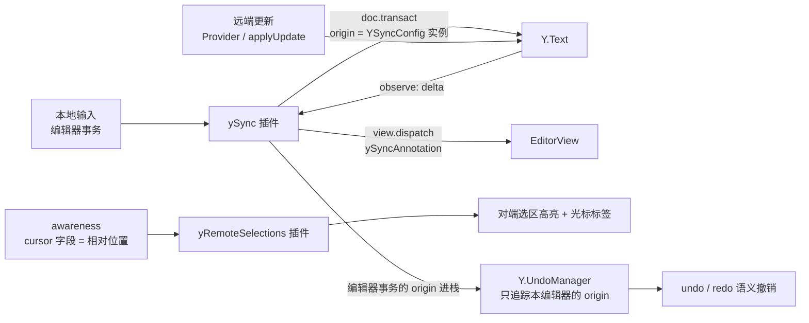

import { Canvas, Controls, Meta } from '@storybook/addon-docs/blocks';
import * as Stories from './y-codemirror.stories';

<Meta of={Stories} name="Docs" />

# CodeMirror 绑定

y-codemirror.next 把 CodeMirror 6 接进 yjs 协同体系,核心是一个 `yCollab` 扩展工厂:传入共享的 `Y.Text` 与 awareness 实例,它一次挂上三件事——**同步**(本地输入写回 Y.Text、远端更新回写编辑器)、**远程光标与选区**(经 awareness 渲染其他端的光标与选区)、**撤销**(把 Yjs UndoManager 接到编辑器,而不是用 CodeMirror 自带 history)。CodeMirror 自身的语言高亮、主题、按键生态不属本课;绑定课程只讲 yjs 侧的映射与协同行为。本课行为均按 y-codemirror.next 0.3.6 源码与浏览器实测核对。

理解本课依次回答四个问题:`yCollab` 怎样在 Y.Text 与 EditorView 之间建立不回环的双向同步、远程光标的颜色名字和位置各来自哪里、撤销为什么必须走 Yjs 而不是 CM history、组装扩展时各个件放在什么位置。



| 成员 / 字段 | 签名 / 默认值 | 回查要点 |
| --- | --- | --- |
| `yCollab(ytext, awareness, opts?)` | 返回 `Extension` 数组 | 一次挂全三件;`awareness` 传 `null` 则不装远程选区插件 |
| `opts.undoManager` | 默认 `new Y.UndoManager(ytext)` | 传自建实例获得编程访问;传 `false` 整组不装 |
| `awareness.user` | `{ name, color, colorLight }` | 远程光标的标签与配色;缺省渲染 `Anonymous` / `#30bced` / `color + '33'` |
| `awareness.cursor` | `{ anchor, head }`(相对位置) | 由 yRemoteSelections 自动写入与读取,业务侧一般不直接操作 |
| `yUndoManagerKeymap` | `Mod-z` / `Mod-y`(Mac `Mod-Shift-z`) | 不自动挂;须 `keymap.of()` 引入,且放在 `basicSetup` **之前** |
| `ySyncFacet` | `Facet<YSyncConfig>` | `view.state.facet(ySyncFacet)` 取配置,做自定义位置换算 |
| `YRange` | 相对位置对(yanchor / yhead) | 可 JSON 序列化的选区,批注、高亮等自定义锚点用 |

## 快速上手

```ts
import * as Y from 'yjs';
import { WebrtcProvider } from 'y-webrtc'; // 任意 Provider,awareness 由它创建维护
import { EditorState } from '@codemirror/state';
import { EditorView, keymap } from '@codemirror/view';
import { yCollab, yUndoManagerKeymap } from 'y-codemirror.next';

const ydoc = new Y.Doc();
const provider = new WebrtcProvider('demo-room', ydoc);
const ytext = ydoc.getText('codemirror');
const undoManager = new Y.UndoManager(ytext); // 自建实例,保留编程访问

const view = new EditorView({
  state: EditorState.create({
    doc: ytext.toString(), // 初始内容取自 Y.Text,此后它才是真值
    extensions: [
      yCollab(ytext, provider.awareness, { undoManager }),
      keymap.of(yUndoManagerKeymap), // 放在 basicSetup 之前,Mod-z 才走 Yjs 撤销
    ],
  }),
  parent: document.body,
});
```

三个组件各就各位后,编辑器里打字即写 `Y.Text`,对端更新即回写编辑器,`Mod-z` 撤销自己的修改并同步给对端。每一步的机制在下面三个小节展开。

## 同步:Y.Text 与编辑器的双向绑定

`yCollab` 的同步由 ySync 插件承担,它维护两条单向通道,合起来是一个不回环的闭环:

- **本地 → Y.Text**:编辑器每次文档变更,插件把变更区间换算成 `ytext.delete` / `ytext.insert`,包进 `ytext.doc.transact(fn, ySyncConfig)`——事务 origin 是本端的 `YSyncConfig` 实例,这是「改动由这个编辑器产生」的标记。
- **远端 → 编辑器**:Y.Text 的 `observe` 收到 delta,若事务 origin 不是本端 `YSyncConfig`(即来自 Provider 的 `applyUpdate`),就换算回 CodeMirror 的 changes 并 `view.dispatch`,事务带 `ySyncAnnotation`;插件看到这个注解就知道改动已进编辑器,不再写回 Y.Text——**origin 与注解各挡一个方向的回环**。

```ts
import { ySyncFacet } from 'y-codemirror.next';

// 组装后,编辑器内容以 Y.Text 为真值(接线见上方快速上手)。
// 需要「改动是否来自本编辑器」的判断时,取回本端配置——它就是本地事务的 origin:
const ysync = view.state.facet(ySyncFacet);
ytext.observe((_event, tr) => {
  if (tr.origin !== ysync) {
    // 远端更新。编辑器马上会收到,业务侧无需自行搬运
  }
});
```

下面实例把两个 Y.Doc 当作两个客户端,手写中继互发文档更新与 awareness 消息(正是 Provider 的角色)。直接点进任一编辑器输入,另一端立即出现同样的文本;「中继连接」开关模拟断网:

<Canvas of={Stories.DualEditor} />
<Controls of={Stories.DualEditor} />

| 读者操作 | 可观察证据 |
| --- | --- |
| 在 A 编辑器输入 | B 立即出现同样文本;读数「B 收到的最近 delta」以 `retain` / `insert` / `delete` 显示这次远端变更 |
| 关闭「中继连接」后输入 | A 照常编辑,B 不再跟随,「两端一致」变「不一致!」 |
| 重新开启「中继连接」 | 全量对答,离线期间的编辑补齐到 B,delta 读数随之更新 |
| 打开 Show code | 看到该 Canvas 实际执行的 `dual-editor-sync.ts`:中继、全量对答与 `yCollab` 接线 |

边界:

- 传入 `yCollab` 的 `ytext` 必须已集成进 Y.Doc(用 `doc.getText()` 获得)——本地通道要走 `ytext.doc.transact`,手写 `new Y.Text()` 传入会在本地输入时报错。
- 初始 doc 必须取 `ytext.toString()`;若编辑器从空文档开始而 Y.Text 已有内容,内容不会自动灌入,此后两端逐渐分叉。
- 断线期间编辑照常进 Y.Text,重连的对账由 Provider 完成;真实接线见 [y-websocket](?path=/docs/y-websocket--docs)。
- 远端更新进入编辑器的事务**没有**任何「别记进撤销历史」的标记——这正是下文 CM history 误用的根源。

## 远程光标与选区

yRemoteSelections 插件(`yCollab` 在传入 awareness 时自动挂上,连同它的主题样式)双向工作:

- **写**:每次视图更新,若编辑器有焦点且选区变化,把 `selection.main` 的 anchor / head 转成**相对位置**,写进本端 awareness 的 `cursor` 字段(内容没变就不重写,省广播)。相对位置锚定内容而非裸索引,并发插入后位置不漂移——协议细节见[相对位置](?path=/docs/relative-positions--docs)。
- **读**:遍历 awareness `states` 里其他客户端的 `cursor`,还原成本端绝对位置,渲染选区背景(`colorLight` 色)与光标 widget(`user.color` 色竖线 + 名字标签,悬停显示)。

光标的颜色与名字来自 awareness 的 `user` 字段:

```ts
provider.awareness.setLocalStateField('user', {
  name: '阿宁',
  color: '#30bced',
  colorLight: '#30bced33', // 选区背景的浅色变体;缺省自动取 color + '33'
});
```

上面双编辑器实例同样承担证据:把光标或选区放在 A 端,B 端立即出现 A 色光标与选区高亮,读数「A 的光标在 B 端视图」给出还原后的索引;反向同理。

| 读者操作 | 可观察证据 |
| --- | --- |
| 在 A 端放置光标或拖选 | B 端渲染 A 色光标与选区,悬停光标显示「用户A」 |
| 观察「A 的光标在 B 端视图」读数 | 索引随 A 端移动而变;B 端未聚焦时对 A 显示「无(对端尚未聚焦)」 |

边界:

- **失焦不清除**:字段只在「有焦点且选区变化」时更新;该端切走焦点后,对端仍显示它最后的位置,直到它重新聚焦、显式下线或 30 秒超时(见 [Awareness 与在线状态](?path=/docs/awareness--docs))。
- 光标所在内容被并发删除时,相对位置解析为 `null`,该端光标直接不渲染——相对位置的语义,不是绑定丢失状态。
- 两端 `doc.clientID` 相同会被插件当作「自己」跳过渲染;clientID 每次会话随机,冲突基本只出现在复制初始化代码时。

### 自定义锚点:YSyncConfig 与 YRange

绑定把「相对位置对」封装成 `YRange`(yanchor / yhead,可 JSON 序列化),远程选区内部用的就是它;做批注、评论、自定义高亮时可以复用同一套换算:

```ts
import { ySyncFacet, YRange } from 'y-codemirror.next';

const ysync = view.state.facet(ySyncFacet);
const ypos = ysync.toYPos(3); // 绝对索引 → 相对位置(assoc 控制贴靠方向)
ysync.fromYPos(ypos);         // → { pos, assoc },内容变化后自动适配
const yrange: YRange = ysync.toYRange(view.state.selection.main); // 选区 → 可广播的锚点
```

边界:`fromYPos` 对另一个文档的位置直接抛错;位置已被删除时返回 `null`,由调用方处理。实例读数里的光标索引就是 `fromYPos` 的结果。

## 撤销:走 Yjs,不要用 CM history

`yCollab` 的撤销件把 Yjs UndoManager 接进编辑器(通用撤销语义——StackItem、`captureTimeout`、`trackedOrigins`——见[撤销与重做](?path=/docs/undo-manager--docs),本课只讲绑定侧):

- 默认 `new Y.UndoManager(ytext)`,插件自动 `addTrackedOrigin(本端 YSyncConfig)`——**只有这个编辑器产生的输入进栈**,远端与 Provider 的事务天然不进栈,协作时撤销只回滚自己的改动。
- undo 在 Yjs 层语义化执行:逆操作作为普通事务同步给对端,两端一致;撤销前的选区存进 `StackItem.meta`,弹出时还原并滚动到原位。
- **CM 自带 history 不能共存**:它记录一切改变文档的事务——包括 ySync 同步进来的远端改动(没有排除标记);`Mod-z` 撤的是「本视图最近一次变更」,在协作里可能是别人刚写的字;撤销以「逆操作新事务」落地,又作为新编辑同步出去,把对方的文本删掉。两套历史互不知情,Yjs 栈还会继续记账。

下面实例对同一序列「A 输入甲 → B 输入乙 → A 撤销一次」分别用两套引擎重放,撤销入口与各自快捷键绑定的命令相同:

<Canvas of={Stories.UndoCompare} />
<Controls of={Stories.UndoCompare} />

| 读者操作 | 可观察证据 |
| --- | --- |
| 撤销引擎选「yCollab(Yjs UndoManager)」 | A 撤销后两端剩「乙」:只回滚 A 自己的「甲」,撤销同步给 B;A 的撤销栈清空 |
| 撤销引擎选「basicSetup 的 history(误用)」 | A 撤销后两端剩「甲」:这次撤销删掉的是 B 刚输入的「乙」,并作为 A 的新编辑同步出去 |
| 对照读数「A 的 Yjs 撤销栈」 | 误用模式下栈里剩 2 步——CM 的撤销本身又被 Yjs 记了一笔,两套历史互不知情 |

接线要点:

```ts
import { EditorView, keymap } from '@codemirror/view';
import { basicSetup } from 'codemirror';
import { yCollab, yUndoManagerKeymap } from 'y-codemirror.next';

const view = new EditorView({
  extensions: [
    keymap.of(yUndoManagerKeymap), // 放在 basicSetup 之前:CM 按键按扩展顺序解析,先声明者优先
    basicSetup,
    yCollab(ytext, awareness, { undoManager }),
  ],
  parent: mount,
});
```

- `yCollab` **不会**自动挂快捷键,只拦截 `beforeinput` 的 `historyUndo` / `historyRedo`——浏览器菜单里的「撤销 / 重做」也会转给 Yjs;键盘快捷键要自己 `keymap.of(yUndoManagerKeymap)`。
- 放置顺序是实测过的坑:把 keymap 放在 `basicSetup` **之后**,`Mod-z` 仍被它自带的 historyKeymap 抢走,撤销走的还是 CM history(CodeMirror 官方文档明确「先声明的 keymap 先被检查」)。
- 包入口**没有导出** `undo` / `redo` 命令;工具条等编程撤销要传自建 `undoManager` 实例,直接调 `.undo()` / `.redo()`,按钮态读 `undoStack.length`。
- 不需要撤销(如只读展示)传 `{ undoManager: false }`,撤销插件与 beforeinput 拦截整组不装。

## 最佳实践

- **组装清单**:内容同步用 `yCollab(ytext, awareness, { undoManager })`;快捷键 `keymap.of(yUndoManagerKeymap)` 放 `basicSetup` 之前;最干净的做法是不装 `history()`(自行组装所需扩展),退而求其次才是靠 keymap 顺序盖住 `Mod-z` / `Mod-y`。
- **user 字段配齐**:接入时 `setLocalStateField('user', { name, color, colorLight })`,远程光标才有可辨识的标签与配色;`colorLight` 直接取 `color + '33'` 即可与光标同色。
- **保留 undoManager 引用**:传自建实例而不是吃默认值,撤销按钮、栈深度展示、`stopCapturing()` 切段才有落点(用法见[撤销与重做](?path=/docs/undo-manager--docs))。
- **清理**:销毁编辑器调 `view.destroy()`——ySync 插件随之 unobserve Y.Text,yUndoManager 插件随之移除 trackedOrigin;`undoManager` 不再使用时调 `destroy()`。两者都不做会向 Y.Doc 泄漏监听。

## 常见问题

- 看不到对端的光标与选区。
  依次检查:创建 `yCollab` 时第二参是否传了 awareness(传 `null` 整组不装);对端是否写入 `user` 字段(缺省也能显示,显示为 Anonymous);两端 `doc.clientID` 是否相同(相同会被当作自己跳过);对端光标所在内容是否已被并发删除(相对位置解析为 `null` 时不渲染);断线一端的消息是否到达(awareness 30 秒超时判离线)。
- 按 `Mod-z` 撤销了别人刚写的字,或重做错乱。
  `basicSetup`(或 `history()` + `historyKeymap`)还在接管快捷键:CM 历史把远端同步进来的改动也记进栈,撤的是「本视图最近一次变更」。把 `keymap.of(yUndoManagerKeymap)` 放到 `basicSetup` 之前(放之后无效,顺序是先声明者优先),或干脆不装 `history()`;判断依据:撤销后**对端**文本也被改写,即 CM 历史在起作用(见撤销对照实例)。
- 想在代码里触发撤销,发现包里没有导出 `undo` 命令。
  包入口只导出 `yUndoManagerKeymap` 等成员,`undo` / `redo` 命令未导出;创建时传自建 `undoManager` 实例,直接对它调 `.undo()` / `.redo()`,与快捷键路径等价。

## 总结回顾

摘要:

y-codemirror.next 用一个 `yCollab(ytext, awareness, opts)` 把 CodeMirror 6 接进 yjs:同步由 ySync 插件承担,本地输入经 `doc.transact`(origin 是本端 YSyncConfig 实例)写回 Y.Text,远端更新经 observe 换算回编辑器并以 `ySyncAnnotation` 防回环,初始 doc 取 `ytext.toString()`,内容自此以 Y.Text 为真值。远程光标与选区由 yRemoteSelections 插件经 awareness 完成——本端把选区转成相对位置写进 `cursor` 字段,对端还原渲染,颜色与名字来自 `user` 字段(缺省 Anonymous / #30bced),自定义锚点可复用 `YSyncConfig` 的 `toYPos` / `fromYPos` / `toYRange` 与 `YRange`。撤销走 Yjs UndoManager:插件自动把本编辑器的 origin 加进追踪集合,undo 只回滚自己的改动并同步对端、恢复光标;CM 自带 history 会把远端改动记进本地栈,`Mod-z` 可能删掉别人的字并作为新编辑同步出去,必须不装它或用 `keymap.of(yUndoManagerKeymap)`(放在 `basicSetup` 之前)接管快捷键。

一句话:

> `yCollab` 之后,编辑器只是 Y.Text 的视图:内容以 Y.Text 为真值、光标锚在相对位置上、撤销走 Yjs——CM 自带 history 在协作里会撤掉别人的字,不要与它共存。

知识要点:

- `yCollab` 的三件产物各解决什么问题?`awareness` 传 `null`、`undoManager` 传 `false` 各关闭什么?
- 本地输入与远端更新各走哪条通道?防回环靠哪两个机制?
- 远程光标的颜色、名字、位置各来自哪里?失焦后对端为什么仍显示最后位置?
- `YRange` 与 `YSyncConfig` 的四个坐标方法各用于什么?位置被并发删除时行为是什么?
- 为什么 CM history 不能与 `yCollab` 共存?误用时两端的文本和 Yjs 撤销栈分别发生什么?
- `yUndoManagerKeymap` 为什么必须放在 `basicSetup` 之前?`beforeinput` 拦截覆盖哪个入口?
- 如何获得编程撤销能力?销毁编辑器时要清理什么?

## 参考资料

- [y-codemirror.next 官方仓库(README 与源码,本课行为按 0.3.6 核对)](https://github.com/yjs/y-codemirror.next)
- [Yjs 官方文档:Editor Bindings / CodeMirror](https://docs.yjs.dev/ecosystem/editor-bindings/codemirror)
- [Yjs 官方文档:Relative Positions](https://docs.yjs.dev/api/relative-positions)
- [CodeMirror 6 文档:keymap 的优先级规则](https://codemirror.net/docs/ref/#view.keymap)
- [Yjs 官方文档:UndoManager API](https://docs.yjs.dev/api/undo-manager)
