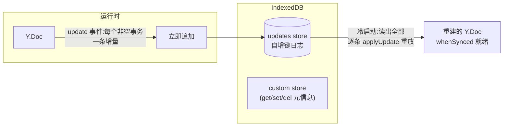

import { Canvas, Controls, Meta } from '@storybook/addon-docs/blocks';
import * as Stories from './y-indexeddb.stories';

<Meta of={Stories} name="Docs" />

# y-indexeddb 离线

y-indexeddb 是 yjs 官方的浏览器端数据库 Provider：它把文档的每条 update 追加进 IndexedDB，下次打开（冷启动、刷新、离线重启）时从库中重放，文档立即有内容。它与 [y-websocket](?path=/docs/y-websocket--docs) 这类网络 Provider 平级、可叠加——网络 Provider 负责端与端，它负责端与自己浏览器里的盘。

先建立三个能预测全文的事实：

- **存的是 update 日志，不是快照**：每次非空事务往 `updates` store 追加一条增量记录；加载 = 把库中全部记录重放合并。与网络同步共用同一套原语（见[文档更新与同步协议](?path=/docs/document-updates--docs))，因此收敛语义一字不改。
- **每个事务一条记录，攒够 500 条自动压缩**：超过阈值并停顿 1 秒后，压成一条全量快照、删掉全部旧记录。
- **它只做本地**：不含网络、不含跨标签页实时同步。离线闭环 = y-indexeddb（本地盘）+ 任意网络 Provider（传输），两者各自独立工作。



构造签名 `new IndexeddbPersistence(name, doc)`，以下行为逐条核对自 y-indexeddb 9.0.12 源码与实测：

| API / 属性 | 签名 / 默认值 | 回查要点 |
| --- | --- | --- |
| `new IndexeddbPersistence(name, doc)` | 两参必填 | `name` 是 IndexedDB 库名，即文档定位键；通常与网络 Provider 的房间名一致。构造即开始加载并持续写库 |
| `persistence.whenSynced` | `Promise<IndexeddbPersistence>` | 本地库全部重放完成时 resolve；空库也 resolve；只代表本地盘，与网络无关 |
| `persistence.on('synced', cb)` / `persistence.synced` | cb 收实例本身 | 与 `whenSynced` 同一时机；之后不再翻转 |
| `get(key)` / `set(key, value)` / `del(key)` | Promise 化 | 读写 `custom` store 的文档元信息；不同步给其他端 |
| `destroy()` | `Promise<void>` | 摘监听、关连接；`doc.destroy()` 时自动触发 |
| `clearData()` | `Promise<void>` | destroy + 删除整个库；resolve **不等**删除完成（实测） |
| `clearDocument(name)` | 静态导出函数 | 无需实例直接删库 |
| `PREFERRED_TRIM_SIZE` | `500` | updates 条数阈值；超过且停顿 1 秒后压缩为单条全量快照 |

## 快速上手

```ts
import * as Y from 'yjs';
import { IndexeddbPersistence } from 'y-indexeddb';

const doc = new Y.Doc();
// name 是 IndexedDB 库名,也是这份文档的定位键
const persistence = new IndexeddbPersistence('my-doc', doc);

// 本地库重放完成后再渲染编辑区,避免内容"后闪出来"
await persistence.whenSynced;

doc.getText('t').insert(0, '离线也丢不掉');
// 验证:刷新页面,同样两行代码,内容原样恢复
```

卸载时 `persistence.destroy()`（或 `doc.destroy()`，会自动带上它）。要彻底抹掉：`await persistence.clearData()`。

## 存储模型：update 日志

库里有两个 object store:`updates`（自增键，装 update 日志）与 `custom`（键值，装元信息）。核心认知是：**落盘的不是文档快照，而是与网络同步完全同源的 update 日志**——这决定了写入、加载、压缩三件事的形态。

### 写入：每个事务立即落盘

`doc.on('update')` 监听把每条增量 update 立即追加为 `updates` store 的一条记录：无防抖、无批量，一个非空事务一条。origin 是 persistence 自身的 update（加载回放产生的）会跳过，不写回声。

实测（9.0.12,Chrome)：空库加载后 1 条 / 2 B（构造时存入的空文档全量，见下）；再做 3 次事务 → 4 条 / 63 B——**条数 = 本地事务数 + 1**。

一个源码级细节：构造后 IndexedDB 连接就绪前的几毫秒内，编辑不会逐条落盘——但连接就绪时先把当前 doc 的全量状态存为第一条记录，所以什么都不丢。

### 加载：重放合并

构造时的加载流程（`fetchUpdates`)：先把当前 doc 全量存一条 → 读出断点 `_dbref` 之后的全部库存记录，在单个事务里逐条 `applyUpdate`(origin 为 persistence 自身）→ 更新 `_dbref` 与条数 → 置 `synced`、触发 `whenSynced`。

因为加载就是重放 update，而 `applyUpdate` 幂等、可交换、可结合：库中记录无论来自本端历史、其他标签页还是重连后的远端，重放一遍就是合并一遍。实测：写入「你好，世界」后重建 doc + persistence，内容原样恢复。

### 压缩：500 条后 trim

条数达到 `PREFERRED_TRIM_SIZE`(500）后，每次 update 重置一个 1 秒防抖计时器；停顿满 1 秒执行压缩（`storeState`)：存一条当前全量快照，删掉断点前的全部旧记录。实测：510 条 / 约 9 KB → 压缩后 1 条 / 548 B。

边界：持续高频编辑会不断推迟压缩（防抖不停重置），总量只增到下一次停顿为止；压缩时的 `fetchUpdates` 会把同库其他标签页写入的记录顺带合进当前文档（见多标签页一节）。

下面实例是真实 IndexedDB（库名固定为 `cheatsheet-y-indexeddb-demo`)：每个块是 `updates` store 里的一条记录，块宽随字节数变化：

<Canvas of={Stories.PersistAndReload} />
<Controls of={Stories.PersistAndReload} />

| 读者操作 | 可观察证据 |
| --- | --- |
| 修改「文档内容」 | 「updates 条目数」与「总字节」每次修改 +1 条；面板出现新块 |
| 写入后直接刷新浏览器页面 | 内容原样恢复——固定库名让真实刷新成为证据 |
| 「操作」选「模拟刷新（重建文档）」 | 全新 doc 从库重放，「最近事件」报告恢复字符数与库中条数 |
| 「操作」选「写入 520 次小编辑」 | 条目数先涨到 500+；停顿约 1 秒后塌缩为 1 个绿色宽块（全量快照），字节数骤降 |
| 「操作」选「清空本地库」 | 条目归零、文档重建为空（执行过一次后先切回「无」再触发下一次） |
| 打开 Show code | 看到 `indexeddb-persistence.ts`：构造、`whenSynced`、经 `persistence.db` 只读统计、`clearData` 与 dispose 时的 `destroy` |

## 就绪时机：whenSynced

`whenSynced` 的语义边界必须记准：**本地库内容重放完成**。空库也 resolve（实测约 7 ms）；它永不反映网络——断网时照常 resolve，联网后也不会再翻转（`synced` 属性一旦 `true` 不变）。

这与网络 Provider 的 `synced` 是两个独立事实：一个管本地盘，一个管服务器握手。叠加使用时，首屏渲染只等 `whenSynced`——本地内容先出来，网络后追上：

```ts
const persistence = new IndexeddbPersistence(room, doc);
await persistence.whenSynced;   // 或 persistence.once('synced', ...)
renderEditor(doc);              // 此刻内容是本地库恢复的最新状态
```

## 离线闭环：叠加网络 Provider

Provider 可任意叠加（官方原话：providers are meshable)。同一 doc 上挂 y-indexeddb + 网络 Provider，离线闭环自然成立，无需任何协调代码：

1. **在线**：每次编辑同时走两条路——落盘一条记录，上网一条增量。
2. **离线**：网络 Provider 断开（doc 照写）；**每条编辑照常落盘**。
3. **重连**：网络 Provider 自动执行 SyncStep1 / SyncStep2 握手，只传差量；合入进来的远端 update,origin 不是 persistence 自身，**同样被逐条落盘**——本地库最终包含完整历史，下次冷启动直接是最新合并态。

```ts
const doc = new Y.Doc();
const persistence = new IndexeddbPersistence(room, doc);      // 本地盘
const provider = new WebsocketProvider(url, room, doc);       // 网络(以 y-websocket 为例)
// 两个就绪互不相干:await persistence.whenSynced 后即可离线编辑
```

下面实例用手动 relay 模拟网络 Provider（与[文档更新与同步协议](?path=/docs/document-updates--docs) 的徒手握手同一手法；真实 Provider 的握手由它自动完成）:A 挂 persistence 落盘，B 是远端：

<Canvas of={Stories.OfflineReconnect} />
<Controls of={Stories.OfflineReconnect} />

| 读者操作 | 可观察证据 |
| --- | --- |
| 关闭「连接 relay」后修改「文档 A 内容」 | 连线变灰、两端分叉；「A 落盘条目」持续增长——离线编辑照常落盘 |
| 离线时也改改「远端 B 内容」 | B 独立分叉；A 的落盘不受影响 |
| 重新打开「连接 relay」 | 「本次重连握手字节」显示 sv + 差量的真实总字节；两端一致恢复「是」;「自 relay 合入 A（同样落盘）」+1，落盘条目随之增长 |
| 打开 Show code | 看到 `offline-reconnect.ts`：双向转发、origin 回声过滤、重连时的 sv + 差量握手 |

## 清空与销毁

- `destroy()`：摘掉 doc 上的写库监听、关闭 IndexedDB 连接；`doc.destroy()` 时会自动触发（源码把 `destroy` 绑在 doc 的 `destroy` 事件上）。组件卸载、路由切换时调用，避免连接泄漏——本课两个实例的 `dispose()` 都是这么做的。
- `clearData()`：先 destroy 再删除整个库。两个实测边界：
  - **Promise 不等删除完成**：它 await 的是 destroy，删除请求发出后不等结果——实测 resolve 时库还在，约数百毫秒后才消失。
  - **同库其他连接不挡删除**：y-indexeddb 经 lib0 打开的连接注册了 `versionchange → 自动关闭`，所以别的标签页的连接会被放行式关闭。但那些实例毫不知情，**继续编辑会在写库时同步抛出 `InvalidStateError`**（实测；内存内容不受影响）——恢复只能 destroy 重建 persistence 或刷新页面。
- `clearDocument(name)`：静态导出，无需持有实例直接删库，适合登出清理等场景。

## 多标签页

y-indexeddb 不含 BroadcastChannel：两个标签页挂同一库名，**各写各的，内存互不实时同步**。实测：标签页 A 写「甲」、B 写「乙」,B 的内存里只有「乙」；但双方的 update 都在库里——新开的第三个实例加载后得到「甲乙」（顺序按 clientID 决定）。

推论：

- 同一文档在两个标签页同时编辑，内存态会分叉，但库是双方并集，**下次加载（或本端压缩时的顺带合并）即收敛**，不丢数据。
- 要跨标签页实时互通，叠网络 Provider——y-websocket 的 BroadcastChannel 近路在同源标签页间天然直达（见 [y-websocket](?path=/docs/y-websocket--docs))；多管道拓扑的取舍见 [Provider 组合](?path=/docs/meshing-providers--docs)。

## 最佳实践

- **库名 = 文档定位键**：与网络 Provider 的房间名用同一字符串，一份文档一份库；改名即开了另一份全新空库，旧库内容不会搬过去。
- **首屏先等 `whenSynced`** 再渲染编辑区；网络 Provider 的 `synced` 是另一件事，离线时它可能永远不来，别把首屏挂在它上面。
- **离线应用两件套**:y-indexeddb 管数据离线，service worker 管页面资源（HTML/JS/CSS）离线——官方离线指南的组合建议。
- **卸载必 destroy**;Storybook 实例、SPA 路由、编辑器组件销毁同理。
- **服务端持久化是另一层**：全量历史的中心存储、多设备冷启动源由服务端承担（y-leveldb / y-redis)，见 [y-websocket 服务端](?path=/docs/y-websocket-server--docs) 与 [y-redis](?path=/docs/y-redis--docs);y-indexeddb 只是每个浏览器自己的副本。

## 常见问题

- `whenSynced` 已 resolve，文档却是空的？
  先查库名：`name` 是定位键，写错一个字符就开了一份全新的空库（空库也会正常 resolve)。确认 name 与预期一致、且与网络 Provider 房间名对齐后再怀疑别的。
- `await clearData()` 之后查 IndexedDB，库怎么还在？
  正常：`clearData()` 的 Promise 只等 destroy 完成，不等 `deleteDatabase` 落地（实测 resolve 时库仍在，约数百毫秒后消失）。需要确认删除完成的场景，稍候再查或自行轮询。
- 清空库之后，另一个还开着该库的标签页一编辑就抛 `InvalidStateError`?
  它的库连接被 `versionchange` 自动关闭了，实例却不知道；内存数据没丢。让该标签页 destroy 旧 persistence 并重建（或直接刷新页面）即可恢复写库。
- `updates` 条目会不会一直涨、撑爆存储？
  不会。条数到 500 后，停顿 1 秒即自动压缩为一条全量快照（实测 510 条 / 约 9 KB → 1 条 / 548 B)；持续高频编辑只是推迟压缩，条目只增不减的情况到下一次停顿就结束。

## 总结回顾

摘要：

y-indexeddb 把文档的每条增量 update 立即追加进 IndexedDB 的 `updates` store——存的是与网络同步同源的 update 日志，不是快照；构造时先把当前全量存一条，再重放库中全部记录完成加载，重放即合并，收敛语义不变。条数过 500 且停顿 1 秒后自动压缩为单条全量快照。`whenSynced` / `synced` 只代表本地库重放完成，与网络无关，空库也就绪。叠加任意网络 Provider 即得离线闭环：离线编辑照常落盘，重连握手只传差量，合入的远端 update 同样落盘。`clearData` 删除整个库但 Promise 不等删除完成；同库其他标签页的连接会被自动关闭且不知情，继续写库会抛 `InvalidStateError`。多标签页同库各写各的、加载时合并；跨标签页实时互通交给网络 Provider。

一句话：

> 本地持久化存的是 update 日志，加载 = 重放合并：y-indexeddb 不改变收敛语义，只让冷启动立即有内容——离线闭环靠它叠加任意网络 Provider 自然成立。

知识要点：

- `name` 与 `doc` 各承担什么？为什么改名等于换了一份文档？
- 写入时机与条数规律？构造时为什么会多一条全量记录？
- 加载为什么叫「重放合并」？它凭什么不破坏收敛语义？
- 压缩（trim）的触发条件、防抖行为与结果？
- `whenSynced` 的语义边界？与网络 Provider 的 `synced` 有何不同？
- 离线闭环三步各发生什么？重连后合入的远端 update 会不会落盘？
- `clearData` 的两个实测边界？多标签页挂同一库时的行为？

## 参考资料

- [Yjs 官方文档：y-indexeddb](https://docs.yjs.dev/ecosystem/database-provider/y-indexeddb)
- [Yjs 官方文档：Allowing Offline Editing](https://docs.yjs.dev/getting-started/allowing-offline-editing)
- [y-indexeddb 官方仓库(README 与源码)](https://github.com/yjs/y-indexeddb)
