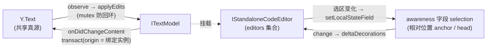

import { Canvas, Controls, Meta } from '@storybook/addon-docs/blocks';
import * as Stories from './y-monaco.stories';

<Meta of={Stories} name="Docs" />

# Monaco 编辑器绑定

y-monaco 用一个 `MonacoBinding` 类把 Monaco 编辑器接入 yjs 协同：它把 `Y.Text` 与 monaco 的 `ITextModel` 双向同步，再借助 awareness 广播并渲染各端的光标与选区。Monaco 与其他编辑器不同——**editor 与 model 是两个对象**，这条分界线贯穿本课：绑定的数据面挂在 model 上（`Y.Text ↔ model`），选区与远程装饰挂在 editor 实例上（构造参数里的 `editors` 集合）；销毁跟着 model 走（model 一销毁绑定自动解除），而 editor 重建后绑定不会跟着迁移，需要重新创建。Monaco 自身的能力（语言服务、diff 编辑器、主题配置）不属于本课，只讲 yjs 侧的映射与协同行为。

理解本课依次回答四个问题：绑定在绑什么（model 与 editor 各自的角色）、远程光标怎么来（awareness 的 `selection` 字段与装饰渲染）、生命周期怎么管（dispose 链与重建）、真实项目怎么接（Provider 与 worker 配置）。本课实例是同一页面里的两个真实 Monaco 客户端，用手写中继扮演 Provider 通道（与 [Awareness 一课](?path=/docs/awareness--docs)的做法相同），可以直接在两个编辑器里打字、拖选。



| 对象 / 参数 | 签名 / 默认值 | 回查要点 |
| --- | --- | --- |
| `new MonacoBinding(...)` | `(ytext, monacoModel, editors = new Set(), awareness = null)` | 前两个参数是数据面，必传；后两个是选区增强，可选 |
| `ytext` | `Y.Doc.getText(...)` | 内容真源；构造时用它覆盖 model 现有值 |
| `monacoModel` | `editor.getModel()` | 一个 (ytext, model) 只建一个绑定；model 销毁即自动解绑 |
| `editors` | `Set<IStandaloneCodeEditor>` | 选区保存/恢复与远程装饰的宿主；缺省则只同步文本 |
| `awareness` | `Awareness \| null` | 传入才广播 `selection` 字段并渲染远程光标 |
| `binding.destroy()` | 手动调用 | 摘除全部监听；不清 awareness 里的本地 `selection` 字段 |
| `selection` 字段 | `{ anchor, head }: RelativePosition` | y-monaco 固定写入的字段名；两端都是相对位置，并发插入下自动平移 |
| `yRemoteSelection` / `yRemoteSelectionHead` | CSS 类，样式需自备 | 另有 `-<clientID>` 后缀类，可逐用户配色 |

## 快速上手

需要打包器（Vite / webpack）；Monaco 在 Vite 下必须自己配置 worker，这是集成 y-monaco 前的第一道坎。依赖：`npm i monaco-editor y-monaco yjs y-websocket`。

```ts
import * as Y from 'yjs';
import { WebsocketProvider } from 'y-websocket';
import * as monaco from 'monaco-editor';
import editorWorker from 'monaco-editor/editor/editor.worker.js?worker';
import tsWorker from 'monaco-editor/languages/features/typescript/ts.worker.js?worker';

// Vite 下必须自备 worker:TS/JS 语言服务有各自的 worker,其余请求走基础 worker。
// 注意 monaco-editor ≥0.56 的深层入口要去掉 esm/vs 前缀。
self.MonacoEnvironment = {
  getWorker: (_workerId, label) =>
    label === 'javascript' || label === 'typescript'
      ? new tsWorker()
      : new editorWorker(),
};

const ydoc = new Y.Doc();
const provider = new WebsocketProvider('ws://localhost:1234', 'monaco-demo', ydoc);
const ytext = ydoc.getText('monaco');

const editor = monaco.editor.create(document.getElementById('editor')!, {
  value: '', // 保持空串:MonacoBinding 构造时用 Y.Text 内容覆盖 model
  language: 'javascript',
});

const binding = new MonacoBinding(
  ytext,
  editor.getModel()!,
  new Set([editor]),   // 选区恢复 + 远程装饰;省略则只同步文本
  provider.awareness,  // 传入才有远程光标与选区
);
```

y-websocket 服务端的搭建见 [y-websocket](?path=/docs/y-websocket--docs)。如果你在 monaco-editor ≥0.56 上 `import { MonacoBinding } from 'y-monaco'` 直接报解析错误，见常见问题第一条——本课实例在工作区内就遇到了，用一行修复的等价副本解决。

## 绑定：Y.Text 与 monaco model 的双行道

`MonacoBinding` 的数据面是 `Y.Text ↔ ITextModel`。构造时绑定把 `ytext.toString()` 写进 model（`setValue`），此后两个方向各自有固定的通路：

- **编辑器 → Y.Text**:监听 `model.onDidChangeContent`,把每个 change 换算成 `ytext.delete` + `ytext.insert`(同一批 change 按 offset 从右到左应用),包在一次 `doc.transact` 里,**事务 origin 就是绑定实例本身**——要区分「Monaco 里的手动输入」与其他写入,给 [UndoManager](?path=/docs/undo-manager--docs) 配 `trackedOrigins` 时可以拿绑定实例当标记。
- **Y.Text → 编辑器**:监听 `ytext.observe`,把事件 delta 顺序 `applyEdits` 到 model;内部用 lib0 的 mutex 互斥,远端改动引起的 `onDidChangeContent` 不会回头再写进 Y.Text,天然防回环。

判断：**model 是 Y.Text 的投影**。任何一方变化，另一方在同一事务周期内跟随；而 editor 只是 model 的一个查看窗口——同一个 model 可以开多个 editor，它们天然同步。

下面实例把两个客户端放进同一页面，双向中继即 Provider 的角色。读者可以直接在两个编辑器里打字，也可以用 Controls 让 B 绕过编辑器直接写 Y.Text，验证「model 跟随 Y.Text」这一方向：

<Canvas of={Stories.Binding} />
<Controls of={Stories.Binding} />

| 读者操作 | 可观察证据 |
| --- | --- |
| 在 A 编辑器打字、换行 | B 编辑器即时出现同样内容；读数「共享文本 Y.Text」同步变化 |
| 切「B 的程序化写入 → 在开头插入一行」 | 两端编辑器首行同时出现注释行——B 没碰编辑器,model 依旧跟随 Y.Text |
| 切「B 的程序化写入 → 清空文本」 | 两端同时清空 |
| 在 B 编辑器里直接打字 | A 端同样实时出现——同步是双向的,没有主从 |
| 打开 Show code | 该 Canvas 实际执行的 `monaco-binding-demo.ts`:worker 配置、中继、绑定、销毁全在其中一个文件 |

边界：一个 (ytext, model) 对只建一个绑定，重复 `new MonacoBinding` 会让同一次编辑被转发两次；换了 Y.Text 或换了 model，旧绑定不会自动跟过去，要重建。

## 远程光标与选区：awareness 接入

传入第四参 `awareness` 后，绑定做两件事：

- **广播本端选区**：监听每个 editor 的 `onDidChangeCursorSelection`,把选区起点/终点转成 `Y.RelativePosition` 写进 `awareness.setLocalStateField('selection', { anchor, head })`。字段名固定为 `selection`,值为相对位置——并发插入下锚点自动平移（机制见[相对位置](?path=/docs/relative-positions--docs)），这正是上表实证里「B 的选区随 A 的插入整体下移」的原因。
- **渲染远端选区**：监听 awareness 的 `change` 事件，遍历 `getStates()`（跳过与本端 `doc.clientID` 相同的条目），把每个客户端的 `selection` 解析回绝对位置，用 `model.deltaDecorations` 渲染成装饰：选区范围加类名 `yRemoteSelection`，光标头加 `yRemoteSelectionHead`。

装饰只是「有类名的 DOM」，**样式需要自己提供**（y-monaco 不带 CSS）。利用 `-<clientID>` 后缀类即可逐用户配色——监听 `awareness.on('update')`，为每个新 clientID 注入一条带用户色的规则：

```css
.yRemoteSelection { background-color: rgb(250, 129, 0, 0.3); }
.yRemoteSelectionHead {
  position: absolute;
  border-left: 2px solid rgb(250, 129, 0);
  height: 100%;
  box-sizing: border-box;
}
/* 逐用户配色:y-monaco 会生成带 clientID 后缀的类 */
.yRemoteSelectionHead-2665995163 { border-color: #e25c5c; }
```

`editors` 集合在这条链路里承担第三件事：每次本端事务前把所有 editor 的选区也存成相对位置，远端变更应用后立即恢复——没有它，别人在光标前的插入会让你的选区错位。把它接进实例继续验证：

| 读者操作 | 可观察证据 |
| --- | --- |
| 切「B 的选区 → 全选」 | A 编辑器出现红色的 B 选区与光标头；读数「A 端看到的 B」显示 `选区 L1:C1 – L…` |
| 切「B 的选区 → 光标移到文首」 | A 端红色选区收缩为一条光标；读数变为 `光标 L1:C1` |
| 在 A 拖选一段文本 | B 编辑器出现蓝色的 A 选区；读数「B 端看到的 A」同步 |
| 先让 B 全选，再用「B 的程序化写入 → 在开头插入一行」 | A 端 B 的选区装饰整体下移一行（起点从 L1 变 L2）——相对位置在并发插入下自动平移 |

边界：实例刚打开就能看到对端光标，不是异常——绑定把 Y.Text 初始内容填进 model 时，本端光标移到内容末尾并广播了 `selection`。「看到远端光标」的准确含义是「对端 awareness 状态里存在 `selection` 字段」，与是否持久连接无关（awareness 的时效规则见 [Awareness 一课](?path=/docs/awareness--docs)）。

## 生命周期：销毁与重建

绑定的自动销毁挂在 model 上：绑定注册了 `model.onWillDispose` → 自动执行 `binding.destroy()`。而 model 由谁销毁，取决于它怎么创建：

| model 创建方式 | `editor.dispose()` 之后 | 绑定状态 | 处理 |
| --- | --- | --- | --- |
| `create(el, { value, language })` | monaco 内部创建的 model 归 editor 所有，**一并销毁** | 随 `onWillDispose` 自动解除 | 无需手动操作 |
| `createModel(...)` + `editor.setModel(...)` | model 归你所有，**仍然存活** | 绑定残活，监听仍在 | 先 `binding.destroy()` 或 `model.dispose()` |

第二条路径是内存泄漏与诡异行为的来源：model 活着、编辑器没了，绑定注册的监听却都还在——awareness 每次变化都会为死掉的 editor 空跑一轮装饰逻辑，其他仍连着该 model 的入口输入也照常经绑定进入 Y.Text。判断句：**销毁顺序以 model 为锚——要么销毁 model（绑定自动解除），要么先 `binding.destroy()`**。

`destroy()` 摘除的监听有五处：model 的内容变化与 `onWillDispose`、`ytext` 的 observe、doc 的 `beforeAllTransactions`、awareness 的 `change`。它**不清** awareness 里本端的 `selection` 字段——销毁或离线时主动补一句，对端的装饰会随 awareness `change` 立即消失：

```ts
binding.destroy(); // 或 editor.dispose() 走自动链
awareness.setLocalStateField('selection', null);
```

editor 重建（容器重挂、热更新、`setModel` 换文档）后绑定不会跟着迁移：构造时注册的选区监听属于旧实例，`editors` 集合里也是旧引用。重建后对新的 (ytext, editor) 重新 `new MonacoBinding(...)`。容器尺寸变化不用重建——创建 editor 时给 `automaticLayout: true`，monaco 自己监听容器尺寸。

## 与 Provider 配合

真实项目里本课的手写中继整段消失：Provider 创建并维护 awareness 实例，把文档 update 与 awareness 消息搬过网络，重连时用 state vector 对账补发丢失的更新。业务代码只剩三个动作——`provider.awareness` 作第四参、`doc.getText(...)` 作第一参、断开时销毁绑定并清理 `selection` 字段。通道层的选择与接线见 [y-websocket](?path=/docs/y-websocket--docs)、[y-webrtc](?path=/docs/y-webrtc--docs) 与 [Provider 组合](?path=/docs/meshing-providers--docs)。

两个协作层面的边界：远程光标随 awareness 走，刷新即失、断线超时即隐，是正常行为；Monaco 的语言服务（诊断、补全）跑在自己的 worker 里，与 yjs 无关，不要在绑定层处理它们的报错。

## 最佳实践

- 四个参数传全：只传 (ytext, model) 得到的是「无光标协同」，并发编辑下还会因选区不恢复而错位；除非刻意做纯文本同步，`editors` 与 `awareness` 都应传入。
- worker 按 label 分发：全部请求回给基础 worker，TS/JS 的语法服务会报 `Missing requestHandler`（本课实例实测复现过）；JSON / CSS / HTML 语言服务同理各有 worker。
- 光标广播没有内置节流：`onDidChangeCursorSelection` 每次触发都写 awareness，大房间配合 [Awareness 一课](?path=/docs/awareness--docs)的节流建议自行限频。
- 颜色按 clientID 注入而不是全体统一色：多客户端一靠位置、二靠颜色区分人，统一色会让选区归属无法辨认。

## 常见问题

- Vite 下 `import { MonacoBinding } from 'y-monaco'` 报 `Failed to resolve import "monaco-editor/esm/vs/editor.editor.api.js"`。
  y-monaco 0.1.6（目前最新，2024-07 发布）的内部导入指向 monaco-editor ≥0.56 已移除的深层路径——0.56 重排了 ESM 入口，深层引用要去掉 `esm/vs/` 前缀，旧包没有跟进。处理：给 y-monaco 提 issue / 等修复；或把 monaco-editor 锁在 ≤0.55（旧 exports 透传，不受影响）；或按 y-monaco 源码自建副本、只把那一行导入改成 `'monaco-editor'`——本课实例就是这份一行修复的副本（`y-monaco-compat.js`），API 与 npm 包完全一致，y-monaco 修复后换回 import 即可。
- 控制台报 `You must define a function MonacoEnvironment.getWorkerUrl or MonacoEnvironment.getWorker`，或者联想、链接识别、diff 计算悄悄失效。
  Monaco 没拿到 worker：Vite 下必须定义 `MonacoEnvironment.getWorker` 并用 `?worker` 导入 worker 入口（快速上手的写法）。注意 ≥0.56 的深层入口路径是 `monaco-editor/editor/editor.worker.js` 这类去掉 `esm/vs/` 前缀的新形式，旧路径已无法解析。配了 worker 但所有 label 都返回同一个基础 worker 时，TS/JS 语法服务会在控制台报 `Missing requestHandler`——按 label 分发各语言 worker。
- 远程光标 / 选区不显示。
  按顺序排查：确认第四参传了 awareness；让对端点一下编辑器（`selection` 字段在其第一次移动光标时才写入）；检查是否引入了 `yRemoteSelection` 系列的 CSS——装饰 DOM 存在但没有样式时「存在却不可见」；最后确认两端 clientID 没有撞车（克隆或深拷贝 Y.Doc 会让两个端共用一个 clientID，而装饰渲染会跳过与本端 `doc.clientID` 相同的条目）。
- 换了编辑器实例（或容器重挂、热更新）后，文本还在同步，但光标不再广播、远程装饰也不显示了。
  绑定不跟随 editor 迁移：构造时注册的 `onDidChangeCursorSelection` 监听和 `editors` 集合都属于旧实例。对新的 editor 重新 `new MonacoBinding(...)`；重建前先 `destroy()` 旧绑定，避免同一 model 上挂两份监听。
- 销毁编辑器后绑定仍在后台运行（监听残留、内存不释放）。
  自建 `createModel` 的 model 在 `editor.dispose()` 后仍然存活，挂在 model 上的绑定不会自动解除——按「先 `binding.destroy()` 或 `model.dispose()`」的顺序清理；只有 `create(el, { value })` 让 monaco 自建 model 时，才有「editor → model → 绑定」的自动销毁链。

## 总结回顾

摘要：

MonacoBinding 把 Y.Text 与 monaco 的 ITextModel 双向同步：编辑器的输入经 `onDidChangeContent` 换算成 Y.Text 的 delete/insert（事务 origin 是绑定实例），Y.Text 的变化经 observe 反向 applyEdits，mutex 防回环。awareness 参数让绑定把本端选区写成 `selection` 字段（相对位置，并发插入下自动平移），并在 `change` 时把远端选区渲染成 `yRemoteSelection(-clientID)` 装饰——样式自备，配色按 clientID 注入。editors 集合承担选区保存恢复与装饰宿主。生命周期以 model 为锚：`editor.dispose()` 销毁其自建 model 时绑定自动解除，自建 model 则要手动销毁或先 `binding.destroy()`；editor 重建后绑定不迁移，须重建。Vite 下还要自备 worker（`MonacoEnvironment.getWorker` + `?worker`，按 label 分发），monaco-editor ≥0.56 的入口重排使得 y-monaco 0.1.6 需要一行修复才能引入。

一句话：

> MonacoBinding 把 model 当作 Y.Text 的投影来同步、把 editor 实例当作选区与装饰的宿主来渲染；销毁跟着 model 走，editor 重建绑定就得重建。

知识要点：

- MonacoBinding 的四个参数各管什么？哪两个是数据面、哪两个是选区增强？
- 编辑器输入怎样进入 Y.Text？事务的 origin 是什么，对 UndoManager 意味着什么？
- 远程光标的广播与渲染各走哪条事件链？`selection` 字段里存的是什么？
- 为什么实例刚打开就能看到对端光标？「看到远端光标」的准确含义是什么？
- `editor.dispose()` 之后绑定是否自动解除，取决于什么？
- `binding.destroy()` 摘除哪些监听？它不清理什么，需要补什么？
- Vite 下 worker 怎么配？为什么不能把所有 label 都回给基础 worker？
- monaco-editor ≥0.56 之后 y-monaco 0.1.6 会遇到什么问题，有哪几条出路？

## 参考资料

- [Monaco Editor Binding - Yjs 官方文档](https://docs.yjs.dev/ecosystem/editor-bindings/monaco)
- [y-monaco 官方仓库(README 与绑定源码)](https://github.com/yjs/y-monaco)
- [monaco-editor 官方仓库(≥0.56 ESM 入口重排说明见 CHANGELOG)](https://github.com/microsoft/monaco-editor)
- [yjs-demos 官方示例集合(monaco 示例)](https://github.com/yjs/yjs-demos)
