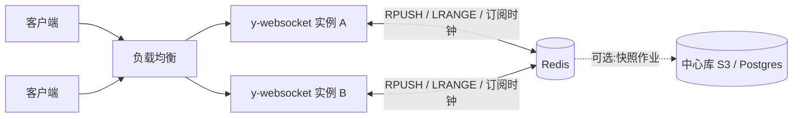
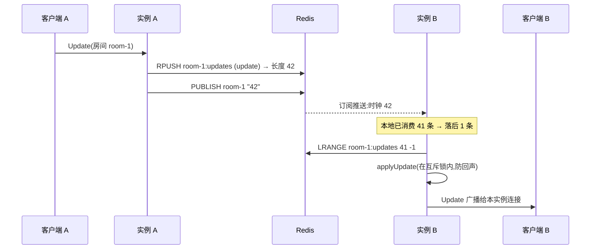
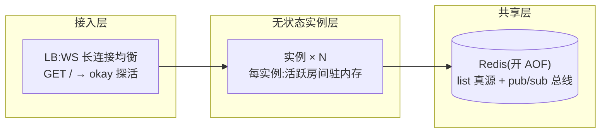

import { Meta } from '@storybook/addon-docs/blocks';

<Meta id="y-redis" title="服务端/y-redis 水平扩展" name="Docs" />

# y-redis 水平扩展

[y-websocket 服务端](?path=/docs/y-websocket-server--docs) 单实例把房间驻留在本进程内存里，能扛的连接数有上限；要水平扩展，房间状态必须搬出进程，交给所有实例共享的存储与通知总线。y-redis 就是 yjs 官方给出的这条路的实现：实例照常驻留房间、收发 WebSocket，但每个房间的全部 update 写进 Redis，新更新经 Redis pub/sub 通知其他实例拉取——任意多个实例因此服务同名房间而内容一致。

先建立三个能预测全文的版本事实：

- **npm 上的 y-redis 最新版是 1.0.3（2021 年发布），本课以它为准**：它是「持久化适配层」而非完整服务端——不管 WebSocket，只管「Y.Doc ↔ Redis」；WebSocket 层由 [@y/websocket-server](?path=/docs/y-websocket-server--docs) 承担，两者经 `setPersistence` 组合。
- **1.0.3 的消息模型是「list + 时钟」**：每个房间一条 Redis list 存全量 update，同名 pub/sub 频道只发最新列表长度；没有 streams、没有 consumer group——那是 2024 年重写版的架构，已演变为独立项目 yhub（见本文「官方重写」一节与 [yhub](?path=/docs/yhub--docs) 一课）。
- **跨实例的只有文档内容**：awareness（光标、在线状态）只在各实例内部广播，y-redis 不过问。



`new RedisPersistence(opts?)` 的全部构造选项与 Redis 键布局，逐条核对自本地 y-redis@1.0.3 源码：

| 构造选项 | 默认值 | 回查要点 |
| --- | --- | --- |
| `redisOpts` | `null` → `new Redis()` | 透传给 ioredis 构造器；默认连 `127.0.0.1:6379` |
| `redisClusterOpts` | `null` | 传节点数组则改用 `Redis.Cluster`；与 `redisOpts` 二选一 |
| （连接数） | 每实例 2 条 | 普通连接 + 订阅连接各一；订阅态连接不能再发其他命令，所以必须两条 |

| Redis 键 | 类型 | 内容 |
| --- | --- | --- |
| `<房间名>:updates` | list | 该房间的全量 update 二进制，每条事务增量一项 |
| `<房间名>` | pub/sub 频道 | 载荷只是最新列表长度（时钟），不含内容 |

## 单实例的瓶颈

单实例 y-websocket 服务端的两个硬边界：

- **房间驻留单进程内存**：每个活跃房间是一份完整 `Y.Doc`，连接数与房间数都压在同一个进程的内存与事件循环上；进程重启即全量房间下线。
- **持久化在本地盘**：默认落盘（y-leveldb）只服务本进程。直接起第二个实例分担连接，两个实例会各自建同名房间、各自读写各自的盘——同房间的两拨客户端看到两份越走越远的文档。

水平扩展的前提因此是：房间真源搬进所有实例共享的存储，并有一条「某房间有新更新」的通知机制。y-redis 1.0.3 让 Redis 同时承担这两件事。

## 消息模型

1.0.3 的全部机制可以一句话说完：**实例把本地产生的 update 追加进房间的 Redis list，然后向同名频道 publish 新的列表长度；订阅了该频道的其他实例凭长度发现自己落后多少，用 LRANGE 把差量拉回来合入。**



贴着源码（`y-redis/src/y-redis.js`）的关键语义：

- **时钟 = 已消费的列表长度**：每个绑定文档记 `_clock`（已消费条数）与 `_fetchingClock`（已发起拉取的条数，去重进行中的拉取）。publish 的载荷只是长度数字，是「瘦推胖拉」——内容永远走 LRANGE。
- **互斥锁防回声**：从 Redis 拉回合入时产生的本地 `update` 事件被同一把 mutex 挡住，不会再次 RPUSH——只有真正源于本实例客户端的更新才入列。
- **非数字载荷视为无穷大时钟**：`Number(sclock) || Infinity`——向频道发任何非数字消息都会强制订阅方触发一次补拉（按本地时钟取差量），可作运维上的「强制对齐」信号。
- **断窗自愈**：Redis 抖动期间丢的 publish 不会补发，但同房间下一条 update 会带上更大的长度，触发订阅方把全部缺口一次拉回；代价是长期无新更新的房间可能停在旧状态（补救见常见问题）。
- **地基假设：列表只增不减**。时钟是列表长度，列表一旦变短，在线实例的记忆就超过新长度，之后的新更新永远触发不了拉取——这决定了「落盘与压缩」一节全部的安全前提。

边界：

- 只桥接文档 update；awareness 消息留在各实例内部（[Awareness 与在线状态](?path=/docs/awareness--docs) 的广播范围是单实例的本地连接）。
- 每个绑定房间一条订阅：实例间通知的扇出 = 绑定了该房间的实例数，不是全集群广播。
- ioredis 断线自动重连并重订阅；`redisClusterOpts` 可接 Redis Cluster 分片。

## RedisPersistence API

```js
import { RedisPersistence } from 'y-redis'

const redisPersistence = new RedisPersistence({
  redisOpts: { host: '127.0.0.1', port: 6379 },
})
```

| 成员 | 签名 | 回查要点 |
| --- | --- | --- |
| `bindState` | `(name, ydoc) → PersistenceDoc` | 绑定文档：订阅频道、拉取存量、挂上 `update` 转发；**同名重复绑定抛错** |
| `closeDoc` | `(name) → Promise?` | 解绑：摘监听、退订频道、移出注册表；房间卸载时必须走这步 |
| `clearDocument` | `(name) → Promise` | 解绑并删除该房间的 Redis 列表；已在各实例内存中的房间继续服务但不再持久化，是运维清库而非运行时「删文档」 |
| `clearAllDocuments` | `() → Promise` | 删除本实例已知全部房间的列表并销毁自身 |
| `destroy` | `() → Promise` | 解绑全部文档并退出两条 Redis 连接 |
| `docs` | `Map<string, PersistenceDoc>` | 当前已绑定文档注册表 |
| `PersistenceDoc.synced` | `Promise` | 初次订阅 + 存量拉取完成的信号；服务端要等「已对齐」再行动时用它 |
| `PersistenceDoc.getUpdates` | `() → Promise` | 手动补拉差量（Redis 断窗后的主动补救） |

## 多实例服务端

组合方式是把 `RedisPersistence` 接进 y-websocket 服务端的持久化挂点（`setPersistence`，接口细节见 [y-websocket 服务端](?path=/docs/y-websocket-server--docs)）。课程目录的 `server.js` 是完整可复制的实例，核心接线：

```js
import { setupWSConnection, setPersistence } from '@y/websocket-server/utils'
import { RedisPersistence } from 'y-redis'

const redisPersistence = new RedisPersistence({ redisOpts })

setPersistence({
  bindState: (docName, doc) => { redisPersistence.bindState(docName, doc) },
  // 房间卸载时必须解绑退订,否则同名房间重进时 bindState 抛「重复绑定」
  writeState: async (docName, _doc) => { await redisPersistence.closeDoc(docName) },
})
```

两个来自源码的行为，见到时不必慌：

- **客户端可能先握到一轮空内容**：`getYDoc` 调 `bindState` 但不 await，SyncStep2 先按内存（空）应答；随后从 Redis 拉到的存量以普通 update 消息推给客户端，必然收敛。
- **房间卸载与极快的重进存在窄竞态**：`writeState` 的解绑是异步的，同名房间在同一瞬间重建可能撞上「重复绑定」抛错；生产上让入口对该异常重试一次即可。

运行条件与验证步骤（本机无 Redis 时用 docker，课程范例经 `node --check` 验证）：

```bash
# 1. 起 Redis(官方镜像;AOF 让重启不丢数据)
docker run -d --name yredis -p 6379:6379 redis:7 redis-server --appendonly yes

# 2. 起两个实例(两个终端)
PORT=3001 node server.js
PORT=3002 node server.js

# 3. 客户端:两个浏览器上下文用 y-websocket 客户端分别连不同实例的同名房间
#    new WebsocketProvider('ws://localhost:3001', 'demo', docA)
#    new WebsocketProvider('ws://localhost:3002', 'demo', docB)
#    (客户端用法见「y-websocket」一课)

# 4. 在 Redis 里核对证据
docker exec -it yredis redis-cli LLEN demo:updates   # 每次编辑 +1:列表即真源
docker exec -it yredis redis-cli SUBSCRIBE demo       # 能看到不断增长的时钟数字

# 5. 杀掉任一实例:客户端重连到另一实例,内容经 Redis 追平,不丢
```

## 落盘与压缩

1.0.3 里 **Redis 列表就是真源**：没有内建快照、没有压缩、没有中心库。要落到 Postgres / S3，得自己加作业，课程目录的 `compact-doc.js` 是可复制起点：

```bash
node compact-doc.js demo   # demo:updates 从 N 条合并为 1 条,快照写到 snapshots/demo.update
```

作业流程：LRANGE 全量 → `Y.mergeUpdates` 合并成单条全量 update → **先写中心库**（范例用本地文件模拟，真实部署换 `s3.putObject` 或一条 SQL)→ 再用 `MULTI` 事务 `DEL` + `RPUSH` 重建列表。Yjs update 幂等，作业可安全重跑。

**安全前提：只对没有任何实例绑定的冷文档执行。** 时钟协议假定列表只增不减——在线实例记着旧长度，列表一旦变短，之后的新长度超不过它的记忆，差量永远拉不到，表现为在线实例静默丢更新（见常见问题）。冷文档下次被绑定时 `_clock` 从零开始、全量拉取，所以安全。

官方教程（撰写中）设想的完整形态是：协作热数据留在 Redis，合并后的 update 块存 S3，元数据（state vector、S3 引用）存 Postgres，由独立 worker 周期性搬运与清理——这正是重写版实现的架构，下一节给出入口。

## 部署与容量



容量判断的四个抓手：

- **文档一致性不要求 sticky session**：内容经 Redis 收敛，同房间任意落在哪个实例都行。但 awareness 不跨实例——光标、在线列表敏感的产品按房间名做负载均衡亲和（如对 URL 里的房间名取哈希），体验更好且不破坏正确性。
- **Redis 命令开销**：每条 update = 1×RPUSH + 1×PUBLISH；扇出到每个绑定该房间的实例各 1×LRANGE（只拉差量）。按「最热房间的 update 频率 × 绑定实例数」估算。
- **内存双份账**：实例侧每个活跃房间一份完整 `Y.Doc`；Redis 侧每个房间一条只增的列表——不压缩就一直涨，用上面的冷压缩作业控制。
- **Redis 自身要持久化**：真源在 Redis，`redis:7` 默认只有 RDB 快照，至少开 `--appendonly yes`；或接受重启后从中心库快照恢复（回放逻辑自己实现）。

## 官方重写：@y/redis 与 yhub

1.0.3 的全部痛点——热文档不能压缩、awareness 不出实例、Redis 无限增长——官方在 2024 年用重写回应（论坛公告《Y-redis: An alternative backend to y-websocket》)，重写线随后演变为独立项目 **yhub**。版本事实：

| 包 | 现状 | 架构 |
| --- | --- | --- |
| `y-redis@1.0.3`（本课） | npm 最新，2021 年 | list + 时钟 pub/sub；持久化适配层 |
| `@y/redis@0.1.x` | 2024 年重写首发的包名 | 每房间一条 Redis stream；无状态 server + 独立 worker |
| `@y/hub`（yhub） | 重写线的现名与现行项目 | 同上 + worker 队列用 consumer group 保证同一房间同一时刻只有一个 worker 压缩/清理（幂等可重跑）；合并块存 S3，元数据存 Postgres；AGPL / 商业双许可 |

重写版与 1.0.3 的根本差异：server 不再驻留房间（文档仅在初次同步时载入内存），Redis 只作短时实时层，持久化与清理由 worker 幂等完成；客户端照旧使用 y-websocket 的 `WebsocketProvider`，协议兼容。部署、鉴权与存储细节由 [yhub](?path=/docs/yhub--docs) 一课承载。

## 最佳实践

- **选型按痛点走**：房间规模单进程扛得住、且在线状态重要 → [y-websocket 服务端](?path=/docs/y-websocket-server--docs) 单实例最省心；要多实例容灾、滚动发布、连接数水平扩展，且能接受 awareness 实例隔离与手工压缩 → 本课的 1.0.3 组合；要内建压缩、S3/Postgres 落盘与真正的无状态 server → [yhub](?path=/docs/yhub--docs) 或托管服务 [y-sweet](?path=/docs/y-sweet--docs)；要插件化定制（鉴权、webhook）的单服务端路线 → [Hocuspocus](?path=/docs/hocuspocus--docs)。
- 鉴权挂在 HTTP `upgrade` 处（`server.js` 已留挂点），没过就直接断 socket；Redis 通道本身没有任何访问控制，别让鉴权依赖它。
- Redis 按真源对待：开 AOF、监控内存增长、规划冷压缩节奏；只当缓存用就要配好中心库快照与回放。
- 多 Provider 叠加（离线编辑、P2P 加速）与部署正交，见 [Provider 组合](?path=/docs/meshing-providers--docs)。

## 常见问题

- 两个实例间文档内容同步了，光标 / 在线列表却互相看不到？
  预期行为：y-redis 1.0.3 只桥接文档 update，awareness 只在各实例内部广播。要么按房间名做负载均衡亲和，要么自建 awareness 跨实例桥，要么用重写版 yhub。
- 压缩或清空列表之后，在线实例再也收不到该房间的更新？
  时钟协议假定列表只增不减：在线实例记着的已消费长度超过了新列表长度，之后 publish 的新长度触发不了拉取。压缩只对无实例绑定的冷文档执行；已经撞上的实例重启或重新 `bindState` 恢复。
- 客户端连上后先看到空文档，过片刻内容才出现？
  `getYDoc` 不等待 `bindState` 完成，首轮同步按内存（空）应答，随后 Redis 存量以增量消息追平，必然收敛。服务端需要「已对齐」语义时等 `PersistenceDoc.synced`。
- Redis 抖动期间丢的 publish 怎么办？
  无需处理：同房间下一条 update 会带更大的列表长度，订阅方一次 LRANGE 补齐全部缺口。长期无新更新的房间可能停在旧状态，运维上可对 `PersistenceDoc` 调 `getUpdates()` 主动补拉，或向频道发一条非数字消息（视为无穷大时钟，强制触发一次补拉）。
- Redis 重启后房间全空？
  1.0.3 里 Redis 就是真源，默认镜像只开 RDB 快照。启动参数加 `--appendonly yes`；有中心库快照的话，重启后由各房间下次绑定时从快照回放（回放逻辑需自己实现，1.0.3 不含）。

## 总结回顾

摘要：

y-redis 解决的是 y-websocket 服务端的水平扩展：单实例把房间驻留内存、把持久化落在本地盘，多实例必须共享房间真源与更新通知。npm 现行版 y-redis@1.0.3 用 Redis 一并承担两者——每房间一条 list 存全量 update，同名频道 publish 最新列表长度当时钟，各实例凭时钟 LRANGE 补拉差量，互斥锁防回声；它经 `setPersistence` 与 @y/websocket-server 组合成多实例服务端，房间卸载时必须 `closeDoc` 解绑。跨实例的只有文档内容，awareness 不出实例。Redis 列表即真源：落盘中心库与压缩要自己加作业，且时钟协议假定列表只增不减，压缩仅限无实例绑定的冷文档。官方 2024 年的重写线（@y/redis → yhub）改用 stream + consumer group 的无状态 server / worker 架构，内建压缩与 S3/Postgres 落盘，是本课方案的继任者。

一句话：

> 多实例共享文档 = 房间真源搬进 Redis（list 存全量、频道发长度当时钟）；但 1.0.3 的时钟以「列表只增不减」为地基——在线压缩与 awareness 跨实例，都留给重写版。

知识要点：

- y-redis 1.0.3 的 Redis 键布局是什么？时钟消息为什么不带内容？
- `setPersistence` 的两个挂点各在什么时候被调用，`writeState` 里为什么必须 `closeDoc`？
- 为什么客户端可能先握到空内容再追平？为什么说它必然收敛？
- 为什么在线文档不能压缩列表？冷文档压缩的安全前提是什么？
- awareness 为什么不跨实例？对部署（sticky session）有什么推论？
- 1.0.3 与重写版（yhub）的架构差异是什么，各自的选型条件？

## 参考资料

- [y-redis 官方仓库（现行内容已迁移为 yhub）](https://github.com/yjs/y-redis)
- [npm:y-redis@1.0.3(本课对象,源码即文档)](https://www.npmjs.com/package/y-redis)
- [官方论坛公告:Y-redis: An alternative backend to y-websocket(重写版架构)](https://discuss.yjs.dev/t/y-redis-an-alternative-backend-to-y-websocket/2509)
- [Yjs 官方文档:y-redis(撰写中)](https://docs.yjs.dev/ecosystem/database-provider/y-redis)
- [Yjs 官方教程:Indefinite Scaling with y-redis(撰写中)](https://docs.yjs.dev/tutorials/untitled-3)
- [@y/websocket-server 官方参考服务端(setPersistence / setupWSConnection)](https://github.com/yjs/y-websocket-server)
