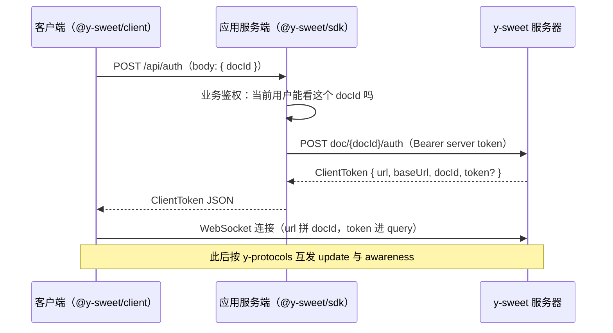

import { Meta } from '@storybook/addon-docs/blocks';

<Meta id="y-sweet" title="服务端/y-sweet" name="Docs" />

# y-sweet

y-sweet 是 Jamsocket 出品的 yjs 服务端：一个 Rust 编写的「文档存储 + 实时同步后端」，MIT 开源，可以自托管（npm wrapper / Docker / 原生二进制），也可以跑在 Jamsocket 托管平台上。与 [y-websocket 服务端](?path=/docs/y-websocket-server--docs) 这个参考实现的本质差别不在同步协议——线上跑的仍是同一套 y-protocols——而在**授权模型与托管运维**：谁能访问哪份文档由你的应用服务端签发 client token 决定，文档存储、持久化与水平扩展由 y-sweet 承担。

先建立三个能预测全文的事实：

- **三个角色一条链**：y-sweet 服务器管存储与转发；你的应用服务端持有 server token（连接字符串），调管理 API 并按业务规则签发 client token；客户端凭 client token 直连 y-sweet。token 是唯一的授权闸门。
- **docId 既定位文档也界定授权**：每份文档一个 docId，每个 client token 绑定一个 docId；签发走 `getOrCreateDocAndToken`，文档不存在则先幂等创建（`createDoc` 对已存在的 ID 是空操作）。
- **客户端不认服务器地址，只认 authEndpoint**：`createYjsProvider` 接收的是你自己的签发接口（或一个直接返回 token 的函数）；服务器地址与凭证都装在 ClientToken 里，客户端无需任何关于 y-sweet 的静态配置。



以下默认值逐条核对自本工作区安装的 `@y-sweet/client@0.9.1`、`@y-sweet/sdk@0.9.1` 源码与 y-sweet 0.9.1 CLI（`--help` 与实测）：

| 项 | 默认值 | 回查要点 |
| --- | --- | --- |
| 起服务命令 | `npx y-sweet@latest serve` | 默认端口 `8080`、内存存储；加目录参数才落盘，`s3://` 前缀走 S3 |
| 连接字符串 | `ys://host:port` | `ys://` = http/ws，`yss://` = https/wss；server token 放用户名段 `ys://token@host` |
| SDK 入口 | `new DocumentManager(connectionString)` | 另有 `getOrCreateDocAndToken` 等三个顶层便捷函数 |
| 客户端入口 | `createYjsProvider(doc, docId, authEndpoint)` | `connect: true` 创建即连接；注意 doc 是第一个参数 |
| token 授权级别 | `full` | `read-only` 时本地写入只 `console.warn`，服务器不应用 |
| token 有效期 | 由服务端决定 | `validForSeconds` 收窄；过期后客户端重连时自动重新签发 |
| 心跳 | 2 秒一次 sync-status 查询 | 3 秒无回包判定僵死，关连接重连 |
| 重连退避 | `500ms × min(10, 1.1^n)` | 同一 token 连试 3 次不通则丢弃，重新走签发端点 |

## 授权模型

y-sweet 把「谁能访问哪份文档」从同步服务器手里拿走，放进你的应用服务端。对照 [y-websocket 服务端](?path=/docs/y-websocket-server--docs)：那边的鉴权是「params 拼上 URL、服务端在 upgrade 阶段自行校验」；y-sweet 这边是一条独立的签发链路——授权判断发生在你自己的 HTTP 端点里，同步服务器只负责验 token 的真伪、授权级别与有效期。

两级凭证不要混淆：

- **server token**：管理 API 的凭证，只存在于你的服务端。它与服务器地址合编为连接字符串（`ys://token@host:port`），`DocumentManager` 构造时解析，之后每次管理请求以 `Authorization: Bearer` 带上。泄露它等于泄露整个服务。
- **client token**：单文档的连接凭证，由管理 API 签发、经你的服务端转发给客户端。`ClientToken` 结构（0.9.1 类型定义）：

| 字段 | 必有 | 含义 |
| --- | --- | --- |
| `url` | 是 | 文档 WS 端点的基地址，客户端会再拼上 docId |
| `baseUrl` | 是 | 文档级 HTTP 端点（`as-update` / `update` 走这里） |
| `docId` | 是 | 该 token 绑定的文档；客户端校验它与请求的 docId 一致，否则直接抛错 |
| `token` | 否 | 持有者凭证；开发模式（服务端无鉴权）时不签发此字段 |
| `authorization` | 否 | `full` / `read-only`，缺省为 `full` |

签发时可传 `AuthDocRequest` 收窄：`authorization: 'read-only'` 让持有者只读（本地仍可写但服务器不应用，客户端 `console.warn` 提示）；`validForSeconds` 限制有效期；`userId` 关联用户（0.9.1 类型注释：目前未被使用）。

实测（0.9.1）：开发模式签发的 ClientToken 为 `{"url":"ws://127.0.0.1:8901/d/probe-demo/ws","baseUrl":"http://127.0.0.1:8901/d/probe-demo","docId":"probe-demo","authorization":"full"}`——没有 `token` 字段；`--auth` 起服务后同样调用会多出一个 `token` 字段，`authorization` 按请求收窄为 `read-only`。

服务端自身的鉴权开关在 `serve --auth`：先用 `npx y-sweet@latest gen-auth --json` 生成密钥对 `{"private_key": "…", "server_token": "…"}`，以 `--auth <private_key>` 起服务，连接字符串里带 `<server_token>`。实测三种结果：没带 server token 调管理 API → `YSweetError` `NoAuthProvided`；带错 token → `InvalidAuthProvided`；正确 → 正常签发。生产部署必须开，见「自托管与托管」。

## 快速上手

目标：本地起 y-sweet，经签发端点让两个客户端互相同步，并验证服务器侧确实持有文档。需要 Node.js 20+；依赖已在本工作区装好（`@y-sweet/sdk` / `@y-sweet/client` / `yjs` / `ws`）。

**1. 起 y-sweet 服务。** 指定存储目录才会落盘；不带目录则纯内存、重启即失：

```bash
npx y-sweet@latest serve ./y-sweet-data
```

启动日志会打印 `No auth key set. Only use this for local development!` 与连接字符串 `ys://127.0.0.1:8080`。

**2. 起令牌签发服务。** 本课 [`auth-server.js`](./auth-server.js) 用 node 原生 http + `DocumentManager` 实现 `POST /api/auth`：先做业务鉴权（演示用 `ALLOWED_DOCS` 白名单），通过后 `getOrCreateDocAndToken` 签发并原样返回——与 tester/ 项目在 `vite.config.ts` 里挂 `/api/auth` 中间件是同一模式，只是换成独立进程：

```bash
CONNECTION_STRING=ys://127.0.0.1:8080 node auth-server.js   # 监听 127.0.0.1:3002
```

**3. 跑全链路验证。** 本课 [`check-sync.js`](./check-sync.js) 起两个 `Y.Doc` 各挂一个 `YSweetProvider`（A 用字符串形态 authEndpoint，B 用函数形态）连同一 docId，A 写入等 B 收到、B 追加等 A 收到，最后用 SDK 直读服务端快照：

```bash
node check-sync.js
```

实测输出（0.9.1，node 24，docId 为随机生成的 `probe-demo`）：

```text
ClientToken：url=ws://127.0.0.1:8901/d/probe-demo/ws baseUrl=http://127.0.0.1:8901/d/probe-demo docId=probe-demo token=（开发模式无） authorization=full
实际连接地址：ws://127.0.0.1:8901/d/probe-demo/ws/probe-demo
事件序列：A connection-status:handshaking → B connection-status:handshaking → A sync:true → A connection-status:connected → A local-changes:false → B sync:true → B connection-status:connected → B local-changes:false → A local-changes:true → A local-changes:false → B local-changes:true → B local-changes:false
两端一致：true
服务端快照一致：true
最终内容：你好，y-sweet！ —— 来自 B 的追加
RESULT: OK
```

三处证据对应三个结论：事件序列里 `local-changes:true → false` 一对恰好包住一次本地写入的「发出 → 服务器 ACK」；`服务端快照一致` 证明 y-sweet 不只是转发器，它持有文档真源（`getDocAsUpdate` 直读得到相同内容）；落盘文件为 `./y-sweet-data/<docId>/data.ysweet`，按 `--checkpoint-freq-seconds`（默认 10 秒）检查点写入。

说明运行条件：以上三条命令都需要本机真实起服务，Storybook 无法稳定复现这个进程组合，所以本课不内嵌实例、以脚本为证据载体；`8901` 为实测时的端口，照抄时换成 `8080`。

## 服务端 SDK

`@y-sweet/sdk` 是应用服务端一侧的管理客户端，全部导出（0.9.1）：`DocumentManager` 类、三个顶层便捷函数、`DocConnection`、`YSweetError` 与 `encodeClientToken` / `decodeClientToken`。

`DocumentManager` 方法表（端点路径核对自 0.9.1 源码）：

| 方法 | 管理端点 | 用途与要点 |
| --- | --- | --- |
| `new DocumentManager(connectionString)` | — | 解析 `ys://` / `yss://`；用户名段为 server token |
| `checkStore()` | `POST check_store` | 存储健康检查，实测返回 `{ ok: true }` |
| `createDoc(docId?)` | `POST doc/new` | 创建文档；已存在是幂等空操作；不传则随机生成 ID |
| `getClientToken(docId, auth?)` | `POST doc/{docId}/auth` | 为既有文档签发 ClientToken；`auth` 即 `AuthDocRequest` |
| `getOrCreateDocAndToken(docId?, auth?)` | 上两者组合 | 签发端点最常用的一个调用 |
| `getDocAsUpdate(docId)` | `GET {baseUrl}/as-update` | 直读服务端文档快照（Yjs update 字节串） |
| `updateDoc(docId, update)` | `POST {baseUrl}/update` | 服务端直写文档：初始化内容、迁移、机器人写入 |
| `getDocConnection(docId, auth?)` | — | 返回 `DocConnection`，`getAsUpdate()` / `updateDoc()` 的承载者 |
| `createDocWithContent(update)` | `doc/new` + `update` | 建文档并写入初始内容，一步到位 |

三个顶层函数 `getOrCreateDocAndToken(connectionString, docId?, auth?)`、`getClientToken(connectionString, docId, auth?)`、`createDoc(connectionString, docId?)` 是无状态包装——serverless 函数或一次性脚本里不必持有 manager 实例；`DocumentManager` 实例形态适合长期服务（本课 `auth-server.js` 与 tester/ 的 vite 中间件都是实例形态）。

服务端直读直写与 [文档更新与同步协议](?path=/docs/document-updates--docs) 手工同步的是同一对象（Yjs update 字节串）：

```js
import * as Y from 'yjs';

// 快照导出：把服务端文档读成一份本地 Y.Doc
const update = await manager.getDocAsUpdate(docId);
const doc = new Y.Doc();
Y.applyUpdate(doc, update);

// 内容初始化 / 迁移：编码后直写服务端
await manager.updateDoc(docId, Y.encodeStateAsUpdate(doc));
```

`YSweetError` 的 `cause.code` 五种取值，覆盖排查时的全部入口：`ServerRefused`（连不上，带 `address` / `port` / `url`）、`ServerError`（HTTP 非 2xx，带 `status` / `message` / `url`）、`NoAuthProvided`（401，没带 server token）、`InvalidAuthProvided`（401，token 不对）、`Unknown`。`YSweetError.fromMessage` 可从错误字符串重建 payload，为 Next.js 只传 `message` 的场景准备。

`encodeClientToken` / `decodeClientToken` 把 ClientToken 编成 base64url 字符串再解回——客户端连接成功后在控制台打印的 Y-Sweet Debugger 链接，payload 就是这么编码的。

## 客户端

`@y-sweet/client` 的唯一入口：

```ts
const provider = createYjsProvider(doc, docId, authEndpoint, {
  connect: true,            // 默认创建即连接
  showDebuggerLink: false,  // 默认 true：连接成功后在控制台打印 debugger 链接
});
```

参数顺序与 y-websocket 不同：`doc` 在前、`docId` 居中，第三参 `authEndpoint` 两种形态：

- **字符串**：Provider 向它 `POST` JSON `{"docId": "…"}`，期望 200 + ClientToken JSON；返回的 `docId` 与请求不一致直接抛错。
- **函数**：`() => Promise<ClientToken>`，fetch 细节（cookie、自定义头、SSR 直传）自己掌控——`check-sync.js` 里 B 端用的就是这种。
- 另有 `initialClientToken` 选项：服务端渲染时已经把 token 带到前端的话，跳过首次签发请求。

**状态与事件。** 原生状态五态：`offline → connecting → handshaking → connected`，异常为 `error`；经 `connection-status` 事件发出（载荷是状态字符串本身）。为兼容 y-websocket 习惯，兼容层同时发：`status`（`{status}`，三态映射 `connected→connected`、`connecting/handshaking→connecting`、其余→`disconnected`）、`sync` 与 `synced`（`connected` 翻转时发 boolean）、`connection-close`、`connection-error`。y-sweet 自有的 `local-changes` 事件与 `hasLocalChanges` 属性回答「本地还有没有没同步上去的改动」：本地写入时发 `true`，服务器 ACK 该版本后发 `false`——快速上手的实测事件序列里能逐条对上。awareness 与文档 update 同管道，机制见 [Awareness 与在线状态](?path=/docs/awareness--docs)。

一个来自源码的实测细节：`connect()` 在构造器里被调用，`connecting` 状态同步发出——`createYjsProvider` 返回后再 `on()` 是赶不上它的。要在日志里看到完整序列，用 `{ connect: false }` 创建、挂好监听再 `provider.connect()`。

**重连与心跳**（常量核对自 0.9.1 客户端源码）：连接断开自动进重连循环；同一 token 连试 3 次不通就丢弃它、重新走 authEndpoint 签发新 token——token 过期不需要手动刷新。重连退避 `500ms × min(10, 1.1^n)`，签发失败退避 `3000ms × min(10, 1.1^n)`。连接期间每 2 秒发一次 sync-status 查询，3 秒无回包判定僵死、关连接重连（兼容不回应该消息的旧服务端：首次收到 sync 响应前不启用这条超时）；浏览器 `online` 事件会立即唤醒重连。

其余选项与成员：

| 成员 | 默认 | 回查要点 |
| --- | --- | --- |
| `awareness` | 新建 `Awareness(doc)` | 传入既有实例可与其他 Provider 共享 |
| `WebSocketPolyfill` | 全局 `WebSocket` | Node 20 无全局 WebSocket，注入 `ws` 包（本课脚本即如此） |
| `offlineSupport` | `false` | `true` 时内建 IndexedDB 离线缓存，AES-GCM 加密、密钥存 `YSWEET_OFFLINE_KEY` cookie，仅浏览器 |
| `warnOnClose` | `false` | `true` 时存在未 ACK 改动则阻止关闭页面 |
| `connect()` / `disconnect()` / `destroy()` | — | 断开与销毁不影响本地文档数据 |
| `generateUrl(clientToken)` | — | 实际连接地址 = `url` 补 `/` 拼 docId、`token` 进 query；由库内部拼接，不要手工构造 |
| `debugUrl` / `shouldConnect` / `wsconnected` / `wsconnecting` / `synced` | 已弃用 | 分别用 `connection-status` 事件与 `status` 属性替代 |

## 自托管与托管

同一套授权模型与 API 跑在四种形态上，应用代码不变，只换连接字符串：

| 形态 | 入口 | 要点 |
| --- | --- | --- |
| npm wrapper | `npx y-sweet@latest serve` | 下载对应平台的 Rust 二进制再执行；本地开发与小型部署够用 |
| Docker | `ghcr.io/jamsocket/y-sweet` | 官方镜像，生产自托管推荐 |
| crates.io | `y-sweet` / `y-sweet-core` | 嵌入自有 Rust 服务 |
| Jamsocket 托管 | 控制台创建后端 | 水平扩展与运维由平台承担，可自带存储；`serve-doc` 子命令即其 session backend 模式（实测不带 `SESSION_BACKEND_KEY` 拒绝启动） |

`serve` 全部选项（`y-sweet serve --help`，0.9.1）：`[STORE]` 存储位置（默认内存；目录则 `<store>/<docId>/data.ysweet` 落盘；`s3://` 前缀走 S3 兼容桶并读本地 AWS 凭证）、`--port`（`8080`）、`--host`、`--checkpoint-freq-seconds`（`10` 秒）、`--auth`（private key）、`--url-prefix`（反代后对外地址）、`--prod`（抑制启动横幅里的连接字符串与提示）、`--max-body-size`；每项都有对应的 `Y_SWEET_*` / `PORT` 环境变量。另有 `gen-auth`（生成密钥对）、`convert-from-update`（stdin 读 YDoc v1 update 转 `.ysweet` 文件，迁移用）、`version`。

托管与自托管的差异只在运维侧：扩展、存储可靠性、升级由平台承担；授权链路、SDK 与客户端完全一致。

**现状提示（2026-10 核对）**：Jamsocket 已并入 Modal，原官方文档站 `docs.jamsocket.com/y-sweet` 跳转至收购公告，`@y-sweet/sdk` README 指向的 `www.y-sweet.dev` 已不可达；GitHub 仓库未归档（最近 push 2025-12），本课以其 README 与 `docs/running.md` 为准。选型时把托管服务的延续性列入评估，自托管路径不受影响。

## 最佳实践

- 业务权限校验固定在签发端点内做（`auth-server.js` 里白名单的位置就是真实项目的鉴权中间件位置），不要依赖「docId 够长够随机」——docId 在 URL、日志与 debugger 链接里都会留下痕迹。
- 生产起服务三件套：`--auth`（不开则管理 API 无鉴权）、`--prod`（不把含 server token 的连接字符串打进日志）、存储目录或 `s3://`（不指定则重启即失）。
- token 有效期用 `validForSeconds` 收窄到会话量级；客户端重连循环第 4 次会自动重新走 authEndpoint 换新 token，不需要自建刷新逻辑——但签发端点必须幂等且快。
- 初始化内容、导出快照、离线迁移走 SDK 直读写（`createDocWithContent` / `getDocAsUpdate` / `updateDoc`），这是相对 4.1 参考实现的现成能力，不必再挂持久化钩子。
- 浏览器端开 `offlineSupport` 前想清楚：缓存加密密钥在 cookie 里，清 cookie 等于清离线缓存；通用离线编辑机制（不加密、可自管）见 [y-indexeddb 离线](?path=/docs/y-indexeddb--docs)。

## 常见问题

- 客户端一直 `connecting`/`error` 循环，控制台反复 `Failed to get client token`？
  签发端点协议不符：必须是 `POST`、接收 JSON `{"docId": "…"}`、返回 ClientToken JSON，且返回的 `docId` 必须与请求一致（客户端会校验，不一致直接抛错）。签发失败后按 3 秒起步退避重试，端点修好即自愈。用 `curl -X POST -H 'Content-Type: application/json' -d '{"docId":"x"}' <端点>` 对照本课的实测样本排查。
- 开发模式的 ClientToken 里没有 `token` 字段，是漏了吗？
  正常。服务端以无 `--auth` 方式启动（启动日志有 `No auth key set` 警告）时不签发该字段；`--auth` 起服务后才有。两级凭证的开销只在需要鉴权时存在。
- `read-only` 客户端本地改了文档，为什么别人看不到？
  授权级别为 `read-only` 时，本地写入只更新本地副本并触发 `console.warn`，服务器拒绝应用。需要写权限就重新以 `full` 签发；前端应同时按 `authorization` 禁用编辑入口，而不是等用户发现丢失。
- `status` 事件的取值和 y-websocket 文档对不上？
  你大概率混用了两套事件：y-sweet 原生的是 `connection-status`（五态字符串），`status` / `sync` / `synced` 是兼容层的 y-websocket 风格映射（三态 + boolean）。新代码统一用 `connection-status` 与 `local-changes`。
- 页面刷新后数据还在吗？
  在服务端：y-sweet 是文档存储而非纯转发器，客户端断开不影响文档；但内存模式重启即失，持久化必须指定存储目录或 `s3://`。客户端侧 `destroy()` 只拆管道，本地文档数据原样保留。

## 总结回顾

摘要：

y-sweet 用一条三级链路替代了参考服务端的「params 拼 URL」鉴权：应用服务端持连接字符串（服务器地址 + server token）调管理 API，业务鉴权通过后为某个 docId 签发 ClientToken，客户端凭它直连 y-sweet。`@y-sweet/sdk` 的 `DocumentManager` 覆盖文档创建、签发、直读直写与健康检查，三个顶层函数适配 serverless；`@y-sweet/client` 的 `createYjsProvider(doc, docId, authEndpoint)` 把 token 获取、连接、五态状态机、心跳与退避重连（同一 token 试 3 次后自动重新签发）全部收进一个 Provider，并用 `local-changes` 回答「有没有没同步上去的改动」。本地 `npx y-sweet serve` 默认内存存储、无鉴权，落盘与 `--auth` 都要显式开；托管与自托管共用同一套 API，差异只在运维侧。注意 Jamsocket 已并入 Modal，文档站不可达，以 GitHub 仓库为准。

一句话：

> 授权在签发、存储在服务端：你的应用服务端按 docId 签发 client token，客户端凭它直连 y-sweet——同步服务器从此只管验 token、存文档、做转发。

知识要点：

- 三级角色各自持有什么凭证？server token 与 client token 的泄露面差在哪？
- 签发端点的协议约定是什么（方法、请求体、响应、docId 校验）？
- `createYjsProvider` 的参数顺序与 authEndpoint 的两种形态？
- `connection-status` 五态与兼容层 `status` / `sync` 事件的映射关系？`local-changes` 什么时候翻转？
- token 过期后客户端怎么恢复，为什么不需要手动刷新？
- 本地开发默认行为（内存存储、无鉴权）与生产三件套分别是什么？

## 参考资料

- [y-sweet 官方仓库（README、CLI 与示例）](https://github.com/jamsocket/y-sweet)
- [y-sweet docs/running.md（自托管运行与存储）](https://github.com/jamsocket/y-sweet/blob/main/docs/running.md)
- [@y-sweet/client（npm）](https://www.npmjs.com/package/@y-sweet/client)
- [@y-sweet/sdk（npm）](https://www.npmjs.com/package/@y-sweet/sdk)
- [Jamsocket 加入 Modal 的公告（托管服务现状）](https://modal.com/blog/jamsocket-is-joining-modal)
