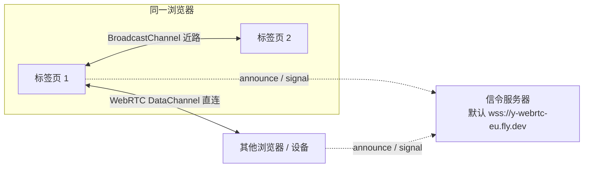

import { Canvas, Controls, Meta } from '@storybook/addon-docs/blocks';
import * as Stories from './y-webrtc.stories';

<Meta of={Stories} name="Docs" />

# y-webrtc

y-webrtc 是 yjs 的 P2P Provider：没有中心服务器，同一房间的各端先经信令服务器互换 WebRTC 连接信息，然后建立 DataChannel 直连，文档 update 与 awareness 状态在直连通道上端到端互发。[文档更新与同步协议](?path=/docs/document-updates--docs) 手工跑过的 SyncStep1 / SyncStep2 / Update，就是它建连之后在通道上跑的东西；[y-websocket](?path=/docs/y-websocket--docs) 那套「服务器转发」模型里服务器的角色，在这里被压缩成一次性的「介绍人」。

先建立三个能预测全文的事实：

- **「房间名」是唯一的汇合键**：同房间名、同密码、传输可达的端互相同步；它同时还是 BroadcastChannel 通道名和密码派生的盐。
- **`connected` 不表示连上了任何人**：它只表示「正在寻找对等端」。找不到对等端时它也是 `true`——P2P 里「有没有人或我连没连上所有人」本来就没有全局答案。
- **信令服务器看不到文档内容**：它只转发 announce 与 signal（offer / answer / ICE 候选）；设了密码之后，连这些介绍信息都是加密的。内容走的 DataChannel 由 WebRTC 强制 DTLS 加密。



构造签名 `new WebrtcProvider(roomName, doc, opts?)`。以下默认值逐条核对自 y-webrtc 10.3.0 源码——注意 GitHub README 列的默认信令地址（signaling.yjs.dev 等三个）已过时，以源码为准：

| 参数 / 选项 | 默认值 | 回查要点 |
| --- | --- | --- |
| `roomName` | 必填 | 汇合键 + BC 通道名 + 密码盐；同一 JS 环境全局唯一，重名抛错 |
| `doc` | 必填 | 同步对象；`destroy()` 不会销毁它，`doc.destroy()` 会级联销毁 Provider |
| `signaling` | `['wss://y-webrtc-eu.fly.dev']` | 并发连接全部地址；传 `[]` 只剩 BroadcastChannel 近路 |
| `password` | `null` | 非空时经 PBKDF2（盐 = 房间名，10 万次迭代）派生 AES-GCM-256 密钥 |
| `awareness` | 新建 `Awareness(doc)` | 传入既有实例可与其他 Provider 共享在线状态（机制见 [Awareness 与在线状态](?path=/docs/awareness--docs)） |
| `maxConns` | `20 + floor(random × 15)`（20–34） | WebRTC 直连上限；随机因子让各端上限错开，降低连接图分裂成孤岛的概率 |
| `filterBcConns` | `true` | 经 BC 可达的对等端（同浏览器标签页）不再重复建立 WebRTC |
| `peerOpts` | `{}` | 透传 simple-peer 构造器；配 TURN 走 `config.iceServers` |

## 快速上手

```ts
import * as Y from 'yjs';
import { WebrtcProvider } from 'y-webrtc';

const doc = new Y.Doc();
// 房间名相同的端互相同步;password 可选
const provider = new WebrtcProvider('my-room', doc, { password: 'optional' });

doc.getText('shared').insert(0, 'hello');
```

最小验证：把这段代码跑在**同一浏览器的两个标签页**里——不经任何网络，BroadcastChannel 近路即同步。换不同浏览器或设备时，两端还要能连上同一台信令服务器（默认公共地址即可）才能互找。

## 房间与密码

房间由全局单例注册表管理：**同一 JS 环境里同名房间只允许存在一个**。同页（或同一进程）创建第二个同房间名的 Provider 会抛 `A Yjs Doc connected to room "X" already exists!`——而且抛在 promise 回调里，第二个 Provider 永远卡在 `connected=false`（10.3.0 实测）。想同页演示两端同步，用 y-websocket 的双 Provider 写法；y-webrtc 的对应演示只能靠两个真实浏览上下文（见下文实例）。

`password` 的边界要说清三层：

- **加密什么**：BC 消息全文、信令 publish 的内容（announce / signal）。密钥由 `PBKDF2(password, 盐 = 房间名, 100000 次, SHA-256)` 派生 AES-GCM-256。
- **不加密什么**：DataChannel 上的文档 update 不经过这层——但 WebRTC 本身强制 DTLS 加密，内容对传输路径上的任何人（包括 TURN 中继）都不可见。signal 消息被加密意味着 DTLS 证书指纹不会被信令服务器篡改，这正是官方所说「在不可信公共信令上防中间人」的机制。
- **盖不住什么**：房间名以明文出现在信令的 topic 字段里——信令服务器知道「有人在房间 X」，只是读不到内容。密码不一致的端之间：消息解密失败后**静默丢弃**（控制台可见未捕获的解密异常），没有握手错误提示。

## 信令与连接建立

信令服务器只做一件事：按 topic（= 房间名）转发 JSON 消息。y-webrtc 自带一个极简参考实现（`bin/server.js`），自托管一行起：

```bash
npx y-webrtc-signaling        # 或 PORT=4444 node ./bin/server.js,默认端口 4444
```

消息协议只有四种：`subscribe` / `unsubscribe`（加入、离开 topic）、`publish`（转发 announce 与 signal）、`ping` / `pong`（保活，30 秒无响应剔除连接）。信令 WS 断线自动重连，退避 `min(log10(n+1) × 1200ms, 2500ms)`，重连成功后自动重新 subscribe + announce。

完整建连时序——从 announce 到 synced：

```mermaid
sequenceDiagram
  participant A as 端 A(新加入)
  participant S as 信令服务器
  participant B as 端 B(已在房间)
  A->>S: subscribe(房间名) + announce{from: A}
  S-->>B: 转发 announce
  Note over B: webrtcConns 数 < maxConns<br/>→ 作为发起方创建 Peer
  B->>S: signal{to: A, offer, token}
  S-->>A: 转发 offer
  A->>S: signal{to: B, answer}
  S-->>B: 转发 answer
  Note over A,B: ICE 候选同样经 signal 消息互发;<br/>打洞成功 → DataChannel open
  A->>B: SyncStep1(DataChannel 直连)
  B->>A: SyncStep1
  B->>A: SyncStep2(你缺的差量)
  A->>B: SyncStep2
  Note over A,B: 各自 peer.synced=true → 房间级 synced 事件;<br/>此后逐条互发 Update,信令不再参与
```

三个控制点各自生效的时刻：

- **`maxConns`** 只在收到 `announce` 时检查：已满就不再向对方发起。但只收 announce 才受限、收到 offer 不受限，加上直连上限是软性的——只要连接图连通，间接相连的端之间也收敛（官方：clients still sync if connected at least indirectly）。`maxConns = Infinity` 即全互联，音视频会议场景才需要。
- **`filterBcConns`**（默认开）：接入 BC 时向同源标签页广播自己的 peerId；之后**来自这些 peerId 的信令消息直接被忽略**——同浏览器标签页之间走 BC 就够了，不再浪费 WebRTC 连接额度。想给同页标签传摄像头流时才关它（配合 `maxConns = Infinity`）。
- **双向同时发起（glare）**：双方都带着 offer 撞上时，比随机 token，小的一方接受对方的 offer，保证只剩一条连接。

下面实例把「信令之后的那一半」搬到同页：两条原生 `RTCPeerConnection` 直连，offer / answer / ICE 候选由本页内的直接调用传递（真实场景里就是信令服务器转发的 signal 消息），DataChannel 打开后跑与 y-webrtc 完全相同的 y-protocols 同步：

<Canvas of={Stories.DataChannelLoopback} />
<Controls of={Stories.DataChannelLoopback} />

| 读者操作 | 可观察证据 |
| --- | --- |
| 默认（建立连接） | 「连接状态 A / B」走到 connected、通道 open；互发 SyncStep1 / SyncStep2 后两端一致 |
| 修改「文档 A 内容」或「文档 B 内容」 | 对应「本地 update」+1、对端「接收 update」随即 +1——P2P 是双向直连 |
| 关闭「建立连接」后改两边内容 | 通道 closed，两端各自分叉，「两端一致」变「否」 |
| 重新打开「建立连接」 | 重新交换 offer / answer，握手按差量追平，一致恢复「是」 |
| 打开 Show code | 看到 `datachannel-loopback.ts`：信令搬运的三个字串长什么样、通道上的 SyncStep1 / Update 怎么收发 |

## BroadcastChannel 同域近路

与 y-websocket 一样，y-webrtc 默认接入 BroadcastChannel；不同点是**通道名就是房间名本身**（不拼任何服务器地址，也没有 `disableBc` 开关——`signaling: []` 就是纯 BC 模式）。接入时连发四条消息（SyncStep1 + SyncStep2 + queryAwareness + 本地 awareness 状态），随后逐条转发增量；设了密码则 BC 消息同样加密。

关键事实：

- BC 受同源策略限制：同浏览器、同 origin 的标签页 / iframe 之间直达，跨浏览器不相通。
- BC 可达的对等端会被 `filterBcConns` 从 WebRTC 互找中过滤掉，所以同浏览器标签页之间**只有 BC、没有 WebRTC**——这也是纯标签页场景下 `synced` 翻不上来的原因（见下节）。
- 房间断开（`disconnect()`）时会向 BC 广播 peerId 移除与 awareness 离线。

## 状态、事件与生命周期

P2P 没有中心，状态语义和 y-websocket 有本质差别，先记住两条：**`connected` 只表示「正在寻找对等端」**（实测 `signaling: []`、零网络下它照样是 `true`）；**`synced` 只统计 WebRTC 对等端**——某条 DataChannel 上收到对方的 SyncStep2，该对等端标记为已同步；全部 WebRTC 对等端都已同步时房间级 `synced` 事件才报 `true`。BC 近路上的同步完全不参与，对等端集合为空时按「全部完成」处理，所以别拿它判断内容是否对齐。

| 事件 | 载荷 | 时机 |
| --- | --- | --- |
| `status` | `{ connected }` | `connect()` / `disconnect()` 生效后（房间密钥派生完毕才首发） |
| `synced` | `{ synced }` | 全部 WebRTC 对等端完成握手 → `true`；对等端断开或新对等端完成同步时，按「剩余对等端是否全部已同步」重新评估 |
| `peers` | `{ added, removed, webrtcPeers, bcPeers }` | WebRTC 对等端建立 / 断开、BC 对等端进出 |

| 属性 / 方法 | 含义 |
| --- | --- |
| `provider.connected` | 只读；= 房间就绪且 `shouldConnect`，不代表连上任何对等端 |
| `provider.room` | Room 实例：`peerId`（随机 uuid，仅用于信令寻址）、`webrtcConns`、`bcConns`、`synced`；密码派生密钥就绪前为 `null` |
| `provider.signalingConns` | 信令连接实例（lib0 WebsocketClient）；同页多个 Provider 用同一地址时共享一条 WS |
| `provider.awareness` | Awareness 实例，与文档 update 共用通道 |
| `connect()` / `disconnect()` | 加入 / 离开：断开信令订阅、退 BC、断全部 WebRTC；文档照常本地读写 |
| `destroy()` | 断开并移除房间注册（之后同名房间可重建）；`doc` 数据原样保留 |

通道消息（BC 与 DataChannel 共用，外层 varUint 类型）：`0` sync（内层 SyncStep1 / SyncStep2 / Update）、`1` awareness、`3` queryAwareness、`4` bcPeerId（BC 上宣告 peerId，`filterBcConns` 的依据）。

下面实例创建**一个真实运行的 `WebrtcProvider`**——本页只有它自己，对等端要由你制造：复制本标签页，或在其他浏览器打开同一房间名。它同时是本课所有状态语义的观察台：

<Canvas of={Stories.TabSync} />
<Controls of={Stories.TabSync} />

| 读者操作 | 可观察证据 |
| --- | --- |
| 复制本标签页（同一浏览器） | 新标签页以绿色 `BC` 芯片出现在对等端区，「awareness 在线」+1；改「文档内容」两标签页互通 |
| 取消「连接信令服务器」（或干脆断网）再复制标签页 | 信令行变灰，BC 对等端照常出现、照常同步——BC 近路零网络 |
| 只给其中一个标签页改「房间密码」 | 两端立刻互相同步不上（消息解密失败被丢弃）；「已接收 update」停在原地 |
| 其他浏览器 / 设备打开本页并把「房间名」改成同一值 | 对等端以蓝色 `RTC` 芯片出现——经信令互找后的 DataChannel 直连；跨网络依赖公共信令服务器可用性 |
| 取消再勾选「加入房间」 | `connected` 翻 `false` 再翻 `true`，重新 announce、重新发现对等端 |
| 打开 Show code | 看到 `tab-sync.ts`：Provider 创建、`status` / `synced` / `peers` 监听与重建逻辑 |

注意读数里 `connected` 与对等端数量的关系：哪怕对等端永远是 0，`connected` 也是 `true`——这就是「连上 ≠ 有对等端」的直接证据。「maxConns」读数每次重建 Provider 都变（20–34 的随机值），正是默认上限随机因子的可视化。

## NAT 穿透与网络边界

DataChannel 能不能建成，取决于 ICE 打洞。y-webrtc 经 simple-peer 默认只带两个公共 STUN（`stun.l.google.com:19302`、`stun.global.twilio.com:3478`），**不带 TURN**：

- **host 候选**：局域网 / 同机直连，最优先。
- **srflx 候选**：STUN 反身地址，覆盖大多数家用 NAT。
- **relay 候选**：只有配了 TURN 才有。对称 NAT、严格企业防火墙下打洞必然失败——表现是信令已连、`peers` 事件里对方一闪而过，`webrtcPeers` 始终为 0。

配 TURN 走 `peerOpts`（整体透传 simple-peer，`config` 会整体替换默认配置，要保留 STUN 需一并写上）：

```ts
const provider = new WebrtcProvider('my-room', doc, {
  peerOpts: {
    config: {
      iceServers: [
        { urls: 'stun:stun.l.google.com:19302' },
        { urls: 'turn:turn.example.com:3478', username: 'user', credential: 'pass' },
      ],
    },
  },
});
```

TURN 中继只转发 DTLS 密文，读不到内容；代价是带宽与延迟都落到你的服务器上——走到这一步，「P2P 省服务器」的优势就只剩隐私了，值得重新评估中心式 Provider。纯局域网场景最舒服：自托管信令（`ws://局域网地址:4444`），host 候选直连，全程零外网。

## 最佳实践

- **按规模选型**：y-webrtc 是全互联 mesh，连接数 O(n²)，官方明示不适合单文档大量协作者。适合几人规模的小房间、局域网、隐私优先（内容不过服务器）场景；更大规模用 [y-websocket](?path=/docs/y-websocket--docs) 或托管服务，两者叠加的拓扑见 [Provider 组合](?path=/docs/meshing-providers--docs)。
- **生产自托管信令并给多个地址**：`signaling` 数组会并发连接全部地址、谁先通用谁；公共信令只是汇合点、不存数据——它挂了不影响已建立的 P2P 连接，只让新对等端找不到彼此，但可用性不在你手里。
- **离线要自己补**：y-webrtc 不做任何持久化，刷新即丢（除非房间里还有别人在线）。离线编辑与重开不丢，叠加 [y-indexeddb 离线](?path=/docs/y-indexeddb--docs)。
- **别拿 `connected` / `synced` 判断内容对齐**：前者只说在找对等端，后者只数 WebRTC 握手。要判断对齐，比较文档内容或 state vector（见 [文档更新与同步协议](?path=/docs/document-updates--docs)）。
- **调试开日志**：`localStorage.log = 'y-webrtc'`（lib0/logging），信令互找与连接建立全过程可见。

## 常见问题

- 控制台抛 `A Yjs Doc connected to room "X" already exists!`？
  同一 JS 环境里同名房间是全局单例：第二个同房间名 Provider 在 promise 回调里抛错，永远卡在 `connected=false`。先 `destroy()` 旧的再建（destroy 后同名房间可复用），或换房间名。想同页演示两端同步，改用 y-websocket 的双 Provider 写法。
- `connected=true` 却什么都没同步？
  `connected` 只表示「正在寻找对等端」。按顺序查：`peers` 事件有没有出现对方 → 没有，查信令（同地址、同房间名、密码一致、信令连接已建立）→ 有但一闪而过，查 NAT / TURN。
- 密码不一致没有任何报错，就是不同步？
  加密消息解密失败后直接静默丢弃（控制台有未捕获的解密异常），没有握手错误。两端「房间名 + 密码」完全一致才会通。
- `synced` 一直是 `false`，内容明明一致？
  `synced` 只统计 WebRTC 对等端的握手；同浏览器标签页之间走 BroadcastChannel 近路，完全不参与——纯 BC 场景它永远不翻转，属正常行为。
- 跨网络两台设备一直连不上，信令明明显示已连接？
  多半是对称 NAT 或企业防火墙打洞失败，默认配置只有 STUN 没有 TURN。配 TURN（见 NAT 一节），或改用中心式 Provider。

## 总结回顾

摘要：

y-webrtc 把同步拓扑从「服务器转发」换成「信令介绍 + P2P 直连」：房间名是唯一的汇合键（兼作 BC 通道名与密码盐），信令服务器只按房间转发 announce 与 signal 消息，offer / answer / ICE 候选交换完毕后文档 update 与 awareness 就走 DataChannel 端到端互发，信令不再参与。同浏览器标签页经 BroadcastChannel 近路同步并被 `filterBcConns` 挡在 WebRTC 互找之外；`maxConns`（默认 20–34 随机）软性限制直连规模，间接相连的端同样收敛。密码经 PBKDF2 派生 AES-GCM 密钥，加密 BC 与信令内容，配合 WebRTC 自身的 DTLS 让公共信令无法窃听或冒充。状态语义与中心式 Provider 有本质差别：`connected` 只表示在找对等端，`synced` 只统计 WebRTC 握手。打洞依赖 STUN（默认两个公共地址），对称 NAT 必须自配 TURN，否则换中心式 Provider。

一句话：

> P2P 没有中心真源：信令服务器只做一次「介绍」，此后数据走 DataChannel 直连——`connected` 只说明在找对等端，真正的对齐永远靠同步协议本身；NAT 打得通是直连，打不通就需要 TURN 或中心式 Provider。

知识要点：

- 房间名承担哪三重身份？为什么同一页面不能有两个同房间名的 Provider？
- `password` 加密了什么、没加密什么？密码不一致时两端各自的表现？
- 从 announce 到 synced 的完整时序？signal 消息搬运的是哪三样东西？
- `maxConns` 与 `filterBcConns` 各自在什么时刻生效？默认值为什么是随机的？
- `status` / `synced` / `peers` 三个事件的语义边界？为什么纯 BC 同步下 `synced` 永远是 `false`？
- 默认带哪两个 STUN？什么网络环境必须 TURN，怎么配？
- `signaling: []` 之后还剩什么能力？纯局域网怎么搭？

## 参考资料

- [y-webrtc 官方仓库（README 与源码；注意 README 的默认信令地址已过时，以 10.3.0 源码为准）](https://github.com/yjs/y-webrtc)
- [Yjs 官方文档：Connection Provider 一节](https://docs.yjs.dev/ecosystem/connection-provider)
- [y-protocols 官方仓库（sync 与 awareness 消息协议）](https://github.com/yjs/y-protocols)
- [simple-peer 官方仓库（peerOpts 透传目标与 iceServers 配置）](https://github.com/feross/simple-peer)
