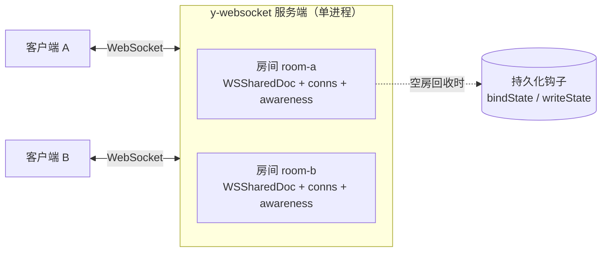

import { Meta } from '@storybook/addon-docs/blocks';

<Meta id="y-websocket-server" title="服务端/y-websocket 服务端" name="Docs" />

# y-websocket 服务端

y-websocket 服务端是 yjs 协同的官方参考服务端：一个按房间转发文档 update 与 awareness 状态的 WebSocket 服务。自 y-websocket 3.x 起，客户端包不再附带服务端，服务端独立为 `@y/websocket-server` 包。本课讲它的快速启动、房间模型与 URL 路由、嵌入自有 HTTP 服务的方式、持久化与鉴权钩子，以及部署时的单进程边界。

先建立三个能预测全文的事实：

- **服务端 = 房间注册表 + 转发器**：每个房间是内存里的一份共享文档（`WSSharedDoc`），连接按 URL 路径进房，服务端自己也跑同步协议的一端——主动发起握手、增量广播、清理 awareness。
- **房间不出进程**：默认不存盘、不跨实例。持久化是要自己接的钩子（`setPersistence`），水平扩展是另外的架构（指向 [y-redis 水平扩展](?path=/docs/y-redis--docs)）。
- **它是参考实现，不是框架**：官方定位就是「拿去改成你自己的」。鉴权、落盘、内容初始化都没有现成功能，只有明确的注入位置——本课的大部分内容就是认清这些位置。



以下默认值与环境变量逐条核对自本工作区安装的 `@y/websocket-server@0.1.5` 源码：

| 项 | 默认值 | 回查要点 |
| --- | --- | --- |
| 启动命令 | `npx y-websocket` | 与 `npx y-websocket-server` 是同一入口（`src/server.js`）；y-websocket 3.x 客户端包已不含 bin |
| `PORT` | `1234` | 监听端口 |
| `HOST` | `localhost` | 生产环境要显式设 `0.0.0.0` 或绑内网地址 |
| `GC` | 开启 | `GC=false` 或 `GC=0` 关闭文档垃圾回收（保留快照/完整历史时用） |
| 房间名 | URL 路径去前导斜杠、去 query | `/room-a?token=x` → 房间 `room-a` |
| 连接保活 | 30 秒 | 服务端定时 ping，一次未 pong 即回收连接 |
| 持久化 | 无 | `setPersistence` 钩子；bin 不读 `YPERSISTENCE`（见常见问题） |
| HTTP 回调 | 关闭 | `CALLBACK_URL` 等五个变量，见本文 HTTP 回调一节 |
| 包导出 | `./server`、`./utils`、`./callback` | 嵌入用 `./utils`：`setupWSConnection`、`setPersistence`、`getYDoc`、`docs` 等 |

## 快速上手

两条路：官方 bin 一行起服务；或运行本课目录的 `server.js`——它是官方参考实现的等价移植，附带鉴权与落盘，且在本工作区保证可用。

**1. 官方 bin（最快）：**

```bash
HOST=localhost PORT=1234 npx y-websocket
# 输出：running at 'localhost' on port 1234
```

兼容性警告：本工作区安装的 `@y/websocket-server@0.1.5` 依赖树里混入了两个不同构建的 yjs v14 预发布包，实测客户端 update 在服务端 `applyUpdate` 时崩溃——**握手能成功（客户端 `synced=true`），内容却永远不同步**。崩溃在服务端内部，与客户端版本无关；判断依据与处置见常见问题。这也是本课自带 `server.js` 的原因。

**2. 本课的可运行服务端：**

```bash
node cheatsheets/y-websocket-server/server.js
```

**3. 验证（另开一个终端）。** `check-sync.js` 在同一进程起两个 `WebsocketProvider` 连同一随机房间（都设 `disableBc`，一致性只能来自服务器往返），A 写入、B 收，B 追加、A 收：

```bash
node cheatsheets/y-websocket-server/check-sync.js
```

实测输出：

```text
连接地址：ws://localhost:1234/probe-zp4czg
事件序列：A status:connected → A sync:true → B status:connected → B sync:true
两端一致：true
最终内容：你好，y-websocket 服务端！ —— 来自 B 的追加
RESULT: OK
```

浏览器端验证同样可行：两个标签页各建一个 `WebsocketProvider` 连 `ws://localhost:1234/<同一房间>` 即互同步，客户端写法见 [y-websocket](?path=/docs/y-websocket--docs)。服务端开了鉴权时用 `TOKEN=<令牌> node cheatsheets/y-websocket-server/check-sync.js` 带令牌。

## 房间模型

房间是服务端内存里的一份 `WSSharedDoc`：它 `extends Y.Doc`，额外挂三样东西——`conns`（连接 → 该连接控制的 awareness clientID 集合）、`awareness`（房间级 Awareness 实例）、`name`。全部房间登记在导出的 `docs` Map 里。

进房规则只有一行：`docName = req.url.slice(1).split('?')[0]`——URL 路径去掉前导斜杠、去掉 query。推论：`/room-a` 与 `/room-b` 是互不相干的两份文档；`?token=xxx` 这类 query 参数不进房间名，带不带令牌进的仍是同一房间。

房间生命周期（`getYDoc` 与连接回收的实际行为）：

- 首条连接到达才创建房间；之后每条连接进房登记、离房摘除，并把该连接控制的 awareness 状态广播移除。
- 服务端给每条连接做 30 秒 ping/pong 保活，一次未 pong 即判定死亡并回收。
- 最后一条连接关闭 → 调持久化钩子的 `writeState` → `doc.destroy()` → 从 `docs` 移除。房间彻底消失，下次有人进房重新创建。

服务端同时是同步协议的一端：连接建立后**主动**发 SyncStep1 与全量 awareness（握手时序与客户端一侧见 [y-websocket](?path=/docs/y-websocket--docs)）；此后收到 sync 消息走 `readSyncMessage`，本地 doc 的每次 update 广播给房间内所有连接（包括发端——回声由客户端按 origin 过滤，不产生循环）。

用本课 `server.js` 跑一遍 `check-sync.js`，服务端日志就是生命周期的直接证据（实测）：

```text
[房间] 创建 probe-zp4czg（当前 1 个房间）
[连接] 进入 probe-zp4czg（当前 1 条）
[连接] 进入 probe-zp4czg（当前 2 条）
[连接] 离开 probe-zp4czg（剩余 1 条）
[连接] 离开 probe-zp4czg（剩余 0 条）
[房间] 回收 probe-zp4czg
```

`server.js` 还提供了一个观测端点，运行中 `curl http://localhost:1234/status` 返回各房间的连接数与文档字节数（JSON）。等价地，官方包导出的 `docs` Map 可以在你自己的代码里直接读。

`@y/websocket-server/utils` 的完整导出（0.1.5 核对）：

| 导出 | 用途 |
| --- | --- |
| `setupWSConnection(conn, req, { docName, gc })` | 连接装配：进房、挂消息监听、保活、发起握手 |
| `getYDoc(docname, gc = true)` | 取房间，不存在则创建 |
| `docs` | 房间注册表 `Map<string, WSSharedDoc>` |
| `WSSharedDoc` | 房间文档类；`whenInitialized` 是内容初始化的完成 Promise |
| `setPersistence(p)` / `getPersistence()` | 接入 / 读取持久化钩子，见服务端持久化一节 |
| `setContentInitializor(f)` | 房间首次创建时回调 `f(doc)`，用于灌入初始内容 |

## 嵌入自有 HTTP 服务

官方 bin 的全部逻辑只有约 30 行：建 `http.createServer`（普通 GET 回 `okay`）→ 建 `WebSocketServer({ noServer: true })` → `upgrade` 事件里 `handleUpgrade` → `connection` 事件交给 `setupWSConnection`。「嵌入自有服务」就是把这段骨架放进你自己的 HTTP 服务：

```js
import http from 'node:http';
import { WebSocketServer } from 'ws';
import { setupWSConnection } from '@y/websocket-server/utils';

const wss = new WebSocketServer({ noServer: true });
wss.on('connection', setupWSConnection);

const server = http.createServer(/* 你的普通 HTTP 路由 */);
server.on('upgrade', (req, socket, head) => {
  // 鉴权位置：先检查 cookie / query / header，再决定是否 handleUpgrade
  wss.handleUpgrade(req, socket, head, (ws) => wss.emit('connection', ws, req));
});
server.listen(1234);
```

`setupWSConnection` 的第三个参数：`{ docName = (req.url||'').slice(1).split('?')[0], gc = true }`。覆盖 `docName` 可以给房间名统一加前缀（比如按租户命名空间隔离）；`gc: false` 关闭该房间的垃圾回收。

本课的 `server.js` 就是这个骨架的完整可运行版——同一套房间模型、连接装配、握手与保活逻辑，另加 upgrade 鉴权、文件落盘与 `/status` 观测端点。有一处有意的差异：官方 0.1.5 创建房间时**不等待** `bindState` 完成就发起握手，恢复中的首握手可能看到空房间（竞态细节见下一节）；`server.js` 把握手与消息处理推迟到恢复完成之后。需要直接抄官方实现时注意，`@y/websocket-server/utils` 在本工作区因版本分裂不可用（见常见问题），`server.js` 因此把同一套机制落在工作区一致的 yjs 13 栈（`yjs` + `y-protocols` + `ws`）上。

## 服务端持久化

持久化通过 `setPersistence` 注入一个实现以下契约的对象（逐字核自 0.1.5 类型签名）：

```js
import { setPersistence } from '@y/websocket-server/utils';

setPersistence({
  // 房间首次创建时触发：从存储恢复历史内容（读出来 Y.applyUpdate 进 doc）
  bindState: async (docName, doc) => { /* ... */ },
  // 房间最后一条连接关闭后触发：把终态写回存储；随后 doc.destroy()、房间注销
  writeState: async (docName, doc) => { /* ... */ },
  provider: null, // 契约里存在的字段，自定义实现可置 null
});
```

两个时机都要记牢：`bindState` 在创建房间时同步触发、**返回值不被等待**；`writeState` 只在空房回收时触发——进程被杀时没有它，想要「随时不丢」需要在 `bindState` 里另挂 `doc.on('update')` 做增量写。

官方的 LevelDB 配套实现是 [y-leveldb](https://github.com/yjs/y-leveldb)（需单独 `npm i y-leveldb`），其 `LeveldbPersistence` 的 `bindState` / `writeState` 接口与该契约一致。官方 README 宣称 `YPERSISTENCE=./dbDir npx y-websocket` 即可启用，但 0.1.5 源码里读取该变量的行已被注释，bin 全程不调 `setPersistence`——**bin 是纯内存服务**，要持久化必须在自己的代码里接钩子（见常见问题）。

本课 `server.js` 实现了最小文件持久化，可直接运行：每房间一个 `<房间名>.yjs` 文件，存 `Y.encodeStateAsUpdate(doc)` 的字节；`bindState` 读文件恢复并挂 500ms 防抖增量写盘，`writeState` 负责空房回收时的终态落盘。验证步骤（实测）：

```bash
# 终端 1：带持久化启动
YPERSISTENCE=/tmp/yws-data node cheatsheets/y-websocket-server/server.js

# 终端 2：往固定房间写入
ROOM=persist-demo node cheatsheets/y-websocket-server/check-sync.js
# 服务端日志：[持久化] 房间 persist-demo 落盘 93 字节 → /tmp/yws-data/persist-demo.yjs

# Ctrl+C 重启终端 1 的服务，再让任意客户端连 persist-demo：
# 服务端日志：[持久化] 房间 persist-demo 从磁盘恢复 93 字节
# 客户端首次握手即见重启前的全部内容
```

边界：官方实现的恢复竞态（`bindState` 不被等待）意味着「连上 ≠ 看到历史」——恢复完成后内容靠随后的 update 广播补齐，客户端最终会一致，但首握手看到的是空房间。`server.js` 的 `whenReady` 设计消除了这个窗口；自己接 `setPersistence` 时同理，要么容忍短暂空窗，要么推迟握手。

## 鉴权

参考实现没有现成鉴权，只有注入位置。**位置在 upgrade 阶段**（官方 bin 源码注释原话：先检查访问权限，再调 `handleUpgrade`）。这里拿得到 `req.url` 的 query（客户端 `params` 拼在 URL 上，见 [y-websocket](?path=/docs/y-websocket--docs)）、cookie 与自定义 header。本课 `server.js` 的做法（`AUTH_TOKEN` 环境变量开启）：

```js
// authToken = process.env.AUTH_TOKEN || null；未设置则不鉴权
server.on('upgrade', (req, socket, head) => {
  if (authToken) {
    const token = new URL(req.url, 'http://localhost').searchParams.get('token');
    if (token !== authToken) {
      socket.write('HTTP/1.1 401 Unauthorized\r\n\r\n');
      socket.destroy(); // 不 handleUpgrade，连接根本建立不起来
      return;
    }
  }
  wss.handleUpgrade(req, socket, head, (ws) => wss.emit('connection', ws, req));
});
```

实测三种情形（`AUTH_TOKEN=secret123` 启动）：不带令牌与带错令牌，`check-sync.js` 均失败且事件序列只剩反复的 `status:connecting`；`TOKEN=secret123` 则正常同步。

拒绝方式决定客户端行为，这是鉴权设计的关键取舍：

- **upgrade 直接拒绝**：客户端看到的是 1006 异常关闭——属「临时」类，Provider 按指数退避**持续重连**（实测拒绝后客户端反复重试，服务端日志刷拒绝记录）；且浏览器 JS 拿不到 401 状态码，无法向用户解释原因。
- **接受后立刻关闭**：`conn.close(4401, 'permission denied')`。4400–4499 属永久关闭码，客户端停止重连并发出 `closed` 事件——需要告诉客户端「为什么拒绝、别再试了」时用这种。客户端一侧的处理（刷新 token 后 `connect()` 恢复）见 [y-websocket](?path=/docs/y-websocket--docs)。

一个源码细节：协议里预留的 `messageAuth`（类型 2）在 0.1.5 服务端被注释保留、实际从不发送——鉴权结论只能靠连接层（拒绝或关闭码）表达，不要等服务器发来 auth 消息。

## HTTP 回调

bin 内置一个观测钩子：设 `CALLBACK_URL` 后，房间文档每次 update 经防抖向该 URL `POST` 一份 JSON。环境变量（默认值核自 `callback.js` 源码）：

| 变量 | 默认值 | 用途 |
| --- | --- | --- |
| `CALLBACK_URL` | 无 | 回调地址；不设则整个机制关闭 |
| `CALLBACK_OBJECTS` | `{}` | 要上报的共享类型，如 `'{"prosemirror":"XmlFragment"}'` |
| `CALLBACK_DEBOUNCE_WAIT` | `2000` | 防抖等待（毫秒） |
| `CALLBACK_DEBOUNCE_MAXWAIT` | `10000` | 防抖最长延迟（毫秒） |
| `CALLBACK_TIMEOUT` | `5000` | HTTP 请求超时（毫秒） |

请求体形如 `{ room: '<房间名>', data: { prosemirror: { type: 'XmlFragment', content: <toJSON 结果> } } }`；实现没有重试逻辑，回调失败即丢。自建服务里的等效做法就是 `doc.on('update')` 加自己的防抖——`server.js` 里的增量写盘正是同一个形状。

## 部署与水平扩展

房间是单进程内存对象——这条事实决定了全部部署约束：

- **两个实例互不知道对方的房间**。多实例部署必须保证同一房间的连接落到同一实例：负载均衡按房间名做一致性哈希或粘性会话。随便轮询 = 同房间被拆成互不相干的多份。
- 跨实例共享房间需要外部总线。官方文档给两条路：pub/sub（每房间一个 channel）或按文档分片；现成实现是 [y-redis 水平扩展](?path=/docs/y-redis--docs)，更大规模的官方方向是 yhub（见 [yhub](?path=/docs/yhub--docs)）。
- 官方 README 明说这份参考后端「can persist to databases, but it can't be scaled easily」——单房间吞吐与连接数上限就是单进程上限。

生产细节清单：

- `HOST` 默认只绑 `localhost`，容器/公网部署必须显式设 `HOST=0.0.0.0`（或内网地址）。
- 反向代理（nginx 等）要转发 `Upgrade` / `Connection` 头，否则 WebSocket 握手在代理层就失败。
- 普通 HTTP GET 返回 200 `okay`，可直接当负载均衡的健康检查。
- 没接持久化时进程重启 = 全部房间丢失（内存房间随进程消失）；接了持久化也要确认 `writeState` 之外有增量兜底。

## 最佳实践

- 生产别裸跑 bin：它是参考实现。按本文「嵌入自有 HTTP 服务」的骨架（或直接基于本课 `server.js`）把服务嵌进自有进程，鉴权、持久化、监控才有落点。
- 房间名即权限边界：知道「地址 + 房间名」就能读写整份文档。鉴权之外，用 `setupWSConnection` 的 `docName` 选项统一加租户前缀，把多租户隔到命名空间层。
- 令牌走 query 必须配 TLS（`wss://`），否则令牌明文上路；query 不进房间名，所以令牌变更不会把客户端拆到不同房间。
- 保留完整编辑历史或做快照时关闭垃圾回收（`GC=false` 或 `setupWSConnection` 的 `gc: false`）；GC 开启时已被删除的内容会被压缩清理，这是默认且通常想要的行为。

## 常见问题

- 客户端握手成功（`synced=true`）但内容永远不同步，服务端日志刷 `Caught error while handling a Yjs update TypeError: store.getClock is not a function`？
  这是本工作区实测命中的版本分裂：`@y/websocket-server@0.1.5` 的房间文档来自 `yjs@14.0.0-16`（旧包名的 v14 预发布），而它的协议层 `@y/protocols@1.0.6-rc.1` 内部用 `@y/y@14.0.0-rc.7`（新包名的另一份 v14 构建）——后者的 encoding 调用 `store.getClock`，前者的 store 没有这个方法。崩溃在服务端自己的 `applyUpdate` 里，与客户端版本无关。诊断：`npm ls yjs @y/y @y/protocols`，看是否有多份 v14 预发布共存。处置：对齐到一致的依赖版本；或像本课 `server.js` 一样，把参考实现落到一致的栈上自托管（官方本就建议 fork 改造）。
- 设了 `YPERSISTENCE` 环境变量却不落盘？
  0.1.5 源码里读取该变量的行被注释掉了（`utils.js`），bin 也从不调用 `setPersistence`——官方 README 的描述落后于当前代码，bin 是纯内存服务。要持久化：自己 `import { setPersistence } from '@y/websocket-server/utils'` 接 y-leveldb 或自定义钩子；本课 `server.js` 恢复了同名变量的行为，可对照参考。
- 鉴权拒绝了，客户端却不停重连、还拿不到拒绝原因？
  upgrade 阶段拒绝对客户端是 1006 异常关闭，属临时故障，Provider 按退避策略持续重连；浏览器 JS 也读不到 401 状态码。要让客户端停下来并知道原因：接受连接后立刻 `conn.close(4401, '<原因>')`，4400–4499 会触发客户端 `closed` 事件并停止重连。
- 两台服务器实例之间，相同房间名却不同步？
  正常——房间是单进程内存对象，实例之间没有任何通信。同房间必须路由到同一实例（粘性会话 / 一致性哈希），跨实例共享要外部总线，见 [y-redis 水平扩展](?path=/docs/y-redis--docs)。
- `npx y-websocket` 启动的到底是哪个包？
  当前是 `@y/websocket-server` 的 bin（`y-websocket` 与 `y-websocket-server` 两个命令名指向同一入口）；y-websocket 3.x 客户端包已不含服务端、没有 bin 字段。老项目里 y-websocket 1.x/2.x 自带 `bin/server.js`——同名命令行为以 `node_modules/.bin/y-websocket` 的实际软链目标为准。

## 总结回顾

摘要：

y-websocket 服务端是按房间转发的参考实现：URL 路径决定去哪个房间，每个房间是内存里的一份 `WSSharedDoc`（文档 + 连接集合 + awareness），首条连接创建、空房回收销毁，服务端自己跑同步协议的一端并做 30 秒保活。bin（`npx y-websocket`，PORT/HOST）只适合体验与开发；自用要嵌入自有 HTTP 服务，在 upgrade 阶段做鉴权（直接拒绝会被客户端当临时故障反复重连，4401 关闭码才能叫停并说清原因），用 `setPersistence` 的 `bindState` / `writeState` 接落盘（注意官方不等待 `bindState` 的恢复竞态），`CALLBACK_URL` 提供防抖的变更回调。房间不出单进程内存，所以多实例必须按房间路由，跨实例扩展指向 y-redis。本工作区的 `@y/websocket-server@0.1.5` 因 yjs v14 双构建分裂而无法应用客户端 update，本课的 `server.js` 在同一契约下给出了一致栈上的可运行等价实现。

一句话：

> y-websocket 服务端 = 每房间一份内存文档加按房间转发，它给的是参考实现与钩子位置（upgrade 鉴权、setPersistence 落盘）——持久化、鉴权、水平扩展都要你自己接，「房间不出进程」是这一切设计的前提。

知识要点：

- 房间名怎样从 URL 得出，query 参数进不进房间名？
- 房间何时创建、何时回收？回收时持久化钩子按什么顺序被调用？
- `setPersistence` 的 `bindState` / `writeState` 各自什么时机触发，官方实现的恢复竞态是什么？
- `setupWSConnection` 的签名与 `docName` / `gc` 选项各控制什么？
- 鉴权代码放哪个阶段？upgrade 直接拒绝与 4401 关闭码对客户端重连行为有何不同？
- 为什么多实例部署时同一房间必须落到同一实例？跨实例扩展指向哪个方案？
- 本工作区官方 bin「握手成功但内容不同步」的现象与根因是什么，怎样用 `npm ls` 确诊？

## 参考资料

- [y-websocket-server 官方仓库（服务端 README 与源码）](https://github.com/yjs/y-websocket-server)
- [y-websocket 官方仓库（客户端 README，含服务端关闭码与替代后端列表）](https://github.com/yjs/y-websocket)
- [Yjs 官方文档：y-websocket Provider](https://docs.yjs.dev/ecosystem/connection-provider/y-websocket)
- [y-leveldb 官方仓库（LevelDB 持久化实现）](https://github.com/yjs/y-leveldb)
