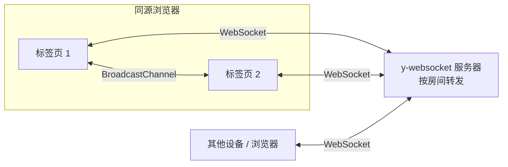
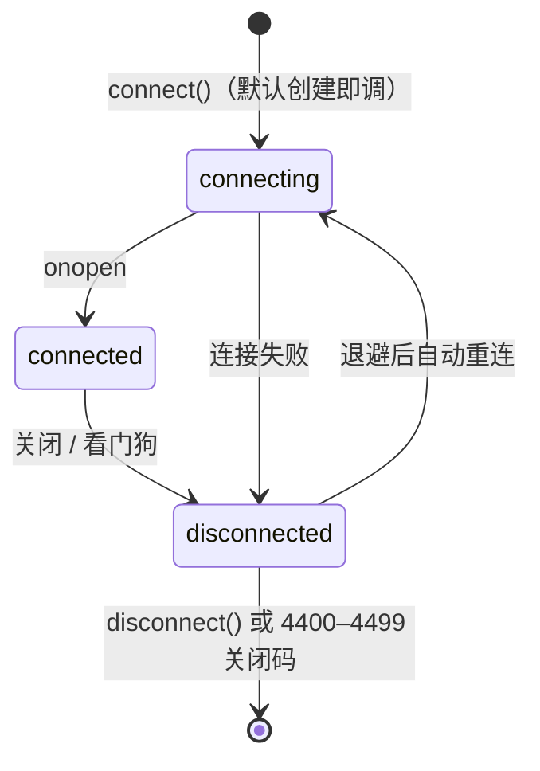
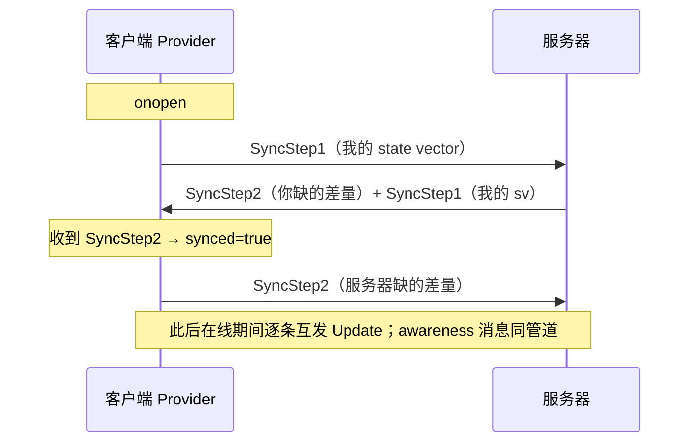

import { Canvas, Controls, Meta } from '@storybook/addon-docs/blocks';
import * as Stories from './y-websocket.stories';

<Meta of={Stories} name="Docs" />

# y-websocket

y-websocket 是 yjs 官方的 WebSocket Provider：经典的客户端-服务器模型，同一房间的各端把文档 update 与 awareness 状态发给服务器，由服务器转发给房间内其他端。[安装与第一个协同文档](?path=/docs/getting-started--docs) 用它跑通过最小闭环，[文档更新与同步协议](?path=/docs/document-updates--docs) 手工实现过它体内的同步协议——本课把客户端 `WebsocketProvider` 完整拆开：房间模型、构造选项全景、连接生命周期与事件、消息协议，以及不经过服务器的 BroadcastChannel 同域近路。

先建立三个能预测全文的事实：

- **「服务器地址 + 房间名」定位一份共享文档**：同一台服务器上房间名相同的端互相同步，不同房间互不相干。
- **「连上」与「对齐」是两个事实**：`status` 只报告 WebSocket 通没通，`synced` 才表示与服务器完成了内容握手。
- **每个 Provider 都有两条通道**：WebSocket 走服务器，BroadcastChannel 在同源标签页之间直达；两条通道跑同一套消息协议。



构造签名 `new WebsocketProvider(serverUrl, roomname, doc, opts?)`，以下默认值逐条核对自 y-websocket 3.1.0 源码：

| 参数 / 选项 | 默认值 | 回查要点 |
| --- | --- | --- |
| `serverUrl` | 必填 | 末尾斜杠会被剥掉；与房间名拼成实际连接地址 |
| `roomname` | 必填 | 房间定位键；公共服务器上是全局命名空间 |
| `doc` | 必填 | 同步对象；`destroy()` 不会销毁它 |
| `connect` | `true` | 创建即连接；`false` 时用 `connect()` 手动连，BC 也同样不开 |
| `awareness` | 新建 `Awareness(doc)` | 传入既有实例可与其他 Provider 共享在线状态 |
| `params` | `{}` | 拼进 URL query；运行时可改 `provider.params`，下次连接生效 |
| `protocols` | `[]` | 透传给 WebSocket 构造器的子协议列表 |
| `WebSocketPolyfill` | 全局 `WebSocket` | Node 等无原生 WebSocket 的环境注入 `ws` 包 |
| `resyncInterval` | `-1`（关闭） | 大于 0 时每间隔重发一次 SyncStep1，兜底对齐 |
| `maxBackoffTime` | `2500` | 断线重连指数退避的上限（毫秒） |
| `disableBc` | `false` | `true` 关闭 BroadcastChannel 同域近路 |
| `shouldReconnect` | 4400–4499 不重连 | 按服务器关闭码决定是否重连的判定函数 |

## 房间模型

Provider 把 `serverUrl` 与 `roomname` 拼成实际连接地址，`params` 以 query 形式追加；BroadcastChannel 的通道名不含 `params`：

```ts
const provider = new WebsocketProvider('wss://demos.yjs.dev/ws', 'my-room', doc, {
  params: { auth: 'token' },
});
provider.url;        // wss://demos.yjs.dev/ws/my-room?auth=token
provider.bcChannel;  // wss://demos.yjs.dev/ws/my-room —— BC 通道名，无 query
```

实测（3.1.0，node）：`serverUrl` 传入 `'wss://example.com/'`（带尾斜杠）、`params` 为 `{ auth: 'a b', x: '1' }` 时，`url` 为 `wss://example.com/room-1?auth=a%20b&x=1`——尾斜杠被剥掉，参数值做了 URL 编码。

边界：

- 房间名是服务器上的**全局命名空间**，谁拿到「地址 + 房间名」谁就能进出同一份文档。公共 demo 服务器上务必用足够独特的房间名（本课实例带随机后缀），敏感场景自托管并加鉴权（见 [y-websocket 服务端](?path=/docs/y-websocket-server--docs)）。
- `provider.params` 运行时可安全更新，新值在下一次建立连接时生效——鉴权 token 轮换就靠它，不需要重建 Provider。
- `params` 不进 BC 通道名：同地址同房间、params 不同的两个端，在 BC 上仍然互通。

## 连接生命周期

`connect()` 与 `disconnect()` 控制整条管道；`shouldConnect` 是自动重连的总开关——`disconnect()` 会把它置为 `false`，断线退避循环随之中止。`synced` 是 `connected` 的子状态：收到服务器的 SyncStep2 才置 `true`，断开时归零。



事件与状态属性全表：

| 事件 | 载荷 | 时机 |
| --- | --- | --- |
| `status` | `{ status }`，取值 `connecting` / `connected` / `disconnected` | 每次连接尝试、成功与断开 |
| `sync` | `boolean` | `synced` 每次翻转：收到服务器 SyncStep2 时为 `true`，断开时为 `false` |
| `connection-close` | `CloseEvent` 或 `null` | 每次底层 WS 关闭；本地主动断开与看门狗触发时载荷为 `null` |
| `connection-error` | `Event` | WS 报错；浏览器随后还会触发关闭 |
| `closed` | `{ code, reason }` | 服务器永久关闭（`shouldReconnect` 返回 `false`），不再自动重连 |

| 属性 / 方法 | 含义 |
| --- | --- |
| `provider.url` | 实际连接地址，只读计算属性 |
| `provider.wsconnected` / `wsconnecting` | WS 已连上 / 正在连 |
| `provider.bcconnected` | BroadcastChannel 通道已接入 |
| `provider.synced` | 与服务器完成内容握手；只反映 WS 通道 |
| `provider.shouldConnect` | 为 `false` 时不再自动重连 |
| `provider.wsUnsuccessfulReconnects` | 连续失败次数，即退避公式的指数 n；synced 成功时清零 |
| `provider.awareness` | 该 Provider 的 Awareness 实例（机制见 [Awareness 与在线状态](?path=/docs/awareness--docs)） |
| `connect()` / `disconnect()` | 建立 / 断开 WS 与 BC；断开后本地文档照常读写 |
| `connectBc()` / `disconnectBc()` | 单独开关 BC 通道 |
| `destroy()` | 断开并摘除全部监听与定时器；`doc` 数据原样保留 |

两个来自源码的细节：`synced` 的 setter 同时发出 `synced` 与 `sync` 两个事件，但官方文档与类型定义只登记 `sync`，监听 `sync` 即可；BC 通道上的消息**不会**影响 `synced`（源码中 BC 路径的 `emitSynced` 恒为 `false`）——`synced=false` 不代表两端内容不一致，只代表没和服务器对齐。

node 实测的一次完整周期（连接 → 主动断开 → 重新连接）：

```text
status:connected → sync:true → connection-close:null → sync:false
→ status:disconnected → status:connecting → status:connected → sync:true
```

下面实例在同一页面放两个 `Y.Doc`，各挂一个 Provider 连接公共 demo 服务器的同一随机房间；两端都设了 `disableBc: true`，关掉同页 BroadcastChannel 近路，保证观察到的一致性只能来自服务器往返：

<Canvas of={Stories.ServerSync} />
<Controls of={Stories.ServerSync} />

| 读者操作 | 可观察证据 |
| --- | --- |
| 加载后默认连接 | 两条连线由虚转实；读数从 `connecting` 走到 `connected / synced=true`；B 面板出现 A 的文本 |
| 修改「文档 A 内容」 | 「A 本地 update」+1，「B 已接收 update」随即 +1；两端保持一致 |
| 关闭「连接服务器」后修改文本 | 两端状态变 `disconnected`、连线变灰；B 停在旧内容，「两端一致」变「否」 |
| 重新打开「连接服务器」 | 重新握手后 B 自动追平（差量同步），一致恢复「是」 |
| 打开 Show code | 看到 `server-sync.ts` 实际执行的双 Provider、`disableBc: true` 与事件监听 |

注意：这个实例依赖外网与公共 demo 服务器的可用性。离线或服务器不可达时，两端状态会停在 `connecting` / `disconnected` 并持续退避重连——「重连计数 A / B」读数持续增长，这本身就是重连行为的直接证据；要看完全不依赖网络的同步证据，用本文 BroadcastChannel 一节的实例。

## 断线重连与关闭码

连接不是本地主动断开的，Provider 都会自动重连：指数退避 `min(2^n × 100ms, maxBackoffTime)`，n 为连续失败次数，首次退避约 200ms（实测 `1006` 断开后约 250ms 内完成重连，含建连）；一旦某次连接完成同步（`synced=true`），n 清零。

服务器可以用 WebSocket 关闭码告诉客户端「别再试了」。默认 `shouldReconnect` 实现：`4400–4499` 视为永久关闭，停止重连并发出 `closed` 事件；其余一律重连。

| 关闭码 | 含义 | 自动重连 |
| --- | --- | --- |
| `4400`–`4499` | 永久：权限被收回、文档不存在等，重试结果一样 | 否，发 `closed` 事件 |
| `4500`–`4599` | 临时：与 44xx 对应的「稍后重试」区间 | 是 |
| 其他（`1006` 异常断开、`1011`、`1013`……） | 一律视为临时 | 是 |

`closed` 之后 Provider 没有被销毁：`shouldConnect` 置为 `false`，但 **BC 通道继续运行**（3.1.0 实测：服务器以 `4401` 关闭后 `bcconnected` 仍为 `true`），修复原因（比如刷新 token）后调用 `connect()` 即可恢复：

```ts
const provider = new WebsocketProvider(url, room, doc, {
  // 覆盖默认分类；传 () => true 可恢复 3.x 之前「一律重连」的行为
  shouldReconnect: (event) => !(event.code >= 4400 && event.code < 4500),
});

provider.on('closed', async ({ code, reason }) => {
  console.warn(`服务器永久关闭：${code} ${reason}`);
  // await refreshToken(); provider.params = { auth: newToken };
  // provider.connect(); // 修复后手动恢复
});
```

本地行为都不走 `shouldReconnect`：`disconnect()` 与看门狗触发的关闭不会发出 `closed`（`connection-close` 的载荷此时为 `null`）。

两个兜底机制：

- **看门狗**：连接期间超过 30 秒没收到任何消息（连自己的 awareness 心跳回环都没有），Provider 主动断开并重连。正常情况下 Awareness 默认状态约每 15 秒心跳一次、经服务器回环保活；单人房间里显式 `setLocalState(null)` 时这条保活链会断，见常见问题。
- **`resyncInterval`**：大于 0 时每间隔在已打开的 WS 上重发一次 SyncStep1，让服务器有机会补发差量——丢消息敏感的场景的兜底对齐，默认关闭。

## 消息协议

WS 与 BC 两条通道跑同一套消息：外层一个 varUint 消息类型，sync 消息内层就是 [文档更新与同步协议](?path=/docs/document-updates--docs) 手工跑过的三个原语。

| 消息类型 | 值 | 用途 |
| --- | --- | --- |
| `messageSync` | 0 | 内层为 SyncStep1（state vector）/ SyncStep2（差量 update）/ Update（在线增量） |
| `messageAwareness` | 1 | awareness 状态增删改（在线状态、光标等） |
| `messageAuth` | 2 | 服务器通知权限拒绝；客户端收到后 `console.warn`，鉴权配置在服务端 |
| `messageQueryAwareness` | 3 | 请求全量 awareness 状态；BC 通道接入时使用 |

握手时序（每次 WS 建连后自动执行）：



与 2.2 的对应关系是逐条的：SyncStep1 装的就是 `encodeStateVector`，SyncStep2 装的就是按对方 sv 编码的 `encodeStateAsUpdate` 差量，Update 就是 `update` 事件的增量载荷——Provider 只是把它们搬上网络。本地每次事务提交后，Provider 的 `update` 监听把增量同时发到 WS 与 BC 两条通道；远端合入时以 Provider 自身为 `origin`，所以回声天然被过滤（与 2.2 的 `origin !== 'sync'` 同一招）。

边界：

- 消息体本身不含房间名——房间由连接 URL 决定（y-protocols 原话：房间名由上层协议处理）。
- 每个 Provider 持有 `messageHandlers` 数组的独立副本，可按实例覆盖或注册新消息类型，这是扩展协议的入口；完整的自定义传输层由 [自定义 Provider](?path=/docs/custom-provider--docs) 承载。
- awareness 消息的细节（30 秒过期、心跳续期、查询机制）见 [Awareness 与在线状态](?path=/docs/awareness--docs)；本课只需要知道它与文档 update 共用通道。

## BroadcastChannel 同域近路

默认开启（`disableBc: false`）：`connect()` 会同时接入 WS 与 BC，同源（同 origin）里「地址 + 房间名」相同的 Provider 不经服务器直接互同步——这就是[安装与第一个协同文档](?path=/docs/getting-started--docs) 里「断网时同浏览器两个标签页还在同步」的机制根源。BC 上跑的是同一套消息协议，接入时连发四条消息（SyncStep1 + SyncStep2 + queryAwareness + 本地 awareness 状态），随后逐条转发增量。

关键事实：

- 通道名 `bcChannel = serverUrl + '/' + roomname`，**不含 params**；BroadcastChannel 本身受同源策略限制，跨 origin 互不相通。
- `connect: false` 创建时 WS 与 BC 都不开；`connectBc()` / `disconnectBc()` 可单独开关 BC——纯 BC 同步完全可以零网络运行。
- `disableBc: true` 时 `connectBc()` 是空操作（3.1.0 源码实测）。
- BC 消息不影响 `synced`；`disconnect()` 断开 BC 时会向通道广播本地 awareness 离线。

下面实例的两个 Provider 都以 `connect: false` 创建、从不建立 WebSocket，只用 `connectBc()` 接入 BC——完全不依赖网络，离线也能跑：

<Canvas of={Stories.BroadcastChannelSync} />
<Controls of={Stories.BroadcastChannelSync} />

| 读者操作 | 可观察证据 |
| --- | --- |
| 默认（BC 开） | A 的文本直达 B；「BC 通道 A / B」显示已接入；读数「BC 通道名」不含 query 参数 |
| 关闭「BroadcastChannel 同步」后修改文本 | B 停在旧内容，「两端一致」变「否」 |
| 重新打开 | 经 BC 上的 SyncStep1 / SyncStep2 握手，B 自动追平 |
| 打开 Show code | 看到 `broadcast-channel-sync.ts`：`connect: false` 构造 + `connectBc()` 控制 |

## 最佳实践

- 验证真实网络同步时先排除 BC 近路：换两个不同的浏览器或设备，或像本课实例 1 那样两端都设 `disableBc: true`——否则同浏览器标签页之间的一致性说明不了服务器通没通。
- 鉴权 token 走 `params` 上 URL；token 会过期就配合 `closed` 事件刷新：`provider.params = { auth: newToken }` 后 `provider.connect()`，不需要重建 Provider。
- 本课管道不存数据：刷新页面后只剩服务器还记着的部分。离线编辑与本地持久化用 [y-indexeddb 离线](?path=/docs/y-indexeddb--docs)，多管道叠加拓扑见 [Provider 组合](?path=/docs/meshing-providers--docs)。
- Node 环境注入 WebSocket 实现（Node 22 之前没有全局 `WebSocket`）：

```ts
import { WebSocket } from 'ws';

const provider = new WebsocketProvider('ws://localhost:1234', 'my-room', doc, {
  WebSocketPolyfill: WebSocket,
});
```

## 常见问题

- 明明显示 `connected`，`synced` 却一直 `false`？
  `synced` 只在收到服务器的 SyncStep2 时置 `true`。常见于自研或代理服务器没有完整实现「SyncStep1 → SyncStep2 + SyncStep1」的双段应答，或中间代理截断了二进制消息；用官方 `@y/websocket-server` 对照验证。另外 BC 消息不影响 `synced`——两端内容一致但 `synced=false` 时，先怀疑这条，再看 BC 是不是在替你同步。
- 房间里只有我一个人，连接每 30 秒左右自己断开重连一次？
  这是看门狗：30 秒没收到任何消息就主动断开重连。Awareness 默认状态（`{}`）约每 15 秒心跳一次，经服务器回环刷新计时；如果你 `setLocalState(null)` 或服务器不回环 awareness，单人房间就会被周期性回收。属正常行为，重连后自动重新握手、内容不受影响。
- 公共 demo 服务器上的数据会被谁看到？
  房间名是全局命名空间：知道「地址 + 房间名」的任何人都能读写同一份文档。`wss://demos.yjs.dev/ws` 官方标注禁止生产、随时可能清库；正式项目自托管（见 [y-websocket 服务端](?path=/docs/y-websocket-server--docs)）并加鉴权。
- `destroy()` 之后文档数据还在吗？
  在。`destroy()` 只拆管道——断开 WS 与 BC、摘监听、清定时器；`Y.Doc` 数据原样保留，换个 Provider 还能继续同步。

## 总结回顾

摘要：

`WebsocketProvider` 用「服务器地址 + 房间名」定位一份共享文档，params 进 URL query、不进 BC 通道名。它同时维护 WebSocket 与 BroadcastChannel 两条通道，跑同一套消息协议（sync / awareness / auth / queryAwareness）；sync 内层就是 state vector 与差量 update 的三步握手，`synced=true` 只代表与服务器对齐，BC 消息不影响它。连接管理全自动：断线按 `min(2^n × 100ms, 2500ms)` 退避重连，sync 成功后计数清零；服务器用 `4400–4499` 关闭码表达永久拒绝，触发 `closed` 事件并停连，但 BC 继续运行、`connect()` 可手动恢复。30 秒无消息看门狗兜底僵死连接，`resyncInterval` 兜底对齐。`disableBc: true` 才能看到纯粹的网络同步——同浏览器标签页之间默认走 BroadcastChannel 近路，零网络也同步。

一句话：

> 连上 ≠ 对齐：`status` 只报告 socket，`synced` 才表示与服务器完成内容握手；此后 Provider 做的只是逐条搬运 update——断线自动重连重新对齐，唯有 `4400–4499` 是服务器让它别再试。

知识要点：

- 实际连接 URL 怎么拼？`params` 去哪了，BC 通道名含不含它？
- `status` / `sync` / `connection-close` / `closed` 各自什么时候触发，载荷是什么？
- `synced` 的语义是什么，为什么说它只反映服务器通道？
- 重连退避公式与清零时机？服务器发 `4401` 关闭码后客户端会发生什么？
- 四种消息类型分别装什么，与同步协议三原语怎么对应？
- `disableBc: true` 改变了什么？怎样搭一个纯 BC、零网络的同步？

## 参考资料

- [Yjs 官方文档：y-websocket Provider](https://docs.yjs.dev/ecosystem/connection-provider/y-websocket)
- [y-websocket 官方仓库（README 与源码）](https://github.com/yjs/y-websocket)
- [y-protocols 官方仓库（sync 与 awareness 消息协议）](https://github.com/yjs/y-protocols)
- [@y/websocket-server 官方参考服务端](https://github.com/yjs/y-websocket-server)
