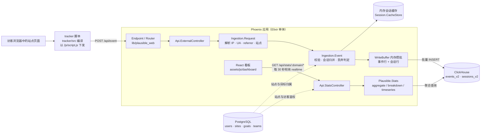

import { Meta } from '@storybook/addon-docs/blocks';

<Meta id="architecture" title="内部架构/总体架构" name="Docs" />

# 总体架构

前面五个阶段都是外部视角：脚本发了什么、API 返回什么、看板显示什么。从本课起翻开内部。官方 README 对 Plausible 的自我描述只有一句话："a standard Elixir/Phoenix application backed by a PostgreSQL database for general data and a Clickhouse database for stats"——一个 Elixir/Phoenix 单体应用，配两台分工不同的数据库；前端用 React（TailwindCSS 样式）实现看板。

整座系统只有两条主干链路，都在 ClickHouse 汇合：**上报链路**把每次访问写成事件行（tracker 脚本 → `POST /api/event` → Phoenix 端点 → 内存缓冲 → ClickHouse）；**查询链路**把事件行聚合成报表读数（React 看板 → `/api/stats` → Phoenix API → ClickHouse 聚合查询 → JSON 渲染）。理解了"写进去的是事件、读出来的是聚合"，本阶段后续的数据模型、事件管线和看板前端课程都只是对这两条链路的局部放大。



## 组件分工

分工的判断标准是**数据形态**：带关系、要事务、改了必须立刻一致的业务数据进 PostgreSQL；海量、只追加、按列聚合的事件流水进 ClickHouse；介于两者之间的热数据——每次上报都要查的站点信息、正在进行的会话、还没落库的事件行——留在应用内存里。四个角色各管一段：

### Phoenix：唯一的 HTTP 入口

`lib/plausible_web/` 是 Phoenix 外壳：`endpoint.ex` 挂载一组 Plug（其中 `PlausibleWeb.TrackerPlug` 直接负责把编译好的 tracker 脚本以 `/js/script.js` 等路径下发给站点），`router.ex` 汇集全部路由。对学习最重要的一组路由：

| 路由 | 落点控制器 | 谁在用 |
| --- | --- | --- |
| `POST /api/event` | `Api.ExternalController`（router.ex 中声明为 `post "/event"`） | tracker 脚本、Events API |
| `GET /api/stats/:domain/*`（`current-visitors`、`main-graph`、`top-stats`、`sources` 等） | `Api.StatsController` | 登录后的 React 看板 |
| `GET /api/v1/stats/*`、`POST /api/v2/query` | `Api.ExternalStatsController`、`Api.ExternalQueryApiController` | 公开 Stats API（[Stats API](?path=/docs/stats-api--docs)） |

业务逻辑不写在控制器里，而在 `lib/plausible/` 的各个 context 模块（`Plausible.Ingestion`、`Plausible.Stats`、`Plausible.Sites` 等）；定时与后台任务交给 Oban，worker 在 `lib/workers/`（邮件报表、CSV 导出导入、盐值轮换等）。

### PostgreSQL：业务数据

由 Ecto（`Plausible.Repo`）管理，存放"这个统计服务自身运转所需"的关系数据：用户与团队（`Plausible.Auth`、`Plausible.Teams`）、站点、目标 Goal、共享链接、tracker 脚本自定义配置、Shield 规则、计费信息。特点是行级可改、事务、改完立刻可读——建站、加 Goal、改设置这些管理动作只写这一台库，与 [团队与站点管理](?path=/docs/team-sites--docs) 里的操作一一对应。数据库迁移在 `priv/repo/`。

### ClickHouse：分析数据

两张核心表：`events_v2` 与 `sessions_v2`（Ecto schema 分别在 `lib/plausible/clickhouse_event_v2.ex` 和 `clickhouse_session_v2.ex`），表结构细节见 [数据模型](?path=/docs/data-model--docs)。驱动是 `Ch` / `ecto_ch`（ClickHouse 原生协议），并按用途拆了多个 Repo：`Plausible.ClickhouseRepo` 跑聚合查询，`Plausible.IngestRepo` 承担上报写入（带缓冲配置），另有 `AsyncInsertRepo`、`ImportDeletionRepo`。列存引擎为聚合而生，但代价是行级改删不走普通 UPDATE/DELETE（原因与替代做法见本课末尾常见问题）。看板上一切读数——访客、页面、来源、转化——全部来自这两张表的聚合。

### 内存缓存与写缓冲

`lib/plausible/application.ex` 的监控树里挂着三组内存设施，是"第三台存储"：

- **读缓存**：`Plausible.Site.Cache`（域名 → 站点）、四组 Shield 规则缓存、`Plausible.Site.TrackerScriptIdCache` 等，都是 warmed cache，每隔约 25–35 秒从 PostgreSQL 增量刷新。每次上报解析站点、命中封禁规则都不必查业务库。
- **会话缓存**：`Plausible.Session.CacheStore` 用 ETS 表保存"正在进行"的会话；同一访客（按 `user_id`）的新事件经 `Plausible.Session.Balancer` 分片加锁后归并进当前会话，超过 30 分钟无活动即视为新会话。新会话随首个事件立刻写入 ClickHouse；之后每个事件都追加一对 `sign = -1` / `sign = +1` 的折叠行把旧版本会话"改"成新版本——`sessions_v2` 的引擎是 `VersionedCollapsingMergeTree`，后台合并时成对抵消、只留最新。部署重启时由 `Plausible.Session.Transfer` 通过 Unix domain socket 把缓存交给新进程，避免进行中的会话被截断。
- **写缓冲**：`Plausible.Ingestion.WriteBuffer` 是个 GenServer，事件行与会话行先在内存里攒批（RowBinary 编码），攒满或到点就批量 INSERT 进 ClickHouse。默认 5 秒或 100KB 触发一次（环境变量 `CLICKHOUSE_FLUSH_INTERVAL_MS` / `CLICKHOUSE_MAX_BUFFER_SIZE_BYTES` 可调，CE 的 compose 里就能改，见 [配置](?path=/docs/ce-configuration--docs)）。

## 一次上报的链路

以浏览器里的一次 pageview 为例（用 curl 手发的过程见 [Events API](?path=/docs/events-api--docs)，管线内部细节见 [事件管线](?path=/docs/ingestion-pipeline--docs)）：

1. **脚本采集**。站点页面加载 `/js/script.js`——它由 `tracker/src/`（`plausible.js`、`track.js`、`custom-events.js`、`engagement.js`、`autocapture.js` 等）按 `tracker/compiler/variants.json` 编译出各变体，Phoenix 在构建时嵌进发布包，由 `TrackerPlug` 下发。脚本收集页面 URL、referrer，从浏览器带上 `User-Agent`，用 `fetch` 发出 `POST /api/event`。
2. **端点接入**。请求进入 `endpoint.ex` → `router.ex` 的 `:external_api` 管道 → `Api.ExternalController.event/2`。这一步不需要登录鉴权，站点归属完全靠请求体里的 `domain`。
3. **构造请求**。`Ingestion.Request.build(conn)` 解析请求体与请求头：取真实客户端 IP（`PlausibleWeb.RemoteIP`）、User-Agent、referrer，校验 `url` 长度等字段约束，并经读缓存找到目标站点。
4. **构建事件、归并会话**。`Ingestion.Event.build_and_buffer(request)` 把请求变成 `ClickhouseEventV2` 事件：设备/浏览器/OS 由 UA 解析库得出，地理由 IP + GeoIP 数据得出，访客 `user_id` 由 IP + UA 哈希；同时查内存会话缓存归并会话。不合格的事件在这里被丢弃，丢弃原因枚举包括 `:bot`（机器人过滤）、`:spam_referrer`、`:invalid` 等——被过滤的事件同样返回 `202`，靠 `x-plausible-dropped` 响应头区分（排查方法见 [Events API](?path=/docs/events-api--docs)）。
5. **缓冲落库**。事件行进入 `Plausible.Event.WriteBuffer`，会话行进入 `Plausible.Session.WriteBuffer`，都在内存攒批；到 5 秒或 100KB 阈值时批量写入 ClickHouse 的 `events_v2` / `sessions_v2`。至此事件才真正可查。
6. **响应**。控制器不等落库完成——缓冲成功即返回 `202 Accepted`。这就是前面课程反复出现的"202 只证明服务端收到了"的源码出处：

```elixir
# lib/plausible_web/controllers/api/external_controller.ex（节选）
def event(conn, _params) do
  with {:ok, request, conn} <- Ingestion.Request.build(conn) do
    case Ingestion.Event.build_and_buffer(request) do
      {:ok, %{dropped: [], buffered: _buffered}} ->
        conn |> put_status(202) |> text("ok")
      {:ok, %{dropped: dropped, buffered: _}} ->
        # 任何丢弃原因（机器人/垃圾来源等）：仍 202，带 x-plausible-dropped 头；
        # 字段非法的 400 发生在上面的 Request.build 验收阶段，不会走到这里
    end
  end
end
```

## 一次看板查询的链路

打开看板 `http://localhost:8000/test.local`（[本地实例](?path=/docs/local-instance--docs)）后发生的：

1. **React 看板发请求**。`assets/js/dashboard/` 是 React + TypeScript 前端，`util/url.ts` 把所有查询拼成 `GET /api/stats/<domain>/<报表名>` 形式，带查询参数（日期范围、指标、筛选器）。
2. **Phoenix 鉴权与解析**。`Api.StatsController` 经登录会话确认当前用户对该站点有权限（站点与成员关系来自 PostgreSQL），再把参数交给 `Plausible.Stats`。
3. **ClickHouse 聚合**。`Plausible.Stats` 的 `aggregate` / `breakdown` / `timeseries` 把报表语义编译成 ClickHouse 聚合 SQL（由 `QueryRunner` 执行）——日期范围、筛选器、目标条件都翻译进 WHERE 子句，聚合在数据库内完成，返回的是已经算好的数字。
4. **JSON 渲染**。控制器把结果整理成 JSON 返回，React 组件渲染成图表与表格。每次切日期、加筛选都是一轮新的查询，前端不缓存数据集。

**realtime 的实现**：看板顶部的"当前访客"走的是同一个查询链路，不是内存计数器。`assets/js/dashboard/util/realtime-update-timer.js` 每 30 秒派发一次 tick，触发前端重新请求 `/api/stats/<domain>/current-visitors`；服务端 `Plausible.Stats.CurrentVisitors` 每次都直接查 ClickHouse：

```elixir
# lib/plausible/stats/current_visitors.ex（节选）
def current_visitors(site, duration \\ Duration.new!(minute: -5)) do
  ClickhouseRepo.one(
    from e in "events_v2",
      where: e.timestamp >= ^first_datetime,   # 最近 5 分钟
      where: e.name != "engagement",           # 排除互动心跳事件
      select: uniq(e.user_id)                  # 按访客去重
  )
end
```

Realtime 页面的 Top Pages 等区块同理：把日期范围换成最近 30 分钟（`realtime_30m`）后走同一套 Stats 管线。公开 Stats API 的 `GET /api/v1/stats/realtime/visitors` 也调同一个 `Plausible.Stats.current_visitors`，所以 [Stats API](?path=/docs/stats-api--docs) 重建的读数与看板同源。

## 代码模块地图

v3.2.1 仓库顶层结构，按"改哪类功能进哪个目录"回查：

| 目录 | 内容 | 关键入口 |
| --- | --- | --- |
| `tracker/` | tracker 脚本源码与编译器：`src/plausible.js` 主入口、`custom-events.js`、`autocapture.js`、`engagement.js` 等；`compiler/variants.json` 定义变体，`Makefile` 里 `npm run deploy --prefix tracker` 编译进 `priv/tracker/js` | 接入脚本类课程：[接入脚本](?path=/docs/script-setup--docs)、[自动追踪](?path=/docs/automatic-tracking--docs) |
| `lib/plausible/` | 业务核心：`ingestion/`（采集管线）、`stats/`（查询与 SQL 生成）、`session/`（会话缓存）、`site/`、`auth/`、`teams/`、`goals/`、`cache/`、`shield/`；`clickhouse_event_v2.ex` / `clickhouse_session_v2.ex` 是两张分析表的 schema | 本阶段主线：[数据模型](?path=/docs/data-model--docs)、[事件管线](?path=/docs/ingestion-pipeline--docs) |
| `lib/plausible_web/` | Phoenix 外壳：`endpoint.ex`、`router.ex`（全部路由）、`controllers/api/`（External / Stats / ExternalStats）、`plugs/tracker_plug.ex`、`tracker.ex`（脚本下发） | 本课的链路证据都在这里 |
| `lib/workers/` | Oban 后台任务：邮件与 Slack 报表、CSV 导出导入、盐值轮换、站点清理等 | [邮件与 Slack 报表](?path=/docs/email-slack-reports--docs)、[数据导出](?path=/docs/data-export--docs) |
| `assets/` | 前端工程：`js/dashboard/` 是 React + TypeScript 看板（TailwindCSS 样式在 `css/`），另有 embed 脚本与 LiveView 资源 | [看板前端](?path=/docs/dashboard-frontend--docs) |
| `extra/` | EE（云端/企业版）专属代码：funnels、consolidated views、SSO（`lib/plausible_web/sso/` 的 SAML 适配器）、Sites API 控制器 | [漏斗](?path=/docs/funnels--docs)、[Sites API](?path=/docs/sites-api--docs) |
| `priv/` | `repo/` PostgreSQL 迁移、`data_migrations/` ClickHouse 数据迁移、`tracker/js/` 编译产物、UA/referer 解析库数据 | [二次开发](?path=/docs/development--docs) |
| `config/` | `config.exs` 默认值、`runtime.exs` 环境变量入口（端口、两台数据库连接、缓冲阈值等） | [配置](?path=/docs/ce-configuration--docs) |

CE 与 EE 的边界由编译期宏控制：源码里的 `use Plausible` 提供 `on_ee` / `on_ce` 宏，`extra/` 只在 EE 构建时加入编译，路由里被 `on_ee` 包住的功能（如 `/api/stats/:domain/funnels/:id`、`/api/v1/sites`）在 CE 中连路由都不存在——这就是 [认识 Plausible](?path=/docs/introduction--docs) 里那张功能差异表在代码层的落点。想跑起来改代码，流程见 [二次开发](?path=/docs/development--docs)。

## 常见问题

- 为什么 ClickHouse 里的数据不能直接改？
  ClickHouse 是面向追加的列存引擎，UPDATE/DELETE 不是行级的即时操作，而是 `ALTER TABLE ... UPDATE/DELETE` mutation：提交后由后台异步合并生效，表大时可能明显滞后，频繁执行代价很高。Plausible 自己的代码也遵守这一点——日常写入只有 INSERT，连"改"都实现成插入：会话更新靠 `sessions_v2`（`VersionedCollapsingMergeTree`）的 sign=-1/+1 折叠行对，删除站点导入数据用异步 `ALTER TABLE ... DELETE`（`lib/plausible/purge.ex` 的模块文档原话："unlike other databases data deletion is done asynchronously"）。手工修数时同样要用 mutation 并接受异步生效；想"改一条事件"不如按追加一条更正事件的思路重新设计。

- PostgreSQL 和 ClickHouse 数据不一致时，以谁为准？
  按对象归属判断，两库之间没有整体同步。站点、账号、目标等管理状态以 PostgreSQL 为准：删除一个 Goal 后，历史事件仍留在 `events_v2` 里，只是不再匹配任何目标、不算转化；站点删除后，其事件即使还在 ClickHouse 里也没有入口可查——每次查询都先经 PostgreSQL 确认站点存在且你有权限。反过来，看板上的一切统计读数只来自 ClickHouse，PostgreSQL 里不存任何统计结果。所以"以谁为准"等价于"这个问题是管理问题还是统计问题"。

- realtime 数字和总览数字对不上，是出错了吗？
  不是，两者口径本来就不同。"当前访客"统计最近 5 分钟内 `uniq(user_id)` 且排除 `engagement` 事件；总览的"今日访客"统计的是当天全部访客，两者窗口不同，翻页间隙、开着的后台标签页都会造成正常偏差。另外前端每 30 秒才轮询一次，而事件要等 WriteBuffer 攒批（默认最长 5 秒）落库后才可查——刚用 curl 发的事件要过几秒才同时出现在 realtime 和总览里。若长时间完全不更新，按 [Events API](?path=/docs/events-api--docs) 的排查顺序先确认事件真被收下了。

## 总结回顾

摘要：

Plausible 是一个 Elixir/Phoenix 单体应用，配两台分工不同的数据库：PostgreSQL 存账号、站点、目标等要事务、可即时修改的业务关系数据；ClickHouse 存 `events_v2` 与 `sessions_v2` 两张列存分析表，一切看板读数由它聚合而来；介于两者之间的热数据放在内存——warmed 读缓存（站点、Shield 规则）、ETS 会话缓存（`Session.CacheStore`）和写缓冲（`WriteBuffer`，默认 5 秒或 100KB 攒批）。上报链路是 tracker 脚本（`tracker/src` 编译、Phoenix 下发）→ `POST /api/event` → `Api.ExternalController` → `Ingestion.Request` 解析 → `Ingestion.Event` 校验与会话归并 → 内存攒批 → 批量 INSERT，缓冲成功即返回 202，被过滤的事件靠 `x-plausible-dropped` 头识别。查询链路是 React 看板（`assets/js/dashboard`）→ `GET /api/stats/<domain>/*` → `Api.StatsController` → `Plausible.Stats` 编译成聚合 SQL → ClickHouse → JSON 渲染；realtime 的"当前访客"也走这条链路——每 30 秒轮询、每次都直接查 ClickHouse 最近 5 分钟的去重访客。代码按职责分目录：`tracker/` 脚本源码、`lib/plausible/` 业务核心、`lib/plausible_web/` HTTP 外壳、`assets/` 前端、`extra/` EE 专属（编译期 `on_ee` 宏裁剪，CE 中连路由都不存在）。

一句话：

> 一次上报是"事件行进 ClickHouse"，一次查询是"聚合数出 ClickHouse"——两台数据库按数据形态分工，内存只解决热数据与攒批，没有第三种真相来源。

知识要点：

- 四个组件各管什么数据？为什么业务数据和分析数据要分两台数据库？
- 一次 pageview 从 tracker 脚本到落库经过哪几步？202 响应在哪一步就返回了？
- 看板一次查询经过哪几层？聚合发生在应用里还是 ClickHouse 里？
- realtime"当前访客"的统计口径是什么？为什么它和总览数字会有正常偏差？
- CE 与 EE 的功能差异在源码里靠什么机制实现？改哪类功能应该进哪个目录？

## 参考资料

- [plausible/analytics v3.2.1：仓库目录结构与 README 架构描述](https://github.com/plausible/analytics/blob/v3.2.1/README.md)
- [lib/plausible_web/router.ex：`POST /api/event`、`/api/stats/:domain/*` 与 `on_ee` 路由](https://github.com/plausible/analytics/blob/v3.2.1/lib/plausible_web/router.ex)
- [lib/plausible_web/controllers/api/external_controller.ex：上报端点与 202/丢弃语义](https://github.com/plausible/analytics/blob/v3.2.1/lib/plausible_web/controllers/api/external_controller.ex)
- [lib/plausible/stats/current_visitors.ex：realtime 计数的 ClickHouse 查询](https://github.com/plausible/analytics/blob/v3.2.1/lib/plausible/stats/current_visitors.ex)
- [lib/plausible/ingestion/write_buffer.ex：写缓冲的攒批与刷新](https://github.com/plausible/analytics/blob/v3.2.1/lib/plausible/ingestion/write_buffer.ex)
- [tracker/ARCHITECTURE.md：tracker 脚本的设计目标与代码布局](https://github.com/plausible/analytics/blob/v3.2.1/tracker/ARCHITECTURE.md)
