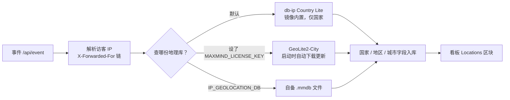

import { Meta } from '@storybook/addon-docs/blocks';

<Meta id="ce-geolocation" title="自托管运维/地理位置" name="Docs" />

# 地理位置

「访客来自哪个国家、哪个城市」不是浏览器上报的，而是服务端算出来的：事件进入 CE 时，服务端从请求链路解析出访客 IP（依赖反代正确转发 `X-Forwarded-For`，见[反向代理与 HTTPS](?path=/docs/ce-reverse-proxy--docs)），拿这个 IP 查一份 IP 地理数据库（`.mmdb` 文件），得出国家、地区、城市几组字段随事件入库；IP 本身不落盘。看板 Locations 区块的地图与三级列表，就是这些字段的直接呈现。

CE 没有配置界面，「查哪份库」完全由环境变量决定：默认用镜像内置的 db-ip 国家库，国家报表开箱即用，地区与城市恒为空；把 `MAXMIND_LICENSE_KEY` 指向免费的 MaxMind GeoLite2，即自动下载 city 级库补全城市数据。本课在 [本地实例](?path=/docs/local-instance--docs) 的 `http://localhost:8000` 环境上讲清默认行为、接入步骤、看板呈现与更新维护。



| 变量 | 默认值 | 作用 |
| --- | --- | --- |
| `IP_GEOLOCATION_DB` | 镜像内置 `priv/geodb/dbip-country.mmdb.gz` | 本地 `.mmdb` 地理库文件路径 |
| `MAXMIND_LICENSE_KEY` | 无默认 | 设了即改为从 MaxMind 自动下载库，优先于 `IP_GEOLOCATION_DB` |
| `MAXMIND_EDITION` | `GeoLite2-City` | MaxMind 库版本，仅在设了 license key 时生效 |
| `GEONAMES_SOURCE_FILE` | 镜像内置 `geonames.lite.csv` | 把库里的 GeoName ID 翻译成看板显示的地名 |

变量写入 `.env` 后 `docker compose up -d` 重建生效，机制见[配置](?path=/docs/ce-configuration--docs)。

## 默认行为：内置 db-ip 国家库

内置库是构建镜像时放进去的：Dockerfile 执行 `mix download_country_database`，从 DB-IP 抓取免费的 Country Lite 库（优先当月版本，404 时回退上月），存为 `priv/geodb/dbip-country.mmdb.gz`；运行时 `IP_GEOLOCATION_DB` 默认就指向这个文件。该任务源码注释写明分工：「Plausible Cloud runs a paid version of DB-IP with more detailed geolocation data」——云端用付费 DB-IP，CE 的免费版只有国家粒度。wiki 配置页对现状的表述是：CE 用 db-ip 创建的国家库为统计数据补充访客国家，库随镜像自带，国家数据自动采集，无需配置。

于是默认环境的行为是：

- **Countries 报表有数据**：公网访客都能定位到国家。
- **Regions / Cities 恒为空**：国家库里没有 `subdivisions` 和 `city` 字段，服务端取不到，只存空值。
- **地图右下角显示「IP Geolocation by DB-IP」署名**：源码在库类型以 `DBIP` 开头时渲染这行链接（换 MaxMind 库后消失）。

一条命令即可自检当前用的是哪份库：

```bash
$ curl -s http://localhost:8000/api/system/
{"geo_database":"DBIP-Country-Lite","build":{...}}
```

`geo_database` 字段就是当前库的类型标识，来自服务端读取的库元数据。

边界：内置库随镜像走，没有在线更新——只有升级 CE 镜像才会换到新版 db-ip 库（构建时重新抓当月库）；内网与保留地址查无记录，本机 `127.0.0.1` 自测的流量没有国家归属；库返回 `ZZ`（未知）、`XX`（争议地区）、`T1`（Tor 出口节点）三类特殊编码时，服务端一律按无国家处理。

## 接入 MaxMind GeoLite2

wiki 的 MaxMind Integration 页给出三步：在 maxmind.com 注册 GeoLite2 免费账号、生成一个 license key、写入两个环境变量并重建容器：

```bash
$ cd plausible-ce
$ echo "MAXMIND_LICENSE_KEY=你的license_key" >> .env
$ echo "MAXMIND_EDITION=GeoLite2-City" >> .env
$ docker compose up -d
$ docker compose exec plausible env | grep MAXMIND_LICENSE_KEY
```

配置后的行为，wiki 原话：「the geolocation databases would be automatically downloaded and kept up to date」——库自动下载并保持更新，无需定时任务。

源码里的机制：设了 key 后，启动配置走 MaxMind 分支——locus 加载器以「edition + license key」向 MaxMind 服务器下载，`async: true` 异步加载，缓存文件放在 `缓存目录/<edition>.mmdb.gz`。CE 的 compose 没设 `DATA_DIR` / `PERSISTENT_CACHE_DIR`，缓存目录落到镜像默认的 `/var/lib/plausible`，恰好是 `plausible-data` 命名卷的挂载点——所以容器重建、甚至 `docker compose down` 之后都不用重下。

可观察证据：

| 检查 | 预期 |
| --- | --- |
| `docker compose exec plausible env \| grep MAXMIND` | 两个变量都在（wiki 的验证步骤） |
| `docker compose logs -f plausible` | 出现 GeoLite2 库下载完成记录，无 locus 报错 |
| `curl -s http://localhost:8000/api/system/` | `"geo_database":"GeoLite2-City"` |
| `docker compose exec plausible ls -l /var/lib/plausible` | 出现 `GeoLite2-City.mmdb.gz` |
| 看板 Locations 地图 | 右下角 DB-IP 署名消失（库类型不再是 DBIP） |

边界：wiki 提醒 city 级库**多占约 1GB 内存**，小内存机器要有预期；首次启动时库异步下载，下载完成前入库的事件地理字段为空；key 的优先级高于 `IP_GEOLOCATION_DB`，两者都设时只用 MaxMind；改完任何地理变量都要 `docker compose up -d` 重建才生效。

## 看板呈现

Locations 区块在[看板导览](?path=/docs/dashboard-tour--docs)里导览过：**Map** 世界热力图，**Countries / Regions / Cities** 三级列表逐级下钻。三级列表分别对应入库时从库里取出的字段：

| 报表 | 入库字段 | 默认 db-ip 国家库 | GeoLite2-City |
| --- | --- | --- | --- |
| Countries | `country.iso_code` | 有 | 有 |
| Regions | `subdivisions` → 「国家-区划」代码 | 无此字段，恒空 | 有 |
| Cities | `city.geoname_id` | 无此字段，恒空 | 有 |

城市的数字 GeoName ID 再经 `GEONAMES_SOURCE_FILE` 翻译成地名展示，所以城市名不必另配翻译文件。

城市级数据的全部需求就是一份含城市字段的库：默认的 `MAXMIND_EDITION=GeoLite2-City` 已经满足；若为省内存把它改成 `GeoLite2-Country`，地区与城市会退回恒空，效果与默认行为相同。

## 更新与维护

MaxMind 模式没有运维负担：locus 定期向 MaxMind 检查新版本并自动更新缓存文件，文件躺在 `plausible-data` 卷里，容器重建不丢。license key 本身的维护在 MaxMind 后台——key 泄露或长期不用可在后台删除重生成，换 key 只需改 `.env` 里 `MAXMIND_LICENSE_KEY` 的值再重建容器。

默认模式则完全被动：库版本等于镜像版本，升级 CE 时构建流程重新抓取当月的 db-ip Country Lite（升级流程见[升级](?path=/docs/ce-upgrade--docs)）。

替代方案现状：旧资料里提到的 ip2location 选项，在 v3.2.1 源码中已无任何引用。非 MaxMind 的路径只剩一条——`IP_GEOLOCATION_DB` 指向自备的 `.mmdb` 文件（例如 DB-IP 同样免费的 City Lite，可拿到城市级），但文件要自己放进容器（`compose.override.yml` 挂载，用法见本地实例课）、更新要自己负责，且与 MaxMind 二选一、key 优先。

## 常见问题

- Locations 区块整个为空，连 Countries 都没有数据。
  先排查访客 IP 有没有进到服务端：反代没配 `proxy_set_header X-Forwarded-For` 时，服务端只能看到代理自己的内网地址，地理库查无记录——判断与修法见[反向代理与 HTTPS](?path=/docs/ce-reverse-proxy--docs)；只用本机 `127.0.0.1` 自测同理，属于环境使然。再用 `curl -s http://localhost:8000/api/system/` 确认 `geo_database` 不是 `"(not configured)"`（出现它说明库没加载成功）。
- 已设 `MAXMIND_LICENSE_KEY`，Regions / Cities 还是空的。
  先看库有没有就绪：启动时异步下载，`curl -s http://localhost:8000/api/system/` 返回 `"(not configured)"` 或仍是 DBIP 开头，说明还没切到 GeoLite2，等下载完成即可。再核对 `MAXMIND_EDITION` 没被改成 `GeoLite2-Country`（country 版没有城市字段，改回 `GeoLite2-City` 重建）。最后注意看板统计的是真实访问：新接入后要有新流量进来，且少量访问定位不到城市属正常。
- 设了 `MAXMIND_LICENSE_KEY` 之后连国家数据都没了。
  key 失效（被删除、填错、复制带了空格）时，地理库配置锁定在 MaxMind 分支，不会回退到内置 db-ip 库——下载失败导致所有地理查询为空。`docker compose logs -f plausible` 里能看到 locus 下载报错；确认 key 有效后修正 `.env` 并 `docker compose up -d` 重建，或暂时注释掉该变量先回到内置国家库。

## 总结回顾

摘要：

CE 在事件入库时用访客 IP 查一份 `.mmdb` 地理库，得出国家、地区、城市字段，IP 不落盘；查哪份库由环境变量决定。默认使用镜像构建时内置的 db-ip Country Lite——Countries 报表开箱即用，Regions / Cities 恒为空，地图上带 DB-IP 署名，`/api/system/` 的 `geo_database` 可随时自检。接入 MaxMind 只需注册 GeoLite2、生成 license key、写入 `MAXMIND_LICENSE_KEY`（可选 `MAXMIND_EDITION`，默认 `GeoLite2-City`）并重建：库自动下载更新，缓存落在 `plausible-data` 卷的 `/var/lib/plausible`，代价是多占约 1GB 内存。看板 Locations 的三级报表分别对应库里的 country、subdivisions、city 字段；旧选项 ip2location 已从 v3.2.1 移除，非 MaxMind 路径只剩 `IP_GEOLOCATION_DB` 自备文件一条。

一句话：

> CE 默认的 db-ip 国家库只够 Countries 报表，地区与城市不靠改报表、靠把 `MAXMIND_LICENSE_KEY` 指向 GeoLite2-City。

知识要点：

- 访客的国家和城市数据是何时、以什么输入算出来的，IP 本身存不存？
- 默认环境下哪份地理库在生效、如何用一条命令自检、哪些报表有数据？
- 接入 MaxMind GeoLite2 需要哪几步，license key 与 edition 两个变量各管什么？
- MaxMind 库如何下载与更新，缓存存在哪，容器重建会不会重下？
- Locations 三级报表分别依赖库里的哪些字段，城市级数据的最低要求是什么？
- Locations 全空、城市不显示、设了 key 反而没国家，各怎么判断与处理？

## 参考资料

- [Wiki: MaxMind Integration（注册、license key、`MAXMIND_LICENSE_KEY` / `MAXMIND_EDITION` 步骤与 ~1GB 内存提示）](https://github.com/plausible/community-edition/wiki/MaxMind-Integration)
- [Wiki: Configuration（IP geolocation 四个变量的默认值与内置 db-ip 国家库说明）](https://github.com/plausible/community-edition/wiki/Configuration)
- [plausible/analytics v3.2.1: config/runtime.exs（地理库二选一逻辑与 `MAXMIND_EDITION` 默认值）](https://github.com/plausible/analytics/blob/v3.2.1/config/runtime.exs)
- [plausible/analytics v3.2.1: lib/plausible/geo.ex（locus 的本地文件 / MaxMind 两种加载模式与缓存文件命名）](https://github.com/plausible/analytics/blob/v3.2.1/lib/plausible/geo.ex)
- [plausible/analytics v3.2.1: lib/mix/tasks/download_country_database.ex（镜像内置 db-ip Country Lite 的来源）](https://github.com/plausible/analytics/blob/v3.2.1/lib/mix/tasks/download_country_database.ex)
- [plausible/analytics v3.2.1: lib/plausible/ingestion/geolocation.ex（国家 / 地区 / 城市字段提取与特殊编码忽略）](https://github.com/plausible/analytics/blob/v3.2.1/lib/plausible/ingestion/geolocation.ex)
