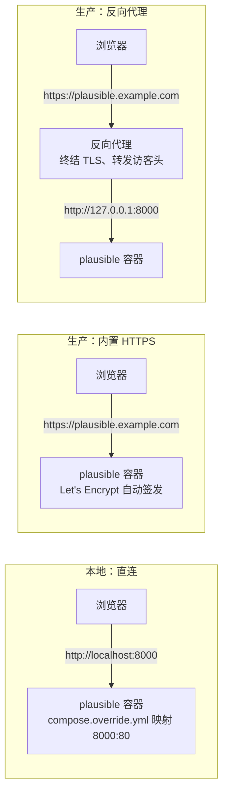

import { Meta } from '@storybook/addon-docs/blocks';

<Meta id="ce-reverse-proxy" title="自托管运维/反向代理与 HTTPS" name="Docs" />

# 反向代理与 HTTPS

`http://localhost:8000` 直连之所以能跑通前面的课程，是因为请求不经过公网：没有域名解析、没有 TLS，浏览器与容器之间只隔一层 compose 端口映射，Plausible 看到的连接 IP 就是访客 IP。把同一套环境放到服务器上、让浏览器从公网访问，本地不存在的三件事必须补齐——**域名**（DNS 记录指向服务器）、**TLS**（浏览器认可的证书）、**访客 IP 转发**（中间多出的代理层会遮住真实 IP）。

CE 提供两条路线，本课各给最小配置：优先评估**内置 HTTPS**——CE 自 v2.1.2 起内置 Let's Encrypt 客户端，把端口设为 80/443 就自动签发并续期证书，完全不需要代理；需要与其他服务共用 443、或服务器上已有代理栈时，选 **Nginx / Caddy 反代**——代理终结 TLS，把请求转给只监听本机回环的 CE 容器，并由代理把访客真实 IP 转发进去。两条路线都要求 `BASE_URL` 从 `http://localhost:8000` 改为 `https://你的域名`。



| 路线 | `.env` 关键变量 | override 端口映射 | TLS 谁终结 | 访客 IP 谁负责 |
| --- | --- | --- | --- | --- |
| 内置 HTTPS | `BASE_URL=https://plausible.example.com`、`HTTP_PORT=80`、`HTTPS_PORT=443` | `80:80`、`443:443` | CE 自带 Let's Encrypt 客户端 | 浏览器直连，无中间层 |
| Caddy 反代 | `BASE_URL=https://plausible.example.com`、`HTTP_PORT=8000`（默认值） | `127.0.0.1:8000:8000` | Caddy 自动 | Caddy 自动附加 |
| Nginx 反代 | 同 Caddy 行 | 同 Caddy 行 | Nginx（证书自备或 certbot） | 必须显式 `proxy_set_header X-Forwarded-For` |
| Apache 反代 | 同 Caddy 行 | 同 Caddy 行 | Apache | `ProxyAddHeaders On` |

wiki 对 Caddy 路线明确要求：站点块域名必须与 `BASE_URL` 一致；Nginx 的 `server_name` 同理。

## 内置 HTTPS

这是官方 README 部署步骤的默认路径：不借助任何代理，由 CE 应用自己向 Let's Encrypt 签发证书。wiki 原话：自 v2.1.2 起「a reverse proxy is no longer necessary」。配置 wiki 对触发条件的表述是：把 `HTTP_PORT` 设为 80、`HTTPS_PORT` 设为 443，Plausible 会尝试签发并保持更新 Let's Encrypt 证书。

前提有三：域名 A 记录已指向本服务器（README 原文要求，证书自动签发依赖它）、80 和 443 从公网可达、`BASE_URL` 写 https 域名。最小配置照抄 README 的 Step 2 / Step 3：

```bash
$ echo "BASE_URL=https://plausible.example.com" >> .env
$ echo "HTTP_PORT=80" >> .env
$ echo "HTTPS_PORT=443" >> .env
```

```yaml
# compose.override.yml
services:
  plausible:
    ports:
      - 80:80
      - 443:443
```

```bash
$ docker compose up -d
```

与 [本地实例](?path=/docs/local-instance--docs) 的环境对比只有两处差异：`BASE_URL` 换成 https 域名，override 的端口映射从 `8000:80` 换成 `80:80` 与 `443:443`；`HTTP_PORT=80` 本地已经设过，沿用即可。`.env` 的改法与变量全景见 [配置](?path=/docs/ce-configuration--docs)。

可观察证据：

| 检查 | 预期 |
| --- | --- |
| `docker compose logs -f plausible` | 出现 Let's Encrypt 证书签发记录，无 ACME 报错 |
| `curl -I https://plausible.example.com` | HTTP 2xx/3xx，证书由 Let's Encrypt 签发 |
| 浏览器地址栏 | 锁形图标，无安全警告 |

边界：README 明确提示，计划放在反向代理后面时应改用其他端口值——80/443 要留给代理，两条路线二选一，不能同时占用；本地评估则根本不需要 `HTTPS_PORT`，只设 `HTTP_PORT` 就够。

## Nginx 反代

服务器上已有 Nginx、需要与其他服务共用 443、或想要更细的访问控制时选这条路线。第一步先让 CE 只暴露给本机回环，代理与 CE 之间的流量不出公网（wiki 的「Expose Plausible」步骤）：

```yaml
# compose.override.yml
services:
  plausible:
    ports:
      - 127.0.0.1:8000:8000
```

`.env` 保持 `HTTP_PORT=8000`（默认值，显式写出只为可读）。先本机验证上游通了再配代理：

```bash
$ curl -I http://127.0.0.1:8000
# 期望 HTTP/1.1 200 OK
```

wiki 给出的 Nginx 骨架原文：

```nginx
server {
    server_name plausible.example.com;

    listen 80;
    listen [::]:80;

    location / {
        proxy_pass http://127.0.0.1:8000;
        proxy_set_header X-Forwarded-For $proxy_add_x_forwarded_for;
    }

    location /live/websocket {
        proxy_pass http://127.0.0.1:8000;
        proxy_http_version 1.1;
        proxy_set_header Upgrade $http_upgrade;
        proxy_set_header Connection "Upgrade";
    }
}
```

三个位置各管一件事：

- `proxy_pass http://127.0.0.1:8000`——上游地址对应 override 里的 `127.0.0.1:8000:8000` 绑定。
- `proxy_set_header X-Forwarded-For $proxy_add_x_forwarded_for`——把访客真实 IP 附加进转发头。缺这行，访客识别与地理报表全部失真，语义见下一节。
- `location /live/websocket`——看板 realtime 页的 WebSocket 端点。Nginx 必须显式传 `Upgrade` / `Connection` 头才能完成协议升级，这段漏配的症状是 realtime 不刷新、普通报表却正常。

wiki 骨架只有 80 端口（该页的 Nginx / Apache 配置为社区贡献、维护者未测试）。TLS 部分用 certbot 一条命令补齐是通用做法：它会自动加上 `listen 443 ssl`、证书路径和 80 到 443 的重定向。

```bash
$ sudo certbot --nginx -d plausible.example.com
```

`server_name` 必须与 `BASE_URL` 的域名一致（wiki 对 Caddy 的要求，Nginx 同理）；改完 `.env` 后照例 `docker compose up -d` 重建生效。

## Caddy 反代

前置与 Nginx 路线完全相同（`HTTP_PORT=8000` + `127.0.0.1:8000:8000` 绑定），Caddyfile 只需三行（wiki 原文）：

```
plausible.example.com {
    reverse_proxy localhost:8000
}
```

wiki 强调站点块域名必须与 `BASE_URL` 一致。Nginx 要手配的三件事在 Caddy 里都是默认行为：证书自动签发续期、WebSocket 透传、`X-Forwarded-For` 自动附加——所以 Caddy 配置里看不到转发头，不是不需要，而是默认已带对。

选型一句话：Caddy 用零配置换约定，Nginx 用显式配置换控制；两者转给 CE 的东西完全一样——终结后的明文请求加三个转发头。

## 访客信息转发

这是反代路线的核心正确性要求，与「代理能不能转发请求」同等重要。两个头各管一半：

- **`X-Forwarded-For` → 访客身份与地理。** Plausible 用 IP + User-Agent 计算访客 `user_id`，用访客 IP 查地理库得出国家与城市。代理不转发、或转发了代理自己的 IP 时：所有访客坍缩成一个访客、地理报表为空或全是服务器位置，事件还可能触发 bot filter 被静默丢弃——照样返回 202，只能靠 `x-plausible-dropped: 1` 响应头发现。请求头与访客属性的完整语义见 [Events API](?path=/docs/events-api--docs)；同一个硬性要求在「绕广告拦截」视角下的讲法见 [绕过广告拦截](?path=/docs/proxy--docs)。
- **`X-Forwarded-Proto` → 原始协议。** 告诉应用客户端实际走的是 https，应用据此生成正确的绝对链接与重定向。官方 proxy 指南的 Nginx 转发位置同时设置三个头，反代整站时照搬这三行即可：

```nginx
proxy_set_header X-Forwarded-For $proxy_add_x_forwarded_for;
proxy_set_header X-Forwarded-Proto $scheme;
proxy_set_header X-Forwarded-Host $host;
```

Caddy 默认三个头都带；漏配 `X-Forwarded-Proto` 的典型症状是页面能打开、但生成的链接或重定向退回 http。

接入地址随之改变。tracker 片段从本地课的写法：

```html
<script defer data-domain="test.local" src="http://localhost:8000/js/script.js"></script>
```

换成生产域名——`src` 跟随 `BASE_URL`，`data-domain` 仍是站点在 Plausible 登记的域名：

```html
<script defer data-domain="test.local" src="https://plausible.example.com/js/script.js"></script>
```

验证链路端到端正确：打开站点页面，Network 面板里脚本请求与 `/api/event` 请求都应走 `https://plausible.example.com` 且状态正常；要核对代理链是否把 IP 带对，用 curl 直发一条测试事件并在请求头加 `X-Debug-Request: true`，响应会给出服务端将采用的访客 IP（调试头语义见 Events API 课）。地理读数另有一个与代理无关的前提：CE 需接入 MaxMind GeoLite2 才有完整地理数据，见 [地理位置](?path=/docs/ce-geolocation--docs)。

## 常见问题

- 证书一直签发失败，`docker compose logs -f plausible` 里反复出现 Let's Encrypt / ACME 报错。
  先查两个前提：`dig +short plausible.example.com` 是否已解析到本服务器（README 要求域名有指向服务器的 DNS 记录，签发依赖它），以及从公网 `curl -I http://plausible.example.com` 是否可达——80 端口不通（安全组、防火墙未放行）或 DNS 未生效，签发必然失败。DNS 刚修改完先等解析生效再重启容器重试。
- 上了生产后访客数明显偏少、所有人被算成一个访客，地理报表为空或全是服务器所在城市。
  这是反代没转发 `X-Forwarded-For` 的典型症状：服务端只看到代理自己的地址。在转发位置显式加 `proxy_set_header X-Forwarded-For $proxy_add_x_forwarded_for;`（Caddy 自动处理，无需配置），改完重载 Nginx 即可；Plausible 没有修改已入库事件的机制，修正只对之后的访问生效。
- 站点页面已是 https，浏览器控制台报 `Mixed Content: ... was loaded over HTTPS, but requested an insecure ... script`，脚本请求被拦下。
  接入片段还带着本地课的 `http://localhost:8000/js/script.js`。把片段 `src` 改为 `https://plausible.example.com/js/script.js`（脚本地址跟随 `BASE_URL`），若做过同域代理，`data-api` / `endpoint` 一并换成 https 同域路径。

## 总结回顾

摘要：

本地 `http://localhost:8000` 直连不经过公网，上生产要补齐域名、TLS、访客 IP 转发三件事。CE 自 v2.1.2 起内置 Let's Encrypt 客户端，官方默认路径是 `BASE_URL` 用 https 域名、`HTTP_PORT=80` / `HTTPS_PORT=443` 并在 override 里映射 `80:80` 与 `443:443`，证书签发续期由应用自己完成，不需要代理；要与其他服务共用 443 时走反代——CE 只绑定 `127.0.0.1:8000`，由 Caddy（三行配置，证书、WebSocket、转发头全默认）或 Nginx（显式配 `X-Forwarded-For` 与 `/live/websocket` 升级块，TLS 用 certbot 补齐）终结 TLS 并转发访客信息。`X-Forwarded-For` 决定访客身份与地理报表的正确性，缺失或填代理 IP 会让所有人坍缩成一个访客甚至触发静默丢弃；`X-Forwarded-Proto` 保证应用生成 https 链接。tracker 片段的 `src` 随 `BASE_URL` 换成生产域名。

一句话：

> 反向代理不是必选项——CE 能自己终结 TLS；一旦引入代理，把真实访客 IP 经 `X-Forwarded-For` 转进去就从可选变成硬性要求。

知识要点：

- 从 localhost 走向公网，生产部署要补齐哪三件事？
- 什么条件下可以完全不用反向代理，CE 如何自动拿到并续期 Let's Encrypt 证书？
- 自建反代时 CE 容器应如何暴露端口，Nginx 与 Caddy 的最小配置差在哪？
- `X-Forwarded-For` 缺失或填错会怎样，为什么它影响访客识别与地理报表？
- 上生产后 tracker 脚本地址改成什么，由哪个变量决定？

## 参考资料

- [plausible/community-edition README（Step 2/3 原文：BASE_URL、HTTP_PORT=80、HTTPS_PORT=443、80:80/443:443 映射与 DNS 前提）](https://github.com/plausible/community-edition)
- [Wiki: Reverse Proxy（v2.1.2 起反代不再必需；Caddy / Nginx / Apache 配置原文与回环绑定步骤）](https://github.com/plausible/community-edition/wiki/Reverse-Proxy)
- [Wiki: Configuration（HTTP_PORT 默认 8000、HTTPS_PORT 与 Let's Encrypt 提示、BASE_URL 用途）](https://github.com/plausible/community-edition/wiki/configuration)
- [Bypass adblockers with a proxy：Nginx 指南（X-Forwarded-For / X-Forwarded-Proto / X-Forwarded-Host 三行出处）](https://plausible.io/docs/proxy/guides/nginx)
