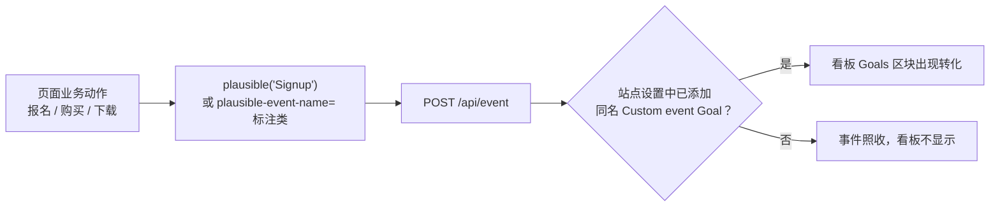

import { Canvas, Controls, Meta } from '@storybook/addon-docs/blocks';
import * as CustomEvents from './custom-events.stories';

<Meta of={CustomEvents} name="Docs" />

# 自定义事件

脚本接入后，Plausible 自动收集的只有 pageview。业务动作——报名、购买、下载、按钮点击——要靠自己上报为「自定义事件」：在 JS 里调用 `window.plausible('Signup')`，或不给 JS 而给 HTML 元素加一个标注类（tagged events）。事件名就是你给动作起的名字，会原样出现在上报请求里。

有一个容易踩空的关键事实：**事件上报成功不等于看板可见**。自定义事件必须先在站点设置里添加为同名 Goal，才会出现在看板的 Goals 区块；添加之前收到的事件不回溯计数。



`window.plausible` 的完整签名（脚本加载后即可用；加载前调用会进入队列桩，加载后自动补发，机制见 [接入脚本](?path=/docs/script-setup--docs)）：

| 参数 | 含义 | 默认 |
| --- | --- | --- |
| 第一参数 `eventName` | 事件名，即看板中的 Goal 名，逐字符匹配（含大小写） | 必填 |
| `callback` | 每次事件发送完成、被忽略或出错后调用的回调 | 无 |
| `props` | 附加自定义属性，见 [自定义属性](?path=/docs/custom-properties--docs) | 无 |
| `revenue` | 附加收入数据，见 [收入归因](?path=/docs/revenue-attribution--docs) | 无 |
| `interactive` | 是否计入跳出率计算；`false` 表示不计 | `true` |

## 快速上手

最小闭环：上报一个 `Signup` 事件，并在看板 Goals 区块看到它。前提：本地实例运行中且已创建站点 `test.local`（见 [本地实例](?path=/docs/local-instance--docs)）。

1. 先添加 Goal：打开 `http://localhost:8000/test.local/settings/goals`，点 **+ Add goal**，触发类型选 **Custom event**，名称填 `Signup`，保存。先做这一步是因为 Goal 创建前的事件不回溯计数。

2. 新建 `test-events.html`：

   ```html
   <script defer data-domain="test.local" src="http://localhost:8000/js/script.manual.local.js"></script>
   <button onclick="plausible('Signup')">报名</button>
   ```

   任何脚本变体都提供 `window.plausible`；这里用 `manual` 只是关掉自动 pageview，让本次实验只剩自定义事件。`.local` 是本地演示必需：默认脚本会忽略 localhost 页面的事件。

3. 用静态服务器打开页面（如 `npx serve .`），点击「报名」。浏览器 Network 面板出现一条 `/api/event` 的 POST、状态 202，请求体里 `n` 字段就是 `"Signup"`。

4. 打开看板 `http://localhost:8000/test.local`，底部 Goals 区块出现 `Signup` 的转化记录（首次转化后该区块才显示）。

## JS 上报

`window.plausible` 是自定义事件的统一入口，第一个参数是事件名，第二个参数是选项对象：

```js
// 最小形式：只给事件名
window.plausible('Signup');

// 带自定义属性与回调
window.plausible('Download', { callback: callback, props: { method: 'HTTP' } });

function callback(result) {
  if (result && result.status) {
    // 已发送，result.status 为 HTTP 状态（正常为 202）
  } else if (result && result.error) {
    // 网络错误，事件未送达
  } else {
    // 事件被脚本忽略，根本没有发出请求（如 localhost 页面遇到不带 .local 的脚本）
  }
}

// 不计入跳出率的事件（如后台轮询触发的动作）
window.plausible('Custom Event', { interactive: false });
```

要点：

- **命名即契约**：事件名原样进入请求体 `n` 字段，也就是看板里的 Goal 名。官方示例使用业务可读的短词（`Signup`、`Purchase`、`Download`、`Button Click`）；内置自动事件用 `Form: Submission`、`File Download` 这类风格。选定后不要轻易改，改动等于换了一个新指标。
- **callback 是唯一的发送结果通道**：`plausible()` 无返回值，成功、忽略、失败三种结果都通过 `callback` 区分（被忽略时回调无参数）。
- **加载顺序安全**：脚本加载完成前 `window.plausible` 是队列桩，先调用后补发，按钮绑定不必等脚本就绪。

下面的实例把两个业务按钮搬进了本页：「报名」固定触发 `Signup`，「购买」触发你在 Controls 里填的事件名。运行条件与快速上手相同：本地实例运行中、站点 `test.local` 已创建；想让看板同步显示转化，先在 `http://localhost:8000/test.local/settings/goals` 添加 `Signup`、`Purchase` 两个 Custom event Goal，再到看板 `http://localhost:8000/test.local` 底部 Goals 区块核对。

<Canvas of={CustomEvents.Interactive} />
<Controls of={CustomEvents.Interactive} />

| 读者操作 | 可观察证据 |
| --- | --- |
| 保持默认 `script.manual.local.js`，点「报名」/「购买」 | 「已触发事件」对应条目 +1；「最近载荷」显示真实请求体的 `n` / `d` / `u`；「发送结果」显示 callback 收到的 `已发送（HTTP 202）` |
| 把「购买按钮事件名」改成 `Checkout` 再点「购买」 | 「已触发事件」出现新的 `Checkout` 条目——事件名完全由调用方决定，看板端只认同名 Goal |
| 「脚本文件」切到 `script.tagged-events.local.js` | 按钮不再走 JS 调用，改由标注类自动捕获，点击同样计数；「发送结果」改由响应状态给出 |
| 「脚本文件」切到 `script.manual.js` 再点击 | 「发送结果」显示「已忽略：localhost 页面需要带 .local 的脚本变体」，计数不变 |
| 停掉本地实例后切换「脚本文件」 | 「脚本状态」显示「加载失败：本地实例未运行？」，按钮点击给出无法上报的提示 |
| 打开 Show code | 看到注入脚本、按钮触发与 callback 处理的完整实现 `example.ts` |

边界提醒：云端会把自定义事件计入按月计费的 pageview 额度（CE 自托管无此概念）；每次上报独立计数，同一访客连点十次「报名」，`Signup` 的总转化就记十次。

## tagged events

tagged events 是 HTML-only 的自定义事件方式：不写 JS，给要跟踪的元素加一个标注类，脚本自动捕获点击并上报。需要换用带 `tagged-events` 的脚本变体（本地演示用 `script.tagged-events.local.js`）：

```html
<script defer data-domain="test.local" src="http://localhost:8000/js/script.tagged-events.local.js"></script>
<button class="plausible-event-name=Signup">报名</button>
```

语法细则（均可在 tracker 源码 `custom-events.js` 中核对）：

- **事件名类**：`plausible-event-name=<事件名>`。class 里不能有空格，用 `+` 代替：`plausible-event-name=Button+Click` 上报的事件名是 `Button Click`。有些 CMS（如 Webflow）会把 `=` 改成 `-`，此时改用双连字符写法 `plausible-event-name--Signup`，脚本对两者等同处理。
- **附加属性**：`plausible-event-<属性名>=<值>` 可加多个，成为事件的自定义属性（概念见 [自定义属性](?path=/docs/custom-properties--docs)）。
- **捕获范围**：点击任意带标注的元素、提交带标注的表单都会触发；点击落在标注元素的子元素上时，最多向上找 3 层父元素。被标注的链接（`<a>`）会自动附加 `url` 属性（值为 `href`）。
- **与 JS 方式的取舍**：简单点击跟踪、CMS 里不能写 JS 的场景用 tagged events；需要动态值、条件逻辑或非点击交互（如音视频播放）时用 JS 上报。
- **边界**：tagged 方式没有 callback，发送结果只能从 Network 面板确认；点击发生在脚本加载完成前不会排队，直接丢失。事件名同样要先添加为 Goal 才上看板。

对照观察：把上面实例的「脚本文件」切到 `script.tagged-events.local.js`，两个按钮上的 JS 调用即被移除、标注类生效，点击后读数与 JS 方式一致。

## 让事件显示在看板

这是自定义事件最容易漏掉的一步：**服务端照收所有事件，但看板只展示已登记为 Goal 的事件名**。

操作路径（本地 CE）：`http://localhost:8000/test.local/settings/goals` → **+ Add goal** → 触发类型选 **Custom event** → 填入事件名 → 保存。要点：

- **逐字符匹配**：Goal 名必须与上报的事件名完全一致，含大小写。tagged events 里最常见的错配是 `+`：`plausible-event-name=Button+Click` 发出的事件名是 `Button Click`，Goal 也必须是 `Button Click` 而不是 `Button+Click`。
- **不回溯**：Goal 创建之前收到的同名事件不计入。先加了 Goal 再触发，或加完后回到页面再触发一次。
- **显示位置**：首次转化发生后，事件出现在看板底部的 **Goals** 区块（点开详情的标题是「Goal conversions」），点击 Goal 名可以过滤整个看板。创建 Goal 时还可以用自定义属性缩小匹配范围（如只统计某个套餐的 Purchase），细节见 [自定义属性](?path=/docs/custom-properties--docs)；转化率的口径与计算见 [目标与转化](?path=/docs/goals-conversions--docs)。

## 常见问题

- Network 里 `/api/event` 返回 202，但看板 Goals 区块始终没有这个事件。
  202 只代表服务端收到事件，不代表它会显示。到站点设置的 Goals 里确认已添加同名的 Custom event Goal，名称逐字符一致（含大小写；tagged 写法里的 `+` 对应空格）。Goal 不回溯历史事件，添加后需重新触发一次再看。

- 点击后 `/api/event` 根本没发出，Console 出现 `Ignoring Event: localhost`。
  页面跑在 localhost 而脚本没带 `.local` 扩展名，脚本主动放弃了事件。本地演示一律使用带 `.local` 的变体（如 `script.manual.local.js`、`script.tagged-events.local.js`），原因与变体规则见 [接入脚本](?path=/docs/script-setup--docs)。tagged events 方式没有 callback，被忽略时页面上唯一的线索就是这条 Console 警告。

## 总结回顾

摘要：

pageview 之外的业务动作通过自定义事件进入 Plausible：JS 方式调用 `window.plausible('Signup')`，可用 `callback` 拿到发送结果（成功、忽略、失败三态），`props` / `revenue` / `interactive` 按需附加；HTML-only 方式给元素加 `plausible-event-name=<事件名>` 标注类，由 `tagged-events` 脚本变体自动捕获点击，空格用 `+`、CMS 场景用 `--` 代替 `=`。两种方式发出的是同一种 `/api/event` 请求，且都必须先在站点设置中把事件名添加为 Custom event Goal，看板底部的 Goals 区块才会显示转化；Goal 不回溯历史事件，名称逐字符匹配。本地演示要带 `.local` 变体，否则 localhost 页面的事件被脚本直接忽略。

一句话：

> 自定义事件 = 你命名的业务动作 + 一次 `plausible()` 调用或一个标注类，但只有先登记为同名 Goal，它才会出现在看板上。

知识要点：

- `window.plausible('Signup')` 的两个参数分别是什么，`callback` 收到的三种结果各代表什么？
- 为什么事件上报返回 202，看板 Goals 区块却没有数据？
- tagged events 的标注类怎么写，空格和 CMS 吞掉 `=` 的情况分别怎么处理，需要哪个脚本变体？
- JS 上报和 tagged events 各自适合什么场景？
- Goal 创建前触发的事件会补进看板吗？
- localhost 页面上自定义事件不发送的原因和解决办法是什么？

## 参考资料

- [Custom event tracking（官方文档）](https://plausible.io/docs/custom-event-goals)
- [Goal conversions（官方文档）](https://plausible.io/docs/goal-conversions)
- [plausible/analytics：tracker 源码 `custom-events.js` 与 `tracker_plug.ex`（tagged 类语法、`+` / `--` 规则与脚本变体的事实来源）](https://github.com/plausible/analytics)
