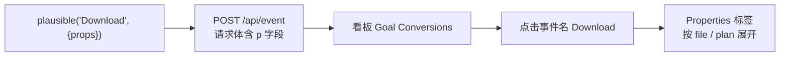

import { Canvas, Controls, Meta } from '@storybook/addon-docs/blocks';
import * as CustomProperties from './custom-properties.stories';

<Meta of={CustomProperties} name="Docs" />

# 自定义属性

自定义事件能告诉你「Download 发生了 500 次」，但看不出下载的是哪份文件。自定义属性（custom properties，相当于 GA 的自定义维度）就是挂在事件上的标量键值对：上报时在调用里多带一个 `props` 对象，看板里就能按这些键把同一个事件名拆开统计。本课讲清 props 怎么随事件与 pageview 上报、在看板里从哪里展开、以及值类型与数量的约束。

读完你应能预测：给事件多加一个 prop 后，要到看板的哪个位置才能看到它；哪些值适合当 prop；看板里找不到 props 时按什么顺序排查。



props 的硬约束（来自官方文档，边界讨论见「约束与命名」）：

| 约束项 | 取值 | 说明 |
| --- | --- | --- |
| 值类型 | 仅标量：字符串、数字、布尔 | 对象与数组不被接受 |
| 每个事件的属性数 | 最多 30 个不同的键 | 超出部分无法随事件发送 |
| 键名长度 | 最多 300 字符 | |
| 值长度 | 最多 2000 字符 | |
| 看板显示前提 | 事件已注册为 Goal，且属性键已加入站点设置 Custom Properties | 二者都不自动出现，缺一不可 |

## 快速上手

最小闭环：上报一个带 props 的 Download 事件，然后在看板里按 `file` 把它拆开。前提：本地实例运行中、站点 `test.local` 已创建（见 [本地实例](?path=/docs/local-instance--docs)），且 `Download` 已注册为自定义事件 Goal（注册方法见 [自定义事件](?path=/docs/custom-events--docs)；Goal 不回溯创建前的数据，先注册再发事件）。

1. 测试页引入脚本与队列桩。本页示例跑在 localhost，脚本必须带 `.local` 变体，否则脚本会忽略 localhost 页面的事件（原因见 [接入脚本](?path=/docs/script-setup--docs)）；队列桩保证脚本加载完成前的点击不丢失：

   ```html
   <script defer data-domain="test.local" src="http://localhost:8000/js/script.manual.local.js"></script>
   <script>window.plausible = window.plausible || function() { (window.plausible.q = window.plausible.q || []).push(arguments) }</script>
   ```

2. 页面上放一个按钮，点击时上报带 props 的事件：

   ```html
   <button onclick="plausible('Download', {props: {file: 'pricing.pdf', plan: 'premium'}})">
     下载定价 PDF
   </button>
   ```

3. 把属性键加入白名单：站点设置 → Custom Properties，添加 `file` 和 `plan`；也可以先点几次按钮，再用那里的「一键添加已发送属性」补登。

4. 打开看板 `http://localhost:8000/test.local`，底部 Goal Conversions 区块的 Goals 标签里点击事件名 `Download`，页面跳到 Properties 标签；选择属性键 `file`，就能看到 `pricing.pdf` 这一行及对应转化数。

## 事件 props

给自定义事件附加属性的写法是在调用的第二个参数里带 `props` 对象：

```js
plausible('Download', {props: {file: 'pricing.pdf', plan: 'premium'}});
```

第二个参数是选项对象，除 `props` 外还支持 `callback`、`revenue`、`interactive`（分别见 [自定义事件](?path=/docs/custom-events--docs) 与 [收入归因](?path=/docs/revenue-attribution--docs)）。tracker 会把 `props` 原样放进上报请求体的 `p` 字段，所以 props 是「这一条事件的」数据：同一个事件名，这次带 `file: 'pricing.pdf'`、下次带 `file: 'whitepaper.pdf'`，互不影响。

不写 JavaScript 的场景也有入口：`tagged-events` 变体下给元素加 class `plausible-event-<property>=<value>` 即可附带属性（值里的空格写成 `+`），同样最多 30 个；这是无代码事件机制的延伸，见 [自定义事件](?path=/docs/custom-events--docs)。

props 与 Goal 的关系要分清两层：

- **显示前提**：自定义事件先注册为 Goal 才会出现在看板，属性键先加入站点设置的 Custom Properties 白名单才会出现在细分里。props 挂在事件上，看板的下钻路径因此是「事件 → 属性键 → 属性值」：在 Goal Conversions 的 Goals 标签里点击事件名，跳到 Properties 标签查看该事件携带的属性键，选一个键即按值分行列出；点击值可以叠加为筛选条件。
- **目标约束（可选）**：定义 Goal 时还可以附加最多 3 个属性条件，让目标只在特定属性值下计数（漏斗步骤只能用这种带约束的 Goal）。这属于目标定义一侧的用法，见 [目标与转化](?path=/docs/goals-conversions--docs)。

下面的实例把上面的片段搬进了本页：注入 `script.manual.local.js`（手动变体不发自动 pageview，页内每次上报都来自按钮点击），两个按钮上报同一个 `Download` 事件但 `file` 不同，`plan` 的值由 Controls 提供。运行条件与快速上手相同（本地实例运行中、`test.local` 站点、Goal 与属性键已配置）；白名单未配置不影响页内读数，只是看板里暂时看不到细分。

<Canvas of={CustomProperties.Interactive} />
<Controls of={CustomProperties.Interactive} />

| 读者操作 | 可观察证据 |
| --- | --- |
| 点「下载定价 PDF」 | 「最近事件名」变为 `Download`，「最近 props」显示 `{"file":"pricing.pdf","plan":"premium"}`，「最近上报结果」显示 `已上报（HTTP 202）` |
| 再点「下载白皮书」 | 「最近 props」中 `file` 变为 `whitepaper.pdf`，「已上报 Download」累加——同一事件名、不同属性值 |
| 把「plan 属性值」改成 `free` 再点按钮 | 「最近 props」中 `plan` 同步变化，同一次上报可以携带多个键 |
| 清空「plan 属性值」再点按钮 | 「最近 props」只剩 `file` 键；看板按 `plan` 细分时，这类不带 `plan` 的事件计入 `(none)` |
| 打开浏览器 Network 面板再点按钮 | `POST /api/event` 请求体含 `n: "Download"` 与 `p: {...}`，与页内读数一致 |
| 打开 Show code | 看到注入脚本与上报调用的完整实现 `example.ts` |

看板核对：点过按钮后打开 `http://localhost:8000/test.local` → Goal Conversions → 点击事件名 `Download` → Properties 标签选择 `file`，`pricing.pdf` 与 `whitepaper.pdf` 各成一行；改选 `plan` 则按 Controls 给过的值分行。

## pageview props

pageview 在 Plausible 内部也是一个事件，`props` 机制完全一样，只是触发方式不同：用 `manual` 变体关闭自动 pageview 后，手动上报时带上 `props`：

```js
// 配合 script.manual.js；本地实验用 script.manual.local.js，即上方实例注入的脚本
plausible('pageview', {props: {author: 'John Doe', logged_in: 'false'}});
```

事件名必须逐字写成 `pageview`，这行调用计为一次页面浏览。适合给页面级维度打标：作者、栏目、登录状态、实验分组等。

不想写 JavaScript 时还有无代码方式：`pageview-props` 变体读取 `<script>` 标签上的 `event-*` 属性，附加到自动上报的 pageview 上：

```html
<script defer data-domain="test.local" event-author="John Doe"
        src="http://localhost:8000/js/script.local.pageview-props.js"></script>
```

注意两点：标签上的属性同样会自动附加到之后上报的自定义事件转化上，不只是 pageview；两种方式可以组合（`script.local.manual.pageview-props.js`），标签属性与手动调用的 `props` 合并，同名键冲突时以手动调用的值为准。变体文件名的组合规则见 [接入脚本](?path=/docs/script-setup--docs)。

补充：站点设置里生成的新版片段（`pa-*.js` + `plausible.init()`）改用 init 的 `customProperties` 选项给所有事件统一附加属性，与本课的经典写法并存，详见官方文档。

## 约束与命名

硬约束已列在开头参考表，这里是读到就必须知道的边界：

- **值必须是标量**：字符串、数字、布尔可以；对象、数组不被接受。想带多个值就拆成多个键。
- **禁止 PII**：姓名、邮箱、IP、电话等个人可识别信息不能放进 props。已发送的属性值无法逐条删除，误发 PII 只能整站重置数据——在设计键值时挡住，别指望事后清理。
- **基数自己控制**：官方没有限制一个键允许多少个不同的值，但看板把每个不同的值列成一行。把用户 ID、精确时间戳、完整 URL 这类高基数值塞进 props，细分列表会膨胀到失去可读性。props 适合取值可枚举的分组维度：文件名、套餐、档位、布尔状态。
- **`(none)` 行的含义**：发送时键没带值或值为 null/undefined、同名事件中有一部分没携带该键，看板都会显示 `(none)`；不按事件筛选直接看 Properties 标签时，不携带该键的其他事件也计入 `(none)`。
- **键名写法前后统一**：键是逐字符记录的字符串，筛选与下钻按记录的键匹配（筛选器支持 is / is not / contains / does not contain）。官方示例习惯小写蛇形（如 `logged_in`），同一站点内保持一种写法即可。

## 常见问题

- 事件上报成功（`/api/event` 返回 202）、看板里也能看到事件，但找不到刚发的属性。
  按链排查：一看属性键是否已加入站点设置 → Custom Properties——白名单不自动生成，可先发事件再用「一键添加已发送属性」补登；二看是否点对了入口——props 不在 Goals 标签里展开，要在 Goals 标签里点击事件名跳到 Properties 标签，再选择属性键；三看时间范围与已有筛选，属性建议只统计当前口径内记录到的键。

- 给 props 塞了高基数的值（比如每个用户一个 ID），会有什么后果？
  上报不会报错，官方没有唯一值数量上限；但看板的属性细分按值逐行列出，几万行的细分既没有可读性也无法逐条清理（属性值不支持单条删除，只能整站重置）。分组维度用可枚举值，标识符留在自己的系统里。

## 总结回顾

摘要：

自定义属性是挂在事件上的标量键值对：在 `plausible()` 调用的第二个参数里带 `props` 对象，tracker 把它放进请求体的 `p` 字段，同一事件名由此可按 `file`、`plan` 等维度拆开。pageview 也是事件，`manual` 变体下 `plausible('pageview', {props})` 同样成立；无代码场景用 `pageview-props` 变体读取 script 标签上的 `event-*` 属性。看板里的下钻路径是「事件 → 属性键 → 属性值」，前提是事件已注册为 Goal、属性键已加入站点设置的 Custom Properties 白名单。约束上每事件最多 30 个键、值仅标量、禁 PII 且无法逐条删除；基数官方不设上限，但由看板可读性兜底。

一句话：

> props 挂在事件上：上报时多带一个 `props` 对象，看板里点事件名就能按键值拆开——但事件先要注册为 Goal、键先要加入白名单，否则一切不可见。

知识要点：

- 给 `Download` 事件附加 `file` 与 `plan` 两个属性的调用怎么写？
- 看板里从哪个入口按属性拆开一个事件？下钻顺序是什么？
- props 在看板可见的两个配置前提是什么，其中哪个不回溯历史数据？
- pageview 怎样携带 props？无代码方式用哪个变体、什么属性名格式？
- props 的值类型、每事件键数、键名与值的长度上限各是什么？
- 看板里的 `(none)` 行代表什么？
- 为什么不该把用户 ID 这类高基数值放进 props？

## 参考资料

- [Custom properties 介绍：值类型、数量与长度上限、PII 禁令（官方文档）](https://plausible.io/docs/custom-props/introduction)
- [Attach custom properties to custom events：props 语法与目标属性约束（官方文档）](https://plausible.io/docs/custom-props/for-custom-events)
- [Analyze your traffic by custom properties：看板下钻路径与白名单配置（官方文档）](https://plausible.io/docs/custom-props/props-dashboard)
- [Attach custom properties to pageviews：新版 init 的 customProperties 写法（官方文档）](https://plausible.io/docs/custom-props/for-pageviews)
- [Attach custom properties to pageviews：经典 script.manual.js 与 event-* 写法（官方文档存档）](https://web.archive.org/web/2024/https://plausible.io/docs/custom-props/for-pageviews)
- [Custom event goals：事件注册为 Goal 的前提、历史数据不回溯（官方文档）](https://plausible.io/docs/custom-event-goals)
- [plausible/analytics：tracker 源码（props 在请求体中的 p 字段、变体编译开关）](https://github.com/plausible/analytics)
