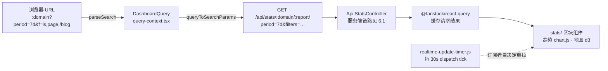

import { Meta } from '@storybook/addon-docs/blocks';

<Meta id="dashboard-frontend" title="内部架构/看板前端" name="Docs" />

# 看板前端

[看板导览](?path=/docs/dashboard-tour--docs)从外部视角介绍了看板有哪些区块；本课翻到内部视角，回答"这些读数是怎么来的"。核心事实只有一句话：**看板的每次读数都是一次 API 查询**。看板不在加载时拿一整页数据，而是每个报表区块（趋势图、来源、页面、地区……）各自向 Phoenix 发 `GET /api/stats/<domain>/<report>/` 请求，[总体架构](?path=/docs/architecture--docs)里的查询链路在浏览器端的起点就是这里。

由此推出整个前端的组织方式，也是本课的知识模型：

- **浏览器 URL 是查询状态的唯一真源。** 时间范围、筛选条件全部编码在地址栏参数里，React 从中解析出 `DashboardQuery` 对象；点击筛选、切换日期本质上都只是改 URL，URL 一变、所有区块按新查询重新请求。
- **组件不存业务数据。** 请求结果交给 @tanstack/react-query 统一缓存，组件只负责渲染；图表用 chart.js 画趋势、用 d3 画地图，其余区块是表格和数字。
- **realtime 不是 WebSocket。** 一段 8 行的定时器每 30 秒广播一次 DOM `tick` 事件，订阅它的组件各自重新请求——realtime 只比普通模式"多敲一次回车"。



`DashboardQuery` 的字段、URL 参数与默认值是全课的回查入口：

| 查询字段 | URL 参数 | API 请求参数 | 默认值 | 说明 |
| --- | --- | --- | --- | --- |
| `period` | `period` | `period` | `28d` | 取值见 `query-time-periods.ts` 的 `QueryPeriod`：`realtime`、`day`、`month`、`7d`、`28d`、`30d`、`91d`、`6mo`、`12mo`、`year`、`all`、`custom` |
| `date` / `from` / `to` | `date` / `from` / `to` | 同名 | `null` | `custom` 或 `day` 时生效，格式 `YYYY-MM-DD` |
| `filters` | `f`（每条筛选一个参数） | `filters`（JSON 数组） | `[]` | 两种编码的互转见下文查询构造 |
| `labels` | `l` | 不发送 | `{}` | ID 类筛选值（如城市 ID）的人读名称，仅用于界面显示 |
| `comparison` | `comparison` | `comparison` | `null` | 对比模式：`off` / `previous_period` / `year_over_year` / `custom` |
| `compare_from` / `compare_to` | 同名 | 同名 | `null` | `comparison=custom` 时的对比区间 |
| `match_day_of_week` | 同名 | `match_day_of_week` | `true` | 对比时是否按星期对齐 |
| `with_imported` | `with_imported` | `with_imported` | `true` | 是否并入导入的历史数据 |
| —（共享链接） | `auth` | `auth` + 请求头 `X-Shared-Link-Auth` | 无 | [分享与嵌入](?path=/docs/sharing-embedding--docs)的鉴权参数，由 `api.setSharedLinkAuth` 注入所有请求 |

## 技术栈与目录

技术栈以 `assets/package.json` 为准：React 18 + TypeScript（存量代码 `.js`/`.ts` 混合）、react-router-dom 6 承担路由、@tanstack/react-query 5 承担服务端数据缓存、chart.js 3 与 d3 7 负责图形、Tailwind 负责样式（CSS 由 Elixir 侧 `:tailwind` mix 任务编译，见构建一节）。依赖里的 Alpine.js 不属于看板——它只服务 `app.js` 挂载的 LiveView 管理页面。

**状态管理没有引入 Redux 之类的库**，分三层：

| 层 | 承载者 | 内容 |
| --- | --- | --- |
| 查询状态 | 浏览器 URL → `query-context.tsx` 解析为 `DashboardQuery` | period、filters、comparison 等一切"查什么" |
| 服务端数据 | `@tanstack/react-query` 缓存（`router.tsx` 里装配 `QueryClientProvider`） | 每个请求的结果与加载状态 |
| 全局 UI 状态 | 一组 React Context：`site-context`、`user-context`、`theme-context`、`last-load-context`、`filtering/segments-context` | 站点信息、登录用户、明暗主题、加载时间戳、已保存细分 |

挂载过程由服务端发起：Phoenix 模板 `lib/plausible_web/templates/stats/stats.html.heex` 输出一个 `<div id="stats-react-container" data-domain=… data-shared-link-auth=…>`，把站点、用户、功能开关通过 `data-*` 属性递给前端；esbuild 入口 `assets/js/dashboard.tsx` 读这份 `container.dataset`，组装 Provider 树后 `createRoot` 渲染。

`assets/js/dashboard/` 的目录地图（以 v3.2.1 源码为准）：

| 目录 / 文件 | 职责 |
| --- | --- |
| `api.ts` | 唯一的 fetch 封装：拼查询参数、`AbortController` 中断、共享链接鉴权头、错误包装 `ApiError` |
| `query.ts`、`query-time-periods.ts` | 查询模型 `DashboardQuery`、默认值、period 与对比模式的合法取值 |
| `query-context.tsx` | 把 `location.search` 解析成 `DashboardQuery`，以 Context 供全树使用 |
| `util/` | 序列化与工具：`url-search-params.ts`（URL 编解码）、`filters.js`（筛选语义）、`realtime-update-timer.js`、`url.ts`（`apiPath`）、`date.js`、`number-formatter.ts` |
| `navigation/use-app-navigate.tsx` | 把 react-router 的 `Link`/`navigate` 包装成"改 URL"的统一入口（`AppNavigationLink`） |
| `router.tsx` | 路由表：basepath 为 `/<domain>`（共享链接为 `/share/<domain>`），每个报表详情弹层是一条子路由（如 `/<domain>/sources`） |
| `hooks/api-client.ts` | 基于 `useInfiniteQuery` 的分页请求 hook（每页 `limit=100`） |
| `stats/` | 各报表区块：`graph/`（趋势图与顶部指标）、`sources/`、`pages/`、`locations/`（含 d3 地图）、`devices/`、`behaviours/`、`reports/`（通用 breakdown 列表）、`modals/`、`current-visitors.js` |
| `nav-menu/` | 顶栏：时间范围选择、筛选入口、站点切换 |
| `filtering/`、`segments/` | 筛选构建器与保存的细分（[筛选与细分](?path=/docs/filtering-segments--docs)的界面实现） |
| `components/` | 通用 UI 原语：combobox、popover、table、tabs 等 |

一个边界值得知道：`index.tsx` 里 Pages 区块有一处 `site.flags.live_dashboard` 分支，命中时改由 `components/liveview-portal.tsx` 渲染 Phoenix LiveView——这是云端的功能开关，CE 中始终走 React 分支。

## 查询构造

查询构造是两次序列化：**URL → `DashboardQuery` → API 请求串**。中间对象在 `query.ts` 里定义，两端格式不同，由不同模块负责转换。

### URL 是查询状态的真源

`query-context.tsx` 监听 `location.search`，用 `util/url-search-params.ts` 的 `parseSearch` 把参数解析成 `DashboardQuery`：出现的参数取 URL 值，没出现的用默认值（开场参考表的第三列）。URL 中的筛选采用紧凑格式 `f=<操作>,<维度>,<值>…`，多个值继续逗号拼接，多个筛选就是多个 `f=` 参数：

```
/{domain}?period=7d&f=is,page,/blog
```

改变查询的唯一入口是 `useAppNavigate` / `AppNavigationLink`：组件传入一个 `(currentSearch) => newSearch` 函数，hook 完成"解析当前 URL → 应用修改 → `stringifySearch` → react-router 导航"四步。所以看板里点筛选胶囊、选日期、点报表条目，落到代码上都是一次 URL 变更；随后 `query-context` 重新解析，所有依赖 `query` 的区块各自重新请求。刷新页面、把链接发给同事，得到的是同一个切片——[筛选与细分](?path=/docs/filtering-segments--docs)讲的"筛选条件编码进 URL"就是这条机制。

一个版本边界：`url-search-params.ts` 的注释记录了三代格式——最早的每维度参数（`?page=/blog`）、其后的 JSONurl 格式（`filters=…`，由 `@jsonurl/jsonurl` 解析）、以及现在的 `f=` 格式。加载时 `maybeDoFERedirect` 会把旧格式链接自动重写成新格式并打上 `r=v1`/`r=v2` 标记，所以旧链接仍然可用。

### 从 query 到 /api/stats 请求

区块向 `api.ts` 的 `get(url, query, ...extra)` 发起请求，内部由 `queryToSearchParams` 把 `DashboardQuery` 拼成请求串。继续上面的算例，"最近 7 天、只看页面 /blog"的完整链路：

```
URL：      /{domain}?period=7d&f=is,page,/blog
             │ parseSearch
             ▼
DashboardQuery：{ period: '7d',
                 filters: [['is', 'page', ['/blog']]],
                 with_imported: true, comparison: null, …默认值 }
             │ queryToSearchParams + URL 编码
             ▼
GET /api/stats/{domain}/top-stats/?period=7d&filters=[["is","page",["/blog"]]]&with_imported=true
```

与 URL 参数相比，发往 API 的差异有三点：

- **筛选换成 JSON 数组**：URL 里给人读的 `f=is,page,/blog` 换成 `filters=[["is","page",["/blog"]]]`，由 `util/filters.js` 的 `serializeApiFilters` 完成，期间还做键名规整（如 `has_not_done` 目标筛选的包装、segment 值转整数）。
- **端点带尾斜杠**：`util/url.ts` 的 `apiPath` 统一拼出 `/api/stats/<domain>/<report>/`，报表名如 `top-stats`、`main-graph`、`sources`、`pages`；`current-visitors` 由组件直接拼字符串。
- **附加上下文**：共享链接 `auth` 进查询串或 `X-Shared-Link-Auth` 请求头；区块特定参数走 `extra` 参数，如趋势图附带 `metric` 与 `interval`。

各区块与端点的对应关系：`current-visitors.js` 请求 `/current-visitors`；`graph/visitor-graph.js` 同时请求 `/top-stats`（顶部指标）和 `/main-graph`（趋势序列）；各 breakdown 表格经 `hooks/api-client.ts` 的 `usePaginatedGetAPI` 请求 `/sources`、`/pages`、`/countries` 等，每页 100 条、滚动加载下一页。响应错误统一抛 `ApiError`，离开看板时 `query-context` 调 `api.cancelAll()` 用 `AbortController` 中断在途请求。

边界：这套 `/api/stats/<domain>/*` 是看板专用的内部 API，鉴权靠登录会话；与 [Stats API](?path=/docs/stats-api--docs) 的公开接口 `/api/v1/stats/*` 不是同一组端点，参数语法也不同（公开 API 的 `filters=visit:page==/blog` 是另一套表达式）。前后端的参数契约还留了一道机器可核对的桥：`npm run generate-types` 从后端的 `priv/json-schemas/query-api-schema.json` 生成 `assets/js/types/query-api.d.ts`，报表组件里的 `Metric` 类型即来源于此。

## 图表渲染

图形库以 `assets/package.json` 依赖与实际 import 为准，全站只有两个：

- **chart.js 3 画趋势图。** `stats/graph/line-graph.js` 一句 `import Chart from 'chart.js/auto'`，`new Chart(ctx, { type: 'line', … })` 渲染访客/浏览量序列；指标切换与粒度（interval）由同目录的 `interval-picker.tsx` 控制。EE 的漏斗图（`extra/funnel.js`）用的是 chart.js 加 `chartjs-plugin-datalabels` 插件，CE 中无此区块。
- **d3 7 画世界地图。** `stats/locations/map.tsx` 用 `d3` + `topojson-client` 解析 `visionscarto-world-atlas` 自带的 110m 世界地图 JSON，按国家数值用 `d3.scaleLinear` 上色。

其余区块——来源、页面、设备、行为——都是数字加条形的表格形态，条形由 Tailwind 的宽度样式画出，不经过任何图表库。所以"换图表库"的实际工作量集中在 `line-graph.js` 和 `map.tsx` 两个文件加对应区块组件，不牵动查询层。

## realtime 更新

realtime 的全部实现是 `util/realtime-update-timer.js`：

```js
const THIRTY_SECONDS = 30000
const tickEvent = new Event('tick')

export function start() {
  setInterval(() => {
    document.dispatchEvent(tickEvent)
  }, THIRTY_SECONDS)
}
```

`dashboard.tsx` 在模块加载时调用一次 `timer.start()`，此后每 30 秒向 `document` 广播一个名为 `tick` 的 DOM 事件。没有任何中央调度——**组件自己决定是否监听**，v3.2.1 中的订阅者：

| 订阅者 | 何时监听 | 到点做什么 |
| --- | --- | --- |
| `stats/current-visitors.js` | 总是 | 重新请求 `/current-visitors`，刷新"当前访客"数字 |
| `stats/graph/visitor-graph.js` | 仅 `query.period === 'realtime'` | 重拉 `/top-stats` + `/main-graph` |
| `stats/reports/list.tsx` | realtime 且区块可见 | 重拉对应的 breakdown 列表 |
| `stats/locations/map.tsx` | 总是（回调内判断 period） | 仅 realtime 时重拉国家数据 |
| `last-load-context.tsx` | 总是 | 更新时间戳，供"Last updated Ns ago"显示 |

两个直接推论：非 realtime 的历史数据区块不随 tick 刷新，`QueryClient` 还配了 `refetchOnWindowFocus: false`，窗口重新聚焦也不刷——改变 URL 是刷新历史读数的唯一途径；而"当前访客"在普通视图里也每 30 秒悄悄更新一次，这是它总能"活着"的原因。服务端那次查询的口径（最近 5 分钟去重访客）见 [总体架构](?path=/docs/architecture--docs)。

## 构建与二次开发入口

看板前端**不用 vite/webpack**，构建由 Elixir 侧驱动：mix 依赖 `{:esbuild, "~> 0.7"}`（esbuild 0.17.11），配置在 `config/config.exs`，共四个入口 `js/app.js`、`js/dashboard.tsx`、`js/embed.host.js`、`js/embed.content.js`，以 `--bundle --target=es2017` 打包进 `priv/static/js/`。`assets/package.json` 的 scripts 只服务开发期校验（jest、eslint、stylelint、`tsc --noEmit`），不参与打包。

- **开发**：`config/dev.exs` 把 esbuild 挂在 Phoenix Endpoint 的 watchers 里，`mix phx.server` 时自动以 `--sourcemap=inline --watch` 运行——保存 `assets/` 下任何文件即重新打包，刷新浏览器可见。
- **生产**：`mix assets.deploy` = `tailwind default --minify` + `esbuild default --minify` + `phx.digest`（加指纹）。Docker CE 镜像在构建期已完成这一步，运行中的容器里没有 watcher，也没有源码编译。

改动的落点按层选择：改区块外观与交互进 `stats/` 对应目录；改筛选语义进 `util/filters.js` 与 `query.ts`；改请求方式进 `api.ts`；改全局状态进各 `*-context`。从零跑起开发环境、测试与贡献流程见 [二次开发](?path=/docs/development--docs)。

## 常见问题

- 本地改前端，怎么最快看到效果？
  用源码方式跑服务：克隆仓库后 `mix deps.get`，进入 `assets/` 执行 `npm install`，然后 `mix phx.server`。dev 环境的 esbuild watcher 会监听 `assets/` 并自动重打包，改完保存、刷新页面即可；顺手可跑 `npm --prefix assets run typecheck` 或 `jest` 做不改界面的校验。不要在 Docker CE 容器里改前端——那是生产构建，没有 watcher。

- 改了 `assets/js` 里的组件，页面为什么不生效？
  先确认改的是源码 `assets/js/` 而不是 `priv/static/js/`——后者是 esbuild 的输出产物，下次构建会被整体覆盖。再确认进程里确有 watcher（生产模式或 `MIX_ENV=prod` 下没有），必要时手动执行 `mix assets.build`。最后浏览器强制刷新（Cmd+Shift+R）：dev 产物同名覆盖，可能吃到缓存。另外注意一个特例：Pages 区块在 `site.flags.live_dashboard` 开启时由 LiveView 渲染，改 React 代码对它无效（该开关属云端）。

- 地址栏的筛选参数和 DevTools 里看到的 `filters=` 为什么长得不一样？
  因为它们是两套编码：地址栏用给人读的紧凑格式 `f=is,page,/blog`（当前版本），API 请求用 JSON 数组 `filters=[["is","page",["/blog"]]]`。转换分别由 `util/url-search-params.ts`（`stringifySearch`/`parseSearch`）和 `util/filters.js`（`serializeApiFilters`）完成。自己构造链接时写 `f=` 格式即可；看到 `?page=/blog` 或 `filters=(...)` 的旧链接也不用改，加载时会自动重定向到当前格式。

- 看板的图表是什么库？为什么不是 recharts/victory/chartist？
  以源码为准：chart.js 3（趋势图，EE 漏斗加 datalabels 插件）+ d3 7（仅世界地图）。没有 recharts、victory 或 chartist。选型上 chart.js 直接操作 canvas、体量小，够用即可；d3 只在需要拓扑数据画地图的地方引入。想替换或新增图表，改 `stats/graph/line-graph.js`、`stats/locations/map.tsx` 及对应区块组件即可，查询层无需变动。

## 总结回顾

摘要：

看板前端（`assets/js/dashboard/`）是一个 React 18 应用，围绕"每次读数都是一次 API 查询"组织：浏览器 URL 是查询状态的唯一真源，`query-context` 把 `location.search` 解析成 `DashboardQuery`，`useAppNavigate` 把一切交互收敛为 URL 变更；每个区块通过 `api.ts` 把 query 拼成 `GET /api/stats/<domain>/<report>/` 请求（筛选从 `f=` 紧凑格式换成 `filters=` JSON 数组），结果由 @tanstack/react-query 统一缓存。图形只有两处用了库——chart.js 画趋势图、d3 画世界地图，其余区块是表格形态。realtime 更新是一段 8 行的定时器：每 30 秒广播 `tick` 事件，订阅组件各自重拉，历史数据区块不受影响。构建不用 vite/webpack，由 Elixir 侧的 esbuild mix 任务完成：dev 挂在 Phoenix watcher 上即时重编译，生产走 `mix assets.deploy` 压缩加指纹。

一句话：

> 看板前端是"URL 里那条查询"的纯函数——改 URL 即改查询、查询即请求，30 秒的 tick 只负责替 realtime 区块多按一次刷新。

知识要点：

- 看板用什么技术栈？查询状态、服务端数据、全局 UI 状态分别由什么承载？
- URL 参数如何解析成 `DashboardQuery`？又如何拼成 `/api/stats` 请求？哪些字段有默认值？
- URL 的 `f=` 格式与 API 的 `filters=` 格式是什么关系？旧格式链接如何处理？
- 趋势图、世界地图分别用什么库渲染？哪些区块不用图表库？
- realtime 的 30 秒轮询如何实现？哪些组件订阅 `tick`？历史区块为什么不刷新？
- 前端如何构建？dev 与生产各走哪条链？前端改动的正确落点和预览方式是什么？

## 参考资料

- [plausible/analytics v3.2.1：仓库与 README](https://github.com/plausible/analytics/blob/v3.2.1/README.md)
- [assets/js/dashboard/：看板源码目录](https://github.com/plausible/analytics/tree/v3.2.1/assets/js/dashboard)
- [assets/js/dashboard/api.ts：fetch 封装与 queryToSearchParams](https://github.com/plausible/analytics/blob/v3.2.1/assets/js/dashboard/api.ts)
- [assets/js/dashboard/query.ts：DashboardQuery 模型与默认值](https://github.com/plausible/analytics/blob/v3.2.1/assets/js/dashboard/query.ts)
- [assets/js/dashboard/query-context.tsx：URL 到查询对象的解析](https://github.com/plausible/analytics/blob/v3.2.1/assets/js/dashboard/query-context.tsx)
- [assets/js/dashboard/util/url-search-params.ts：URL 三代格式与编解码](https://github.com/plausible/analytics/blob/v3.2.1/assets/js/dashboard/util/url-search-params.ts)
- [assets/js/dashboard/util/filters.js：筛选语义与 serializeApiFilters](https://github.com/plausible/analytics/blob/v3.2.1/assets/js/dashboard/util/filters.js)
- [assets/js/dashboard/util/realtime-update-timer.js：30 秒 tick 定时器](https://github.com/plausible/analytics/blob/v3.2.1/assets/js/dashboard/util/realtime-update-timer.js)
- [assets/js/dashboard/hooks/api-client.ts：分页请求 hook](https://github.com/plausible/analytics/blob/v3.2.1/assets/js/dashboard/hooks/api-client.ts)
- [assets/js/dashboard/router.tsx：路由表与 Provider 装配](https://github.com/plausible/analytics/blob/v3.2.1/assets/js/dashboard/router.tsx)
- [assets/js/dashboard/stats/graph/line-graph.js：chart.js 趋势图](https://github.com/plausible/analytics/blob/v3.2.1/assets/js/dashboard/stats/graph/line-graph.js)
- [assets/js/dashboard/stats/locations/map.tsx：d3 世界地图](https://github.com/plausible/analytics/blob/v3.2.1/assets/js/dashboard/stats/locations/map.tsx)
- [assets/package.json：前端依赖与开发脚本](https://github.com/plausible/analytics/blob/v3.2.1/assets/package.json)
- [config/config.exs：esbuild 入口与参数](https://github.com/plausible/analytics/blob/v3.2.1/config/config.exs)
- [lib/plausible_web/templates/stats/stats.html.heex：React 挂载容器与 data 属性](https://github.com/plausible/analytics/blob/v3.2.1/lib/plausible_web/templates/stats/stats.html.heex)
