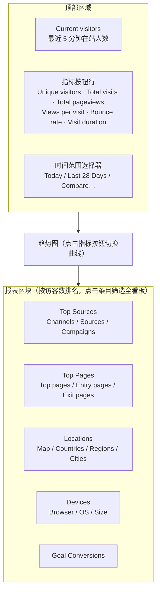

import { Meta } from '@storybook/addon-docs/blocks';

<Meta id="dashboard-tour" title="上手/看板导览" name="Docs" />

# 看板导览

Plausible 的看板只有一个页面，没有子菜单和自定义报表，所有读数都排在这一页上。它自上而下回答五个问题：**多少人**来了（顶部指标与趋势图）、**从哪来**（Top Sources）、**看了什么**（Top Pages）、**在哪里、用什么设备**（Locations、Devices）、**有没有转化**（Goal Conversions）。看懂这页的关键不是记住区块位置，而是弄清每个数字的口径——同一个词在不同统计工具里算法可能完全不同。

本课用两个看板互相印证：本地实例的 `http://localhost:8000/test.local`（前置课程已产生你自己的 pageview，量小但每个数字都能亲手复现）和[官方公开演示看板](https://plausible.io/plausible.io)（plausible.io 站点的真实流量，区块形态完整）。读完你应能解释顶部指标各自的计算口径、说清每个报表区块按什么排名和 drill-down，并用时间范围与对比功能读出趋势。筛选、分享、周期报表推送等协作入口留到阶段 3，本课专注「看懂读数」。

顶部各读数的口径速查（细节见「指标口径」一节）：

| 指标 | 口径 | 要点 |
| --- | --- | --- |
| Unique visitors | 所选时间范围内去重后的访客人数 | 同一人同一天多个会话算 1 人；跨天、跨设备分开计（无 cookie，按每日轮换的匿名哈希判定） |
| Total visits | 会话数 | 30 分钟无操作会话结束，之后再有动作开新会话 |
| Total pageviews | 页面加载总次数 | 同一人重复加载同页每次都计入 |
| Views per visit | pageviews ÷ visits | 重复浏览同一页也计入 |
| Bounce rate | 只看了一个页面、且没有触发交互式自定义事件的会话占比 | 官方参考：低于 40% 优秀，40–60% 常见，超过 70% 需警惕 |
| Visit duration | 平均会话时长（会话总长 ÷ 会话数） | 跳出会话按 0 秒计入平均，不是被排除 |
| Current visitors | 最近 5 分钟内加载过页面的人数 | 实时读数，不受筛选器影响，点击进入 realtime 视图 |

## 指标口径

顶部指标按钮行和趋势图是同一套数据的两个视图：点击任一指标按钮，趋势图就切换为按该指标绘制（时间粒度随范围变化，Today 按小时、Last 28 Days 按天）。理解这页读数，先把指标口径拆成三组：流量怎么数、参与度怎么算、实时数怎么看。

### Unique visitors、Total visits、Total pageviews

三个流量指标的关系是「人数 × 会话 × 页面」：

- **Unique visitors**：所选时间范围内来过的**人数**。Plausible 不用 cookie，靠「每日盐 + 域名 + IP + User-Agent」的匿名哈希区分访客（隐私模型见 [认识 Plausible](?path=/docs/introduction--docs)），所以口径是：同一人同一天内多个会话只算 1 人；换设备或隔天再来，就另算一个访客。
- **Total visits**：**会话数**。一个会话从访客落地开始，「没有任何操作满 30 分钟」即结束；之后再产生动作就计为新会话。同一人一天可以贡献多个会话。
- **Total pageviews**：**页面加载总次数**，不去重——一个访客加载 5 个页面就是 5 个 pageviews、1 个 unique visitor。

对照本地看板验证：你通过 [接入脚本](?path=/docs/script-setup--docs) 的测试页产生的访问，在 `http://localhost:8000/test.local` 上体现为三个数字全部极小（例如 1 人、1 会话、若干 pageviews）；同一个浏览器隔 30 分钟以上再打开测试页，Total visits 会 +1 而当天 Unique visitors 不变。

### Views per visit、Bounce rate、Visit duration

三个参与度指标都由会话数据派生：

- **Views per visit** = pageviews ÷ visits，即每个会话平均看了几页，重复浏览同一页也计入。
- **Bounce rate**：会话「只看了一个页面，且没有触发交互式自定义事件」即为跳出，跳出会话占比就是跳出率。注意两个边界：标记为 `interactive: false` 的自定义事件照常记录但**不**阻止跳出（否则统计脚本自身就会污染跳出率）；反之，单页阅读但触发了交互式事件（如出站链接点击）的会话不算跳出。官方参考区间：低于 40% 优秀，40–60% 常见，超过 70% 说明访客可能没找到想要的内容。
- **Visit duration**：所有会话时长的平均值。会话时长 = 会话内最后一个事件时间减去会话开始时间，所以**跳出会话的时长是 0 秒，并且计入平均**——单页访客越多，平均时长被拉得越低，这不是统计错误而是口径使然。

与 GA 的会话指标相比，Plausible 这组口径更朴素（没有 engaged session 这类复合定义）；读数不符合预期时先怀疑口径，再怀疑内容质量。

### Current visitors 与 Realtime

顶部右上角的绿色数字是 **Current visitors**：最近 **5 分钟**内加载过页面的去重人数。它有两个与顶部其他指标不同的性质：不受看板筛选器影响，且即时变化，与当前所选时间范围无关。

点击这个数字（或在时间范围里选 Realtime）进入 realtime 视图：趋势图变成最近 30 分钟的 pageviews 曲线，每 30 秒自动刷新；顶部指标同步换成「last 30 min」口径（Unique visitors (last 30 min)、Pageviews (last 30 min) 等）。接入新站点后验证脚本是否工作，看的就是这里——这也是 [接入脚本](?path=/docs/script-setup--docs) 用它做闭环证据的原因。

## 报表区块

趋势图下方是五个报表区块，共享一套交互模型，先记住共性再看个性：

- **排名口径**：每个区块默认按访客数从高到低排序（Goal Conversions 按 unique conversions），让「贡献人数最多」的条目排在前面。
- **点击筛选**：点击任意条目，整个看板按该值过滤（如点 Top Pages 里的 `/pricing`，所有区块都只剩看过该页的流量）。组合筛选、编辑与清除的完整玩法见 [筛选与细分](?path=/docs/filtering-segments--docs)，本课只需知道「点一下就能下钻」。
- **Details 弹层**：区块默认只显示前 9 行，点底部的 **DETAILS** 打开全量弹层——带搜索框、按区块而异的更多指标列（如 Bounce rate、Visit duration、Scroll depth、转化率），点击列头可切换排序。

### Top Sources：来源与 UTM

回答「访客从哪来」。三个标签页层层递进：**Channels** 把流量归入 Organic Search、Organic Social、Email、Referral、Direct 等渠道大类；**Sources** 列出具体来源（如 `google`、`newsletter`）；**Campaigns** 下拉按 UTM 参数拆分，可选 utm_medium / utm_source / utm_campaign / utm_content / utm_term 五个维度。

来源归因的两条规则直接影响读数：

1. **URL 参数优先于 Referer**：落地页 URL 带 `utm_source`（或 `source`、`ref`）参数时以参数为准，否则取 Referer 头并按已知来源库归类（如 google.com 归为 Google），两者都没有则计入 `Direct / None`。
2. **来源只在会话开始时记录**：访客从 Google 进站、浏览中途切去别的网站再回来，来源仍是 Google，不会覆盖成新的 referrer。

本地验证路径：给测试页 URL 加上参数访问，例如 `http://localhost:3000/test-page.html?utm_source=newsletter`（tracker 上报完整 URL，参数在服务端解析），稍后 Top Sources 的 Sources 标签里就会出现 `newsletter`。点击某个来源名称后，看板按该来源过滤，Sources 区块同时切换为下钻视图，列出该来源下具体是哪些页面带来了流量。

### Top Pages：页面

回答「访客看了什么」。三个标签页：**Top pages** 按 unique visitors 排最常被浏览的页面；**Entry pages** 是各会话的第一个页面（着陆页）；**Exit pages** 是各会话的最后一个页面，配 exit rate（从该页结束的会话数 ÷ 该页 pageviews）。

Details 弹层里每个页面还带 Bounce rate、Time on page、Scroll depth 列。其中 Time on page 与顶部的 Visit duration 口径不同：它是单页平均停留，靠页面跳转或切走标签页时上报的 engagement 事件测算，标签页在后台的时间不计入——所以作为最后一跳的 exit page，停留时长天然偏短。

本地测试页已在 Top pages 里可见，路径即脚本上报的页面地址。

### Locations：地理

回答「访客在哪里」。**Map** 为世界地图热力，**Countries / Regions / Cities** 三级列表逐级下钻。地理位置在服务端用访客 IP 查地理数据库得出，IP 本身从不落盘；使用 VPN / Tor 的访客归入 `Anonymous VPN Service` 条目。

数据完整度与环境直接相关：官方演示看板能看到完整的国家/地区/城市分布；本地 CE 默认只内置 db-ip 的**国家级**数据，城市与地区需要接入 MaxMind GeoLite2（见 [地理位置](?path=/docs/ce-geolocation--docs)）；而本机访问本地实例时来源是内网私有地址，地理库里查无记录，Locations 区块可能整个为空——这是环境使然，不是看板故障。

### Devices：设备

回答「访客用什么访问」。三个标签页：**Browser**、**OS**、**Size**（desktop / mobile / tablet 三档）。全部信息解析自 User-Agent 请求头，解析完即丢弃，原始 UA 不存储。

点击浏览器或操作系统品牌可下钻到版本号。一个已知边界：Windows 与 macOS 新版本不再在 UA 里暴露真实版本号，这部分访客会被归入最后一个已知版本，所以新版本占比看起来「涨得慢」属正常现象。本地看板里这一区块一定有你自己的浏览器与系统记录，是最直观的自证区块。

### Goal Conversions：目标转化

回答「有没有转化」。未配置目标时该区块为空并提示去创建目标；配置后按 unique conversions 排名，**转化率 = 完成该目标的去重访客数 ÷ 所选范围的 unique visitors**。目标本身（pageview 目标、自定义事件目标）的配置与验证见 [目标与转化](?path=/docs/goals-conversions--docs)；漏斗分析为云端专属功能，CE 看板没有对应区块（功能边界见 [认识 Plausible](?path=/docs/introduction--docs)）。

## 时间与对比

右上角的时间范围选择器决定整页（除 Current visitors 外）所有数字的统计窗口。选项与对应快捷键：

| 分组 | 选项（快捷键） |
| --- | --- |
| 日 | Today（D）、Yesterday（E）、Realtime（R） |
| 滚动窗口 | Last 7 Days（W）、Last 28 Days（F）、Last 91 Days（N） |
| 月 | Month to Date（M）、Last Month（P） |
| 年 | Year to Date（Y）、Last 12 Months（L） |
| 全部 | All time（A） |

两条容易踩坑的规则：

- **当天包含规则**：只有 Month to Date、Year to Date 和 All time 包含今天；其余范围（包括 Last 7 Days）都**不含**进行中的当天。趋势图上当前未完成的周期（今天/本周/本月）用虚线标出，提示该点数据仍在累积。
- **状态在 URL 里**：时间范围、对比、筛选都编码在看板 URL 的查询参数里（如 `?period=7d`），刷新或分享链接可复现同一视图（分享的完整能力见 [分享与嵌入](?path=/docs/sharing-embedding--docs)）。

**期间对比**：在选择器里选 Compare 或直接按 **X**，三种对比方式——Previous period（上一等长周期）、Year over year（去年同期）、Custom period（自定义区间）；默认按星期对齐（Match day of week，避免周末错位），也可切回按确切日期。开启后顶部指标卡显示带箭头的变化百分比，趋势图叠加对比周期的曲线。周期性报表推送（邮件/Slack）属于自动化协作能力，见 [邮件与 Slack 报表](?path=/docs/email-slack-reports--docs)。

## 常见问题

- 本地看板 Bounce rate 是 100%、Visit duration 是 0。
  符合口径的正常结果：你只访问了一个页面且没触发任何自定义事件，所有会话都是跳出会话，跳出会话时长按 0 秒计入平均。在多页间跳转一次或触发一个交互式事件（见 [自定义事件](?path=/docs/custom-events--docs)），数字立刻变化。真实站点跳出率偏高时先对照官方区间（40–60% 常见）与页面类型判断——博客等单页阅读场景天然偏高。
- Current visitors 显示有人，顶部 Unique visitors 却很小，两边对不上。
  两个数字口径不同，无需对齐：Current visitors 只看最近 5 分钟且不受筛选器影响；Unique visitors 是当前时间范围内的累计去重人数。同理，realtime 视图里的「last 30 min」指标与 Today 范围的指标也不相等。
- 选了 Last 7 Days 却看不到刚才自己的访问。
  Last 7 Days 等滚动窗口不含进行中的当天。改用 Today、Realtime，或含当天的 Month to Date / Year to Date / All time。
- 本地看板 Top Sources 全是 Direct / None，Locations 空白。
  都是本地环境的预期现象：直接输入地址打开测试页没有 Referer 也没有 UTM 参数，只能归 Direct / None；本机访问的内网私有地址在地理库里无记录。要观察真实分布形态，打开[官方演示看板](https://plausible.io/plausible.io)对照。

## 总结回顾

摘要：

Plausible 看板是单页结构：顶部指标按钮行与趋势图回答「多少人」，其下 Top Sources、Top Pages、Locations、Devices、Goal Conversions 五个区块依次回答「从哪来、看了什么、在哪用什么设备、有没有转化」。六个顶部指标的口径是读懂一切的前提——unique visitors 按每日匿名哈希去重（同日多会话算 1 人，跨天跨设备另计），会话 30 分钟无操作结束，跳出 = 单页且无交互式自定义事件，跳出会话时长按 0 秒计入平均；Current visitors 是最近 5 分钟的实时数，独立于时间范围与筛选器。报表区块共享同一交互模型：按 unique visitors 排名、点击条目筛选全看板、底部 DETAILS 打开带排序与更多指标列的全量弹层。时间范围选择器控制整页窗口，注意只有 Month to Date、Year to Date、All time 包含当天；按 X 开启与上一周期、去年同期或自定义区间的对比。本地小流量看板适合亲手验证口径，真实分布形态以官方公开演示看板为参照。

一句话：

> 看懂 Plausible 看板的关键是把每个数字还原成口径：人数按每日哈希去重、会话 30 分钟超时、跳出按 0 秒计入平均时长——口径清楚了，任何读数都能解释。

知识要点：

- 顶部六个指标（Unique visitors、Total visits、Total pageviews、Views per visit、Bounce rate、Visit duration）各自的计算口径是什么？
- 什么样的会话算跳出？标记 `interactive: false` 的自定义事件对跳出率有什么影响？
- Current visitors 的时间窗口是多久，它为什么与 Unique visitors 对不上？
- 来源归因中 UTM 参数与 Referer 的优先级如何，为什么来源只在会话开始时记录？
- 五个报表区块各自回答什么问题，Details 弹层多出哪些能力？
- 哪些时间范围包含今天？按 X 开启的对比有哪几种模式，默认如何对齐？

## 参考资料

- [Guided tour of the dashboard（官方文档）](https://plausible.io/docs/guided-tour)
- [Metrics definitions（官方指标定义）](https://plausible.io/docs/metrics-definitions)
- [Locations：地理报表与 IP 处理（官方文档）](https://plausible.io/docs/countries)
- [Devices：设备/浏览器/系统报表（官方文档）](https://plausible.io/docs/devices)
- [官方公开演示看板](https://plausible.io/plausible.io)
- [plausible/analytics：v3.2.1 看板前端与会话口径源码（指标命名、跳出判定、30 分钟超时、渠道分类的事实来源）](https://github.com/plausible/analytics)
- [plausible/community-edition Wiki：Configuration（CE 默认国家级地理数据与 MaxMind 集成）](https://github.com/plausible/community-edition/wiki/configuration)
