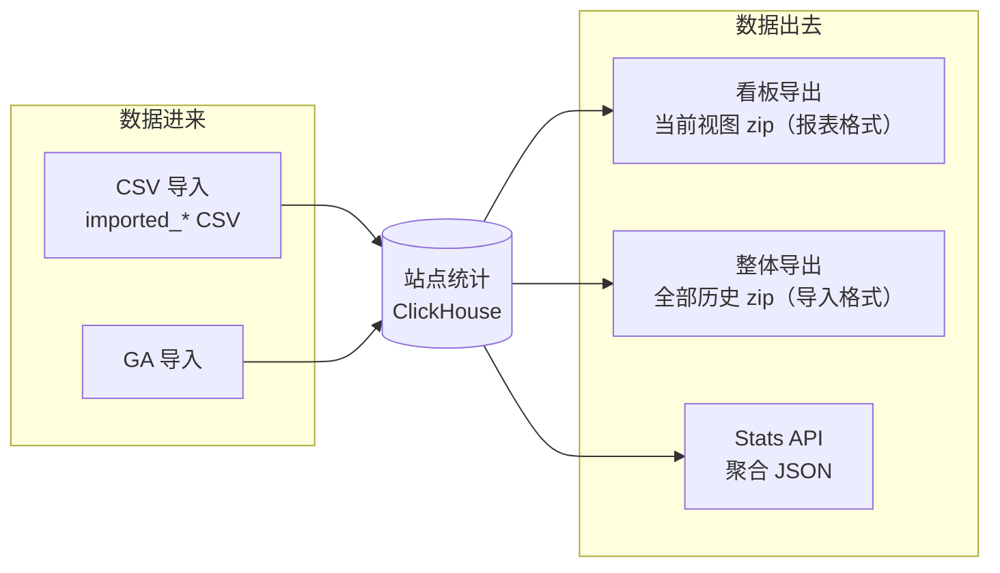

import { Meta } from '@storybook/addon-docs/blocks';

<Meta id="data-export" title="API 与集成/数据接口/数据导出" name="Docs" />

# 数据导出

Plausible 的数据模型决定了「数据的所有权在你手里」：统计存在你自己的 ClickHouse 里（CE），也要能完整拿走、搬走、备份。本课讲清数据进出 Plausible 的全部途径：**看板导出**把当前视图打包成报表 zip，**整体导出**把站点全部原生历史打包成可回迁的 CSV，**CSV 导入**把这样的 CSV 灌回任意实例，**Stats API** 以 JSON 程序化读数（接口细节见 [Stats API](?path=/docs/stats-api--docs)，本课不重复），**GA 导入**走 Google OAuth 通道（见 [导入 GA 数据](?path=/docs/ga-import--docs)，本课只给入口）。

本课覆盖的途径分两种格式，这是全课的核心结构：看板导出是**报表格式**，给人看、进 Excel；整体导出是**导入格式**，给机器迁移——它的 zip 解开就是 CSV 导入要求的输入文件，导出与导入因此构成闭环。除云端 Enterprise 专属的原始事件导出外，其余途径在 CE v3.2.1 全部实测可用，本地操作路径以 `http://localhost:8000`、站点 `test.local` 给出。

| 途径 | 内容范围 | 格式 | 入口 | 适用场景 |
| --- | --- | --- | --- | --- |
| 看板导出 | 当前视图：所选时间范围与筛选下的各报表；页面类报表封顶 100 行、其余 300 行 | zip（报表 CSV） | 看板趋势图右上角下载图标 | 把报表切片交给 Excel / 汇报 |
| 整体导出 | 站点全部原生历史，11 张 `imported_*` 表；不含导入数据 | zip（导入格式 CSV） | 站点设置 → Imports & exports → Export data | 实例迁移、归档备份 |
| CSV 导入 | 10 张 `imported_*` 表，单文件 ≤ 1 GB；与已有数据重叠的日期会被裁掉 | CSV | 站点设置 → Imports & exports → Import data → Import from CSV | 迁入历史、恢复备份 |
| Stats API | 与看板同口径的聚合读数 | JSON | `GET /api/v1/stats/*` | 定时报表、数据管道，见 [Stats API](?path=/docs/stats-api--docs) |
| GA 导入 | GA4 历史数据 | — | Import data 区块的 Google 按钮 | 见 [导入 GA 数据](?path=/docs/ga-import--docs) |
| 原始事件导出 | 事件级数据每日推送 S3 兼容存储 | — | 云端 Enterprise 计划 | 云端专属，CE 无此入口 |

## 看板导出

看板导出回答的是「把眼前这张报表拿走」：导出内容**跟随当前视图**——时间范围、筛选条件、趋势图粒度都作用于结果，筛过的切片导出来就是筛过的数据。

操作路径（CE v3.2.1）：打开看板 `http://localhost:8000/test.local`，选好时间范围与筛选，点**主趋势图右上角的下载图标**（悬停提示 "Click to export stats"；实时视图下不显示），浏览器直接下载 zip。官方文档描述的云端入口是趋势图右上角 ⋮ 菜单里的 Export stats，同一功能两种界面措辞。

文件名形如 `Plausible export <域名> <起始日期> to <截止日期>.zip`，内含 22 张 CSV（CE v3.2.1 源码清单）：

| 报表区块 | CSV 文件 |
| --- | --- |
| 趋势图 | `visitors.csv`（时间序列：date + 当前选中指标的逐桶值） |
| 来源 | `sources.csv`、`channels.csv`、`referrers.csv`、`utm_sources.csv`、`utm_mediums.csv`、`utm_campaigns.csv`、`utm_contents.csv`、`utm_terms.csv` |
| 页面 | `pages.csv`、`entry_pages.csv`、`exit_pages.csv` |
| 地区 | `countries.csv`、`regions.csv`、`cities.csv` |
| 设备 | `browsers.csv`、`browser_versions.csv`、`operating_systems.csv`、`operating_system_versions.csv`、`devices.csv` |
| 目标与属性 | `conversions.csv`（目标汇总）、`custom_props.csv`（各属性的值分布） |

三条边界：

- **行数封顶**：`pages.csv` 与 `exit_pages.csv` 最多 100 行，其余报表最多 300 行（CE 源码注释说明原因：更大的结果集会让 time on page 等二次查询的 IN 过滤超载）。长尾被截断时，全量数据走整体导出或 Stats API 的 `limit` / `page` 分页。
- **导入数据可选并入**：站点存在导入数据时，导出图标旁出现 Include imported data 开关，开关状态决定导出是否含导入部分。
- **只有聚合报表**：看板导出不含事件级原始数据；出站链接、文件下载、404 的明细 URL 在 `custom_props.csv`，而 `conversions.csv` 只有目标汇总读数（官方文档）。

## 整体导出与导入

站点设置的 Imports & exports 区块（`http://localhost:8000/test.local/settings/imports-exports`）是站点级数据进出的总开关，左侧栏同名入口进入。它管两件事：Export data（整体导出）与 Import data（CSV / GA 导入）。两者共享同一套格式——整体导出的 zip 解开就是 CSV 导入要求的 `imported_*` 文件，**导出即备份、导入即恢复**。

共同边界：两边都只覆盖**统计聚合数据**。站点配置（目标、自定义属性白名单、成员、分享链接）不在导出包里；换域名、转移站点所有权也不需要导出导入，站点设置里有专门入口（官方文档）。

### 整体导出

操作路径：

1. 进入 `http://localhost:8000/test.local/settings/imports-exports`，在 Export data 区块点 **Prepare download**。
2. 导出是后台任务：页面显示 "We are preparing your download ..."，界面文案提示视数据量**可能长达 20 分钟**，期间可离开页面稍后回来（CE v3.2.1：Oban 任务，15 分钟超时、最多 3 次尝试）。
3. 就绪后同一区块出现下载链接，CE 同时显示文件在服务器上的存储路径与大小。下载文件名形如 `test_local_20261013.zip`（域名下划线化 + 站点时区的导出日期）。

内容与限制：

- zip 内含 11 张 CSV：`imported_visitors`、`imported_sources`、`imported_pages`、`imported_entry_pages`、`imported_exit_pages`、`imported_custom_events`、`imported_locations`、`imported_devices`、`imported_browsers`、`imported_operating_systems`、`imported_custom_props`，文件名自带覆盖区间后缀（如 `imported_pages_20250101_20261012.csv`）。
- 覆盖站点有数据以来的**全部日期**；只含原生采集数据（直接查询 `events_v2` / `sessions_v2`），**不含 GA 等导入数据**（官方文档明确 "excludes imported data"）。
- 站点尚无数据时点击会收到 "There is no data to export"。
- 云端差异：云端导出上传 S3、完成后邮件通知、链接 **24 小时过期**；CE 写到服务器本地数据目录（`plausible-exports/<site_id>`）、**不过期**、页面直接下载。CE 同样会尝试发送成功/失败邮件，未配置 SMTP 时收不到，以页面状态为准。

### CSV 导入

操作路径：同一区块 Import data → **Import from CSV** → `http://localhost:8000/test.local/settings/import`。把解压后的 CSV 拖入选择框（或点选），界面按 10 张表逐个列出匹配到的文件，底部 **Confirm import** 按钮显示解析出的日期区间，确认后转入后台任务；Existing imports 列表显示每份导入的状态、日期区间与 pageviews 数，**Delete import** 可删除某份导入且不影响原生数据。

文件规则（CE v3.2.1 实测）：

- **文件名即元数据**：必须是 `{表名}_{开始}_{结束}.csv`，日期为 `YYYYMMDD`；`imported_` 前缀可省略（`devices_20230101_20231231.csv` 同样合法）。命名不符的文件静默落选，不进匹配列表。
- 只收 `.csv`；一次最多 10 个文件（每表一个）；**单文件上限 1 GB**（超限报错 "is too large (max size is 1 gigabyte)"）。
- 列结构固定（下表与官方文档一致）：指标列是区间内的**总量计数**而非平均值，`visit_duration` 是总秒数；地理列用代码——country 是 ISO 3166-1 alpha-2、region 是 ISO 3166-2、city 是 GeoName ID。

| 表 | 关键列 |
| --- | --- |
| `imported_visitors` | date, visitors, pageviews, bounces, visits, visit_duration |
| `imported_sources` | date, source, referrer, utm_source/medium/campaign/content/term, pageviews, visitors, visits, visit_duration, bounces |
| `imported_pages` | date, hostname, page, visits, visitors, pageviews，另有 total_scroll_depth / total_time_on_page 及各自的 visits 计数列 |
| `imported_entry_pages` / `imported_exit_pages` | date, entry_page/exit_page, visitors, entrances/exits, visit_duration, bounces, pageviews |
| `imported_custom_events` | date, name, link_url, path, visitors, events |
| `imported_locations` | date, country, region, city, visitors, visits, visit_duration, bounces, pageviews |
| `imported_devices` | date, device, visitors, visits, visit_duration, bounces, pageviews |
| `imported_browsers` / `imported_operating_systems` | date, browser(+_version) / operating_system(+_version), visitors, visits, visit_duration, bounces, pageviews |

冲突处理（日期区间规则，CE v3.2.1 源码）：

- 导入区间取所有上传文件区间的**并集包络**，再经两道裁剪：截止日不超过站点**原生数据的开始日**（防止与原生统计重复计数）；与已有导入重叠的部分裁掉，取最长的空闲区间。
- 裁剪后区间变了，显示黄色提示 "Dates Adjusted"，可继续提交；完全没有可用区间时显示红色 "Dates Conflict"，无法提交。区间起止至少相差 2 天，更短的区间不被接受。
- 最多同时存在 **5 份**完成的导入（界面文案 "Up to 5 imports are allowed at a time"），CSV 与 GA 导入可混合。

导入数据的展示边界（官方文档）：

- 导入数据与原生数据并列显示；趋势图右上 Include imported data 开关可整体关闭导入部分。
- 筛选能力受限：不支持任意维度交叉（如 页面×来源）；筛选排除了导入数据时，看板提示 "Imported data is excluded due to applied filters"。
- 自定义属性只支持特殊目标携带的 `url` / `path`；电商收入不支持。特殊目标的访客数可能虚高（同一访客两次下载计为 2）。
- 导入数据不进 consolidated view（汇总视图），也不会出现在整体导出里——**导入数据不能再导出**。
- `imported_custom_props.csv` 是单向的：整体导出的包里有这张表，但 CSV 导入会静默丢弃它（CE v3.2.1 源码明确拒收）——自定义属性的值分布不能经 CSV 完整回迁。

## 迁移与备份

**实例间迁移**是这套格式的设计用途，闭环如下：

1. 旧实例整体导出，拿到 `域名_日期.zip`。
2. 新实例创建同名站点，**先导入再开始采集**：解压 zip，把 CSV 全部拖入 Import from CSV，确认区间后提交。文件名与列结构天然合规，无需改名。
3. 顺序敏感的根源是冲突规则：导入区间的截止日不能超过新站点原生数据的开始日。新实例先采集再导入，重叠段会被裁掉（黄色 Dates Adjusted）；先导入则完整保留。`imported_custom_props.csv` 被丢弃属预期行为。

**归档备份**：定期整体导出并保存 zip 即可覆盖全部统计历史，恢复手段就是 CSV 导入。注意导出包不含站点配置（目标、属性白名单、成员、分享链接），完整备份需另行保存这些设置；CE 整站级备份还应包含 Postgres 数据卷（部署结构见 [本地实例](?path=/docs/local-instance--docs)）。

**大站点心态**：导出与导入都是后台任务，不是即时下载。导出界面文案上限约 20 分钟，期间可离开页面；失败后可重试（CE 最多自动尝试 3 次）。

## 常见问题

- 拖入 CSV 后文件没有出现在列表里，Confirm import 一直是灰的。
  文件名必须严格符合 `{表名}_{开始}_{结束}.csv`（如 `imported_pages_20230101_20231231.csv`，`imported_` 前缀可省）；表名不在 10 张支持表之内或命名不符的文件会被静默忽略。确认按钮亮起的前提是至少一个文件匹配成功且日期区间有效。
- 提示 "is too large (max size is 1 gigabyte)"、"too many files" 或 "unacceptable file types"。
  对应三条上传限制：单文件 ≤ 1 GB、一次最多 10 个文件（每表一个）、只收 `.csv`。上传的必须是解压后的 CSV 文件本身——整个 zip 原包、套在子目录里的文件都不符合；文件名也必须在两段日期之后直接收尾，多余的后缀段（如 `imported_pages_20230101_20231231_extra.csv`）同样解析失败。
- 确认前弹出黄色 "Dates Adjusted" 或红色 "Dates Conflict"。
  导入区间与已有导入或原生数据重叠：黄色表示已自动裁到最长空闲区间，可继续；红色表示无可用区间，需先到 Imports & exports 删掉冲突的旧导入（Delete import 不影响原生数据）再重新提交。
- 导出包里没有某类数据：整体导出缺 GA 历史，看板导出的 `conversions.csv` 只有汇总。
  整体导出只含原生采集数据，导入数据一律不回迁（官方文档）；看板导出是否含导入部分取决于趋势图右上的 Include imported data 开关。出站链接、文件下载、404 的明细 URL 在 `custom_props.csv`，`conversions.csv` 按设计只有目标汇总。
- 大站点点 Prepare download 后一直转圈。
  正常，导出是后台任务：界面文案提示视数据量可能长达 20 分钟，可离开页面稍后回来，就绪后同一区块出现下载链接；CE 失败时显示 try again 可手动重试（worker 15 分钟超时、最多 3 次尝试）。
- 云端订阅到期后还能不能拿走数据。
  按官方文档：无有效订阅时看板导出与 Stats API 不可用，但站点设置里的整体导出在数据删除前仍可使用——这是云端取回全量数据的最后通道；CE 无订阅体系，不受此限。

## 总结回顾

摘要：

数据进出 Plausible 有四条途径两种格式：看板导出把当前视图（时间范围与筛选生效）打成报表 zip，22 张 CSV 对应各报表区块，页面类封顶 100 行、其余 300 行，入口是趋势图右上角的下载图标；整体导出在站点设置 Imports & exports 区块，把站点全部原生历史打成 11 张 `imported_*` CSV 的 zip，后台任务、云端 24 小时过期而 CE 本地不过期；CSV 导入接受同格式文件回填数据，文件名 `{表名}_{开始}_{结束}.csv` 即元数据，单文件 ≤ 1 GB、每表一个、最多 5 份导入并存，区间与已有数据重叠时自动裁剪或拒绝；Stats API 提供同口径 JSON 读数。整体导出与 CSV 导入构成迁移闭环——先导入再采集可避开区间裁剪；但闭环有缺口：导入数据不能再导出，`imported_custom_props.csv` 导得出导不进，站点配置不在任何导出包里。

一句话：

> 看板导出是给人看的报表切片，整体导出是给机器回迁的全量备份——两者格式不同、互不替代；迁移的黄金顺序是在新实例先导入、再开采集。

知识要点：

- 看板导出、整体导出、CSV 导入、Stats API 四者的内容范围、格式与入口分别是什么，各自适合什么场景？
- 看板导出的 zip 里有哪些 CSV？行数封顶是多少、为什么页面类报表更低？
- 整体导出的内容范围与云端/CE 差异分别是什么（过期时间、存储位置、通知方式）？
- CSV 导入的文件名规则、大小与数量上限、列结构口径（总量 vs 平均、地理代码）是什么？
- 导入区间的两道裁剪规则是什么？"Dates Adjusted" 与 "Dates Conflict" 分别意味着什么、怎么处理？
- 为什么说「先导入再采集」是迁移的黄金顺序？哪些数据不能经 CSV 闭环回迁？

## 参考资料

- [Export stats（官方文档：看板导出入口与内容、行数封顶、整体导出云端流程、订阅到期后的出口）](https://plausible.io/docs/export-stats)
- [Import stats via CSV（官方文档：10 张表的列结构、指标口径、冲突处理、导入数据的筛选限制与删除）](https://plausible.io/docs/csv-import)
- [plausible/analytics v3.2.1 源码（CE 路由与设置页入口、`StatsController.csv_export` 的 22 张 CSV 与封顶值、`Plausible.Exports` 的 11 张导入格式表与本地存储行为、`CSVImporter` 的文件规则与区间裁剪逻辑）](https://github.com/plausible/analytics)
