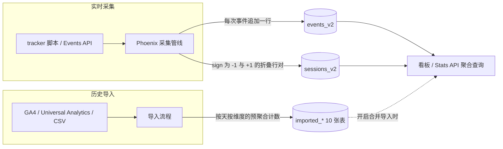

import { Meta } from '@storybook/addon-docs/blocks';

<Meta id="data-model" title="内部架构/数据模型" name="Docs" />

# 数据模型

[总体架构](?path=/docs/architecture--docs)已经定位：Plausible 的每一个看板读数最终都出自 ClickHouse。而 ClickHouse 里真正存分析数据的只有两类表——`events` 与 `sessions`，外加一族导入历史数据的 `imported_*` 聚合表。`events` 表一次事件一行、只追加不修改；`sessions` 表一次会话一行、但靠「折叠行」模拟更新；`imported_*` 表存的不是原始事件，而是按天按维度预先算好的计数。看板和 Stats API 的每个数字，都是在这三类表上做聚合查出来的。

本课是[看板导览](?path=/docs/dashboard-tour--docs)的数据侧镜像：那节课讲「读数的口径是什么」，本课讲「口径落在哪张表、用什么表达式算出来」。读完你应能说出 events 表的完整字段清单及其分组、sessions 表的滚动更新机制、user_id 的计算与隐私含义、导入数据如何与实时数据合并，并能直接用 ClickHouse 查询复现看板读数。事件从 HTTP 到落库的管线细节由[事件管线](?path=/docs/ingestion-pipeline--docs)承载，本课只关心落库之后的形态。

以 v3.2.1 源码为准：NumericIDs 迁移完成后，两张实时表的实际表名是 `events_v2` 与 `sessions_v2`（本文通称 events 表、sessions 表）；旧版的 `events`/`sessions` 表（列名为 `domain`、`props` 字符串）在该迁移后退役。



表族速查（行含义与写入来源）：

| 表 | 一行是什么 | 写入来源 |
| --- | --- | --- |
| `events_v2` | 一次事件（pageview、自定义事件或 engagement 事件） | 实时采集管线批量插入，只追加 |
| `sessions_v2` | 一次会话（物理上是带 `sign` 的折叠行，见下文） | 会话引擎随每个事件滚动更新 |
| `imported_visitors` 等 10 张 | 某一天 × 某个维度取值的预聚合计数 | GA4 / Universal Analytics / CSV 导入流程 |
| `site_imports`（PostgreSQL） | 一次导入任务的登记与状态 | 导入流程，不在 ClickHouse |

## events 表

events 表是分析数据的主体：tracker 上报的 pageview、自定义事件，以及页面关闭时补发的 engagement 事件，都各自成为一行。表引擎是 MergeTree，`PARTITION BY toYYYYMM(timestamp)` 按月分区，`ORDER BY (site_id, toDate(timestamp), name, user_id, timestamp)` 把同站点同日期同事件的行排在一起，`SAMPLE BY user_id` 预留按访客采样能力。对只追加的时序事件来说，这个形态写入快、按时间范围扫描便宜——代价是没有「更新」：事件写错了不会改，只会被后续查询的筛选条件排除。

v3 起表里没有 `domain` 字符串列：站点被替换成整数 `site_id`，域名到 ID 的映射存在 PostgreSQL 的 sites 表里。事件上报时用的 `props` 自定义属性，也拆成两个平行数组 `meta.key` 与 `meta.value` 存储——下标一一对应，键值都是字符串数组，比单个 JSON 字符串更利于 ClickHouse 的数组查询。

完整字段清单（v3.2.1，按职责分组）：

| 分组 | 字段 | 说明 |
| --- | --- | --- |
| 事件本体 | `name` | 事件名：`pageview`、自定义事件名，或 `engagement` |
| 事件本体 | `site_id` | 站点整数 ID（NumericIDs 迁移后替代 domain 字符串） |
| 事件本体 | `user_id` / `session_id` | 访客与所属会话的 ID，见下文两节 |
| 事件本体 | `hostname` / `pathname` | 页面主机名与路径 |
| 事件本体 | `timestamp` | 事件时间（按月分区列） |
| 事件本体 | `scroll_depth` / `engagement_time` | 滚动深度与互动时长，随 engagement 事件补发 |
| 自定义属性 | `meta.key` / `meta.value` | props 的平行数组形态 |
| 收入 | `revenue_source_amount` / `revenue_source_currency` | 上报币种金额（可空） |
| 收入 | `revenue_reporting_amount` / `revenue_reporting_currency` | 报告币种金额（可空） |
| 来源（会话属性冗余） | `referrer` / `referrer_source` / `click_id_param` | 原始 referrer、归类来源、广告点击 ID |
| 来源（会话属性冗余） | `utm_medium` / `utm_source` / `utm_campaign` / `utm_content` / `utm_term` | 五个 UTM 参数 |
| 地理 | `country_code` / `subdivision1_code` / `subdivision2_code` / `city_geoname_id` | 国家、一级行政区、二级行政区、城市 GeoName ID |
| 设备 | `screen_size` / `operating_system` / `operating_system_version` / `browser` / `browser_version` | 解析自 User-Agent 的设备信息 |
| 派生与内部 | `acquisition_channel` | 渠道归类列，由字典自动计算（迁移建的物化列，采集端不写入） |
| 派生与内部 | `transferred_from` | 数据迁移期间的行级标记，采集与查询不使用 |

两个容易误判的细节：

- **来源与设备字段是冗余进事件行的。** 它们本属于会话，但写入时直接合并进每个事件行（源码里 `merge_session` 一景），让按来源、设备拆分事件指标时不必回表 join。这正是「events 表自包含」的设计取向。
- **收入字段在 CE 里只是表结构存在。** 采集管线的收入解析只在云端/企业版编译进产物（源码 `put_revenue` 带 EE 守卫），CE 上报的 revenue 属性不会写入这几列；收入指标的表达式同样只在 EE 编译。收入归因的操作与边界见[收入归因](?path=/docs/revenue-attribution--docs)。

## sessions 表

sessions 表回答「一次访问整体怎么样」：入口和出口页面、时长、是否跳出。它一次会话在概念上只有一行，但 ClickHouse 不支持原地 UPDATE，Plausible 的办法是折叠行：表引擎为 CollapsingMergeTree（v3.2.1 的 VersionedSessions 迁移把它升级为 VersionedCollapsingMergeTree，排序键 `(site_id, toDate(start), user_id, session_id)`，同样按月分区、`SAMPLE BY user_id`）。每行带一个 `sign` 列：`+1` 表示有效状态，`-1` 表示抵消旧行。后台合并时正负对互相抵消，查询时按 `sign` 语义聚合，任何时刻都能还原会话的当前状态。

滚动更新的完整机制（源码 `Plausible.Session.CacheStore`）：

1. 事件到达后，先按 `user_id` 经 Balancer 分片加锁，保证同一访客的事件串行处理。
2. 在内存会话缓存里按 `(site_id, user_id)` 找会话；距该会话最近一次事件**不超过 30 分钟**视为同一会话。
3. 找到会话：在内存里更新字段，然后写入两行——旧状态 `sign = -1`，新状态 `sign = +1`。字段更新规则：
   - `entry_page`：仅当它还是空字符串且本事件是 pageview 时写入（会话的第一个页面，之后不再变）；
   - `exit_page` / `exit_page_hostname`：每个 pageview 都覆盖（会话的最后一个页面）；
   - `is_bounce`：初始为 1（pageview 或非交互事件开启的会话），一旦 `pageviews` 达到 2 或出现一个交互式非页览事件，翻为 0；
   - `duration`：本事件时间减去会话 `start`；`pageviews`、`events` 分别累计。
4. 没找到会话：写一行新会话（`sign = +1`，`session_id` 随机生成），来源、地理、设备等会话属性在此时固定。
5. engagement 事件只刷新缓存的活跃时间（让会话不被判过期），不写新行。

一次访问的折叠行算例（访客依次产生三个事件）：

| 到达的事件 | 写入的行 | entry_page | exit_page | pageviews | is_bounce | duration |
| --- | --- | --- | --- | --- | --- | --- |
| 10:00 pageview `/blog` | `+1` | `/blog` | `/blog` | 1 | 1 | 0 |
| 10:02 pageview `/pricing` | `-1`（旧行）+ `+1`（新行） | `/blog` | `/pricing` | 2 | 0 | 120 |
| 10:05 自定义事件 `signup` | `-1`（旧行）+ `+1`（新行） | `/blog` | `/pricing` | 2 | 0 | 300 |

三个事件后表里物理上有 5 行，后台合并后只剩最后那行 `+1`；但无论合并是否发生，按 `sign` 聚合（有效行 `greatest(sum(sign), 0)`、时长 `sum(duration * sign) / sum(sign)`）得到的都是同一份当前状态。这也是 dashboard-tour 里「30 分钟无操作会话结束、单页无交互即跳出」口径的存储落点。

## user_id 与隐私

events 表和 sessions 表里的 `user_id` 都是服务端算出来的匿名标识，计算公式（源码 `Plausible.Ingestion.Event.put_user_id`）：

```elixir
SipHash.hash!(salt, user_agent <> request.remote_ip <> domain <> root_domain)
```

即以 salt 为密钥，对「User-Agent + 访客 IP + 站点域名 + 页面主机名的可注册根域」做 SipHash，得到一个 UInt64 落进 `user_id` 字段。IP 和 User-Agent 只作为哈希输入参与计算，本身从不落盘——这就是[认识 Plausible](?path=/docs/introduction--docs)隐私模型里「不使用 cookie、不存个人数据」的表字段落点。

salt 的生命周期（源码 `Plausible.Session.Salts`）决定这套标识的时效：

- salt 是 16 字节随机数，存在 PostgreSQL 的 `salts` 表；每天午夜的定时任务轮换一次。
- 任意时刻保留 current 和 previous 两个 salt，超过 48 小时的旧 salt 清理。
- salt 轮换瞬间，管线会用 previous salt 再算一个 `prev_user_id`，只用于在缓存里找回进行中的会话（30 分钟窗口内的会话跨轮换不断），不产生第二份落盘身份。

由此推出三个口径，与前面课程互相印证：

- **访客身份每天失效。** salt 每天一换，同一浏览器今天的 user_id 和明天不同——「跨天另算一个访客」的口径（见[看板导览](?path=/docs/dashboard-tour--docs)）正是因此成立，也让跨天追踪无从谈起。
- **身份按站点隔离。** 站点域名参与哈希，同一访客在不同站点的 user_id 不同，跨站画像不存在。
- **去重只在同一天内精确。** `uniq(user_id)` 跨多天时，实际上接近各天去重人数之和，而不是全范围精确去重。

## imported 表族

GA4、Universal Analytics 或 CSV 导入的历史数据不进 events 表，而是落在 10 张预聚合表里。每张表的行都是「某一天 × 某个维度取值」的计数，公共列为 `site_id`、`import_id`（区分多次导入）、`date`，以及 `visitors`、`pageviews`、`visits`、`bounces`、`visit_duration` 五组计数：

| 表 | 维度 | 特有列举例 |
| --- | --- | --- |
| `imported_visitors` | 无（站点总量） | —— |
| `imported_sources` | 来源、渠道、UTM | `source`、`channel`、`utm_*` |
| `imported_pages` | 页面 | `page` |
| `imported_entry_pages` / `imported_exit_pages` | 入口页 / 出口页 | `entrances` / `exits` |
| `imported_locations` | 国家、地区、城市 | `country`、`region`、`city` |
| `imported_devices` / `imported_browsers` / `imported_operating_systems` | 设备三件套 | `device` / `browser` / `operating_system` |
| `imported_custom_events` | 自定义事件 | `name` |

导入的操作与边界（哪些指标能导、CSV 列格式）已由[数据导出](?path=/docs/data-export--docs)从操作角度讲过，GA4 导入的流程细节见[导入 GA 数据](?path=/docs/ga-import--docs)；每次导入任务在 PostgreSQL 的 `site_imports` 表登记与追踪状态。本课补齐的是查询侧的合并逻辑（源码 `Plausible.Stats.Imported`）：

1. 看板的「合并导入数据」开关对应查询参数 `with_imported`；关闭时只查实时表，导入数据完全不参与。
2. 开启时，查询引擎先按维度和筛选挑一张 imported 表：无条件或按时间拆分用 `imported_visitors`，按来源拆用 `imported_sources`，以此类推；查询里带行为筛选（如「访问过某页面」这类需要事件明细的条件）时无法用预聚合模拟，放弃导入数据、只查实时表。
3. 实时查询与导入查询各自聚合，再在维度上 FULL JOIN，指标直接相加：访客数 = 实时 `uniq(user_id)` + 导入 `sum(visitors)`，跳出率 = 两边 bounces 之和除以两边 visits 之和。
4. 只有状态为 complete 的导入参与合并（`complete_import_ids`），失败或进行中的导入不会污染读数。

算例：站点 5 月实时采集到 120 位访客，导入的 GA4 历史覆盖 5 月且计入 880 位访客——开启合并后 5 月访客显示约 1000。注意这是**近似值**：实时表的 `uniq` 与导入表的 `sum` 之间无法跨数据集去重，同一天既被实时采集又被导入覆盖时，人数会略微偏高；导入数据的粒度也只有到天。这正是官方把合并开关做成显式选项而非默认行为的原因。

## 指标计算示例

把看板读数还原成表达式（源码 `Plausible.Stats.SQL.Expression`，节选）：

| 看板指标 | 归属表 | 表达式（节选） |
| --- | --- | --- |
| Unique visitors | events | `uniq(user_id)` |
| Total visits | events / sessions | `uniq(session_id)` 或 `greatest(sum(sign), 0)` |
| Total pageviews | events | `countIf(name = 'pageview')` |
| Events | events | `countIf(name != 'engagement')` |
| Bounce rate | sessions | `round(sumIf(is_bounce * sign, cond) / sumIf(sign, cond) * 100)` |
| Visit duration | sessions | `sum(duration * sign) / sum(sign)` |
| Views per visit | sessions | `sum(sign * pageviews) / sum(sign)` |

查询引擎先做分派（源码 `Plausible.Stats.TableDecider`）：pageviews、events、scroll_depth、收入类指标走 events 表；bounce_rate、visit_duration、views_per_visit、exit_rate 走 sessions 表；visitors 和 visits 默认走 events，但按分钟拆分时改走 sessions——会话活跃但没产生事件的分钟也要计入曲线，此时会话指标沿时间轴「摊开」。当筛选条件混用事件维度（如 `event:page`）与会话维度（如 `visit:source`）时，events 查询会按 `session_id` JOIN 一个 `sign = 1` 的 sessions 子查询。

在本地实例上直接复现看板读数（CE 部署目录下执行，ClickHouse 服务名为 `plausible_events_db`，主机名换成你的测试站点，前置课程接入的本地页面通常是 `localhost`）：

```bash
# 访客数与 pageviews（对照看板 Unique visitors、Total pageviews）
docker compose exec plausible_events_db clickhouse-client --query \
  "SELECT uniq(user_id), countIf(name = 'pageview') FROM events_v2 WHERE hostname = 'localhost'"

# 会话数与平均时长（对照 Total visits、Visit duration）
docker compose exec plausible_events_db clickhouse-client --query \
  "SELECT greatest(sum(sign), 0), round(sum(duration * sign) / sum(sign)) FROM sessions_v2 WHERE hostname = 'localhost'"
```

第二条查询特意不带 `sign = 1` 过滤：正负折叠行同存时，`sum(sign)` 语义本身就是对的，这正是看板查询的算法。事件行按 `site_id` 过滤才与看板完全等价（站点域名到 `site_id` 的映射在 PostgreSQL 的 sites 表）；本地测试站点只有一个主机名时，按 `hostname` 过滤的结果与之相同。更省事的验证路径是用[Stats API](?path=/docs/stats-api--docs)取同一个数字再对照上面的表达式表——API 返回值就是这些表达式算出来的。

表的 `SAMPLE BY user_id` 子句是给云端大站准备的：查询可声明按访客采样、用 `_sample_factor` 放大回真实值（顶部会出现 sample percent 读数）；CE 部署不启用采样，表达式里的 `scale_sample` 包装在 CE 上等于原值。

## 常见问题

- 用 clickhouse-client 直接查 sessions 表，同一个 session_id 出现多行，数字和看板对不上。
  sessions 表是折叠行存储，未合并的旧行（`sign = -1`）与新行并存是正常状态。按会话筛选当前状态用 `WHERE sign = 1`，做聚合统计用 `sum(sign)` 语义的表达式（如 `greatest(sum(sign), 0)` 当 visits、`sum(duration * sign) / sum(sign)` 当平均时长），与查询引擎的做法保持一致。
- 直接查 events 表，`count(*)` 比 Total pageviews 大不少。
  engagement 事件也是 events 表的一行。pageview 用 `countIf(name = 'pageview')` 统计，自定义事件总量用 `countIf(name != 'engagement')` 统计，裸 `count(*)` 会把 engagement 行也数进去。
- 看板的访客数和直接查库对不上，还差得挺多。
  依次核对四个口径：查询是否合并了导入数据（看板开关对应 `with_imported`，导入数据会相加）；日期是否按站点时区切分（查询引擎用 `toTimeZone(timestamp, 站点时区)` 归日，不是 UTC）；events 查询是否只统计了 `name = 'pageview'`；以及查询时刻的写入是否已经落库（采集端先入内存缓冲再批量插入，秒级延迟）。跨多天的 `uniq(user_id)` 与看板一致，但不等于逐天去重人数的精确并集（见 user_id 一节的每日轮换）。
- 站点时区改了，历史读数为什么变了？
  归日、归时表达式按站点时区把 `timestamp` 转换后再聚合，改时区等于重新划日界：跨午夜边界的事件会被分到不同的天，每天的去重访客随之变化。这不是数据损坏，把时区改回去读数即恢复。

## 总结回顾

摘要：

Plausible 的分析数据在 ClickHouse 里只分三类：events 表一次事件一行、只追加，完整字段涵盖事件本体、平行数组形态的 props（`meta.key`/`meta.value`）、收入列（CE 不写入）以及冗余进事件行的来源与设备属性；sessions 表一次会话一行，但以 CollapsingMergeTree 的折叠行模拟更新——会话引擎在 30 分钟窗口内随事件滚动改写 entry/exit page、duration、is_bounce 等字段，每次更新写一对 `sign` 为 -1 与 +1 的行，查询按 sign 语义还原当前状态；`imported_*` 十张聚合表承接 GA/CSV 导入的历史数据，开启「合并导入数据」后与实时查询按维度 FULL JOIN、指标相加。user_id 由服务端对「User-Agent + IP + 站点域名 + 根域」做每日轮换 salt 的 SipHash 得出，IP 与 UA 不落盘，访客身份按天、按站点失效。看板每个指标都能还原成这些表上的表达式：`uniq(user_id)` 数访客、`countIf(name = 'pageview')` 数页览、`sumIf(is_bounce * sign) / sumIf(sign)` 算跳出率。

一句话：

> 看板读数 = events 表的 uniq 与 countIf + sessions 表按 sign 折叠后的聚合，导入数据只是显式开启后相加的近似项。

知识要点：

- events 表一行是什么，完整字段分为哪几组，props 与 domain 在 v3 表结构里变成了什么？
- sessions 表为什么会出现 `sign` 为 -1 和 +1 的行，entry_page、exit_page、duration、is_bounce 各按什么规则更新？
- 会话的 30 分钟窗口在源码里如何判定，engagement 事件对 sessions 表有什么影响、对 events 表呢？
- user_id 的计算公式是什么，salt 的生命周期如何决定「跨天另算访客」的口径？
- imported 表族一行是什么，开启合并后查询如何选表、如何与实时数据相加，为什么结果是近似值？
- Unique visitors、Total pageviews、Bounce rate、Visit duration 各自由哪张表上的什么表达式算出？

## 参考资料

- [plausible/analytics v3.2.1：`lib/plausible/clickhouse_event_v2.ex`（events 表字段定义）](https://github.com/plausible/analytics/blob/v3.2.1/lib/plausible/clickhouse_event_v2.ex)
- [plausible/analytics v3.2.1：`lib/plausible/clickhouse_session_v2.ex`（sessions 表字段定义）](https://github.com/plausible/analytics/blob/v3.2.1/lib/plausible/clickhouse_session_v2.ex)
- [plausible/analytics v3.2.1：NumericIDs 迁移 DDL（`create-events-v2` / `create-sessions-v2` 表引擎、分区与排序键）](https://github.com/plausible/analytics/tree/v3.2.1/priv/data_migrations/NumericIDs/sql)
- [plausible/analytics v3.2.1：`lib/plausible/session/cache_store.ex`（会话滚动更新与折叠行写入）](https://github.com/plausible/analytics/blob/v3.2.1/lib/plausible/session/cache_store.ex)
- [plausible/analytics v3.2.1：`lib/plausible/ingestion/event.ex`（user_id 计算与采集管线）](https://github.com/plausible/analytics/blob/v3.2.1/lib/plausible/ingestion/event.ex)
- [plausible/analytics v3.2.1：`lib/plausible/session/salts.ex`（salt 生命周期）](https://github.com/plausible/analytics/blob/v3.2.1/lib/plausible/session/salts.ex)
- [plausible/analytics v3.2.1：`lib/plausible/stats/sql/expression.ex`（指标 SQL 表达式）](https://github.com/plausible/analytics/blob/v3.2.1/lib/plausible/stats/sql/expression.ex)
- [plausible/analytics v3.2.1：`lib/plausible/stats/table_decider.ex`（指标与维度的表分派）](https://github.com/plausible/analytics/blob/v3.2.1/lib/plausible/stats/table_decider.ex)
- [plausible/analytics v3.2.1：`lib/plausible/stats/imported/base.ex`（导入查询的选表与维度映射）](https://github.com/plausible/analytics/blob/v3.2.1/lib/plausible/stats/imported/base.ex)
- [plausible/community-edition：`compose.yml`（本地 ClickHouse 服务名 `plausible_events_db`）](https://github.com/plausible/community-edition/blob/master/compose.yml)
