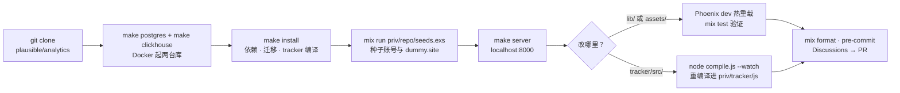

import { Meta } from '@storybook/addon-docs/blocks';

<Meta id="development" title="内部架构/二次开发" name="Docs" />

# 二次开发

[上一课的模块地图](?path=/docs/architecture--docs)回答了"代码在哪"，本课回答"怎么把代码跑起来、改下去"。Plausible 是一个标准 Phoenix 应用，二次开发的完整循环只有五步：用 Docker 起两台数据库 → 装依赖并把 tracker 编译出来 → `mix phx.server` 跑通 localhost:8000 → 在对应目录改代码（服务端热重载、tracker 重编译）→ `mix test` 与 Playwright 验证。文中命令以仓库 CONTRIBUTING.md 与 Makefile 原文为准，版本以 `.tool-versions` 为准，均按 v3.2.1 tag 核对。



工具链与两台数据库的锚点，回查以此为准：

| 依赖 | 版本 / 来源 | 说明 |
| --- | --- | --- |
| Erlang / Elixir / Node.js | `.tool-versions`：erlang 27.3.4.6 · elixir 1.19.4-otp-27 · nodejs 23.2.0 | 用 asdf / mise 等工具按 `.tool-versions` 对齐；mix.exs 兜底要求 Elixir `~> 1.18` |
| PostgreSQL | Docker，`make postgres`（postgres:latest） | 容器 `plausible_db`，端口 5432，口令 postgres |
| ClickHouse | Docker，`make clickhouse`（latest-alpine） | 容器 `plausible_clickhouse`，端口 8123 / 9000 |
| 与生产同版本 | `make postgres-prod`（postgres:15）· `make clickhouse-prod`（24.12.2.29-alpine） | 复现线上问题、核对版本差异时用 |

## 快速上手

从克隆到打开带数据的看板，五条命令：

```bash
git clone https://github.com/plausible/analytics.git
cd analytics
make postgres && make clickhouse   # Docker 起 PostgreSQL 与 ClickHouse
make install                       # Elixir/JS 依赖、建库迁移、tracker 编译
mix run priv/repo/seeds.exs        # 种子账号与 dummy.site 假数据
make server                        # 等价于 mix phx.server，监听 localhost:8000
```

打开 `http://localhost:8000/login`，用种子账号 `user@plausible.test`（口令 `plausible`）登录，即可看到一个带统计数据的 `dummy.site`。终端跑 `mix send_pageview` 造一条假 pageview，等 WriteBuffer 攒批落库（默认最长 5 秒），总览与 realtime 读数随之变化——这个闭环就是后面所有改动的验证基准。

不想用种子数据时，也可以在 `/register` 手动注册（域名填 `dummy.site`，跳过 JS 接入代码步骤），再跑 `mix send_pageview` 造数据，这是 CONTRIBUTING.md 给出的替代路径。

## 环境与依赖

本机只需要三样东西：Docker、Elixir/Erlang、Node.js。CONTRIBUTING.md 不写死版本号，而是把锚点放在 `.tool-versions` 里，供 asdf 或 mise 等版本管理工具读取；PostgreSQL 和 ClickHouse 不装在本机，全部由 Makefile 里的 `docker run` 提供。

### 两台数据库的 Docker 目标

| Makefile 目标 | 做什么 |
| --- | --- |
| `make postgres` | 起 `postgres:latest`，容器名 `plausible_db`，端口 5432，口令 postgres |
| `make clickhouse` | 起 `clickhouse-server:latest-alpine`，容器名 `plausible_clickhouse`，端口 8123 / 9000，带 `--ulimit nofile=262144`，数据目录挂到 `./.clickhouse_db_vol` |
| `make postgres-client` / `make clickhouse-client` | 直接进 `psql`（库 `plausible_dev`）或 `clickhouse-client`（库 `plausible_events_db`） |
| `make postgres-stop` / `make clickhouse-stop` | 停止并删除容器，卷保留 |
| `make postgres-prod` / `make clickhouse-prod` | 用与生产相同的版本起容器（postgres:15 / 24.12.2.29-alpine），卷与 latest 版分开 |

CONTRIBUTING.md 明确提醒：容器删除后卷仍保留，下次启动无需重新注册；但执行 `docker volume prune` 时可能把数据库卷一并清掉，届时要重新初始化。

### 开发模式默认是 EE 形态

mix.exs 的 `elixirc_paths` 按 Mix env 决定编译范围：`:dev` / `:test` 会把 `extra/lib`（[总体架构](?path=/docs/architecture--docs)里讲过的 EE 专属目录）一起编译；`:ce_dev` / `:ce_test` / `:ce` 只编 `lib`。`lib/plausible.ex` 里的 `on_ee` / `on_ce` 宏据此在编译期裁剪代码，CE 形态集合是 `[:ce, :ce_test, :ce_dev]`。

所以克隆下来直接 `make server`，跑的是含 `extra/` 的 EE 形态——这是 Plausible 团队开发云端功能的方式。要验证自己的改动在 CE 下的表现，用 CE 的 Mix env 起服务：

```bash
MIX_ENV=ce_dev mix phx.server
```

被 `on_ee` 包住的代码块在 CE 形态下会被裁掉，CE 形态的测试也不会执行 `:ee_only` 用例（见下文测试）。

### 种子数据与地理库

- `mix run priv/repo/seeds.exs`：生成账号 `user@plausible.test` 与带统计数据的 `dummy.site`（口令 `plausible`）。
- `mix send_pageview`：往当前注册的站点造一条假 pageview，不依赖浏览器。
- `mix download_country_database`：下载 DB-IP 的 Country Lite 免费库到 `priv/geodb/`，开发环境下"按 IP 解析国家"（[总体架构](?path=/docs/architecture--docs)的上报链路）靠的就是它；它与自托管部署接入的 MaxMind GeoLite2（见[地理位置](?path=/docs/ce-geolocation--docs)）是两条路径。

## 测试

测试分三块，各有自己的入口：服务端 Elixir 用 `mix test`，tracker 脚本用 Playwright 端到端，看板前端用 jest。

### 服务端：mix test

mix.exs 把 `test` 任务包成了一条链，建库、迁移、清理全自动：

```elixir
# mix.exs（节选）
test: ["ecto.create --quiet", "ecto.migrate", "test", "clean_clickhouse"]
```

目录组织是 `test/` 镜像 `lib/`：`test/plausible/ingestion/event_test.exs` 对应 `lib/plausible/ingestion/`，`test/plausible_web/controllers/api/external_controller_test.exs` 对应 API 控制器；测试工厂等共享设施在 `test/support/`（如 `factory.ex`）。`test/test_helper.exs` 会主动检查并在 `lib/` 下出现 `*_test.exs` 时直接报错，测试只放 `test/`。

测试模式由 Mix env 决定，跑测试时开头就会打印当前模式：

```bash
mix test                          # Enterprise Edition 模式，排除 :ce_build_only 用例
MIX_ENV=ce_test mix test          # 输出 "Test mode: Community Edition"，排除 :ee_only 用例
```

两种模式都默认排除 `:slow`、`:minio`、`:migrations` 标签的用例（`test_helper.exs`）。跑单个文件直接传路径，参数会落到 `test` 任务上：

```bash
mix test test/plausible/ingestion/event_test.exs
```

### tracker：Playwright

`npm test --prefix tracker` 执行的是 `npx playwright test`（tracker/package.json）。配置在 `tracker/playwright.config.ts`：测试目录 `test/`，跑 chromium / firefox / webkit 三个浏览器项目（`installation_support` 相关只跑 Chrome），并自动启动测试用站点服务器（`npm run start`，即 `test/support/server.js`，端口 3000）。

前置步骤在 tracker/README.md：先 `npm install`，再 `npx playwright install` 装浏览器。调试单个用例时，README 建议 UI 模式（`npm run playwright --ui`）。

### 看板前端：jest

`npm test --prefix assets` 以 `TZ=UTC jest` 跑单元测试（assets/package.json）；类型检查单独走 `npm run typecheck --prefix assets`，mix.exs 里也有等价别名 `mix assets.typecheck`。

## 常用命令

开发期的回查表，命令出处以括号内文件为准：

| 命令 | 作用 |
| --- | --- |
| `make server` 或 `mix phx.server` | 启动开发服务器，localhost:8000（CONTRIBUTING.md） |
| `iex -S mix phx.server` | 带控制台启动（Phoenix 通用用法），可在控制台直调 context 模块 |
| `mix ecto.migrate` | 应用 PostgreSQL 迁移（CONTRIBUTING.md；迁移文件在 `priv/repo/`） |
| `mix ecto.setup` / `mix ecto.reset` | 建库 + 迁移 + 种子 / 删库重来（mix.exs alias） |
| `mix setup` | 串联 deps.get → ecto.setup → assets.setup → assets.build（mix.exs alias） |
| `mix format` | Elixir 代码格式化（`.formatter.exs`） |
| `mix credo` | Elixir 静态检查（mix.exs 的 dev/test 依赖） |
| `mix assets.typecheck` / `mix assets.build` / `mix assets.deploy` | 看板类型检查 / 构建 Tailwind+esbuild 产物 / 压缩并 digest（mix.exs alias） |
| `npm run deploy --prefix tracker` | 编译 tracker 脚本进 `priv/tracker/js`（CONTRIBUTING.md） |
| `npm run lint --prefix tracker` / `npm run check-format --prefix tracker` | eslint / prettier 检查（tracker/package.json） |
| `npm run lint --prefix assets` / `npm run format --prefix assets` / `npm test --prefix assets` | eslint+stylelint / prettier 写入 / jest（assets/package.json） |
| `mix download_country_database` | 更新 IP 地理库（CONTRIBUTING.md） |
| `mix send_pageview` | 造一条假 pageview（CONTRIBUTING.md） |
| `pre-commit install` | 提交钩子，覆盖 Elixir、JavaScript、CSS，先 `pip install --user pre-commit`（CONTRIBUTING.md） |

## tracker 编译

tracker 的开发循环和 Elixir 侧不同：它有独立 npm 工程、独立测试，还有一道必须手动（或半自动）触发的编译步骤。设计目标（tracker/ARCHITECTURE.md）是"多目标、单一源码"：所有变体从 `tracker/src/` 同一套源码编出来。

编译链是：`tracker/src/` 源码 → `tracker/compiler/variants.json`（变体清单）→ `compile.js`（rollup 打包 + `@swc/core` 压缩）→ `priv/tracker/js/` 编译产物。[接入脚本](?path=/docs/script-setup--docs)和[自动追踪](?path=/docs/automatic-tracking--docs)里见过的 `script.*.js` 变体体系就来自这份清单：每个变体用一组 `COMPILE_*` 编译期常量开关功能，压缩器把未启用的分支整个删掉。全量一千多个变体并行编译约 3 秒。

```bash
npm run deploy --prefix tracker   # 即 node compile.js，全量编译进 priv/tracker/js
node compile.js --watch           # 监听 src/ 变更自动重编译（compile.js）
node compile.js --web-snippet     # 输出官网安装代码片段
node compile.js --suffix xxx      # 产出带后缀的副本，用于对比脚本体积
```

`variants.json` 的顶层是 `manualVariants`（`plausible-web.js`、npm 包入口等）与 `legacyVariants`（`plausible.file-downloads.tagged-events.js` 这类老式后缀变体）；其中 `detector.js`、`verifier.js` 两个安装支持变体标了 `ee_only`，只进 EE。产物名是 `plausible.*.js`，而 `PlausibleWeb.TrackerPlug` 会把 `/js/script.*.js`、`/js/analytics.*.js` 等请求映射到同一批文件，按变体后缀排序后从 `priv/tracker/js` 直接 `send_file`。

开发循环：

1. `mix phx.server` 启动时，config/dev.exs 的 watcher 会先跑一次 `npm run deploy --prefix tracker`——但仅此一次。
2. 改 `tracker/src/` 后必须重新编译：另开一个终端跑 `node compile.js --watch`，或每次手动 `npm run deploy --prefix tracker`。
3. 浏览器硬刷新后验证。legacy 变体响应头是 `Cache-Control: public, max-age=86400`（tracker_plug.ex），普通刷新可能吃缓存；也可以绕开浏览器直接 `curl http://localhost:8000/js/script.js` 检查产物内容。
4. `/js/pa-<id>.js` 这类按站点配置动态注入的脚本不同：`PlausibleWeb.Tracker` 在 Elixir 编译期把 `plausible-web.js` 读进模块属性再拼配置，改了 tracker 后如果它没更新，重启一次 `mix phx.server`。

## 改动落点

"想改 X 应该动哪里"速查表，落点来自 [总体架构](?path=/docs/architecture--docs)的模块地图，验证方式来自本课的工作流：

| 想改什么 | 落点 | 怎么验证 |
| --- | --- | --- |
| tracker 采集行为 | `tracker/src/` | 重编译 tracker，站点页硬刷新；自动追踪、SPA 路由等行为都在这里 |
| 上报管线（校验、丢弃、会话） | `lib/plausible/ingestion/`、`lib/plausible/session/` | `mix test test/plausible/ingestion/`；链路细节见 [事件管线](?path=/docs/ingestion-pipeline--docs) |
| 报表口径与查询 | `lib/plausible/stats/` | 看板读数或 [Stats API](?path=/docs/stats-api--docs) 对照；表结构见 [数据模型](?path=/docs/data-model--docs) |
| 新增 / 修改 API 端点 | `lib/plausible_web/router.ex` + `controllers/api/` | curl 直接打；公开接口形态见 [Events API](?path=/docs/events-api--docs) |
| 看板 UI | `assets/js/dashboard/`（React + TypeScript） | dev server 的 esbuild / tailwind watcher 自动重编译（config/dev.exs）；见 [看板前端](?path=/docs/dashboard-frontend--docs) |
| EE 功能 | `extra/` | 默认 dev 即 EE 形态，可直接跑；`MIX_ENV=ce_dev` 验证 CE 下被裁剪 |
| 数据库结构 | `priv/repo/`（PostgreSQL 迁移）、`priv/data_migrations/`（ClickHouse 数据迁移） | `mix ecto.migrate` |
| 后台任务 | `lib/workers/`（Oban worker） | 邮件报表、导出导入等行为见 [邮件与 Slack 报表](?path=/docs/email-slack-reports--docs)、[数据导出](?path=/docs/data-export--docs) |

服务端与看板的改动在 dev 下基本即时生效（Phoenix 热重载 + 前端 watcher）；需要额外一步的只有 tracker（重编译）和数据库结构（迁移）。

## 许可与贡献

### AGPLv3 对 fork 意味着什么

仓库 LICENSE.md 是 GNU Affero General Public License v3，README 的 License 段原文："Plausible CE is open source under the GNU Affero General Public License Version 3 (AGPLv3) or any later version"。AGPLv3 允许自由使用、修改、再分发，代价是衍生版本必须以同许可开放完整对应源码；其中第 13 条网络条款把"对外提供网络服务"也算作再分发。落到实践：

- **fork 自用**（内部部署、不向他人提供服务）：随便改，无对外开源义务。
- **改完对外提供服务**：服务对象有权索取对应源码——这是 AGPLv3 与普通 GPLv3 的关键差异。
- **分发注意**：tracker 目录的 package.json 单独声明 MIT（与仓库整体的 AGPLv3 不同），单独分发 tracker 衍生品时以该声明为准核对。

### CE 与 EE 的代码边界

`extra/` 是云端/企业版的实现（funnels、SSO、Sites API 等，见 [总体架构](?path=/docs/architecture--docs)），elixirc_paths 只在 EE Mix env 把它编进产物，`on_ee` 块在 CE 构建（`MIX_ENV=ce`）里根本不参与编译。给自己维护的 CE fork 打功能补丁时，改动落在 `lib/`（`on_ce` 可用），不要引用 `extra/` 里的模块——CE 形态下它们不存在，编译直接失败。README 对 premium features 不进 CE 的解释是"支持项目长期可持续性"，想让功能进 CE，走下面的上游贡献流程。

### 向上游贡献的流程

CONTRIBUTING.md 定了两条入口：

- **bug**：直接在 issue 列表认领，"Issues are usually up for grabs"。
- **新功能**：必须先在 Discussions 与核心团队和社区讨论，并在讨论里提出方案后再开 PR；没有关联 issue 或讨论的 PR 也可能被合并，但维护者的精力优先给讨论过的改动。

提交前装好钩子：`pip install --user pre-commit` 后 `pre-commit install`，它会检查 Elixir、JavaScript 和 CSS（不想被钩子拦可以 `pre-commit uninstall`）。PR 里改 tracker 时，团队还要求打 `tracker release:` 标签并更新 tracker/CHANGELOG.md（tracker/README.md）。

## 常见问题

- `make clickhouse` 起的库和线上行为对不上，怀疑版本差异？
  换成生产同版本容器：`make clickhouse-prod`（固定 `clickhouse/clickhouse-server:24.12.2.29-alpine`）和 `make postgres-prod`（固定 postgres:15）。Makefile 里普通目标拉的是 `latest-alpine` / `latest`，方便跟进新版本，但与生产可能有行为差异；`*-prod` 目标用不同卷（如 `.clickhouse_db_vol_prod`），数据不会互相覆盖，但容器同名，切换前先 `make clickhouse-stop`。

- `mix setup` 或 `make install` 中途失败？
  按 alias 链拆步定位：先确认 `make postgres`、`make clickhouse` 容器在跑；再依次单独执行 deps.get → ecto.create → ecto.migrate → 种子 → `npm ci --prefix assets` / `npm ci --prefix tracker` → `mix assets.setup` → `npm run deploy --prefix tracker` → `mix download_country_database`（CONTRIBUTING.md 的完整步骤表），哪步断修哪步。最常见的根因是 Erlang/Elixir/Node 版本与 `.tool-versions` 不符，用 asdf / mise 对齐后再试。若只是 `/js/script.js` 返回 404，多半是 tracker 尚未编译，单独补 `npm run deploy --prefix tracker`。

- 改了 `tracker/src/`，页面上看不到效果？
  页面拿到的是 `priv/tracker/js/` 下的编译产物，改源码不会生效——先重编译（`npm run deploy --prefix tracker`，开发期建议开着 `node compile.js --watch`）。之后注意两层缓存：legacy 变体响应带 `Cache-Control: public, max-age=86400`，浏览器要硬刷新或改用 `curl` 验证；`/js/pa-<id>.js` 的内容经 `PlausibleWeb.Tracker` 在 Elixir 编译期嵌入，必要时重启 `mix phx.server`。

## 总结回顾

摘要：

本课把"读源码"变成"改源码"：用 Docker 起 PostgreSQL 与 ClickHouse（`make postgres` / `make clickhouse`，`*-prod` 目标提供与生产一致的版本），`make install` 装齐依赖并把 tracker 编译进 `priv/tracker/js`，`mix phx.server` 跑通 localhost:8000，种子脚本给出带数据的 `dummy.site`。dev 模式默认按 EE 形态编译（`extra/lib` 参与），`MIX_ENV=ce_dev` 验证 CE 形态。测试分三块：`mix test` 自动建库迁移并在跑完清理 ClickHouse，CE 用例用 `MIX_ENV=ce_test` 跑；tracker 是 Playwright 端到端测试；看板前端是 jest。tracker 的开发循环是改 `tracker/src` → `node compile.js --watch` → 浏览器硬刷新，页面上永远是编译产物。改哪类功能进哪个目录由模块地图决定；仓库按 AGPLv3-or-later 开源——fork 自用无需对外开源，对外提供服务则要开放源码，`extra/` 不进 CE，向上游贡献新功能先过 Discussions。

一句话：

> 本地开发就是"两台库 + 一个 Phoenix + 一个 tracker 编译器"——改 `lib/` 靠热重载，改 `tracker/src` 靠重编译，动手前先确认自己跑的是 EE 还是 CE 形态。

知识要点：

- 从克隆到打开带数据的 localhost:8000 有哪几步？种子账号和口令是什么？
- `mix test` 别名帮你做了哪些事？CE 与 EE 两种测试模式怎么切换、各自排除什么用例？
- tracker 从 `tracker/src` 到 `/js/script.*.js` 经过哪条编译链？改完源码为什么要重编译、还可能被什么缓存挡住？
- dev 模式下 `extra/` 参与编译吗？如何本地验证改动在 CE 下的表现？
- AGPLv3 对 fork 自用和对外服务分别意味着什么？`extra/` 代码为什么不能进 CE 的功能补丁？向上游提新功能的入口是什么？

## 参考资料

- [CONTRIBUTING.md：开发环境步骤、种子账号、pre-commit 与贡献流程（v3.2.1）](https://github.com/plausible/analytics/blob/v3.2.1/CONTRIBUTING.md)
- [Makefile：postgres / clickhouse / install / server 等 make 目标（v3.2.1）](https://github.com/plausible/analytics/blob/v3.2.1/Makefile)
- [.tool-versions：Erlang / Elixir / Node.js 版本锚点（v3.2.1）](https://github.com/plausible/analytics/blob/v3.2.1/.tool-versions)
- [mix.exs：`setup` / `ecto.setup` / `test` / `assets.*` 别名与 `elixirc_paths` 的 CE/EE 编译范围（v3.2.1）](https://github.com/plausible/analytics/blob/v3.2.1/mix.exs)
- [test/test_helper.exs：CE/EE 测试模式与默认排除标签（v3.2.1）](https://github.com/plausible/analytics/blob/v3.2.1/test/test_helper.exs)
- [tracker/README.md：tracker 依赖、编译与测试方式（v3.2.1）](https://github.com/plausible/analytics/blob/v3.2.1/tracker/README.md)
- [tracker/ARCHITECTURE.md：variants.json 清单与 COMPILE 宏的编译模型（v3.2.1）](https://github.com/plausible/analytics/blob/v3.2.1/tracker/ARCHITECTURE.md)
- [tracker/compiler/variants.json：manualVariants / legacyVariants / ee_only 变体（v3.2.1）](https://github.com/plausible/analytics/blob/v3.2.1/tracker/compiler/variants.json)
- [tracker/compile.js：`--watch` / `--suffix` / `--web-snippet` 编译入口（v3.2.1）](https://github.com/plausible/analytics/blob/v3.2.1/tracker/compile.js)
- [tracker/playwright.config.ts：tracker 测试目录、浏览器矩阵与测试站点服务器（v3.2.1）](https://github.com/plausible/analytics/blob/v3.2.1/tracker/playwright.config.ts)
- [tracker/package.json：tracker 脚本与 npm 包的 MIT 声明（v3.2.1）](https://github.com/plausible/analytics/blob/v3.2.1/tracker/package.json)
- [lib/plausible.ex：`on_ee` / `on_ce` 宏与 CE 构建集合（v3.2.1）](https://github.com/plausible/analytics/blob/v3.2.1/lib/plausible.ex)
- [lib/plausible_web/tracker.ex：动态 tracker 脚本的编译期嵌入与配置注入（v3.2.1）](https://github.com/plausible/analytics/blob/v3.2.1/lib/plausible_web/tracker.ex)
- [lib/plausible_web/plugs/tracker_plug.ex：`/js/script.*.js` 的文件下发与缓存头（v3.2.1）](https://github.com/plausible/analytics/blob/v3.2.1/lib/plausible_web/plugs/tracker_plug.ex)
- [config/dev.exs：前端与 tracker 的 dev watcher 配置（v3.2.1）](https://github.com/plausible/analytics/blob/v3.2.1/config/dev.exs)
- [LICENSE.md：GNU AGPLv3 许可全文（v3.2.1）](https://github.com/plausible/analytics/blob/v3.2.1/LICENSE.md)
- [README.md：License & Trademarks 段与 CE/EE 功能差异说明（v3.2.1）](https://github.com/plausible/analytics/blob/v3.2.1/README.md)
