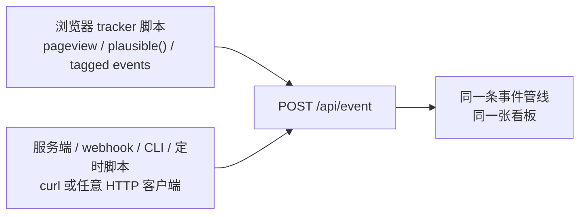

import { Meta } from '@storybook/addon-docs/blocks';

<Meta id="events-api" title="数据采集/采集方式/Events API" name="Docs" />

# Events API

浏览器脚本只能看见浏览器里发生的事。注册在数据库里写入成功、支付平台把回调打到你的服务器、一个 CLI 工具跑完了任务——这些动作发生时，访客的浏览器可能不在场，甚至根本不存在浏览器。Plausible 把事件入口开成一个普通的 HTTP 端点 `POST /api/event`：任何能发 HTTP 请求的环境——后端服务、Serverless 函数、支付 webhook、定时脚本——都能用一条 `curl` 把事件写进同一张看板。

浏览器里的 tracker 脚本（自动 pageview、`plausible('Signup')`、tagged events）内部调的也是这一个端点，脚本只是它的封装。本课讲清这个端点的完整请求形状、请求头如何决定访客属性、典型服务端场景，以及它与脚本上报的关系。



请求体字段回查表（以官方 Events API 参考页为准）：

| 字段 | 必填 | 含义 | 示例值 |
| --- | --- | --- | --- |
| `domain` | 必填 | 站点在 Plausible 中登记的域名；移动 App 可填 App 名 | `"test.local"` |
| `name` | 必填 | 事件名；`pageview` 是特殊值，其余一律按自定义事件处理 | `"pageview"`、`"Signup"` |
| `url` | 必填 | 事件发生处的 URL；从中提取 UTM，hostname 参与访客识别 | `"https://test.local/pricing"` |
| `referrer` | 可选 | 引荐来源（类似 `document.referrer`），经 referer-parser 库解析归类 | `"https://www.google.com/"` |
| `props` | 可选 | 自定义属性 JSON 对象，最多 30 对键值，超出部分丢弃 | `{"plan": "pro"}` |
| `revenue` | 可选 | 收入对象，`currency`（ISO 4217）+ `amount`（浮点或字符串）；无效值丢弃，事件仍照收 | `{"currency":"USD","amount":"1322.22"}` |
| `interactive` | 可选 | 是否计入跳出率；`false` 不计，默认 `true` | `false` |

`props` 的概念与看板拆分玩法见 [自定义属性](?path=/docs/custom-properties--docs)；`revenue` 的收入读数是云端专属能力，CE 上报不报错但看板无读数，见 [收入归因](?path=/docs/revenue-attribution--docs)。

## 快速上手

最小闭环：两条 `curl`——一条 pageview、一条自定义事件——然后到看板 realtime 与 Goals 区块核对。前提：本地实例运行中（`http://localhost:8000`，见 [本地实例](?path=/docs/local-instance--docs)），站点 `test.local` 已创建。

1. 发一条 pageview：

   ```bash
   curl -i -X POST http://localhost:8000/api/event \
     -H 'Content-Type: application/json' \
     -H 'User-Agent: Mozilla/5.0 (Macintosh; Intel Mac OS X 10_15_7) AppleWebKit/537.36 (KHTML, like Gecko) Chrome/126.0.0.0 Safari/537.36' \
     -H 'X-Forwarded-For: 203.0.113.10' \
     --data '{"domain":"test.local","name":"pageview","url":"https://test.local/from-cli"}'
   ```

   预期响应：`HTTP/1.1 202 Accepted`，响应体 `{}`。`User-Agent` 显式给了一个标准浏览器 UA——`curl` 默认的 `curl/8.x` 无法被设备解析库识别（后果见「请求头与访客属性」）。端点无需鉴权，归属完全靠 `domain` 匹配。

2. 打开看板 `http://localhost:8000/test.local`：realtime 区块当前访客数 +1，Top Pages 出现 `/from-cli`。pageview 无需任何登记即可显示。

3. 自定义事件要先注册 Goal：打开 `http://localhost:8000/test.local/settings/goals` → **+ Add goal** → 触发类型选 **Custom event** → 填 `Signup` 保存。必须先注册再发送，Goal 不回溯历史事件（规则见 [自定义事件](?path=/docs/custom-events--docs)）。然后发事件：

   ```bash
   curl -i -X POST http://localhost:8000/api/event \
     -H 'Content-Type: application/json' \
     -H 'User-Agent: Mozilla/5.0 (Macintosh; Intel Mac OS X 10_15_7) AppleWebKit/537.36 (KHTML, like Gecko) Chrome/126.0.0.0 Safari/537.36' \
     -H 'X-Forwarded-For: 203.0.113.10' \
     --data '{"domain":"test.local","name":"Signup","url":"https://test.local/from-cli","props":{"source":"cli"}}'
   ```

   预期同样是 `202` + `{}`。两条命令用了同一 UA + IP，会计为同一个访客。

4. 回到看板，底部 Goals 区块出现 `Signup`：Unique conversions 为 1。看不到时按常见问题排查（`domain` 拼写、Goal 未注册、`x-plausible-dropped` 响应头）。

## 请求形状

端点是 `POST <基址>/api/event`：云端基址 `https://plausible.io`，本地 CE 即 `http://localhost:8000`；配置了脚本与 API 代理时换成代理路径（见 [绕过广告拦截](?path=/docs/proxy--docs)）。

请求头：

| 请求头 | 必填 | 作用 |
| --- | --- | --- |
| `Content-Type` | 必填 | `application/json` 或 `text/plain`；后者 body 仍按 JSON 解析 |
| `User-Agent` | 必填 | 参与计算访客 `user_id`，同时是 Browsers / OS / Devices 报表的数据来源 |
| `X-Forwarded-For` | 可选 | 显式指定客户端 IP；从后端/代理代发时必须带（见下节） |

响应只有一条规则：**成功是 `202 Accepted` + 空对象 `{}`，而且被丢弃的事件也返回 202**。所以 202 只证明「服务端收到了请求」，不证明「事件被计数」。

调试与约束：

- **丢弃确认**：检查响应头 `x-plausible-dropped: 1`，出现即事件被机器人过滤丢弃，常见诱因是 `X-Forwarded-For` 填了服务器或 CDN 的 IP。
- **IP 调试**：请求头加 `X-Debug-Request: true`，API 改回 `200` 并在响应中给出将用于访客计数的 IP，用来验证代理转发是否正确。
- **健康检查**：`GET /api/health` 可探测 API 状态。
- **字段约束**：`url` 除去域名与查询串后最长 2000 字符，不支持 data URI；`props` 最多 30 对键值，超出丢弃；`revenue` 的 `currency` / `amount` 无效时只丢弃收入数据，事件本身仍记录并返回 202。官方参考页未公布限流阈值。

## 请求头与访客属性

Plausible 的访客身份由 `user_id` 标识，它由 **IP + User-Agent** 计算得出（`url` 的 hostname 也参与访客识别）；IP 只用于计算，不被存储。两个请求头各自控制一半访客属性：

- **User-Agent → 访客身份 + 设备报表**。Browsers / OS / Devices 报表由开源 device-detector 库解析 UA 得出。浏览器和常规 HTTP 库会自动带 UA，不要无故覆盖；但 `curl/8.x` 这类默认值识别不出设备，设备列会落为 Unknown，服务端代发时应转发真实访客的 UA。
- **X-Forwarded-For → 访客身份 + 地理报表**。从访客设备直接发（浏览器、App）不用带，服务端取连接 IP 即可；从自己的后端或代理代发必须带访客真实 IP，否则服务端看到的是你服务器的 IP——所有事件算成同一个访客，还可能触发机器人过滤被静默丢弃。支持 IPv4 / IPv6；逗号分隔的列表取第一个有效 IP。
- **地理读数另有前提**：IP 只是输入，CE 需要接入 MaxMind GeoLite2 才有国家/城市数据（见 [地理位置](?path=/docs/ce-geolocation--docs)）。

## 服务端场景

四类典型场景，浏览器脚本都够不着，只能走 API：

| 场景 | 为什么走 API | `url` 怎么填 |
| --- | --- | --- |
| 注册完成 | 动作以后端 DB 写入为准，确认页未必被打开 | 语义路径，如 `https://test.local/signup-complete` |
| 支付回调 | webhook 由支付方服务器发起，访客浏览器不在场 | 语义路径，如 `https://test.local/purchase` |
| CLI / 桌面 / 移动 App | 没有浏览器，脚本无从加载 | 可用官方移动端写法，如 `app://localhost/login` |
| 离线脚本 / 定时任务 | 无访客在场，批量补录 | 语义路径，并带 `interactive: false` |

共性取舍：

- **`url` 必填但没有真实页面**——填语义化 URL。它决定事件落在 Top Pages 的哪一行，也是 UTM 提取的来源。
- **能拿到真实访客上下文就转发 UA + IP**（如同步的注册接口）：事件会和该访客的浏览器会话合并为同一访客，来源与设备归因不断裂。拿不到的场景（异步支付 webhook、定时任务）接受「全部事件归为同一访客」的事实，用 `props` 区分业务维度。
- **后台类事件带 `interactive: false`**，避免无页面的任务事件干扰跳出率。
- **支付场景想带收入**：CE 上上报 `revenue` 不报错，但看板没有收入读数——收入归因是云端专属能力，见 [收入归因](?path=/docs/revenue-attribution--docs)。

## 与脚本上报的关系

浏览器 tracker 不是一个平行系统，它只是这个 API 的封装：

- 前面课程在 Network 面板里看到的 `/api/event` 请求，就是 tracker 用 `fetch` 发出的；请求体是同一形状的缩写版：`n` = `name`、`u` = `url`、`d` = `domain`、`p` = `props` 等（观察路径见 [自定义事件](?path=/docs/custom-events--docs)）。
- 脚本在封装之上自动补全了本课要自己负责的东西：`User-Agent`（浏览器自带）、`referrer`（取自 `document.referrer`）、当前页面 `url`（含 SPA 路由，见 [SPA 路由](?path=/docs/spa-tracking--docs)）等。脱离浏览器调 API 时，这些全部要显式给出。
- 同一端点、同一管线，所以服务端事件与浏览器事件落进同一站点、同一张看板：服务端发的 `Signup` 和浏览器发的 `Signup` 是同一个 Goal，来源报表与实时访客一视同仁，自定义事件同样要先注册 Goal 才显示。
- [绕过广告拦截](?path=/docs/proxy--docs) 代理的也是这个端点：换的是 URL，不是协议。

## 常见问题

- `curl` 返回 202，看板却完全没有这条事件。
  202 只代表服务端收到请求，被丢弃的事件同样返回 202。按序回查：`domain` 与站点登记域名逐字符一致（是 `test.local`，不是 `localhost:8000`）；自定义事件已在站点设置注册同名 Goal，且注册之后重新发过一次（不回溯历史事件）；响应头是否有 `x-plausible-dropped: 1`——有即被机器人过滤丢弃，检查 `X-Forwarded-For` 是否填了服务器/CDN 的 IP。

- 事件进去了，但设备、浏览器显示 Unknown，地理为空。
  设备 / 浏览器 / OS 报表来自 `User-Agent` 解析，地理来自 IP。服务端代发时转发真实访客的 UA，并显式带 `X-Forwarded-For: <访客IP>`；不带时用的是直连 IP（本地即 `127.0.0.1` 或 Docker 网关地址），且所有事件算成同一访客。CE 的地理读数还需先接入 MaxMind GeoLite2，见 [地理位置](?path=/docs/ce-geolocation--docs)。

- 网络超时重试或支付平台重投 webhook，事件被计了两次。
  Events API 没有幂等键，每次 POST 独立计数，重试与重投都会重复。在自己一侧做幂等：每订单、每用户只发一次。看板口径上，Total conversions 每次都 +1，Unique conversions 按访客去重只涨一次（口径见 [目标与转化](?path=/docs/goals-conversions--docs)），但事件总量与 pageview 计数无法去重。

## 总结回顾

摘要：

Events API 是 Plausible 唯一的事件入口：`POST /api/event`，无需鉴权，归属靠 `domain` 匹配。body 必填 `domain` / `name` / `url`，可选 `referrer` / `props` / `revenue` / `interactive`；请求头 `Content-Type` 与 `User-Agent` 必填，后端代发时 `X-Forwarded-For` 必须带。访客身份由 IP + UA 算出：UA 同时决定设备/浏览器/OS 报表，IP 决定地理（CE 需 MaxMind）。响应永远是 `202` + `{}`，被机器人过滤丢弃也不例外，确认丢弃看 `x-plausible-dropped: 1` 响应头，调试转发用 `X-Debug-Request: true`；约束是 `url` 最长 2000 字符、`props` 最多 30 对、`revenue` 无效即丢弃且收入读数为云端专属。浏览器 tracker 只是这个 API 的封装（`fetch`，缩写字段 `n` / `u` / `d` / `p`），服务端事件与浏览器事件走同一管线、进同一看板——自定义事件仍需先注册同名 Goal 才显示，API 无幂等，重试会重复计数。

一句话：

> `POST /api/event` 是 Plausible 唯一的事件入口：浏览器脚本只是替你把 UA、IP 和页面 URL 填好的封装，自己调 API 时这三样——以及先注册 Goal——都要自己负责。

知识要点：

- `POST /api/event` 的必填请求头和必填 body 字段各是哪些？
- `User-Agent` 和 `X-Forwarded-For` 分别决定看板上的哪些报表？后端代发不带会怎样？
- 响应 202 代表什么、不代表什么？如何确认事件被机器人过滤丢弃、如何调试转发 IP？
- 注册完成、支付回调、CLI 任务三类场景为什么必须走 API？`url` 没有真实页面时怎么填？
- 为什么服务端事件和浏览器脚本上报的事件落在同一个 Goal 上？
- 重复 POST 同一事件的计数口径是什么，幂等应在哪一侧做？

## 参考资料

- [Plausible Events API reference（官方文档：端点、请求头、body 字段、202 语义、调试头与字段约束）](https://plausible.io/docs/events-api)
