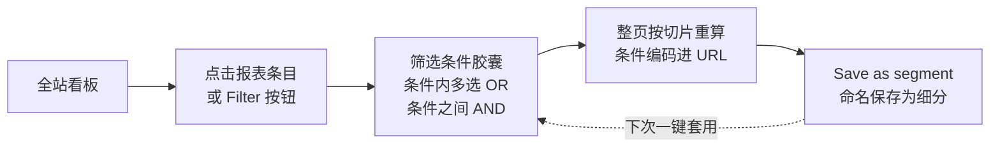

import { Meta } from '@storybook/addon-docs/blocks';

<Meta id="filtering-segments" title="看板与协作/筛选与细分" name="Docs" />

# 筛选与细分

看板默认回答的是「全部流量」的问题：一共来了多少人、从哪来、看了什么。但真正的分析动作是切片——「从 newsletter 来的访客都看了哪些页面」「完成 Signup 的流量集中在哪些国家」。**筛选（filters）**就是给整个看板加条件：加一条，顶部指标、趋势图和所有报表区块一起缩到这个切片上；**细分（segments）**是把一组常用条件命名保存，之后一次点击整套套用。

本课讲清两件事：筛选怎么加、怎么组合、加上之后读数口径怎么变；细分怎么存、谁能看见。操作全部发生在看板上，本地实例 `http://localhost:8000/test.local`（前置课程已产生 pageview 与 Download 事件）即可完成全部验证。各报表区块的读数口径见 [看板导览](?path=/docs/dashboard-tour--docs)，本课不重复。

Filter 按钮菜单的维度分组（与 CE v3.2.1 看板前端一致）：

| 分组 | 菜单项 | 覆盖维度 | 点击添加入口 |
| --- | --- | --- | --- |
| URL | Page、Hostname | 页面 / 着陆页 / 退出页；hostname | Top Pages 各标签页条目 |
| Acquisition | Source、UTM tags | source / channel / referrer；utm_source 等五个 UTM 参数 | Top Sources 各标签页条目 |
| Device | Location、Screen、Browser、OS | 国家 / 地区 / 城市；屏幕尺寸；浏览器（含版本）；操作系统（含版本） | Locations、Devices 区块条目 |
| Behaviour | Goal、Property | pageview 目标与自定义事件；事件自定义属性 props | Goal Conversions 区块条目与 Properties 标签 |

Property 一项只在属性键注册进站点设置后才出现（见 [自定义属性](?path=/docs/custom-properties--docs)）。

## 添加与组合筛选

加筛选有两条路径，效果相同：

- **点击条目**：点任意报表区块里的条目（来源、页面、国家、设备、目标……），顶部筛选栏立即出现一枚条件胶囊（如 `Page is /test-page.html`），整页读数缩到该切片；继续点其他区块的条目即叠加条件。这是最快的下钻方式。
- **Filter 按钮**：右上角放大镜图标的 **Filter** 按钮打开维度菜单（分组见上表），选一个维度进入弹层：搜索框定位取值、勾选多个值、切换匹配方式（见「匹配方式」一节）。适合取值太多需要搜索、一次要点多个值、或条目暂时不在报表前 9 行里的场景。

组合规则只有两条：

- **同一条件内多选 = OR**：一个 Source 条件里同时勾选 `google` 和 `newsletter`，命中任一即算。
- **不同条件之间 = AND**：`Source is google` 加 `Country is Germany` 再加 `Goal is Signup`，只留下三者同时成立的流量。

移除与清除：点胶囊上的 **x** 移除单条；点胶囊文字可重新编辑该条；按 **Esc** 一次清空全部条件；筛选栏右侧 *** 菜单里的 **Clear all filters** 等效（条件达到两条时出现）。

本地验证（先把时间范围切到 All time，把前置课程产生的数据都纳进来）：

| 操作 | 可观察证据 |
| --- | --- |
| 点 Top Pages 里的 `/test-page.html` | 筛选栏出现 `Page is /test-page.html` 胶囊，顶部指标与所有区块只剩看过该页的流量；地址栏追加筛选参数（当前格式如 `f=is,page,/test-page.html`；旧的 `filters=` JSON 格式链接会被自动重写，见[看板前端](?path=/docs/dashboard-frontend--docs)） |
| 再点 Devices 里的浏览器品牌 | 出现第二枚胶囊，读数进一步收窄——两条件 AND 叠加 |
| 打开右上角 Filter 按钮 | 菜单按 URL / Acquisition / Device / Behaviour 四组列出维度，与开场参考表一致 |
| 按 Esc | 全部胶囊消失，看板恢复全站读数 |

本地数据量小，切片条目有限；想体验在真实大流量报表里点选、叠加筛选的手感，可打开[官方公开演示看板](https://plausible.io/plausible.io)对照操作。

筛选状态和时间范围一样编码在看板 URL 的查询参数里，刷新或把链接发给同事即可复现同一切片（分享能力的全貌见 [分享与嵌入](?path=/docs/sharing-embedding--docs)）。

## 匹配方式

Filter 弹层里可在四种匹配方式之间切换：

| 匹配方式 | 含义 | 典型用途 |
| --- | --- | --- |
| is | 精确等于任一勾选值 | `Source is google` |
| is not | 排除所选值 | 排除某个来源、某个国家 |
| contains | 包含子串（手动输入文本，不限于已有取值） | `Page contains /blog` 圈出整个博客目录 |
| does not contain | 不包含子串 | 排除某类路径 |

两条维度级边界（来自 CE v3.2.1 看板源码 `util/filters.js`）：

- **Location（国家/地区/城市）与 Screen 只有 is / is not**，没有 contains——层级枚举值不支持子串匹配。
- **Goal 的 is not 是行为口径**：`Goal is not Signup` 在后端按「整个会话从未触发该目标」过滤（`has_not_done`），而不是「触发过别的事件」。另外同一时刻只能存在一个 Goal 条件。

contains 与 is 的取舍：要「整棵子树」用 contains，要「精确一个值」用 is。误用的典型后果见常见问题。

## 筛选后的口径变化

加筛选不只是「数字变小」，某些条件会改变顶部指标行的**指标集合**（行为来自 CE v3.2.1 `stats_controller.ex`，本地可直接复现）：

- **按目标筛选**：点击 Goal Conversions 区块里的目标（如 `Download`），顶部指标从流量口径切换为转化口径——**Unique conversions**（完成目标的去重访客）、**Total conversions**（完成总次数）、**Conversion rate**（unique conversions ÷ 所选范围的 unique visitors，分子分母同窗口）；Realtime 视图下同步换成 last 30 min 的转化读数。目标注册与转化口径本身见 [目标与转化](?path=/docs/goals-conversions--docs)。
- **按页面筛选**：加 Page 条件后，顶部出现 **Time on page** 与 **Scroll depth**，替代 Views per visit 与 Visit duration——单页停留与滚动深度只在锁定具体页面时才有意义（两者口径见 [看板导览](?path=/docs/dashboard-tour--docs)）。
- **Current visitors 不受筛选影响**：它始终是全站最近 5 分钟人数（见 [看板导览](?path=/docs/dashboard-tour--docs)）。

本地验证：在 Goal Conversions 区块点击 `Download` 目标，顶部指标行立即换成三个转化读数；Esc 清除后恢复流量口径。

## 细分 segments

常用切片每次重新点一遍太麻烦：把当前筛选条件组命名保存，就是细分（segment）。保存入口在筛选栏 *** 菜单的 **Save as segment**（有至少一条条件时出现）；保存后 Filter 按钮菜单里多出 **Segments** 一节，点名字一键套用整套条件。

保存时二选一可见性：

- **Personal segment**：只有你自己可见，适合个人分析习惯，viewer 等只读角色也能建。
- **Site segment**：所有能访问该站点看板的团队成员可见（创建需 editor 及以上角色），相当于团队共识的标准切片。

编辑与删除：套用细分后点筛选栏里细分的名称 → **Edit segment** 修改条件 → **Update segment**；名称旁箭头里另有 **Save as a new segment**（基于当前条件另存）与 **Delete segment**。

环境差异：云端把 site segments 归为付费计划功能（计划特性名「Shared Segments」）；CE v3.2.1 源码包含完整的 segments 实现（`lib/plausible/segments/` 与看板前端 `filtering/` 模块均在主构建内），自托管两种细分都可用，本地实例可直接走完下表全流程。

| 操作 | 可观察证据 |
| --- | --- |
| 加一条条件（如 `Page is /test-page.html`），*** → Save as segment，命名 `测试切片`，选 Personal | Filter 按钮菜单底部出现 Segments 一节 |
| Esc 清空条件，再从 Segments 一节点 `测试切片` | 整套条件一次恢复，看板回到该切片 |
| 点细分名称 → Edit segment，改条件后 Update segment | 细分按新条件生效；箭头菜单里可另存或删除 |

## 与 Stats API 的对应

看板上的每个筛选操作都对应 Stats API 查询体里的一条 filter（API 完整用法见 [Stats API](?path=/docs/stats-api--docs)）：

| 看板操作 | API filter |
| --- | --- |
| 点 Top Pages 条目 `/pricing` | `["is", "event:page", ["/pricing"]]` |
| 点来源 `google` | `["is", "visit:source", ["google"]]` |
| `Page contains /blog` | `["contains", "event:page", ["/blog"]]` |
| 套用某个细分 | `["is", "segment", [<细分ID>]]` |

对应规则：页面、hostname、目标、props 用 `event:` 前缀，来源、UTM、地理、设备用 `visit:` 前缀；filters 数组顶层是隐式 AND——正是看板「多条件 AND」的同构表达。API 比看板多出正则匹配（`matches` / `matches_not`）与显式 `or` / `not` 嵌套，看板表达不了的组合逻辑可以走 API。

## 常见问题

- 加了筛选后数字全变 0。
  多数情况是 AND 叠加过紧：每条条件都必须同时成立，本地小流量下交集很容易为空——逐条移除胶囊，定位出把交集清空的那一条。其次检查时间范围（Last 7 Days 等滚动窗口不含今天，见 [看板导览](?path=/docs/dashboard-tour--docs)）；若按 Goal 筛选后全为 0，确认目标早于筛选范围起点就已注册——目标不回溯注册前的数据（见 [目标与转化](?path=/docs/goals-conversions--docs)）。
- 用 contains 圈一组页面，把不相关页面也算了进来；或反过来用 is 圈目录，一个子页面都匹配不到。
  is 是精确匹配、contains 是子串匹配：`Page contains /blog` 会同时命中 `/blog`、`/blog/post-1`，甚至 `/blogroll`；只想要精确一页用 is。圈目录时给子串带上斜杠边界（如 `/blog/`）可减少误命中。
- Filter 菜单里找不到 Property，props 筛选不出现。
  属性键必须先注册进站点设置的 Custom Properties 白名单，看板才把它当作可筛选维度；未注册时该维度整个不显示。注册方法与「一键添加已发送属性」见 [自定义属性](?path=/docs/custom-properties--docs)。

## 总结回顾

摘要：

筛选把看板从「全站汇总」切成任意流量切片：点击任意报表条目或经右上角 Filter 按钮添加条件，同一条件内多选值按 OR、不同条件之间按 AND 组合；胶囊可逐条移除或编辑，Esc 与 Clear all filters 一次清空。匹配方式有 is / is not / contains / does not contain 四种，地区与屏幕尺寸只支持精确匹配，Goal 的 is not 是「会话从未触发」的行为口径。筛选会改变口径：按目标筛选时顶部指标切换为 Unique conversions / Total conversions / Conversion rate，按页面筛选时多出 Time on page 与 Scroll depth，Current visitors 始终不受影响。细分是把条件组命名保存：personal 仅自己可见、site 全团队可见，CE v3.2.1 两种都可用，保存在 *** 菜单、套用在 Filter 菜单的 Segments 一节。看板筛选与 Stats API 的 filters 参数一一同构，API 额外支持正则与 or/not 嵌套。

一句话：

> 筛选是「整页读数同时缩到一个切片」，组合规则只有两条——条件内多选是 OR、条件之间是 AND；常用的条件组存成细分，一次点击整套复现。

知识要点：

- 添加筛选的两条入口分别是什么，各自适合什么场景？
- 多条件如何组合？同一条件内勾选多个值是什么语义？
- 四种匹配方式各自匹配什么？哪些维度没有 contains？
- 按 Goal 筛选后顶部指标变成什么？按 Page 筛选多出哪两个指标？
- Personal 与 site 细分的可见性差别是什么，分别在哪里保存、套用和编辑？
- 看板筛选与 Stats API 的 filters 参数如何对应？

## 参考资料

- [Filters and segments（官方文档：筛选入口、匹配方式、细分保存与编辑）](https://plausible.io/docs/filters-segments)
- [Goal conversions（官方文档：按目标过滤看板）](https://plausible.io/docs/goal-conversions)
- [Stats API reference（filters 语法与维度前缀）](https://plausible.io/docs/stats-api)
- [官方公开演示看板](https://plausible.io/plausible.io)
- [plausible/analytics v3.2.1 源码：看板筛选与细分实现（Filter 菜单分组、匹配方式边界、目标筛选口径切换、segments 在 CE 可用的事实来源）](https://github.com/plausible/analytics)
