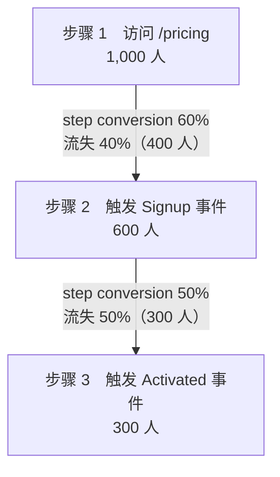

import { Meta } from '@storybook/addon-docs/blocks';

<Meta id="funnels" title="数据采集/事件与目标/漏斗" name="Docs" />

# 漏斗

目标回答「有没有转化」，漏斗回答接下来的问题：**多步流程里，人在哪一步走丢了**。注册、结账、激活这类流程要经过好几个页面或事件才算完成，只看终点转化率无法定位问题——漏斗把流程拆成 2–8 个有序步骤，逐步统计进入人数和相邻步之间的流失比例，瓶颈步骤直接现形。

漏斗是**云端专属功能**（官方定价中属 Business 计划）：Community Edition 没有实现，本地实例的站点设置和看板里都没有入口（功能边界见 [认识 Plausible](?path=/docs/introduction--docs)）。本课因此以官方文档为真值来源讲清概念、创建、读数口径与设计方法；动手验证需要云端账号，CE 读者可按「常见问题」中的路径亲自确认边界。读完你应能判断一个流程该不该建漏斗、选哪种漏斗类型，并读懂报表上每个数字。

上图同时是本课的算例：每步数字是进入该步的去重访客数；相邻两步之间，step conversion 与流失百分比（drop-off）互补；整体转化率 overall conversion = 完成最后一步的人数 ÷ 进入第一步的人数 = 300 ÷ 1,000 = 30%。读漏斗就是读这三组数。

| 关键事实 | 取值 |
| --- | --- |
| 功能归属 | 云端专属（Business 计划）；CE 无此功能 |
| 步数限制 | 最少 2 步、最多 8 步；更长流程在逻辑中点拆成两个漏斗 |
| 步骤构成 | pageview goal 或 custom event goal（含带收入的目标、按属性过滤的事件目标） |
| 漏斗类型 | Sequential（默认）/ Flexible / Strict，决定「怎样算按顺序完成」 |
| 数据起点 | 只统计漏斗**创建之后**的访客，不追溯历史数据 |
| 配置入口 | 站点设置 → 左侧栏 Funnels → Add funnel |
| 报表位置 | 看板底部，步骤上首次记录到访问后出现 |

## 创建漏斗

漏斗没有新的事件机制：每一步就是一个已讲过的目标——pageview goal 或 custom event goal（配置与验证见 [目标与转化](?path=/docs/goals-conversions--docs)）。创建漏斗本质上是把 2–8 个既有目标串成一条有序序列。

配置路径（云端看板）：

1. 进入站点设置，点左侧栏的 **Funnels** → **Add funnel**。
2. 填 Funnel name，逐步添加步骤：每步选一个 pageview goal（如 `/pricing`）或 custom event goal（如 `Signup`）。
3. 选择 Funnel type：Sequential、Flexible 或 Strict（口径差别见「漏斗类型」一节）。
4. **Save** 保存；之后在同一入口点编辑图标修改，改完点 **Update Funnel**。

三个直接影响读数的事实：

- **数据不追溯**：漏斗只统计创建之后发生的访问。刚保存的漏斗报表空白不代表配错——等步骤目标被真实触发才会出数。先把每个目标在 Goal Conversions 区块里确认能出数，再建漏斗，能避开大部分「漏斗没数据」的排查。
- **步骤可带属性过滤**：同一自定义事件的不同变体（如 `plan=pro` 的订阅事件）可作为独立步骤，属性机制见 [自定义属性](?path=/docs/custom-properties--docs)。
- **收入目标可直接入列**：revenue-enabled goal 作为步骤时，报表在该步额外显示收入；收入目标的配置见 [收入归因](?path=/docs/revenue-attribution--docs)。

两条边界：一个漏斗只有一条线性序列，不支持分支或条件路径，分支流程要拆成多个漏斗；访客中途跳到站外再回来（如去 Stripe 付款页），官方说明返回的访问计入同一会话，且漏斗跨主域名与子域名生效，所以含外部收银台的结账流程不会被截断。

## 漏斗类型

三种类型是同一个问题的三种答案：**一个访客的行为序列，怎样才算「走完了流程」**。创建时选定，之后可改。

| 类型 | 判定规则 | 适用场景 |
| --- | --- | --- |
| Sequential（默认） | 必须按顺序完成**所有**步骤，但步骤之间允许穿插其他页面或事件 | 大多数流程的默认选择 |
| Flexible | 必须完成第一步和最后一步，中间步骤可跳过任意个 | 中间步骤可选的流程（如商品页 → 购买） |
| Strict | 每步必须严格连续发生，中间不能有任何其他动作 | 校验「无干扰」的严格路径，读数最保守 |

区分证据——同一批访客行为，三种类型判定不同。设漏斗为 `/pricing → Signup → Activated`：

| 访客实际行为 | Sequential | Flexible | Strict |
| --- | --- | --- | --- |
| `/pricing` → 看了 `/about` → `Signup` → `Activated` | 计入（顺序对，穿插允许） | 计入 | 不计入（步骤间穿插了 `/about`） |
| `/pricing` → `Activated`（跳过 `Signup`） | 不计入（缺中间步） | 计入（首尾完成即可） | 不计入 |

两个直接影响读数解读的后果：

- **Flexible 下人数不单调**：跳过中间步的访客只计入首尾，所以最后一步的人数可能比中间某步还多——这是口径使然，不是数据错误。
- **Strict 读数系统性偏低**：任何一次穿插（哪怕看一眼首页）都会把访客排除，人数通常明显低于 Sequential。读数不符合直觉时，先核对当前漏斗是哪种类型。

## 漏斗报表

漏斗报表挂在看板底部——步骤目标首次记录到访问后出现。结构与读数：

- **每步一行**：进入该步的去重访客数；
- **相邻两步之间**：流失百分比（drop-off），定位流失发生的位置；
- **整体转化率**：官方定义为「进入流程并以转化结束的访客占比」，即完成最后一步的人数 ÷ 进入第一步的人数；
- **收入列**：revenue-enabled 目标所在步骤显示该步收入，步骤详情里还有 revenue per visitor。

两个配套的读数工具：

- **日期对比**：开启 Compare 后，报表并列显示两个周期的各步完成数、整体转化率与收入——改动上线后用对比验证瓶颈步是否真的改善，而不是只看单日波动。
- **筛选下钻**：漏斗报表跟随看板筛选器，可按 campaign、来源、落地页、设备、地区过滤后重读漏斗，定位流失集中在哪个切片（例如移动端在某一步的流失是桌面端的两倍）。筛选器的完整玩法见 [筛选与细分](?path=/docs/filtering-segments--docs)。

## 漏斗设计

三个典型漏斗，步骤全部由既有目标组成：

| 场景 | 步骤序列 | 类型建议 |
| --- | --- | --- |
| 注册 | 访问 `/signup` → 触发 `Signup` → 触发 `Activated`（首次关键动作） | Sequential |
| 结账 | 访问商品页 → 触发 `AddToCart` → 访问 `/checkout` → 触发 `Purchase`（带收入） | Sequential；含 Stripe 等站外支付页也成立（往返算同一会话） |
| 激活 | 触发 `Signup` → 访问 `/onboarding` → 触发 `Setup` → 触发 `UsedFeature`（核心功能） | onboarding 必走用 Sequential，可跳过用 Flexible |

设计要点：

- **步骤对齐决策点，而不是每个页面**：每一步应代表访客做了一次选择（看了价格、提交了表单、付了款）。过细的步骤把流失摊平，报表反而看不出瓶颈。
- **超过 8 步在逻辑中点拆开**：官方建议拆成两个漏斗（如「落地到注册」与「注册到付费」），交界处共享同一个目标，两段读数才能衔接。
- **分支流程另建漏斗**：一条序列不支持条件分支；多端入口（web / 邮件链接）分别建漏斗，或留在同一漏斗里用看板筛选切分。
- **默认留在 Sequential**：只有「跳过中间步也算转化」符合业务语义时才换 Flexible；Strict 用来验证路径是否如设计般紧凑，不适合当主报表口径。

分析动作闭环：读漏斗找到流失最大的相邻两步 → 回到看板用筛选器按来源、落地页、设备对该切片下钻 → 定位到具体人群（如某渠道流量在付款步流失畸高）→ 改产品或页面 → 用日期对比验证瓶颈步的改善。

## 常见问题

- 本地 CE 实例（http://localhost:8000）里找不到 Funnels 入口。
  正常，漏斗是云端专属功能。打开站点 `test.local` 的站点设置，左侧栏有 Goals 但没有 Funnels，看板底部也不会出现漏斗区块；官方仓库 README 明确 CE 中 "Premium features (marketing funnels, ecommerce revenue goals, SSO and sites API) are not available"。需要动手验证时用云端账号；在 CE 中可先用 [目标与转化](?path=/docs/goals-conversions--docs) 的单目标转化率替代观察。
- 访客在步骤之间来回跳页、顺序很乱，漏斗怎么算。
  取决于漏斗类型：Sequential 只要求各步按顺序完成，中间穿插其他页面不影响计入；Strict 要求严格连续，任何穿插都排除该访客；Flexible 允许跳过中间步骤。读数比预期低时先核对当前类型，多数流程应留在默认的 Sequential（判定对照见「漏斗类型」一节）。
- 漏斗保存后报表一片空白。
  漏斗只统计创建之后的访客，历史数据不追溯。先到 Goal Conversions 区块和 Top Pages 确认每个步骤目标本身在出数，再等新的访问触发；某一步长期为零通常是目标名或 URL 配错、事件没上报。
- 最后一步的人数比中间某步还多。
  当前漏斗是 Flexible 类型：跳过中间步骤的访客只计入首尾两步，末步人数因此可以超过中间步，不是统计错误。希望每步人数单调递减时改用 Sequential。

## 总结回顾

摘要：

漏斗把 2–8 个既有目标（pageview goal 或 custom event goal，含带收入、带属性过滤的变体）串成一条有序序列，回答「多步流程里人在哪一步流失」。创建入口在云端站点设置的 Funnels 页，保存后只统计之后的访问、不追溯历史；Sequential / Flexible / Strict 三种类型分别对应「按顺序完成全部步骤」「首尾必须、中间可跳」「严格连续无穿插」三种判定口径，同一条访客行为在不同类型下计入结果不同。报表挂在看板底部：每步给进入人数，相邻步之间给流失百分比，整体给 conversion rate，带收入的步骤另显示收入；日期对比用于验证改动，看板筛选用于按来源、落地页、设备定位流失切片。设计上步骤对齐决策点、超 8 步在中点拆开、分支流程另建漏斗；发现瓶颈后的标准动作是回到看板下钻再验证。整套功能云端专属，CE 的站点设置与看板均无对应入口。

一句话：

> 漏斗的价值不在终点转化率，而在相邻两步之间的流失百分比——找到流失最大的那一步，回到看板按来源和页面下钻，才算把漏斗用起来。

知识要点：

- 漏斗由什么组成？步数上下限是多少，超长流程怎么处理？
- Sequential、Flexible、Strict 的判定规则分别是什么？同一访客行为在三种类型下的计入结果有何不同？
- 漏斗报表的每步人数、相邻步流失百分比、整体转化率分别怎么读？Flexible 下为什么会出现末步人数反超中间步？
- 为什么新建的漏斗看不到历史数据？排查「某一步一直为零」先看哪里？
- 发现瓶颈步骤后，如何用看板筛选和日期对比完成「定位 → 改动 → 验证」的闭环？
- 在本地 CE 实例中观察漏斗边界的入口在哪里，官方对 CE 功能限制的原文表述是什么？

## 参考资料

- [Funnel analysis（官方文档：创建路径、2–8 步限制、三种漏斗类型、读数口径与排查建议）](https://plausible.io/docs/funnel-analysis)
- [plausible/analytics README：Cloud 与 CE 功能差异对照（CE 无 marketing funnels 的官方表述）](https://github.com/plausible/analytics)
