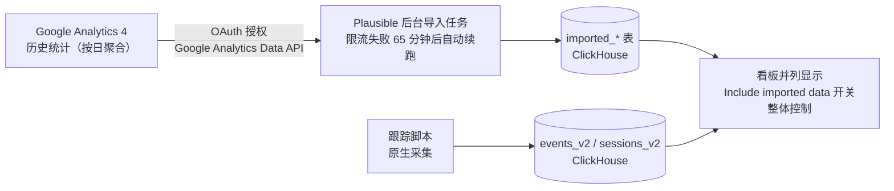

import { Meta } from '@storybook/addon-docs/blocks';

<Meta id="ga-import" title="API 与集成/集成/导入 GA 数据" name="Docs" />

# 导入 GA 数据

迁到 Plausible 不等于从零开始：Google Analytics 里躺着的历史数据是同比、环比的对比基线，丢掉它，看板的前几个月就只有一条孤零零的新曲线。**GA 导入**用一次 Google OAuth 授权，把 GA4 属性的历史统计按日聚合后灌进站点的 `imported_*` 表，与原生采集数据并列显示——趋势图在采集起点前后连成一条连续的线，来源、页面、地区等历史报表也随之补齐。导入是后台任务：授权、选属性、确认，剩下交给服务器跑，完成后邮件通知。

先立住全课最重要的一条边界：**导入的是按日聚合的统计结果，不是逐事件明细**。GA4 的原始事件留在 Google 那边，Plausible 拿到的是「每天 × 每个来源 / 页面 / 国家……各有多少访客、会话、pageview」这样的计数行。聚合粒度决定了导入数据的能力上限——能并列显示、能总量对比，但不能任意维度交叉下钻。第二条边界：**新导入只支持 GA4**。Universal Analytics 已被 Google 关停，Plausible v3.2.1 源码中 UA 导入模块仍在，但只用于渲染历史导入——其 `import_data` 直接 raise "Importing data not supported"，导入入口已关闭。

| 关键事实 | 取值 |
| --- | --- |
| 支持范围 | 新导入仅 GA4；UA 导入已随 Google 关停下线（v3.2.1 源码仅保留旧导入的展示） |
| 数据粒度 | 按日聚合（官方原文 "Data is imported in aggregate for each date"），非逐事件明细 |
| 时间范围 | 从首个 GA 访客到首个 Plausible 访客，自动避开与原生数据重叠 |
| 属性上限 | 同一站点最多导入 5 个 GA 属性；整属性导入，不能按 hostname 拆分 |
| 操作入口 | 站点设置 → Imports & Exports → Import Data → Google Analytics 按钮；本地为 `http://localhost:8000/test.local/settings/imports-exports` |
| 任务形态 | 后台任务，多数站点几分钟，大站可达数小时（受 Google API 限额约束）；完成后邮件通知 |
| 删除方式 | Imports & Exports 里点垃圾桶图标删除某份导入，不影响原生数据；导入完成后可安全删除 GA 账号 |
| CE 前提 | `GOOGLE_CLIENT_ID` / `GOOGLE_CLIENT_SECRET` + 启用四个 Analytics API（见「CE 自托管导入」） |

## 导入流程

云端（以及配好 OAuth 的 CE）操作路径，括号内是 v3.2.1 源码对应的路由：

1. 打开站点设置，左侧进入 **Imports & Exports**（`GET /:domain/settings/imports-exports`）。
2. 在 **Import Data** 区块点 **Google Analytics** 按钮，走 Google OAuth 授权并选择要用的 Google 账号。
3. 从下拉框选择要导入的 GA4 属性（`GET/POST /:domain/import/google-analytics/property`），点 Continue。
4. 确认页（`GET /:domain/import/google-analytics/confirm`）核对属性与区间后点 **Confirm import**，任务提交（`POST /:domain/settings/google-import`）。

提交后的执行形态：

- **后台任务而非即时完成**：官方口径是多数站点几分钟内完成，大站可能拖到数小时——瓶颈是 Google 侧的 API 限额。完成后收到邮件通知；CE 未配置 SMTP 时收不到邮件，以 Imports & Exports 页的导入状态为准。
- **限流自动续跑**：v3.2.1 源码中 GA4 导入遇到 rate limit、socket 错误或服务端错误时，不会把导入标记为失败，而是带着进度标记（dataset/offset）调度一个 65 分钟后的续跑任务——看到导入长时间停在中间态，先等它自己恢复。
- **时间范围自动确定**：导入区间取「首个 GA 访客」到「首个 Plausible 访客」，避免与原生数据重复计数。换属性迁移（同一站点先后用过多个 GA 属性）时，最多可导入 5 个属性，最早的先导入，后续属性补剩余缺口。
- **整属性导入**：不能只挑属性里的某个 hostname——官方原文 "It can't be split by hostname"，一个属性跟踪过多个站点时，这些站点的数据会全部进入同一个 Plausible 站点，且导入后无法再剥离。属性混用了多个站点时先想清楚再动手。
- **受 GA 数据保留期约束**：GA4 的 API 最多回溯约 14 个月；更早的日期只能拿到主趋势图层面的指标，明细报表没有数据。要导入尽早动手，越拖 GA 侧能给的越早数据越少。

导入完成后，Existing imports 列表出现这份导入（状态、日期区间、pageviews 数），看板数据随之补齐。此后删除 GA 账号或属性都不影响已导入的数据——官方原文 "you can safely delete your Google Analytics account. Your imported data will stay in your Plausible account."

## 导入数据的形态与边界

GA 导入与 CSV 导入写入同一批 `imported_*` 表，共享同一套展示规则（Include imported data 开关、最多 5 份导入并存、不能再导出等，细节见 [数据导出](?path=/docs/data-export--docs)），本课只讲 GA 导入特有的形态与边界。

### 写入的表

v3.2.1 源码 `Plausible.Imported.GoogleAnalytics4` 把 GA4 报表行（维度：date、source、page path、hostname、event name、国家/地区/城市、device、browser、OS；指标：`totalUsers`、`sessions`、`screenPageViews`、`bounces`、`userEngagementDuration`、`eventCount`）转换后写入九张表：

`imported_visitors`、`imported_sources`、`imported_pages`、`imported_entry_pages`、`imported_custom_events`、`imported_locations`、`imported_devices`、`imported_browsers`、`imported_operating_systems`。

注意缺了 `imported_exit_pages`——源码注释说明原因："no exit pages metrics in GA4 API available for now"，GA4 API 根本没有退出页指标可拉。

### 看板里看不到的部分

以下报表对导入数据没有内容（原生数据不受影响），原因都是 GA4 API 不暴露对应维度或指标：

| 看板位置 | 导入数据表现 | 原因（官方原文要点） |
| --- | --- | --- |
| UTM sources 报表 | 无导入数据 | "we cannot show UTM sources imported from Google Analytics"——GA 不暴露独立的 UTM source 维度 |
| 浏览器版本下钻 | 无导入数据 | 无法 "drill down to see the imported data's exact browser versions" |
| Exit Pages 标签 | 无导入数据 | "Google Analytics API does not expose this information" |
| 滚动深度指标 | 无导入数据 | 同上，API 不提供 |
| 趋势图小时粒度（当天视图） | 不显示导入数据 | "We can't display hourly graph interval on the daily view"——导入数据按日聚合 |
| Consolidated view（汇总视图） | 只含原生数据 | "Imported data is not included in the consolidated view dashboard" |

### 三条口径差异

读导入数据前必须知道，它的计数方式与原生数据不同：

- **访客数按日加总**：导入数据的 unique visitors 是把每天的唯一访客数直接加起来（官方原文 "we just sum up the daily unique visitor numbers"），跨天回访的访客会被重复计——时间范围拉得越长，导入段的访客数越偏高。原生数据做的是全区间真去重。
- **筛选能力受限**：导入数据是预聚合的，不能任意维度交叉（如 页面×来源 同时筛选）；允许的组内组合只有：国家/地区/城市、浏览器与版本、OS 与版本、hostname 与页面、特定自定义事件与其属性。筛选排除了导入数据时，看板提示 "Imported data is excluded due to applied filters"，原生数据不受影响。筛选机制本身见 [筛选与细分](?path=/docs/filtering-segments--docs)。
- **目标要手动重建**：GA4 的目标转化数据可以导入（进 `imported_custom_events`），但 Plausible 不会替你创建目标——导入后要在站点设置里手动重建同名目标，转化报表才开始计数。电商收入数字不能导入（官方原文 "ecommerce revenue numbers cannot be imported"）。

### 与原生数据的关系

官方明说原生数据 "superior to the imported data"：计数方法不同，两边数字本来就对不齐，导入段与原生段的接缝处出现台阶属预期。导入数据与原生数据并列显示，趋势图右上 **Include imported data** 开关可整体关掉导入部分。不要让导入区间与原生区间重叠后指望互相替换——官方建议的做法是导入天然截止到首个 Plausible 访客，而不是先清空原生统计再导（重置统计并不值得）。

## CE 自托管导入

CE 的导入流程与云端一致，多出的只有前置准备：OAuth 客户端身份跟部署走，每个自托管实例要用自己在 Google Cloud 建的客户端。客户端的创建、同意屏、回调地址（`<BASE_URL>/auth/google/callback`）与 `GOOGLE_CLIENT_ID` / `GOOGLE_CLIENT_SECRET` 两个环境变量的配置方法与 Search Console 集成**完全相同**，已在 [Search Console](?path=/docs/search-console--docs) 课走完一遍，这里不重复。

GA 导入特有的只有一步：在 Google Cloud 为项目额外启用四个 API（CE wiki 原文全列，缺一不可）：

- Google Analytics API
- Google Analytics Reporting API
- Google Analytics Admin API
- Google Analytics Data API

三条边界：

- **同一套凭据，两个独立功能**：GA 导入与 Search Console 集成共用 `GOOGLE_CLIENT_ID` / `GOOGLE_CLIENT_SECRET`，但互不强依赖——CE wiki 原文 "You can do both, neither, and anything in between."。只做 GA 导入就不必启用 Google Search Console API，反之亦然。
- **未配置时界面上是警告**：没配这两个变量时，Imports & Exports 的 Import Data 区块位置显示一条配置警告而不是 Google Analytics 按钮——与 Integrations 页的 GSC 模块同一表现。配好变量 `docker compose up -d` 重启后按钮出现，这就是最直观的可见性核对点。
- **完成通知依赖 SMTP**：导入完成的邮件通知需要实例配好 SMTP；未配置时收不到邮件，以 Imports & Exports 页的导入状态为准（SMTP 配置见 [配置](?path=/docs/ce-configuration--docs)）。

## 常见问题

- 导入完成后，看板数字与 GA 后台的读数对不上。
  预期行为，不用修。官方明确原生数据优于导入数据、两边计数方法不同；尤其访客数——导入段是按日唯一值加总，跨天回访会重复计，范围越长偏得越多。对比总量看趋势形状是否合理即可，不要逐日报表对账。
- 一加筛选，导入段的数据就消失，页面提示 "Imported data is excluded due to applied filters"。
  导入数据是按日预聚合的，不支持任意维度交叉筛选；提示出现时原生数据仍在正常过滤。要用筛选分析就接受导入段缺席，或取消筛选看总量。允许的组内组合见「三条口径差异」。
- 本地 CE 的 Import Data 区块只有一条警告，没有 Google Analytics 按钮。
  未配置 `GOOGLE_CLIENT_ID` / `GOOGLE_CLIENT_SECRET`。按 [Search Console](?path=/docs/search-console--docs) 课的「CE 自托管接入」建好 OAuth 客户端、写入 `.env`、重启容器后按钮出现；再做 GA 导入还需在 Google Cloud 启用本课列出的四个 Analytics API。
- OAuth 走通了，但选属性的下拉框是空的，或导入中途报错。
  先核对四个 API 是否全部启用（Google Analytics API、Google Analytics Reporting API、Google Analytics Admin API、Google Analytics Data API），少一个就可能拉不到属性列表或中途失败；再确认授权的 Google 账号对目标 GA4 属性有读取权限。
- 找不到 Universal Analytics 的导入选项。
  UA 已被 Google 关停，新导入不再支持。v3.2.1 源码中 UA 导入模块仅保留用于展示历史导入（`import_data` 直接 raise "Importing data not supported"）；手里只有 UA 时代数据的话，可先从 GA 导出报表再整理成 `imported_*` 格式走 CSV 导入（见 [数据导出](?path=/docs/data-export--docs)）。
- 导入提交后长时间停在中间状态，没有完成也没有失败。
  多半是撞上 Google API 限额：源码对 rate limit / 网络 / 服务端错误会调度 65 分钟后的续跑任务而不是判失败，大站全程数小时属正常范围。等它自己续跑；超过一天仍无进展再到 Imports & Exports 删除该导入重新提交。

## 总结回顾

摘要：

GA 导入把 GA4 属性的历史统计以按日聚合的形式灌入站点的 `imported_*` 表，让迁移后的看板在采集起点前后连成连续曲线。操作链路是站点设置 → Imports & Exports → Google Analytics 按钮 → OAuth 授权 → 选属性 → Confirm import，之后是后台任务：多数站点几分钟、大站数小时，限流自动 65 分钟后续跑，完成邮件通知；导入区间自动取首个 GA 访客到首个 Plausible 访客，最多 5 个属性、整属性导入、不能按 hostname 拆，且受 GA4 约 14 个月数据保留期约束。新导入只支持 GA4，UA 导入已随 Google 关停下线。导入数据的能力边界由聚合粒度决定：UTM sources、浏览器版本下钻、Exit Pages、滚动深度、小时粒度趋势图和汇总视图都没有导入数据；访客数按日加总会高估、不能任意维度交叉筛选、目标要手动重建且电商收入不进。CE 侧与 Search Console 集成共用同一套 `GOOGLE_CLIENT_ID` / `GOOGLE_CLIENT_SECRET`，只需额外启用四个 Analytics API，未配置时导入入口是警告而不是按钮。

一句话：

> GA 导入迁的是「按日聚合的历史基线」而不是原始事件——它让对比曲线连续，但导入段的读数口径、筛选能力和明细粒度都低原生数据一等，把它当背景基线用，不要当可下钻的数据用。

知识要点：

- GA 导入支持哪些 GA 版本？UA 导入现在的状态是什么，源码证据是什么？
- 云端导入的完整操作路径是什么？导入的时间范围如何确定，多属性迁移怎么补缺口？
- 导入数据的粒度是什么？写入了哪些表，缺哪张、为什么？
- 哪些看板报表看不到导入数据？访客数、筛选、目标三条口径差异分别是什么？
- 为什么说导入完成后可以安全删除 GA 账号？删除某份导入影响原生数据吗？
- CE 做 GA 导入比云端多什么前置？四个必须启用的 API 叫什么，未配置 OAuth 变量时界面看到什么？

## 参考资料

- [Import Google Analytics data（官方文档：GA4 导入流程、按日聚合与时间范围、5 属性上限、看板限制清单、删除导入与删除 GA 账号）](https://plausible.io/docs/google-analytics-import)
- [plausible/community-edition Wiki：Google Integration（CE 自建 OAuth 客户端、四个 Analytics API、与 Search Console 集成共用凭据且相互独立）](https://github.com/plausible/community-edition/wiki/Google-Integration)
- [Import stats via CSV（官方文档：导入数据的筛选限制与允许的组内组合、"Imported data is excluded due to applied filters" 提示）](https://plausible.io/docs/csv-import)
- [plausible/analytics v3.2.1 源码（`Plausible.Imported.GoogleAnalytics4` 的 GA4 报表维度/指标与九张写入表、缺 `imported_exit_pages` 的注释、限流 65 分钟续跑；`Plausible.Imported.UniversalAnalytics` 的 UA 导入下线声明；router 中 imports-exports 与 google-analytics 导入路由）](https://github.com/plausible/analytics)
