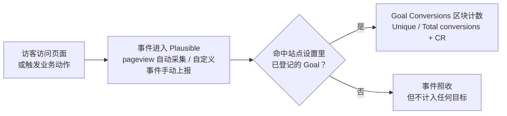

import { Meta } from '@storybook/addon-docs/blocks';

<Meta id="goals-conversions" title="数据采集/事件与目标/目标与转化" name="Docs" />

# 目标与转化

访问量告诉你「来了多少人」，但不能回答「这些人有没有做成事」。转化（conversion）就是访客完成了你期望的动作：到达报名成功页、点击购买、下载文件。Plausible 用**目标（Goal）**把这类动作声明出来——你在站点设置里登记一条匹配规则（某个页面路径，或某个自定义事件名），看板就为它持续计数，并算出**转化率 = 完成目标的去重访客数 ÷ 全部去重访客数**。流量数字由此变成可考核的业务指标。

目标只有两类：**pageview 目标**匹配页面路径，pageview 本来就会自动采集，所以不需要改任何代码；**自定义事件目标**匹配已上报的自定义事件名，动作本身要先按 [自定义事件](?path=/docs/custom-events--docs) 上报。官方文档中的其它转化功能（漏斗、收入归因、user journeys）都建立在这两类之上。

两类目标的回查对比：

| | pageview 目标 | 自定义事件目标 |
| --- | --- | --- |
| 匹配对象 | 页面路径（不含域名与查询参数），即 Top Pages 里看到的路径 | 已上报的事件名 |
| 匹配方式 | 逐字符精确匹配，或用 `*` 通配符 | 逐字符精确匹配，含大小写 |
| 需要改代码 | 不需要 | 需要（JS 调用或标注类，见 [自定义事件](?path=/docs/custom-events--docs)） |
| 设置入口 | `/:domain/settings/goals` → Add goal → Pageview | 同一入口 → Custom event |
| 典型用途 | 感谢页、订单确认页、按栏目聚合（如 `/blog*`） | 报名、购买、下载、按钮点击 |
| 显示名默认 | `Visit <路径>`，可改 | 事件名本身，可改 |

两条共同规则：**目标只从创建生效时起计数，不回溯历史数据**（官方文档对自定义事件目标明确写明 "Past events are not backfilled"）；目标创建后，**首次转化发生时才出现在看板的 Goal Conversions 区块**。

## 快速上手

最小闭环：创建一个 pageview 目标，触发一次转化，在看板看到 Unique conversions 与转化率。前提：本地实例运行中（`http://localhost:8000`，见 [本地实例](?path=/docs/local-instance--docs)），站点 `test.local` 已创建，且已有一个接入脚本的测试页（见 [接入脚本](?path=/docs/script-setup--docs)；localhost 页面须使用 `.local` 脚本变体）。

1. 打开 `http://localhost:8000/test.local/settings/goals`，点 **+ Add goal**，触发类型选 **Pageview**，路径填测试页的实际路径（如 `/test-page.html`，以看板 Top Pages 中显示的为准），保存。显示名自动填为 `Visit /test-page.html`。
2. 用浏览器打开该测试页，让 tracker 上报一次 pageview。
3. 打开看板 `http://localhost:8000/test.local`，底部 **Goal Conversions** 区块出现 `Visit /test-page.html` 一行：Unique conversions 为 1，Total conversions 为 1。CR = Unique conversions ÷ 当前范围的 unique visitors——如果今天只有这一次访问，CR 是 100%；如果之前课程在今天还产生过其它访问，分母变大，CR 随之降低。
4. 再刷新一次页面：Total conversions 变 2，Unique conversions 仍为 1，CR 不变——同一访客重复完成目标时，两个口径的差别立刻可见。

如果第 3 步看不到这一行，先确认测试页用的脚本带 `.local` 后缀，且访问发生在目标创建之后（目标不回溯历史数据）。

## pageview 目标

pageview 目标匹配的是事件的**路径部分**：服务端从上报 URL 中只取 path（不含域名，查询参数不参与匹配），也就是看板 Top Pages 里显示的路径。设置时填的路径必须以 `/` 开头。

**精确匹配**：不带 `*` 时按完整路径逐字符相等比较。`/blog` 与 `/blog/` 是两个不同路径，填之前先到 Top Pages 核对实际记录的路径形态。

**通配符**：官方语法是单个 `*`，可放在路径两端或中间：

| 写法 | 匹配 | 不匹配 |
| --- | --- | --- |
| `/blog*` | `/blog`、`/blog/hello`、`/blog/2026/10/post`，以及 `/blogroll` 等同前缀路径 | `/news` |
| `/blog/*` | `/blog/hello` 等栏目下的页面 | `/blog` 本身、`/blogroll` |
| `/checkout/order-received/*` | WooCommerce 订单确认页（官方示例） | `/checkout` |
| `/*/thank-you` | 任意层级前缀下的 thank-you 页（如 `/a/thank-you`、`/a/b/thank-you`） | `/thank-you`（无前缀层级） |

匹配按整路径锚定（源码把含 `*` 的路径编译为 `^...$` 形式的正则，`*` 展开为 `.*`，会跨越 `/` 分段；旧写法 `**` 仍被接受且与 `*` 等价）。所以 `/blog*` 本质是**前缀匹配**而非「按目录匹配」——这是最常见的误判，见常见问题。

**显示名与窄化**：创建后显示名（Display Name）自动填 `Visit <路径>`，它就是看板里看到的目标名，随时可改。创建时还可以附加自定义属性窄化统计范围（如只统计 `account_type = trial` 的访问），属性概念见 [自定义属性](?path=/docs/custom-properties--docs)。

## 自定义事件目标

自定义事件目标匹配的是事件名。事件如何上报（`plausible('Signup')`、tagged events 标注类、请求载荷细节）见 [自定义事件](?path=/docs/custom-events--docs)，本课只讲「把事件设为目标」这一半。

设置路径：`/:domain/settings/goals` → **+ Add goal** → 触发类型选 **Custom event** → 填事件名 → 保存。三条规则：

- **逐字符匹配，含大小写**：Goal 名必须与上报的事件名完全一致。tagged events 的最高频错配是 `+`：标注类 `plausible-event-name=Button+Click` 上报的事件名是 `Button Click`（`+` 替换为空格），Goal 写成 `Button+Click` 就一个也计不到。
- **不回溯**：官方文档明确「Past events are not backfilled」——计数从目标创建时刻开始。如果事件先上报、Goal 后添加，创建之前的事件不计入，需回到站点重新触发一次。
- **首次转化后才上看板**：只创建 Goal 而没有转化发生时，Goal Conversions 区块不显示该目标。

自动采集的事件（`File Download`、`Outbound Link: Click`、`Form: Submission` 等）同样以事件目标的方式登记后才统计，采集机制见 [自动追踪](?path=/docs/automatic-tracking--docs)。事件目标也支持用自定义属性窄化，例如只统计某个套餐的 `Purchase`。

## 转化率口径与下钻

Goal Conversions 区块每个目标有三列读数，口径以官方 metrics 定义为准：

| 读数 | 口径 |
| --- | --- |
| Unique conversions | 所选时间范围内完成该目标的**去重访客数**，同一访客只计一次 |
| Total conversions | 目标完成的**总次数**，同一访客重复完成全部计入 |
| CR（Conversion rate） | **unique conversions ÷ unique visitors**，分子分母取同一时间范围与筛选条件 |

区块按 unique conversions 从高到低排名。读数随看板的时间范围与筛选器变化——先看 Today 再看 All time，CR 会不同，因为分子分母都换了窗口。

**下钻**（读数之后的第二步）：点击某个目标名，整个看板按该目标过滤，Top Sources、Top Pages 等区块随之只剩「完成了该目标的流量」——来源区块回答「哪些来源带来转化」，页面区块回答「访客在哪些页面上完成转化」。这对应官方文档的描述：设置目标后可以追踪 driving conversions 的 referrer sources、entry pages 和 top pages。过滤后顶部指标行也切换为转化口径（Unique conversions、Total conversions、CR 均可选上趋势图）。组合筛选与细分的完整玩法见 [筛选与细分](?path=/docs/filtering-segments--docs)。

区块底部的 **DETAILS** 打开全量弹层（标题 Goal conversions），带搜索框、可点列头排序，目标多于 9 个时在这里看全。收入列（Total revenue、Average revenue）与漏斗属于云端专属能力，CE 看板没有，分别见 [收入归因](?path=/docs/revenue-attribution--docs) 与 [漏斗](?path=/docs/funnels--docs)。

## 管理目标

所有目标集中在站点设置的 Goals 页管理，URL 为 `/:domain/settings/goals`，本地即 `http://localhost:8000/test.local/settings/goals`：

- **添加**：+ Add goal，先选触发类型（Pageview 或 Custom event），再填路径或事件名。
- **编辑**：列表中点铅笔图标，可改路径/事件名、显示名和窄化属性，保存后立即生效——但只影响之后的计数，历史读数留在原口径下（见常见问题）。
- **删除**：点垃圾桶图标，有确认提示。删除即移除这个统计口径，看板不再显示它的转化；误删后只能按原口径重建。
- **上限**：默认每站点 1000 个目标（源码 `@max_goals_per_site` 默认值），正常使用很难触达。

多目标并存时的组织经验：

- **动态页面用通配符收敛**：博客、订单号这类路径无限增长的页面，用一个 `/blog*` 目标聚合，而不是逐篇建目标。只想临时按路径分组看流量、不想长期计数时，用看板顶部的 Filter 即可，不必建目标。
- **显示名即看板展示名**：pageview 目标默认名是 `Visit <路径>`，多目标并排时可读性差，改成业务语言（如「报名成功」）后同事才能直接读懂看板。
- **事件名是契约，不是标签**：改自定义事件名等于换了一个指标，新旧数据断成两截；命名约定（动词开头、业务可读）应在多目标铺开前定好，见 [自定义事件](?path=/docs/custom-events--docs)。

## 常见问题

- 改了目标的匹配路径后，历史转化数没有跟着新路径重算。
  这是目标的计数规则：目标从创建生效时起计数，不回溯历史数据；编辑匹配条件后，历史读数仍留在原口径下，不会用新条件重算。如果新旧两个口径都要保留对比，不要改旧目标，新建一个目标承接新口径，改口径前先把旧读数记录下来。注意只改显示名不影响计数——匹配看的是路径/事件名，显示名只是看板上的标签。

- 通配符 `/blog*` 把 `/blogroll` 这类同前缀路径也算进了转化。
  `*` 是跨分段的任意字符匹配（编译为 `.*`），`/blog*` 本质是前缀匹配，不是「`/blog` 目录下的页面」。只想聚合栏目内容时用 `/blog/*` 形态（代价是不匹配 `/blog` 本身）；建目标前先到 Top Pages 核对站点实际的路径形态，再决定通配位置。

- 事件已上报（Network 里 `/api/event` 返回 202），Goal Conversions 区块却一直没有它。
  202 只代表服务端收到事件。按序回查：Goal 是否已创建且与事件名逐字符一致（tagged 写法里 `+` 对应空格）；目标创建后是否重新触发过一次（不回溯历史事件）；本地页面是否用了带 `.local` 的脚本变体。逐项排查见 [自定义事件](?path=/docs/custom-events--docs) 的常见问题。

## 总结回顾

摘要：

目标把「期望访客完成的动作」声明为可计数的规则，流量由此变成可考核的转化指标。目标分两类：pageview 目标匹配页面路径（不含域名与查询参数），不带 `*` 时逐字符精确匹配，`*` 可放两端或中间、会跨越路径分段（`/blog*` 是前缀匹配）；自定义事件目标匹配已上报的事件名，逐字符且区分大小写。两类目标都在 `/:domain/settings/goals` 管理，可添加、编辑（立即生效但不重算历史）、删除（有确认），默认上限 1000 个；目标从创建起计数、不回溯历史，首次转化发生后才出现在看板。Goal Conversions 区块按 unique conversions 排名，三列读数是 Unique conversions（去重访客数）、Total conversions（含重复完成的总次数）和 CR（unique conversions ÷ unique visitors，分子分母同窗口同筛选）；点击目标名可过滤整个看板，用来源与页面区块回答「谁在带来转化」。

一句话：

> 目标 = 一条先声明、后计数的匹配规则：路径或事件名逐字符对上才算转化，转化率是 unique conversions ÷ unique visitors。

知识要点：

- pageview 目标与自定义事件目标在匹配对象、匹配方式和代码改动上有什么区别？
- `/blog*`、`/blog/*`、`/blog` 三种写法各自的匹配边界是什么？
- 为什么目标创建前发生的事件/访问不计入转化？想让事件上看板要按什么顺序操作？
- Unique conversions、Total conversions、CR 三个读数的口径分别是什么？同一访客刷新两次转化页，三列各怎么变？
- 点击 Goal Conversions 区块里的目标名后，看板其它区块变成什么？
- 想改一个目标的统计口径又不丢历史读数，应该编辑它还是新建它？

## 参考资料

- [Goal conversions（官方文档：两类目标与看板转化报告）](https://plausible.io/docs/goal-conversions)
- [Pageview goals（官方文档：路径匹配、通配符语法与示例、编辑与属性窄化）](https://plausible.io/docs/pageview-goals)
- [Custom event tracking（官方文档：事件名逐字符匹配、目标不回溯声明）](https://plausible.io/docs/custom-event-goals)
- [Metrics definitions（官方指标定义：unique / total conversions 与 conversion rate 口径）](https://plausible.io/docs/metrics-definitions)
- [plausible/analytics：源码（`/:domain/settings/goals` 路由、通配符编译为 `.*`、`Visit ` 默认显示名、1000 目标上限、Goal Conversions 区块列名的事实来源）](https://github.com/plausible/analytics)
