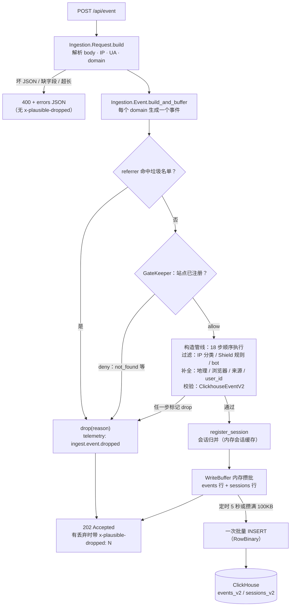

import { Meta } from '@storybook/addon-docs/blocks';

<Meta id="ingestion-pipeline" title="内部架构/事件管线" name="Docs" />

# 事件管线

[总体架构](?path=/docs/architecture--docs)给了上报链路的全景：`POST /api/event` → `Api.ExternalController` → 内存缓冲 → ClickHouse。本课走进这条链路内部，回答三个问题：一个事件从请求到落库要过哪些关卡？202 返回时数据在哪里？哪些环节会让它无声消失？管线的入口是 `lib/plausible/ingestion/` 目录：`request.ex` 验收请求，`event.ex` 构造事件并决定去留，`write_buffer.ex` 攒批落库——以下机制全部以 v3.2.1 源码为准。

整条管线只有两种结局：**buffered**（进入内存写缓冲，稍后批量写入 ClickHouse）或 **dropped**（带原因丢弃，客户端只会看到 `202` + `x-plausible-dropped` 响应头）。真正的 `400` 只发生在请求验收阶段；一旦验收通过，无论后续如何丢弃，响应都是 202。



开场参考表——管线上的关键判定与默认值（均可回查到对应小节）：

| 关卡 / 机制 | 判定或默认值 | 事件的下场 |
| --- | --- | --- |
| 请求验收（`Ingestion.Request`） | 缺 `n`/`u`/`d`、坏 JSON、字段超长 | 400 + errors JSON |
| 垃圾来源（`ReferrerBlocklist`） | referrer 主机命中名单 | 丢弃 `:spam_referrer` |
| 站点门禁（`GateKeeper`） | domain 在站点缓存中查不到 | 丢弃 `:not_found` |
| Bot 过滤（`put_user_agent`） | UA 解析为机器人或 Headless Chrome | 丢弃 `:bot` |
| 刷盘节奏 | 默认 5 秒（`CLICKHOUSE_FLUSH_INTERVAL_MS`） | 到点批量 INSERT |
| 缓冲上限 | 默认 100 000 字节（`CLICKHOUSE_MAX_BUFFER_SIZE_BYTES`） | 攒满立即刷盘 |
| UA 解析超时 | 200 ms | 放行，只记 telemetry |
| 落库可见延迟 | 最长一个刷盘间隔（默认 5 秒） | 之后才可查询 |

## 请求验收

`Api.ExternalController.event/2` 收到请求后第一步是 `Ingestion.Request.build(conn)`：把 `Plug.Conn` 解析成一个 Ecto 结构体，填上服务端接收时刻（`timestamp` 截断到秒，不用客户端时间）、按 `RemoteIP.get` 的优先级取真实 IP（`x-plausible-ip` > `cf-connecting-ip` > `b-forwarded-for` > `x-forwarded-for` > `forwarded` > 直连地址），再做字段验收。任一项失败，立即返回 `400` 和错误详情 JSON，事件根本不会进入管线。

验收规则速查（`request.ex`）：

| 请求字段 | 规则 | 违规后果 |
| --- | --- | --- |
| body | 必须是合法 JSON 对象（读取上限默认 1 MB） | 400 |
| `n` / `name` | 必填，最长 120 字符；整数也收（404 页追踪发的是数字） | 400 |
| `u` / `url` | 必填，最长 2000 字节，禁 `data:` scheme | 400 |
| `d` / `domain` | `domain` 与 `url` 主机至少有一处；逗号分隔可发多个站点；去掉 `www.` 前缀 | 400 |
| `sd` / `e` | `engagement` 事件至少带一个有效整数（滚动深度 0–100，超出截到 100） | 400 |
| `p` / `props` | 最多 30 对，多余静默截断；key 超 300 字节或 value 超 2000 字节 | 400 |
| `r` / `referrer` | 截断到 2000 字符 | 静默 |

注意两件事：`domain` 在这一步只做语法验收——「这个域名是不是已注册站点」是下一步门禁的事，所以 domain 拼错的请求不会得到 400，而是得到 202 + 丢弃头；`url` 的主机名会决定 `hostname` 和 `pathname`（hash 模式下 `#` 后缀并入路径），这也是看板上页面报表的数据来源。

## 事件构造

`Ingestion.Event.build_and_buffer(request)` 接手验收过的请求：一次请求带多个 domain 会生成多个事件，每个事件独立走「入场闸门 → 补全管线 → 会话归并」。

### 入场闸门

管线之前有两道快速否决：

- **垃圾来源**：referrer 的主机名送 `ReferrerBlocklist`（官方维护的垃圾名单依赖包）比对，命中则整个请求的所有事件直接丢弃（`:spam_referrer`），连站点都不查。
- **站点门禁**：`Plausible.Site.GateKeeper.check(domain)` 从站点缓存（约每 25–35 秒从 PostgreSQL 刷新，同 [总体架构](?path=/docs/architecture--docs)）里找 domain。查不到是 `:not_found`；另有 `:block`（站点被停用）、`:throttle`（触发站点级限流）、`:payment_required`（订阅过期）三个策略——后三者的阈值由云端 CRM 配置，自托管 CE 默认不限流，实践中几乎只会遇到 `:not_found`（domain 拼错或站点没建）。

### 补全管线

通过闸门后，事件经过 18 个顺序执行的步骤（`event.ex` 的 `pipeline/0`），任何一步都可以把它标记为 dropped 并立即终止：

| # | 步骤 | 做什么 / 丢弃原因 |
| --- | --- | --- |
| 1 | drop_verification_agent | 云端安装验证器的 UA（EE 专属，CE 空操作） |
| 2–3 | drop_datacenter_ip / drop_threat_ip | 按请求头 `x-plausible-ip-type` 判定机房/威胁 IP，丢弃 `:dc_ip` / `:threat_ip`（该头由云端边缘注入，见下文 Bot 过滤） |
| 4–6 | drop_shield_rule_hostname / page / ip | 站点 Shield 规则：主机名白名单、页面黑名单、IP 黑名单 |
| 7 | put_geolocation | IP 查 MaxMind 地理库补 country/region/city；VPN IP 的国家记为 `A1` |
| 8 | drop_shield_rule_country | 站点 Shield 规则：国家黑名单（必须放在地理补全之后） |
| 9 | put_user_agent | 解析 UA：机器人或 Headless Chrome 丢弃 `:bot`；否则补 OS/浏览器/屏幕尺寸 |
| 10–12 | put_basic_info / source_info / medium | 落 name、pathname 等基本字段；解析 referrer 来源与 utm 参数；gclid/msclkid 推断媒介 |
| 13 | put_props | 自定义属性转成 `meta.key` / `meta.value` 数组 |
| 14 | put_revenue | 收入归因字段（EE 专属，CE 空操作） |
| 15–16 | put_salts / put_user_id | 取盐并计算访客 `user_id` |
| 17 | validate_clickhouse_event | 组装 `ClickhouseEventV2` 并整体校验，失败丢弃 `:invalid` |
| 18 | register_session | 会话归并，然后把事件行交给写缓冲 |

三个关键计算值得单独记住：

- **UA 解析**用 UAInspector 库，结果按 UA 字符串缓存；解析限时 200 ms，超时不丢弃、放行事件，只记一条 telemetry——解析再慢也不挡数据。移动端浏览器名在此归一（如 Chrome Mobile 并入 Chrome）。
- **地理解析**调用 `Plausible.Geo`（CE 需按[地理位置](?path=/docs/ce-geolocation--docs)接入 MaxMind 库），没配库时地理字段留空，报表里国家维度为空。
- **user_id** 是 `SipHash(盐, UA + IP + 站点域名 + 可注册域名)`——带盐哈希，无法从库里的 `user_id` 反推访客。盐存在 PostgreSQL，每日 0 点由 Oban 任务 `RotateSalts` 轮换；计算时同时用当前盐和上一把盐，轮换瞬间进行中的会话仍能被找回，不会把同一访客劈成两个。

`register_session` 是管线的最后一步：按 `user_id` 分片加锁，在内存会话缓存里找到进行中的会话就归并（会话模型见[数据模型](?path=/docs/data-model--docs)），找不到就开新会话；`engagement` 事件找不到所属会话会被丢弃（`:no_session_for_engagement`）。会话行和事件行随后分别进入两个写缓冲。

丢弃在这个阶段是「标记 + telemetry」：每个 dropped 事件带原子原因（`:bot`、`:spam_referrer`、`:not_found`……），发一条 `[:plausible, :ingest, :event, :dropped]` 事件，然后控制器统一回 `202` + `x-plausible-dropped: N`。（控制器里保留了「drop_reason 携带 changeset 时改回 400」的分支，但 v3.2.1 管线给出的丢弃原因全是原子，实际观察到的丢弃均为 202。）

## 缓冲与刷盘

写缓冲是两个 GenServer：`Plausible.Event.WriteBuffer` 攒 `events_v2` 的行，`Plausible.Session.WriteBuffer` 攒 `sessions_v2` 的行，共用同一套 `Plausible.Ingestion.WriteBuffer` 逻辑（`write_buffer.ex`）。事件行在进入缓冲前就编码成 ClickHouse 的 RowBinary 格式，刷盘就是一次批量 `INSERT ... FORMAT RowBinaryWithNamesAndTypes`——攒批正是为了适配 ClickHouse「少量大批次远优于大量小批次」的写入模型。

两个触发条件，谁先到谁触发：

```elixir
# lib/plausible/ingestion/write_buffer.ex（节选）
def handle_info(:tick, state) do          # 到点：每 flush_interval_ms 一次
  do_flush(state)
  ...
end
def handle_cast({:insert, row_binary}, state) do   # 每行进来先攒
  if state.buffer_size >= state.max_buffer_size do # 攒满：立即刷
    do_flush(state)
  ...
end
```

- **定时**：每 `flush_interval_ms` 毫秒刷一次，默认 5000（环境变量 `CLICKHOUSE_FLUSH_INTERVAL_MS`）。
- **攒满**：缓冲字节数达到 `max_buffer_size` 立即刷，默认 100 000 字节（环境变量 `CLICKHOUSE_MAX_BUFFER_SIZE_BYTES`；旧名 `CLICKHOUSE_MAX_BUFFER_SIZE` 已废弃，启动时会打警告）。CE 的 compose 里即可修改，见[配置](?path=/docs/ce-configuration--docs)。

`insert/1` 是 `GenServer.cast`——纯异步。控制器把行丢进缓冲就立刻返回 202，不等落库，这就是「202 只证明收到了」的实现层原因。想在本地实例亲眼看刷盘，用 [本地实例](?path=/docs/local-instance--docs)的环境发一条事件后跟日志：

```bash
docker compose logs plausible | grep Flushing
# Flushing 1234 byte(s) RowBinary from Plausible.Event.WriteBuffer
# Flushing 567 byte(s) RowBinary from Plausible.Session.WriteBuffer
```

两行日志分别是事件表和会话表的批量写入；正常流量下大约每 5 秒成对出现。

## 丢失窗口与可靠性边界

把「202」和「可查」之间的一段放大看：202 返回时，事件只在内存里。从进入到刷盘的最长间隔就是刷盘间隔（默认 5 秒），这段窗口内数据没有任何持久化保障：

- **进程崩溃**（OOM、`kill -9`、节点断电）：未刷盘的行全部丢失，无重投。
- **刷盘失败**：刷盘用的 `IngestRepo.query!` 失败即抛异常，GenServer 崩溃，整批丢失；监督树重启后从空缓冲继续，客户端早已拿到 202，不会重发。
- **优雅停机**：`WriteBuffer` 开了 `trap_exit`，正常停止（如 `docker compose stop`）会在 `terminate` 里先刷盘再退出，这种路径不丢。

所以管线的可靠性模型是 **best-effort**：不承诺 at-least-once，也不承诺恰好一次。反方向同样成立——API 没有幂等键（见 [Events API](?path=/docs/events-api--docs)），客户端对超时重发、监控脚本重复上报都会变成重复事件，ClickHouse 表也没有去重键。这是统计场景的自觉取舍：容忍极小概率的丢与重，换取高吞吐写入；要更稳的送达保证，得在客户端自己做对账补偿，而不是指望服务端。

## Bot 过滤

管线里所有与「机器人」相关的判定，CE 与云端能力不同，自托管排查时别按云端文档预期：

- **CE 实际生效的只有 UA 过滤**：UAInspector 把请求 UA 解析为机器人、或识别出 Headless Chrome，事件按 `:bot` 丢弃。测试用例明确覆盖「bots and crawlers are ignored」和「Headless Chrome is ignored」两种情况。
- **IP 信誉过滤是云端边缘注入的**：`:dc_ip`（机房 IP）、`:threat_ip`（威胁 IP）依据的是请求头 `x-plausible-ip-type`，CE 源码里只有 `request.ex` 读它，没有任何地方写它——除非自己在反向代理注入这个头，这两个分支在自托管实例上永远不触发；VPN 访客国家记 `A1` 同理。CE 实例即使收到大量机房流量也不会因此被丢。
- **云端「高级机器人过滤」**是付费功能，不在 CE 代码中（见[认识 Plausible](?path=/docs/introduction--docs) 的差异表）。
- **Shield 规则**（IP / 页面 / 国家黑名单、主机名白名单）的管线步骤在 CE 可用，前提是站点配置了对应规则。

## 常见问题

- `curl` 返回 202，几秒后看板还是查不到这条事件。
  先分「还没落库」和「被丢弃」两种情况：事件要等写缓冲刷盘（默认最长 5 秒）才可查，先 `docker compose logs plausible | grep Flushing` 确认确实发生过写入，再等一拍刷新看板；若始终没有，查响应头 `x-plausible-dropped: 1`——有即被丢弃，按开场参考表的丢弃原因排查。CE 里最常见的两个诱因：用了 `curl` 默认 UA 之类的机器人 UA（换真实浏览器 UA 重发），或 domain 与站点登记名不一致（走 `:not_found`）。完整的排查顺序见 [Events API](?path=/docs/events-api--docs)。

- 事件会重复吗？
  会。管线从请求到缓冲没有任何幂等机制：`user_id` 只用于会话归并和去重计数，不用于事件去重，ClickHouse 表也没有唯一键。同一条事件发两次就是两条、计两次访客；客户端超时后重试、多个埋点实例重复初始化，都会产生重复数据。要避免重复，只能在发送端自己做事件 ID 去重。

- 为什么 Plausible 不能保证事件不丢？
  因为 202 在落库之前就返回了，事件在内存缓冲里最长待一个刷盘间隔（默认 5 秒），这期间进程崩溃或刷盘失败，整批未刷盘数据直接丢失，没有持久化队列、没有重投协议。这是写入吞吐与持久承诺之间的取舍：ClickHouse 最优的写入方式就是攒大批次，而「先答后写」让接收端永远不被数据库拖慢。数据重要性极高的场景（如收入事件），要在客户端侧记录待确认队列并自行补偿。

## 总结回顾

摘要：

一个事件从 `POST /api/event` 到落库经过四段：`Ingestion.Request.build` 做请求验收（缺字段、坏 JSON、超长直接 400）；`Ingestion.Event.build_and_buffer` 先过垃圾来源与站点门禁两道闸门，再走 18 步顺序管线——过滤（IP 分类、Shield 规则、bot）、补全（MaxMind 地理、UAInspector 设备解析、SipHash 带盐计算 user_id）、整体校验与会话归并，任一步都可以带原因丢弃；存活的行以 `GenServer.cast` 异步进入 `Event.WriteBuffer` / `Session.WriteBuffer` 两个内存缓冲，攒满 100 KB 或到 5 秒就批量 RowBinary INSERT 进 ClickHouse。丢弃一律 202 + `x-plausible-dropped` 响应头；202 只证明服务端收到，落库前数据只存在于内存——崩溃丢窗口默认最长 5 秒，无重投也无幂等，重复发送就是重复计数。

一句话：

> 事件管线是「先验收、再补全、后攒批」的单向流：丢弃不报错、202 不保落库——低丢失是设计结果，不丢不重不是设计目标。

知识要点：

- 一个请求从进入端点到返回 202 要经过哪些关卡？哪些关卡返回 400，哪些返回 202 + 丢弃头？
- 管线补全了哪些字段？UA、地理、user_id 分别怎么算出来？为什么 user_id 无法反推访客？
- 写缓冲何时刷盘？默认值是多少、用哪些环境变量改？如何在本地日志里观察刷盘？
- 事件在哪些情况下会丢、哪些情况下会重？优雅停机和进程崩溃的差别在哪？
- Bot 过滤在 CE 里实际生效的是哪一层？机房 IP 过滤为什么自托管不触发？

## 参考资料

- [lib/plausible_web/controllers/api/external_controller.ex：上报端点与 202/丢弃响应语义](https://github.com/plausible/analytics/blob/v3.2.1/lib/plausible_web/controllers/api/external_controller.ex)
- [lib/plausible/ingestion/request.ex：请求验收规则与字段约束](https://github.com/plausible/analytics/blob/v3.2.1/lib/plausible/ingestion/request.ex)
- [lib/plausible/ingestion/event.ex：入场闸门、18 步管线、丢弃原因与 user_id 计算](https://github.com/plausible/analytics/blob/v3.2.1/lib/plausible/ingestion/event.ex)
- [lib/plausible/ingestion/write_buffer.ex：写缓冲的攒批、定时/满额刷盘与停机冲刷](https://github.com/plausible/analytics/blob/v3.2.1/lib/plausible/ingestion/write_buffer.ex)
- [lib/plausible/ingestion/persistor/embedded.ex：会话归并后写入两个缓冲的落库路径](https://github.com/plausible/analytics/blob/v3.2.1/lib/plausible/ingestion/persistor/embedded.ex)
- [lib/plausible/site/gate_keeper.ex：站点门禁的 allow/deny 策略](https://github.com/plausible/analytics/blob/v3.2.1/lib/plausible/site/gate_keeper.ex)
- [lib/plausible/session/cache_store.ex：会话归并与 no_session_for_engagement 丢弃](https://github.com/plausible/analytics/blob/v3.2.1/lib/plausible/session/cache_store.ex)
- [config/runtime.exs：CLICKHOUSE_FLUSH_INTERVAL_MS / CLICKHOUSE_MAX_BUFFER_SIZE_BYTES 默认值](https://github.com/plausible/analytics/blob/v3.2.1/config/runtime.exs)
- [Plausible Events API reference：202 语义与 x-plausible-dropped 调试头（官方文档）](https://plausible.io/docs/events-api)
