import { Meta } from '@storybook/addon-docs/blocks';

<Meta id="integrations" title="API 与集成/集成/框架与平台集成" name="Docs" />

# 框架与平台集成

接入脚本课里的那行 `<script>` 不是唯一入口。同一份统计能力——同一个 tracker、同一个 `/api/event` 端点、同一块看板——可以被装进四种不同的壳里：直接贴脚本标签、npm 包程序化初始化、框架/平台插件代劳、Google Tag Manager 统一注入。它们上报的事件协议完全一致，看板里看不出任何差别；真正的差别只有三个：谁来注入脚本、配置写在哪里（HTML 标签属性 / `init` 选项对象 / 插件设置页 / GTM 面板）、胶水层由谁维护。

读完本课你应能预测：给定一个技术栈该选哪种接入方式；每种方式的最小接入代码长什么样、配置项叫什么；计数翻倍或数据丢失时先怀疑哪一层。

```mermaid
flowchart LR
  A["script 标签直插"] --> T["同一 tracker"]
  B["npm 包 init()"] --> T
  C["框架 / 平台插件"] --> T
  D["GTM 模板"] --> T
  T -->|"POST /api/event"| E["Plausible 实例（云端或 CE）"]
  E --> F["看板与 API"]
```



| 接入方式 | 适用条件 | 维护方 |
| --- | --- | --- |
| 脚本标签直插 | 任何能改 HTML 的站点；无构建工具；最少依赖 | 官方（见 [接入脚本](?path=/docs/script-setup--docs)） |
| npm 包 `@plausible-analytics/tracker` | 有打包工具的 JS 工程；想把接入代码纳入包管理和版本锁定 | 官方（与网站脚本同源编译） |
| 框架/平台插件 | 平台有现成插件：WordPress 官方插件；Next.js 的 next-plausible、Nuxt 的 @nuxtjs/plausible 等社区包 | WordPress 插件为官方；其余为社区 |
| Google Tag Manager | 组织已用 GTM 统一管理标签；不便改站点代码（如机构代管多站点） | 官方 GTM 模板 |

## 接入方式

四种方式殊途同归，所以选择逻辑可以压缩成一条决策链，从最有约束的条件开始判断：

1. **站点跑在 WordPress 上** → 用官方插件，官方文档明确称它是 WordPress 的推荐接入方式（"this is the recommended setup"）。
2. **项目有构建工具**（Vite、Webpack、Next.js 等）→ 官方 npm 包；React/Next.js 想要现成组件和类型化事件，再考虑社区包 next-plausible。
3. **纯静态站、能直接改 HTML** → 脚本标签直插，零依赖、配置最少，就是 [接入脚本](?path=/docs/script-setup--docs) 课的内容。
4. **组织已经用 GTM 管理所有第三方标签** → 官方 GTM 模板，不动站点代码。

一条总原则来自官方集成指南原文："we recommend using our official script or one of the official integrations"。官方集成会随产品演进保持更新并直接获得支持；社区插件则 "we do not develop, audit or maintain these plugins, and we do not guarantee their compatibility"——用社区包前先看它的最近发布日期和 issue 区，本课各小节给出了核对过的现状。

### npm 包

`@plausible-analytics/tracker` 是官方把 tracker 以 npm 形式分发的同名能力（仓库 `plausible/analytics` 的 `tracker/npm_package`，MIT 许可；2025 年 8 月首发，当前 0.4.x 活跃维护）。适用场景：项目本身有打包工具，想让接入代码进 `package.json`、随依赖锁定版本，而不是在 HTML 模板里贴地址。

```bash
npm install @plausible-analytics/tracker
```

```ts
// 在入口模块执行一次（云端实例）
import { init, track } from '@plausible-analytics/tracker'

init({ domain: 'yourdomain.com' })

// 自定义事件；pageview 由 autoCapturePageviews 默认自动完成
track('Signup', { props: { tier: 'startup' } })
```

本地 CE 实例要把端点指回来，并放开 localhost 忽略规则（对应脚本 `.local` 变体，见 [接入脚本](?path=/docs/script-setup--docs)）：

```ts
init({
  domain: 'test.local',
  endpoint: 'http://localhost:8000/api/event',
  captureOnLocalhost: true, // 本地开发需要；线上去掉
})
```

`init(options)` 全部选项（默认值以 npm 包 README 为准）：

| 选项 | 默认值 | 作用 | 对应脚本变体 |
| --- | --- | --- | --- |
| `domain` | （必填） | 站点标识，与实例中创建的站点逐字符一致 | `data-domain` |
| `endpoint` | `https://plausible.io/api/event` | 上报端点；CE 或代理场景必改 | `data-api` / 脚本源推导 |
| `autoCapturePageviews` | `true` | 自动采集 pageview，含 SPA pushState 路由 | 关闭 = `script.manual.js` |
| `hashBasedRouting` | `false` | hash 路由站点 | `script.hash.js` |
| `outboundLinks` | `false` | 自动跟踪出站链接 | `script.outbound-links.js` |
| `fileDownloads` | `false` | 自动跟踪文件下载 | `script.file-downloads.js` |
| `formSubmissions` | `false` | 自动跟踪表单提交 | 同名变体 |
| `captureOnLocalhost` | `false` | 允许上报 localhost 页面事件 | `script.local.js` |
| `logging` | `true` | 被忽略的事件在 Console 打印原因 | — |
| `customProperties` | `{}` | 对象或函数 `(eventName) => props`，给事件附加自定义属性 | — |
| `transformRequest` | 无 | 改写或丢弃上报请求 | — |
| `bindToWindow` | `true` | 把 `window.plausible` 暴露出来，便于沿用脚本写法的安装验证 | — |

`track(eventName, options?)` 上报自定义事件，文档列出的选项：`props`（自定义属性）、`revenue: { amount, currency }`（收入，见 [收入归因](?path=/docs/revenue-attribution--docs)）、`interactive: false`（不计入跳出率）、`callback`（请求结束后拿到 `{ status }` 或被忽略的结果）。

两条边界：

- **仅在浏览器环境可用**：README 明确警告 "only works in browser environments"。SSR 渲染期间（Next.js 服务端组件、Nuxt 服务端）不要调用 `init`/`track`，放客户端入口或挂载钩子里。
- 自动采集的细节（pushState 挂钩、同路径去重、`replaceState` 不触发）与脚本完全一致，见 [SPA 路由](?path=/docs/spa-tracking--docs)；`autoCapturePageviews: false` + 路由钩子里手动 `track('pageview')` 就是 manual 模式的程序化写法。

### React 与 Next.js

普通 React SPA（Vite/CRA 等）：pushState 类路由开箱即用，直接用上面的官方 npm 包在入口 `init` 一次即可，不需要任何 React 专用封装。

Next.js 有两条路，官方集成指南推荐社区包 **next-plausible**（"the simpler `next-plausible` package because it also enables custom events"），备选是 `next/head` 或 react-helmet 手动塞脚本标签。next-plausible 由 4lejandrito 维护、MIT 许可，当前 v4.x（2026 年 4 月发布）仍在活跃维护；它提供三样东西：

- `PlausibleProvider`：注入脚本并提供上下文的组件，App Router 和 Pages Router 都支持。
- `usePlausible()`：发自定义事件的 hook，支持 TypeScript 事件类型映射（只让合法的事件名/属性组合通过编译）。
- `withPlausibleProxy()`：包装 `next.config.js`，用 rewrites 把脚本和上报代理到自己域名下绕开广告拦截（代理原理见 [绕过广告拦截](?path=/docs/proxy--docs)）。

最小接入（App Router，Pages Router 同理改放 `pages/_app.js`）：

```jsx
// app/layout.js
import PlausibleProvider from 'next-plausible'

export default function RootLayout({ children }) {
  return (
    <html>
      <body>
        {/* src 是站点设置里按站点生成的脚本地址；本地 CE 同样形如 /js/pa-XXXXX.js */}
        <PlausibleProvider src="http://localhost:8000/js/pa-XXXXX.js">
          {children}
        </PlausibleProvider>
      </body>
    </html>
  )
}
```

```jsx
// 任意组件里报自定义事件
import { usePlausible } from 'next-plausible'

const plausible = usePlausible()
plausible('Signup', { props: { buttonId: 'hero' } })
```

要点：

- **v4 是 `src` + `init` 模型**：`src` 传站点专属脚本 URL（云端 `https://plausible.io/js/pa-XXXXX.js`，CE 换成实例地址）；`init` 对象的选项直接透传给 `plausible.init()`，与上节 npm 包的选项同名（`autoCapturePageviews`、`hashBasedRouting`、`captureOnLocalhost`、`customProperties` 等）。
- **`enabled` 默认只在生产环境渲染脚本**，开发环境不发事件——本地联调看不到数据时先想到它。
- 代理写法 `module.exports = withPlausibleProxy({ src })({})`；只支持 `next start`，纯静态导出（`next export`）用不了。
- v3 升级注意：`domain`、`selfHosted`、`customDomain`、`trackOutboundLinks` 等 prop 已删除，分别并入 `src`（自托管直接传实例脚本 URL）和 v2 脚本的内置能力；`trackLocalhost`/`manualPageviews`/`hash` 改名为 `init` 里的 `captureOnLocalhost`/`autoCapturePageviews: false`/`hashBasedRouting: true`。完整对照见仓库的 MIGRATION.md。

### 其他框架与平台

官方集成指南列出的清单很长（几十个建站器、CMS、后端框架、移动端 SDK），本课不逐个铺开，按下表入口对号入座；"状态"一列是核对过的 npm 最近发布情况，社区包选型先看它。完整清单见参考资料里的官方集成指南页。

| 目标栈 | 推荐入口 | 维护方与状态 | 关键点 |
| --- | --- | --- | --- |
| Gatsby | 官方 npm 包手动接，或社区 `gatsby-plugin-plausible` | 插件最后发布于 2020 年，基本停更 | Next.js 与 Gatsby 有官方记录的 async 脚本双载 bug，见常见问题 |
| Vue（Vue Router） | 官方 npm 包在入口 `init` 一次 | 官方 | Vue Router 走 pushState，开箱即用；社区 `vue-plausible`（2022 停更）、`v-plausible`（2023）已是旧时代封装 |
| Nuxt | 社区模块 `@nuxtjs/plausible` | nuxt-modules 组织维护，v4.0.0（2026 年 8 月）活跃 | `npx nuxt module add plausible`；默认 `autoPageviews`；`useTrackEvent`/`useTrackPageview` composables；可选 Nitro 代理绕拦截 |
| WordPress | 官方插件 "Plausible Analytics" | 官方，推荐方式 | 见下文 |
| Ghost | 后台贴脚本 | 平台原生能力 | 见下文 |
| Webflow | 站点设置贴脚本 | 平台原生能力（付费计划） | 见下文 |

**WordPress（官方插件）**：插件目录搜索 "Plausible Analytics" 安装激活，输入站点域名，再到 plausible.io 生成 Plugin Token（固定以 `plausible-plugin-` 开头）贴回插件即完成连接。插件自带一大批开关，基本覆盖无代码追踪的全部能力：404 页面、文件下载、出站链接、表单提交（Contact Form 7 / WPForms / Ninja Forms / Elementor）、搜索词、作者与分类、登录态、hash 路由；自定义事件可以只给区块加 `plausible-event-name=Signup` 形式的 CSS class；电商侧内置 WooCommerce 和 Easy Digital Downloads 的收入与购买漏斗；还有后台统计小工具（Dashboard → Analytics）、代理模式（脚本经 `/wp-json` 下的随机路径以一方请求发出，绕开拦截）、按路径/用户角色排除。自托管 CE：插件设置里有 self-hosted 域名项，多站点网络可用 `PLAUSIBLE_SELF_HOSTED_DOMAIN` 常量统一指定（常量优先于设置项）。要求 WordPress 5.9+、PHP 7.4+。

**Ghost**：无专用集成，走平台原生代码注入——Admin → Settings → Code Injection，把脚本片段贴进 **Site Header**（注入全站 `<head>`），保存即可。注意用全局注入而不是单篇文章的注入；注册/登录流程跑在 Ghost Portal 应用里，不加 CSS class 无法定制，要做 tagged events 得换自定义主题（Creator 及以上计划）。

**Webflow**：Project Settings → Custom Code，把片段贴进 **Head Code**，Save Changes 后必须 **Publish** 才生效。全站 JS 注入是付费功能，免费计划没有这个入口。一个平台特有的坑：Webflow 会把 class 名里的 `=` 转成 `-`，所以 tagged events 的 `plausible-event-name=Signup` 写在 Webflow 里不生效，改用双横线写法 `plausible-event-name--Signup` 或纯 JS 方式。

### Google Tag Manager

组织已用 GTM 管理第三方标签时，Plausible 提供官方 GTM 模板（模板库中发布者为 "plausible"），接入不改站点代码。步骤（以官方 GTM 文档为准）：

1. **拿 Script ID**：站点开通向导里选 "Tag Manager" 页签，或事后在站点设置 → General → Site Installation → Tag Manager 处复制。Script ID 就是新版脚本 `pa-XXXXX.js` 里的那串标识。
2. **装模板**：在 GTM 模板库搜索 "Plausible Analytics"，安装发布者为 plausible 的模板。
3. **建 Initialization 标签**：Tags → New → 选 Plausible Analytics 模板，Type 选 "Initialization"——必填，且全容器只建一个；唯一必填字段是 Script ID。
4. **挂触发器**：选 "All Pages"（Page View），让每页都触发。
5. **按需开增强测量**：Initialization 标签里的勾选项——File Downloads、Form Submissions、Outbound Links、Hash Based Routing、Custom Properties、Capture on Localhost、Logging、Auto Capture Pageviews、Custom File Download Types；填 404 页标题可开 404 跟踪。取消勾选 Auto Capture Pageviews 后可用独立标签手动发 pageview。
6. **自定义事件（可选）**：再建 Type 为 "Custom Event" 的标签，唯一必填字段是 Event Name，配 "Clicks - All Elements" 之类的触发器，可附加自定义属性和收入数据。
7. **Preview 验证，Submit + Publish 发布**：GTM 的改动不发布不生效，发布前真实访客不会产生数据。

边界：模板只认 Script ID，官方文档未说明对自托管实例的支持方式；CE 环境想走 GTM，稳妥做法是用 GTM 的自定义 HTML 标签贴经典片段（`data-domain` + `src` 指向实例），或直接放弃 GTM 改用前三种方式。

## 常见问题

- 接入后每个页面计了两次。
  两种注入并存或自动采集未关闭。npm 包和 next-plausible 的 `autoCapturePageviews` 默认都是 `true`，又在路由钩子里手动 `track('pageview')` 就会叠加；或者 `init` 了 npm 包，HTML 模板里还留着旧的 script 片段。处理：确认整站只有一处注入，需要手动控制时显式 `autoCapturePageviews: false`。双计数机制详解见 [SPA 路由](?path=/docs/spa-tracking--docs)；另外 Next.js 与 Gatsby 有官方记录的 async 脚本双载 bug，同样表现为计数翻倍。

- 装了 WordPress 插件后数据翻倍。
  插件注入脚本之外，主题（或页脚插件）里还留着以前手工贴的片段。View Source 搜 `plausible` 出现两处 script 标签即可确认；删掉主题里的那份，只保留插件。

- GTM 里找不到 `data-domain` 配置项。
  官方 GTM 模板只收 Script ID，没有 `data-domain` 字段——那是经典 script 片段写法的站点标识。需要用 `data-domain`（比如指向自托管实例）时，改用 GTM 的自定义 HTML 标签手动贴完整片段，而不是官方模板。

- 照着旧教程写 `<PlausibleProvider domain="...">` 报错或不生效。
  next-plausible v4 删除了 `domain`/`selfHosted`/`customDomain` prop，改为 `src`（站点专属脚本 URL，自托管直接传实例地址）+ `init`（选项对象）。按正文的迁移说明改，或查仓库 MIGRATION.md。

## 总结回顾

摘要：

四种接入方式装的是同一份统计能力：同一 tracker、同一 `/api/event` 端点、同一套事件协议，差别只在谁注入脚本、配置写在哪、胶水谁维护。选择沿决策链走：WordPress 用官方插件，有构建工具的工程用官方 npm 包 `@plausible-analytics/tracker`（`init({ domain })` 起步，`autoCapturePageviews`/`hashBasedRouting`/`captureOnLocalhost` 等选项与脚本变体一一对应，SSR 环境不可调用），React/Next.js 想要组件化接入用社区包 next-plausible（v4 是 `src` + `init` 模型，`enabled` 默认仅生产环境），纯静态站直接贴脚本，组织统一管标签才上 GTM 模板（Script ID + Initialization 标签 + All Pages 触发器）。Ghost/Webflow 这类平台走各自后台的代码注入入口。官方原则是优先官方脚本与官方集成，社区插件先看维护状态再用。计数异常的统一怀疑方向是「重复注入」和「自动采集未关闭」。

一句话：

> 接入方式选谁，看的是「谁注入脚本、配置写在哪」——能力完全一样；出问题先查是否两处注入、自动采集是否重复开启。

知识要点：

- 四种接入方式各自注入什么、配置写在哪里？官方对官方集成与社区插件的支持立场分别是什么？
- `@plausible-analytics/tracker` 的 `init` 有哪些选项，哪些对应脚本的 `manual`/`hash`/`local` 变体？为什么不能在 SSR 期间调用？
- next-plausible v4 的 `src`/`init`/`enabled` 各管什么？从 v3 升级时哪些 prop 没了、改成什么？
- Nuxt、Gatsby、Vue 各自的推荐入口和维护状态如何？
- WordPress 官方插件比手工贴片段多带来什么？CE 自托管怎么指？
- GTM 模板接入的必填项和标签类型是什么？为什么里面没有 `data-domain`？
- 页面计数翻倍的两个最常见原因分别怎么确认和处理？

## 参考资料

- [Integration guides（官方文档：官方与社区集成总清单、官方推荐立场与免责声明）](https://plausible.io/docs/integration-guides)
- [@plausible-analytics/tracker：npm 包 README（init/track API 与全部选项默认值的事实来源）](https://github.com/plausible/analytics/tree/master/tracker/npm_package)
- [@plausible-analytics/tracker 在 npm 上的版本与发布状态](https://www.npmjs.com/package/@plausible-analytics/tracker)
- [Next.js integration（官方文档：推荐 next-plausible 及备选方式）](https://plausible.io/docs/nextjs-integration)
- [next-plausible 仓库（v4 的 src/init 模型、usePlausible、withPlausibleProxy 与 MIGRATION.md）](https://github.com/4lejandrito/next-plausible)
- [@nuxtjs/plausible 模块页（composables 与代理能力）](https://nuxt.com/modules/plausible)
- [WordPress plugin integration（官方文档：插件连接流程与功能清单）](https://plausible.io/docs/wordpress-integration)
- [plausible/wordpress 仓库（自托管域名设置与 PLAUSIBLE_SELF_HOSTED_DOMAIN、版本要求）](https://github.com/plausible/wordpress)
- [Ghost integration（官方文档：Code Injection 接入与 Portal 边界）](https://plausible.io/docs/ghost-integration)
- [Webflow integration（官方文档：Head Code 接入、付费计划与 class 转义问题）](https://plausible.io/docs/webflow-integration)
- [Google Tag Manager integration（官方文档：Script ID、Initialization/Custom Event 标签与发布流程）](https://plausible.io/docs/google-tag-manager)
