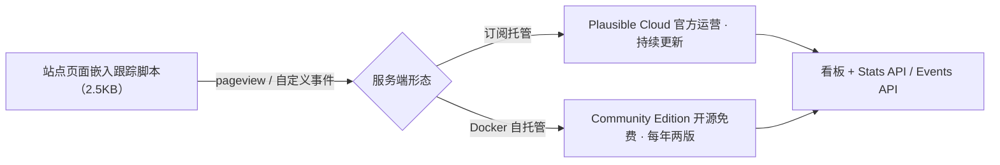

import { Meta } from '@storybook/addon-docs/blocks';

<Meta id="introduction" title="上手/认识 Plausible" name="Docs" />

# 认识 Plausible

Plausible 是一个开源、隐私优先、轻量的网站统计工具，官方定位是 "Simple, privacy-friendly Google Analytics alternative"：它回答和 Google Analytics 相同的问题——多少访客、从哪里来、看了哪些页面、有没有达成目标——但默认不碰个人数据，跟踪脚本体积只有 GA 的 1/54，项目代码以 AGPLv3 公开、可审计。

本课建立三个判断支点：它的隐私模型到底"隐私"在哪、为什么不需要 cookie 同意横幅；同一套代码的两种交付形态——官方托管的 Cloud 与自托管的 Community Edition（CE）——在功能和更新节奏上差多少；以及全手册从接入到内核的能力地图，每个阶段从哪门课进入。读完后你应能判断 Plausible 适不适合自己的站点，并在 Cloud 与 CE 之间做出初步选择。



| 关键事实 | 官方说法 |
| --- | --- |
| 定位 | "Simple, privacy-friendly Google Analytics alternative" |
| 许可证 | AGPLv3，代码公开可审计 |
| 跟踪脚本体积 | 2.5KB；GA 脚本 135KB gzipped，官方称小 54 倍 |
| cookie | 不使用 cookie、浏览器缓存或 localStorage |
| 个人数据 | 不收集；原始 IP 与 User-Agent 从不落盘 |
| 法规姿态 | GDPR / CCPA / PECR 合规，不需要 cookie 同意横幅 |
| 交付形态 | 官方托管 Cloud / 自托管 Community Edition |

## 隐私模型

隐私在 Plausible 里不是配置开关，而是默认架构。官方数据政策给出四条核心主张：

- 不使用 cookie，也不用浏览器缓存或 localStorage 做访客标识
- 不收集个人数据，不跟踪单个访客
- 不跨设备、跨站、跨应用跟踪（"We do not track people across devices, websites or apps."）
- 站点数据不用于广告、画像或变现（"Your data is not used for advertising, profiling or monetization."）

**怎么做到"统计但不跟踪"**：独立访客的判定依赖一个每日匿名标识符——

```
hash(daily_salt + website_domain + ip_address + user_agent)
```

原始 IP 地址和 User-Agent 从不存储；daily_salt 每 24 小时轮换并删除。盐一换，昨天的标识符就无法与今天关联，所以 Plausible 能算出"今天有多少独立访客"，却无法跨天识别同一个人。GA 里常见的用户级回访分析在 Plausible 中天然不存在——这是隐私模型的直接代价，选型前要有预期。

**合规姿态**：官方表述为 "compliant with cookie laws and privacy regulations including GDPR, CCPA and PECR"。因为不用 cookie、不收集个人数据，站点不需要为统计向访客征求同意，也不需要挂 cookie 同意横幅；GA 方案里"横幅 + 用户拒绝后的数据缺口"这一对问题随之消失。

**数据驻留**：Cloud 版所有访客数据在欧洲公司自有的基础设施上处理和存储，不离开欧盟；CE 自托管时，数据完全落在你自己的服务器上。

## Cloud 与 Community Edition

Plausible 是同一套代码的两种交付形态。Cloud 由官方运营、订阅付费，订阅收入同时资助 CE 开发；CE 以 AGPLv3 完整开源，用官方仓库提供的 Docker Compose 样例自托管（完整部署步骤见 [本地实例](?path=/docs/local-instance--docs)）。

| 维度 | Plausible Cloud | Community Edition |
| --- | --- | --- |
| 交付 | 官方托管，订阅付费 | Docker 自托管，免费 |
| 更新节奏 | 持续开发，每周多次更新 | 每年发布两次，新功能不会立即可用 |
| funnels 漏斗 | 有 | 无 |
| ecommerce 收入目标 | 有 | 无 |
| SSO | 有 | 无 |
| Sites API | 有 | 无 |
| 机器人过滤 | 高级过滤 | 仅基础过滤（针对最常见的非人类流量） |
| 数据驻留 | 欧盟自有基础设施 | 你自己的服务器 |

官方 README 的原文表述：CE 中 "Premium features (marketing funnels, ecommerce revenue goals, SSO and sites API) are not available"，机器人能力只有 "basic bot filtering that targets the most common non-human traffic"；CE "published twice per year"，而 Cloud "continuously developed and improved with new features and updates multiple times per week"。

**怎么选**：

- 需要 funnels、收入目标、SSO、Sites API，或不想维护服务器 → Cloud。
- 需要数据完全自控、内网部署或源码级改造 → CE。
- 选 CE 的机器要能运行 ClickHouse：CPU 需支持 SSE 4.2 或 NEON 指令集，建议至少 2GB 内存；环境细节见 [本地实例](?path=/docs/local-instance--docs)。
- 拿不准时回到上面的对照表：CE 缺的那几项是不是你的硬需求。

## 能力地图

全手册按「接入 → 采集 → 看板 → API → 自托管 → 内部架构」六个阶段展开。除概念课外，各课程的范例事件真实上报到本地 Docker 运行的 CE 实例，以看板读数和 API 响应作为可核对证据；云端专属功能会在对应课程标注，并以官方文档为对照依据。

| 阶段 | 解决什么问题 | 课程入口 |
| --- | --- | --- |
| 1 上手 | 跑起本地实例、接入脚本、看懂看板 | 认识 Plausible（本课）· [本地实例](?path=/docs/local-instance--docs) · [接入脚本](?path=/docs/script-setup--docs) · [看板导览](?path=/docs/dashboard-tour--docs) |
| 2 数据采集 | 事件、属性、目标、收入、漏斗；SPA、代理、服务端上报 | [自定义事件](?path=/docs/custom-events--docs) · [自定义属性](?path=/docs/custom-properties--docs) · [目标与转化](?path=/docs/goals-conversions--docs) · [收入归因](?path=/docs/revenue-attribution--docs) · [漏斗](?path=/docs/funnels--docs)（云端）· [自动追踪](?path=/docs/automatic-tracking--docs) · [SPA 路由](?path=/docs/spa-tracking--docs) · [绕过广告拦截](?path=/docs/proxy--docs) · [Events API](?path=/docs/events-api--docs) |
| 3 看板与协作 | 筛选细分、分享嵌入、周期报表、团队管理 | [筛选与细分](?path=/docs/filtering-segments--docs) · [分享与嵌入](?path=/docs/sharing-embedding--docs) · [邮件与 Slack 报表](?path=/docs/email-slack-reports--docs) · [团队与站点管理](?path=/docs/team-sites--docs) |
| 4 API 与集成 | 用 API 取数、迁移数据、接入框架与平台 | [Stats API](?path=/docs/stats-api--docs) · [数据导出](?path=/docs/data-export--docs) · [Sites API](?path=/docs/sites-api--docs)（云端）· [Search Console](?path=/docs/search-console--docs) · [导入 GA 数据](?path=/docs/ga-import--docs) · [框架与平台集成](?path=/docs/integrations--docs) |
| 5 自托管运维 | CE 的配置、反代、升级与地理数据 | [配置](?path=/docs/ce-configuration--docs) · [反向代理与 HTTPS](?path=/docs/ce-reverse-proxy--docs) · [升级](?path=/docs/ce-upgrade--docs) · [地理位置](?path=/docs/ce-geolocation--docs) |
| 6 内部架构 | Phoenix + ClickHouse 的设计与二次开发 | [总体架构](?path=/docs/architecture--docs) · [数据模型](?path=/docs/data-model--docs) · [事件管线](?path=/docs/ingestion-pipeline--docs) · [看板前端](?path=/docs/dashboard-frontend--docs) · [二次开发](?path=/docs/development--docs) |

## 常见问题

- 在 CE 看板里找不到漏斗、收入目标或 Sites API 入口
  属于正常情况：这些是云端专属功能，CE 没有对应实现。先对照上文「Cloud 与 Community Edition」表格确认功能归属；确实需要时改用 Cloud，或按对应课程以官方文档对照理解（[漏斗](?path=/docs/funnels--docs)、[Sites API](?path=/docs/sites-api--docs)）。
- 站点已有 GA 历史数据，换 Plausible 后想保留
  Plausible 官方提供从 Google Analytics 导入历史数据的工具，导入后与现有报表连续展示；具体操作见 [导入 GA 数据](?path=/docs/ga-import--docs)。

## 总结回顾

摘要：

Plausible 是开源（AGPLv3）、隐私优先、轻量的网站统计工具，官方定位为 Google Analytics 替代品。它的隐私模型靠架构默认实现：不使用 cookie、不收集个人数据、不跨站跟踪、数据不用于广告，独立访客由「daily_salt + 域名 + IP + User-Agent」的每日哈希标识判定，原始 IP 与 UA 从不落盘，因此合规 GDPR/CCPA/PECR、不需要 cookie 同意横幅；跟踪脚本仅 2.5KB，是 GA 脚本（135KB gzipped）的 1/54。同一套代码分两种形态：订阅托管、持续更新的 Cloud 独占 funnels、ecommerce 收入目标、SSO、Sites API 与高级机器人过滤；自托管的 CE 免费开源、每年发布两次。全手册按接入、采集、看板、API、自托管、内部架构六个阶段展开，执行型课程的范例统一跑在本地 CE 实例上。

一句话：

> Plausible 把「不跟踪个人」做成架构默认而非配置项，统计、合规与轻量因此兼得；采用前唯一要先选的是托管形态——省心的 Cloud，还是数据完全自控的 CE。

知识要点：

- Plausible 相对 GA 的三个核心差异（开源可审计、无 cookie 的隐私模型、脚本体积）分别是什么？
- 不用 cookie，Plausible 如何计算独立访客？原始 IP 和 User-Agent 会怎样处理？
- 为什么用 Plausible 不需要 cookie 同意横幅？它声明合规哪些法规？
- Cloud 与 CE 在功能、更新节奏、数据驻留上各有什么差异？哪四项功能云端专属？
- 本手册六个阶段各自解决什么问题？执行型课程的范例运行在什么环境上？

## 参考资料

- [Plausible 官网：产品定位与脚本体积对比](https://plausible.io)
- [Plausible 官方文档](https://plausible.io/docs)
- [Data Policy：收集与不收集的数据、每日哈希标识符](https://plausible.io/data-policy)
- [Lightweight web analytics：2.5KB 与 GA 135KB 的官方对比](https://plausible.io/lightweight-web-analytics)
- [Privacy-focused web analytics：GDPR/CCPA/PECR 合规表述](https://plausible.io/privacy-focused-web-analytics)
- [plausible/analytics：Cloud 与 CE 差异、发布节奏、AGPLv3 许可](https://github.com/plausible/analytics)
- [plausible/community-edition：Docker Compose 部署样例与硬件要求](https://github.com/plausible/community-edition)
