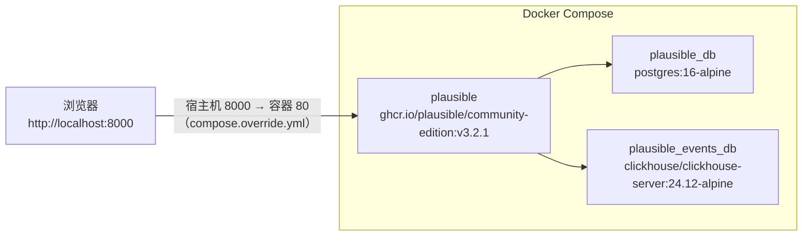

import { Meta } from '@storybook/addon-docs/blocks';

<Meta id="local-instance" title="上手/本地实例" name="Docs" />

# 本地实例

用 Docker Compose 在本机跑起 Plausible Community Edition（CE），作为全套手册的范例后端：之后课程里的事件上报、看板观察、API 查询都以这台实例为真值来源。本课产物有两个：一个跑在 http://localhost:8000 的 CE 实例，以及实例里的第一个站点 `test.local`。

整套环境只有三个容器：`plausible` 应用本体（提供看板与事件接收）、`plausible_db`（PostgreSQL，存账号与站点等元数据）、`plausible_events_db`（ClickHouse，存统计数据）。官方 compose.yml 不对外发布任何端口，本课用一个 compose.override.yml 把宿主机的 8000 映射到容器的 80，浏览器访问 http://localhost:8000 即进入实例。



关键输入与默认值：

| 项目 | 取值 / 默认 | 说明 |
| --- | --- | --- |
| 部署仓库 | `plausible/community-edition`，标签 `v3.2.1` | 官方 Docker Compose 部署样例，克隆时按标签锁定版本 |
| `BASE_URL` | `http://localhost:8000`（必填，无默认） | 实例对外地址，用于生成链接与 WebSocket 来源检查（CSWSH） |
| `SECRET_KEY_BASE` | `openssl rand -base64 48` 生成（必填，无默认） | 会话与派生密钥的根，至少 64 字节 |
| `HTTP_PORT` | 官方默认 `8000`；本课设为 `80` | 容器内 HTTP 监听端口，配合 override 的 `8000:80` 映射 |
| 访问入口 | `http://localhost:8000` | 宿主机端口由 compose.override.yml 决定，须与 `BASE_URL` 一致 |
| 资源要求 | ≥ 2 GB 内存；CPU 支持 SSE 4.2 / NEON | 内存与指令集要求来自 ClickHouse |
| 数据卷 | `db-data`、`event-data`、`event-logs`、`plausible-data` | 命名卷持久化数据，`docker compose down` 不会删除 |

## 快速上手

最小闭环：克隆 → 配置 → 启动 → 看到登录页。动手前确认已安装 Docker 与 Docker Compose，且 Docker 可用内存不低于 2 GB（指令集等细项见下文「前置条件」）。

1. 克隆官方部署仓库，按发布标签锁定版本：

```console
$ git clone -b v3.2.1 --single-branch https://github.com/plausible/community-edition plausible-ce
Cloning into 'plausible-ce'...

$ cd plausible-ce
$ ls -1
clickhouse/
compose.yml
LICENSE
README.md
```

2. 创建 `.env` 并写入两项必填变量。`SECRET_KEY_BASE` 用官方推荐命令生成：48 字节随机数据经 base64 编码正好得到 64 字符：

```console
$ touch .env
$ echo "BASE_URL=http://localhost:8000" >> .env
$ echo "SECRET_KEY_BASE=$(openssl rand -base64 48)" >> .env

$ cat .env
BASE_URL=http://localhost:8000
SECRET_KEY_BASE=...64 字符随机串...
```

3. 本机评估只需 HTTP：把容器内监听端口设为 80，再用 override 文件把宿主机 8000 映射过去：

```console
$ echo "HTTP_PORT=80" >> .env
$ cat > compose.override.yml << EOF
services:
    plausible:
        ports:
            - 8000:80
EOF
```

4. 启动服务：

```console
$ docker compose up -d
```

首次启动会拉取三个镜像；plausible 容器的启动命令自带 `db createdb && db migrate`，等两个数据库通过健康检查后才会跑迁移并监听端口。

5. 打开 http://localhost:8000，看到注册表单即闭环成功。

## 前置条件

官方 README 列出的硬性要求只有三条，逐条可验证：

- **Docker 与 Docker Compose**：`docker version` 与 `docker compose version` 均能输出版本号即可。命令是 v2 插件形式的 `docker compose`，不是旧版带连字符的 `docker-compose`。
- **内存至少 2 GB**：官方建议值，低于它 ClickHouse 与 Plausible 有 OOM 风险。Docker Desktop 用户在设置里确认分配给虚拟机的内存。
- **CPU 支持 SSE 4.2（x86）或 NEON（ARM）**：ClickHouse 的硬性要求。2008 年以后的 Intel、2011 年以后的 AMD 处理器和全部 Apple Silicon Mac 都满足；更老的 CPU 或裁剪了指令集的虚拟机不满足时，`plausible_events_db` 会在启动时直接崩溃（见常见问题）。

## 配置项

本课只动三个变量，其余环境变量（SMTP、注册限制、地理位置等）的全景见 [配置](?path=/docs/ce-configuration--docs)。

| 变量 | 必填 | 本课取值 | 说明 |
| --- | --- | --- | --- |
| `BASE_URL` | 是 | `http://localhost:8000` | 对外地址，用于生成链接和 CSWSH 检查；浏览器访问地址必须与它一致（用了 `localhost` 就不要换 `127.0.0.1`） |
| `SECRET_KEY_BASE` | 是 | `openssl rand -base64 48` 的输出 | 会话与派生密钥（如 TOTP Vault Key）的根，至少 64 字节 |
| `HTTP_PORT` | 否 | `80`（不设则为 `8000`） | 容器内 HTTP 监听端口 |

端口发布机制单独值得理解：官方 compose.yml **不发布任何端口**，三个容器之间走内部网络，对外入口完全交给 `compose.override.yml`。compose 启动时自动合并两个文件且 override 优先，该文件不被 git 跟踪——本地改动放在这里，之后拉取仓库更新不会冲突。映射写法是 `宿主机端口:容器端口`，本课即 `8000:80`；宿主侧端口必须与 `BASE_URL` 的端口一致。

## 验证与首个站点

启动后按「容器状态 → 页面 → 站点」三层验证：

| 操作 | 可观察证据 |
| --- | --- |
| `docker compose ps` | `plausible_db`、`plausible_events_db` 状态为 `Up (healthy)`；`plausible` 为 `Up`，PORTS 列出现 `0.0.0.0:8000->80/tcp` |
| 打开 http://localhost:8000 | 全新实例直接呈现注册表单（姓名、邮箱、密码） |
| 注册第一个用户 | 无需邮箱验证（`ENABLE_EMAIL_VERIFICATION` 默认 `false`），注册即登录 |
| 添加站点 | 域名填 `test.local`、选报表时区，创建后看板给出跟踪代码片段 |

两个数据库容器各有 1 分钟的健康检查宽限期（`start_period: 1m`），首次启动时 plausible 要等它们都健康后才跑迁移，稍等片刻属正常现象；观察过程用 `docker compose logs -f plausible`。

站点域名约定为 `test.local`：它是后续课程示例页面上报时携带的 `data-domain`，不要求真实 DNS 存在，Plausible 只按上报内容归组数据。站点创建完成时看板展示的跟踪代码片段形如：

```html
<script defer data-domain="test.local" src="http://localhost:8000/js/script.js"></script>
```

该片段如何接入页面并观察到第一个 pageview，见 [接入脚本](?path=/docs/script-setup--docs)。

边界：默认 `DISABLE_REGISTRATION=invite_only`，第一个用户创建后，其他账号只能经邀请注册——本机自用无需改动。

## 日常操作

| 目的 | 命令 | 说明 |
| --- | --- | --- |
| 看状态 | `docker compose ps` | 健康状态与端口映射 |
| 跟日志 | `docker compose logs -f` 或 `docker compose logs -f plausible` | 定位启动失败先看这里 |
| 停止 | `docker compose stop` | 保留容器与数据，之后 `docker compose start` 快速恢复 |
| 拆除 | `docker compose down` | 删除容器与网络；数据在命名卷中保留，加 `-v` 才连卷一起删（数据全失） |
| 改配置 | 编辑 `.env` 或 `compose.override.yml` 后重新 `docker compose up -d` | compose 在 up 时重新插值并重建受影响的容器 |

升级（拉取新标签、重建容器、PostgreSQL 大版本迁移）有独立流程，见 [升级](?path=/docs/ce-upgrade--docs)。

## 常见问题

- `docker compose up -d` 报端口绑定失败（`bind: address already in use` 或 `ports are not available`）。
  宿主机 8000 被占用。用 `lsof -i :8000` 找到占用进程；或把 compose.override.yml 的宿主侧改成别的端口（如 `8080:80`），同时把 `.env` 里 `BASE_URL` 改为 `http://localhost:8080`，再重新 `docker compose up -d`。
- plausible 容器启动失败，日志提示 `secret_key_base` 长度不足。
  `SECRET_KEY_BASE` 至少 64 字节，手写的短密码不满足。用 `openssl rand -base64 48` 重新生成（48 字节随机数据 base64 编码后正好 64 字符），写回 `.env` 后 `docker compose up -d` 重建容器。
- plausible 一直不启动，`docker compose ps` 显示 `plausible_events_db` 反复重启或 `unhealthy`。
  plausible 依赖两个数据库通过健康检查（`depends_on: service_healthy`）才会启动。先看 `docker compose logs plausible_events_db`：若是内存不足被 OOM 杀掉，去 Docker Desktop 把内存分配调到 2 GB 以上；若是指令集崩溃，见下一条。
- ClickHouse 日志出现非法指令类崩溃（如 `Illegal instruction`），容器起不来。
  CPU 不满足 SSE 4.2（x86）或 NEON（ARM）的硬性要求，常见于老旧 CPU 或裁剪指令集的虚拟机，只能换满足要求的机器。Apple Silicon Mac 上 Docker 会自动拉取 arm64 镜像变体、原生满足 NEON；不要在 override 里加 `platform: linux/amd64` 强制模拟运行。

## 总结回顾

摘要：

本地实例由官方 plausible/community-edition 仓库的 compose.yml 编排出三个容器：plausible 应用、PostgreSQL（元数据）、ClickHouse（统计数据），宿主机经 compose.override.yml 的 `8000:80` 映射访问。配置只需 `.env` 里两项必填变量——`BASE_URL=http://localhost:8000` 和用 `openssl rand -base64 48` 生成的 `SECRET_KEY_BASE`。`docker compose up -d` 之后，用 `docker compose ps` 确认两个数据库健康、plausible 发布了端口，再在 http://localhost:8000 注册第一个用户并添加站点 `test.local`，全套手册的范例后端就此就绪；日常运维围绕 `logs -f`、`stop`、`down` 展开，升级另有独立流程。

一句话：

> 克隆仓库、写好 `.env` 两项必填变量、用 compose.override.yml 发布宿主端口，`docker compose up -d` 后能在 http://localhost:8000 注册第一个用户并添加 `test.local` 站点，本地实例就算跑通了。

知识要点：

- 三个容器各自负责什么，数据落在哪些命名卷里？
- `.env` 里哪两个变量必填，`SECRET_KEY_BASE` 为什么用 `openssl rand -base64 48` 生成？
- 官方 compose.yml 为什么启动后不能直接访问，compose.override.yml 起什么作用？
- 启动后如何用 `docker compose ps` 和日志判断实例真的就绪？
- `docker compose stop`、`down`、`down -v` 对数据的影响分别是什么？
- `plausible_events_db` 反复重启时，往哪两个方向排查？

## 参考资料

- [plausible/community-edition（README 与 quickstart）](https://github.com/plausible/community-edition)
- [compose.yml（v3.2.1）](https://github.com/plausible/community-edition/blob/v3.2.1/compose.yml)
- [Wiki: Configuration（环境变量）](https://github.com/plausible/community-edition/wiki/configuration)
- [Wiki: Compose Override](https://github.com/plausible/community-edition/wiki/compose-override)
