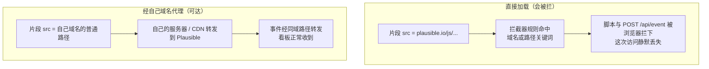

import { Meta } from '@storybook/addon-docs/blocks';

<Meta id="proxy" title="数据采集/采集方式/绕过广告拦截" name="Docs" />

# 绕过广告拦截

Plausible 注重隐私，但广告拦截器的规则列表不看隐私实践：`plausible.io` 域名和常见统计路径写在主流拦截列表里，浏览器在发出脚本请求和事件请求时直接拦下，服务端完全收不到——这部分访问从统计中静默消失。官方给出的典型丢失比例是 **5%–25%**，具体取决于受众。

解决思路不是换统计工具，而是改变请求的网络位置：把**脚本文件**和 **`/api/event` 事件端点**都代理到自己域名下。浏览器发出的就是 first-party 请求，与站点自身资源无法区分，按域名和路径写的拦截规则不再命中。本课讲清拦截成因、代理方案的必要组成、各平台官方配置入口和验证方法。代理配置发生在站点服务端与部署层，本课没有页内实例，「验证方法」一节给出可照做的核对步骤。



| 关键事实 | 取值 |
| --- | --- |
| 丢失量级 | 官方口径：通常 5%–25%，随受众拦截器使用率变化 |
| 必须代理的对象 | 脚本文件 + `/api/event` 事件端点，缺一不可 |
| 端点覆盖方式 | 经典片段用标签上的 `data-api`；新版片段用 `plausible.init({ endpoint })` |
| 路径命名 | 避开 `analytics`、`stats`、`plausible` 等关键词，它们在拦截规则里 |
| IP 转发 | 代理必须经 `X-Forwarded-For` 传出真实访客 IP，否则事件被 bot filter 静默丢弃（照样返回 202） |
| 可选方案 | 不代理（默认）/ WordPress 插件一键开关 / 按官方指南自建 / Managed proxy（Enterprise） |

## 拦截成因

广告拦截器按规则列表（blocklist）工作：维护者把已知的统计、广告域名和 URL 模式写进列表，浏览器在请求发出前比对，命中就拦下。两类规则与 Plausible 相关：

- **域名规则**：`plausible.io` 在部分列表中。官方说明 Plausible 被拦程度远低于 Google Analytics，Firefox 与 Safari 默认不拦，但有些列表维护者不看隐私实践、无差别拦截所有统计工具。
- **路径与文件名规则**：URL 中含 `analytics`、`stats`、`plausible` 等关键词的请求可能被通用规则命中，与域名无关。官方各平台指南都明确要求代理路径避开这些词。

被拦的特征是**静默**：页面无报错，看板无异常，只是数据里少了一批人。丢失比例取决于受众的拦截器使用率——技术类受众比例高的站点更接近官方口径的上限 25%。这决定了代理方案的目标：不是让 Plausible「解锁」，而是让它的请求从网络上看起来和站点自身资源完全一样。

## 代理原理

代理方案由两个必要部分组成，只做一个等于没做：

1. **脚本文件走自己域名**：在自己域名的某个路径（如 `/js/script.js`）下放一条转发规则，上游指向 Plausible 的脚本地址。
2. **`/api/event` 走自己域名**：同样在自己域名下放一条事件转发规则，并让脚本把事件发到这个同域路径。

只代理脚本、不代理事件时，脚本虽能加载，事件仍发往 `plausible.io/api/event`，照样被拦。

三个直接影响成败的细节：

- **没有专用的 proxy 脚本变体**。代理与脚本变体家族（`manual`、`hash`、`local` 等）是正交的两件事：任何变体都可以放在代理路径后面，变体组合规则见 [接入脚本](?path=/docs/script-setup--docs)。要改的是片段里的脚本地址和上报端点，不是换一个特殊文件名。
- **上报端点要显式指向代理路径**。经典片段（`script.js` + `data-domain`）的默认端点是「脚本源 + `/api/event`」，用标签上的 `data-api` 属性覆盖；新版片段（站点设置给出的 `pa-XXXXX.js` + `plausible.init()`）的端点写死在实例下发的配置里，必须用 `plausible.init({ endpoint })` 覆盖。两种写法的对应关系见「各平台配置入口」的示例。
- **`X-Forwarded-For` 必须带真实访客 IP**。官方原文：如果该 header 缺失或装着代理服务器自己的 IP，Plausible 的 bot filter 会静默丢弃事件，而 API 照样返回 HTTP 202。Cloudflare Workers、Vercel rewrites 这类 CDN 级方案会自动带对；自写转发（Nginx、Apache、应用内 controller）必须显式设置。

## 各平台配置入口

不管哪个平台，配置都是同一副骨架：① 拿到脚本地址（云端站点设置里的 `pa-XXXXX.js`；CE 是实例上的 `/js/script.js` 变体）→ ② 在自己域名下放脚本与事件两条转发规则 → ③ 把页面片段的 `src` 和端点改到这两个同域路径。

| 平台 | 机制 | 配置落点 | 平台特有注意点 |
| --- | --- | --- | --- |
| WordPress | 官方插件内置代理，无需服务器配置 | 插件设置的「Bypass adblockers」→ 打开「Enable proxy」 | 经 `wp-json` 随机端点与随机命名文件实现；开了缓存插件要先清缓存 |
| Cloudflare | 官方 Worker 模板转发脚本与事件 | Workers & Pages 部署模板，改三个常量 | 可加 route 把 Worker 挂到站点同域子路径；目录名自取且避开关键词 |
| Vercel | `rewrites` 重写 | 项目根目录 `vercel.json` | 源路径必须与片段里的 `src`/`endpoint` 逐字符一致 |
| Netlify | `_redirects` 200 重写 | 发布目录的 `_redirects` 文件 | 必须关闭 asset optimization 的 Bundle JS 与 Minify JS，否则 `src` 被改写 |
| Nginx | 反向代理 `location` + 脚本缓存 | server 配置 | 脚本响应配 `proxy_cache`（官方示例缓存 5 分钟），避免每请求回源 |
| Apache | `mod_proxy` 按 `Location` 转发 | VirtualHost | 先 `a2enmod proxy proxy_http ssl` 启用三个模块 |
| Caddy | `reverse_proxy` + `rewrite` | Caddyfile | 配置最短，`reverse_proxy` 默认自动带 `X-Forwarded-For` |
| Laravel | 应用内 controller 缓存脚本、转发事件 | routes + controller | 事件路由必须加 CSRF 豁免，否则 POST 被 Laravel 拦下 |
| 任意平台（Enterprise） | Managed proxy：Plausible 托管 | 加一条 CNAME 记录，改片段 | 零维护，需 Enterprise 计划 |

各平台完整配置见官方 proxy 指南（链接在「参考资料」）。下面以 Nginx 为例给出对照官方指南整理的关键片段，其他平台照同一骨架替换机制即可。

Nginx 转发配置（云端上游；注释标明每段的作用）：

```nginx
# server 块之外：脚本响应缓存，避免每个请求都回源取脚本
proxy_cache_path /var/run/nginx-cache/jscache levels=1:2 keys_zone=jscache:100m inactive=30d use_temp_path=off max_size=100m;

server {
    # ... 站点原有配置 ...
    resolver 9.9.9.9;  # proxy_pass 使用变量时必须配 DNS resolver；已有则省略
    set $plausible_script_url https://plausible.io/js/pa-XXXXX.js;  # 站点设置里复制的专属脚本地址
    set $plausible_event_url https://plausible.io/api/event;

    # 脚本：自己域名 /js/script.js → 云端专属脚本；响应缓存 5 分钟
    location = /js/script.js {
        proxy_pass $plausible_script_url;
        proxy_set_header Host plausible.io;
        proxy_cache jscache;
        proxy_cache_valid 200 5m;
    }

    # 事件：自己域名 /api/event → Events API；访客 IP 必须透传
    location = /api/event {
        proxy_pass $plausible_event_url;
        proxy_set_header Host plausible.io;
        proxy_set_header X-Forwarded-For $proxy_add_x_forwarded_for;
        proxy_set_header X-Forwarded-Proto $scheme;
    }
}
```

页面片段相应改成同域路径。新版片段（云端站点设置给出的写法）：

```html
<script async src="/js/script.js"></script>
<script>
  window.plausible=window.plausible||function(){(plausible.q=plausible.q||[]).push(arguments)},plausible.init=plausible.init||function(i){plausible.o=i||{}};
  plausible.init({
    endpoint: "/api/event"
  })
</script>
```

经典片段（本手册多数课程使用的写法）的等价配置：

```html
<script defer data-domain="yourdomain.com" data-api="/api/event" src="/js/script.js"></script>
```

`data-api` 指向代理后的事件路径；省略时经典片段默认发往「脚本源 + `/api/event`」，脚本经同域代理加载时默认刚好指向同域 `/api/event`，事件路径不叫这个名字时才必须显式写。

## 自托管 CE

自托管 CE 时脚本本来就从自己域名加载（本手册环境是 `http://localhost:8000/js/script.js`），指向 `plausible.io` 的域名规则天然不命中，丢失率通常已低于云端直引。但仍有两类规则可能命中：

- **主机名关键词**：自托管常见命名习惯反而踩雷——`analytics.example.com`、`plausible.example.com` 这类子域名本身就在规则列表的模式里。
- **路径规则**：URL 含 `analytics`、`stats`、`plausible` 的通用规则与域名无关，脚本路径或上报路径带这些词同样被拦。

对策与云端是同一套：在站点主域名下放两个普通路径，转发到 CE 实例（上游换成 CE 基址，如 `http://localhost:8000`，脚本路径用任意变体），片段里 `src` 与 `data-api` / `endpoint` 指向同域路径。与云端唯一的差别是上游地址和脚本地址的取法，转发与 IP 透传要求完全相同。CE 实例本身的 TLS 终结与访客信息转发属于部署运维主题，见 [反向代理与 HTTPS](?path=/docs/ce-reverse-proxy--docs)；`/api/event` 的字段与响应细节见 [Events API](?path=/docs/events-api--docs)。

## 验证方法

代理配置无法从配置文本看出对错，按下面的对照步骤验证：

1. **无拦截基线**：开无痕窗口（不装拦截扩展），打开站点页面。Network 面板应看到：脚本请求走自己域名路径、状态 200；随后 `POST` 事件请求走自己域名路径、状态 202；看板 realtime 同步 +1。这一步不过，问题在转发配置本身，与拦截器无关。
2. **开拦截器对比**：装上主流拦截器并启用默认规则列表，刷新同一页面。代理前能看到 `plausible.io` 的请求被标为已拦截（Chrome 显示 `ERR_BLOCKED_BY_CLIENT`）；代理后两个请求都是自己域名的普通路径，状态仍是 200 / 202。
3. **看板核对事件到达**：Network 只能说明请求发出，最终在本地看板（`http://localhost:8000/test.local`）或云端看板的 realtime 里确认这次访问被记录。
4. **202 不等于入库**：事件返回 202 但看板无数据时，查响应头 `x-plausible-dropped: 1`（出现即被服务端丢弃），并回头核对 `X-Forwarded-For` 是否带的是真实访客 IP；`/api/event` 的字段与响应细节见 [Events API](?path=/docs/events-api--docs)。

## 常见问题

- 代理配好后看板仍无数据，事件请求却返回 202。
  202 只代表请求到达 Plausible，不代表事件被接收。先查 `X-Forwarded-For`：header 缺失或装着代理服务器自己的 IP 时，bot filter 会静默丢弃事件，返回码照样是 202——CDN 级方案（Cloudflare Workers、Vercel rewrites）会自动带对，自写转发必须显式设置。再核对两条转发规则的目标地址：脚本请求 404 说明脚本转发配错，事件请求 4xx/5xx 说明事件转发配错。最后检查片段本身：`src` 是否指向同域路径、端点是否已用 `data-api` / `endpoint` 覆盖、`data-domain` 与站点域名是否逐字符一致（完整排查顺序见 [接入脚本](?path=/docs/script-setup--docs)）。
- 改了上游配置或怀疑脚本版本陈旧，页面加载的还是旧脚本。
  代理层缓存所致：官方 Nginx 示例把脚本缓存 5 分钟，Laravel 示例缓存 24 小时，CDN 方案也有各自的 TTL。先清代理层缓存（或等缓存过期）再排查，不要直接改片段。
- 路径已换到自己域名，开启拦截器后仍被拦。
  检查路径和主机名里的关键词：`analytics`、`stats`、`plausible` 都在常见规则列表里，官方指南明确建议避开。把代理路径换成无含义的词（如 `/qwerty/`）再按「验证方法」重测。
- Netlify 上代理后脚本加载异常或内容不对。
  Netlify 的 asset optimization 会改写 `src` 并压缩脚本，官方要求把 Bundle JS 与 Minify JS 两项都关掉；或者在 `src` 里改用绝对 URL 绕过处理。

## 总结回顾

摘要：

广告拦截器按域名与路径关键词规则拦下 `plausible.io` 的脚本与事件请求，官方口径的典型丢失比例是 5%–25%，且浏览器端完全静默。代理方案把脚本文件和 `/api/event` 事件端点都挪到自己域名下成为 first-party 请求，两者缺一不可；不存在专用 proxy 脚本变体，经典片段用 `data-api`、新版片段用 `plausible.init({ endpoint })` 把上报端点指到同域路径，路径命名避开 `analytics`、`stats`、`plausible`。方案上 WordPress 插件有一键开关，Cloudflare、Vercel、Netlify、Nginx、Apache、Caddy、Laravel 有官方自建指南，Enterprise 可用 CNAME 托管代理。自建转发的硬性要求是 `X-Forwarded-For` 透传真实访客 IP，否则事件被 bot filter 静默丢弃且照样返回 202。自托管 CE 的脚本本就在自己域名，但主机名与路径里的关键词仍可能命中规则，同一套代理思路适用。验证靠开关拦截器对比 Network 中的请求路径与状态码，最终在看板 realtime 核对事件到达。

一句话：

> 代理的本质是把脚本和 `/api/event` 都变成自己域名下的 first-party 请求——只挪脚本不挪事件端点，拦截照样发生。

知识要点：

- Plausible 注重隐私，为什么仍会被广告拦截器拦下？官方给出的典型丢失比例是多少？
- 代理方案必须转发哪两个对象？只转发脚本会出现什么结果？
- 经典片段与新版片段分别用什么把上报端点指到代理路径？经典片段不显式覆盖时默认发往哪里？
- 为什么 `X-Forwarded-For` 配错会导致「返回 202 但看板无数据」？
- 代理路径命名要避开哪些关键词？官方为哪些平台提供了配置指南，各自落在什么配置文件？
- 自托管 CE 的脚本本就在自己域名，为什么仍可能被拦？对策与云端有何异同？
- 如何用「无拦截基线 → 开拦截器对比 → 看板核对」三步验证代理生效？

## 参考资料

- [Bypass adblockers with a proxy（官方文档：丢失比例、四种方案、X-Forwarded-For 要求）](https://plausible.io/docs/proxy/introduction)
- 官方平台配置指南（本课对照表与各平台配置的出处）：[Nginx](https://plausible.io/docs/proxy/guides/nginx)、[Caddy](https://plausible.io/docs/proxy/guides/caddy)、[Apache](https://plausible.io/docs/proxy/guides/apache)、[Netlify](https://plausible.io/docs/proxy/guides/netlify)、[Vercel](https://plausible.io/docs/proxy/guides/vercel)、[Cloudflare](https://plausible.io/docs/proxy/guides/cloudflare)、[Laravel](https://plausible.io/docs/proxy/guides/laravel)
- [WordPress 插件文档：Enable proxy 开关位置与实现方式](https://plausible.io/docs/wordpress-integration)
- [plausible/analytics：tracker/src/config.js（经典片段 `data-api` 与默认端点规则的事实来源）](https://github.com/plausible/analytics/blob/master/tracker/src/config.js)
