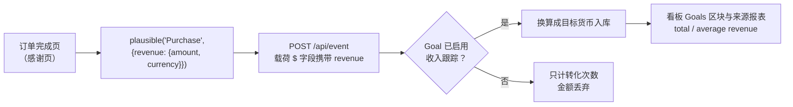

import { Meta } from '@storybook/addon-docs/blocks';

<Meta id="revenue-attribution" title="数据采集/事件与目标/收入归因" name="Docs" />

# 收入归因

[目标与转化](?path=/docs/goals-conversions--docs)回答「有没有转化、转化率多少」，收入归因再往前一步：给每次转化标上金额，回答「**哪里的流量最值钱**」。机制是一条三段链路——事件上报时带上 `revenue` 金额与币种，把该事件注册为启用了收入跟踪的目标（Goal）并选定报告货币，看板随即在 Goals 区块和各来源报表中给出 total revenue / average revenue，于是同一笔收入可以按来源、活动、落地页拆开看。

**云端专属**：收入目标是云端付费功能（官方文档标注为 Business plan 功能），Community Edition 不可用。官方仓库 README 的 Cloud/CE 功能对照写明 CE「Premium features (marketing funnels, ecommerce revenue goals, SSO and sites API) are not available」；源码侧，服务端 `goals` 表的 `currency` 字段只在 EE 构建中存在（`lib/plausible/goal.ex`），CE 构建里它是恒为 nil 的虚拟字段。因此本地 CE 实例的 Goal 表单没有「Enable Revenue Tracking」开关，本课证据改用官方文档与仓库接口形状；事件上报链路本身的本地验证见 [自定义事件](?path=/docs/custom-events--docs)。



`revenue` 对象的两个字段（官方格式 `{currency: 'USD', amount: 49.00}`）：

| 字段 | 含义 | 规则 |
| --- | --- | --- |
| `amount` | 订单金额 | 必须是数字，不能是字符串；用主单位（`29.99` 表示 29.99 美元，不要传分单位的 `2999`） |
| `currency` | 币种 | ISO 4217 三位码（`USD`、`EUR`、`GBP`、`SEK` 等）；币种无效时事件照收入库，但不计收入 |

## 上报语法

JS 上报在 `window.plausible` 的第二个参数中加 `revenue` 对象（完整签名与 `callback` 等其余选项见 [自定义事件](?path=/docs/custom-events--docs)）：

```js
// 最小形式：订单完成时上报一笔 29.99 美元的购买
window.plausible('Purchase', { revenue: { amount: 29.99, currency: 'USD' } });
```

tagged events（HTML-only）方式用两个标注类给出金额与币种（需要 `tagged-events` 脚本变体，标注类语法见 [自定义事件](?path=/docs/custom-events--docs)）：

```html
<button class="plausible-event-name=Purchase plausible-revenue-amount=10.29 plausible-revenue-currency=EUR">购买</button>
```

也可以脱离浏览器，用 Events API 从服务端直接 POST 带收入的事件（见 [Events API](?path=/docs/events-api--docs)）。

接口形状（tracker 源码 `track.js`）：revenue 对象不做任何客户端校验，被原样塞进请求体的 `$` 字段：

```json
{
  "n": "Purchase",
  "u": "https://yourstore.com/thank-you",
  "d": "yourstore.com",
  "$": { "amount": 29.99, "currency": "USD" }
}
```

`$` 字段由编译开关 `COMPILE_REVENUE` 控制：云端默认脚本与新版 web/npm 构建已编入该能力（另有文件名带 `revenue` 的脚本变体），所以官方文档不要求为收入更换脚本。校验发生在服务端：币种无效时事件照常入库，收入部分被丢弃。

要点：

- **触发时机放在订单确认页（感谢页），不要绑在「去支付」按钮上**——点击不等于付款成功，会虚增收入（官方建议）。
- 事件名规则与自定义事件完全一致：逐字符匹配（含大小写），且必须已注册为 Goal 才上看板；`props`、`callback` 等选项可与 `revenue` 同用。
- 每次上报独立计数：同一访客重复触发会重复计收入；官方排错提示，页面上装了多份脚本会导致收入翻倍。

## 启用收入目标

云端操作路径：站点设置 → **Goals** → **Add goal** → 触发类型选 **Custom event** → 填事件名（与上报名逐字符一致）→ 打开 **Enable Revenue Tracking** → 选择默认货币 → 保存。

- **货币是目标的「报告货币」，保存后不可修改**。服务端有专门校验：改动已有目标的币种会报 `cannot change currency of existing goal`（`lib/plausible/goal.ex`）。选错币种只能删除目标重建。
- **多币种上报自动换算**：可以按买家当地币种上报（日元订单传 `JPY`、欧元订单传 `EUR`），Plausible 统一换算成目标货币后再计算总/平均收入。
- **CE 对照**：本地 CE 的 Goal 表单没有收入开关——README 把 ecommerce revenue goals 列为 CE 不可用的高级功能，`goals.currency` 字段也只在 EE 构建编译。本地能验证的是事件上报链路本身，收入入库与读数只有云端可见。

## 看板收入读数

启用收入的目标发生转化后，看板底部 **Goals** 区块在 unique/total conversions、conversion rate 之外多出两列：

| 读数 | 口径 | 回答的问题 |
| --- | --- | --- |
| Total revenue | 所选时间范围内该目标的收入总额（按目标货币） | 这个转化一共带来多少钱 |
| Average revenue | 总收入 ÷ 转化次数 | 单次转化平均值多少钱 |

**归因读法**：点击 Goals 区块里的收入目标名，整个看板按该目标过滤，此时各报表（Sources、Campaigns、Top/Entry/Exit Pages、Locations、Devices、自定义属性）的展开视图多出 **Revenue** 列，可升/降序排列。回答「哪里的流量最值钱」用 average revenue 排序找高客单价来源，回答「哪个活动总量最大」用 total revenue。

边界与注意：

- **支付渠道不会被误记为来源**：PayPal、Stripe、Paddle 等支付域名被自动排除在 referrer 之外，付款后跳回感谢页的访客仍归因到会话开始时的来源。
- **漏斗步骤也显示收入**：用收入目标搭漏斗时，每步给出总收入，悬停可见人均收入（漏斗同样是云端功能，见 [漏斗](?path=/docs/funnels--docs)）。
- **Stats API 对应指标**：`total_revenue` 与 `average_revenue`，必须配合收入目标的 `event:goal` 过滤或维度使用；未配置收入目标、未按目标过滤、或过滤到的多个收入目标币种不同时，指标返回 `null`，原因写在 `response.meta.metric_warning` 里（API 用法见 [Stats API](?path=/docs/stats-api--docs)）。

## 常见问题

- 事件有转化数，但没有收入列或收入列是空的。
  先确认目标是打开了 **Enable Revenue Tracking** 的 Custom event 目标，且目标名与上报事件名逐字符一致（含大小写）；再检查上报的 `currency` 是不是有效的 ISO 4217 码——币种无效时事件照收、收入丢弃。另外 Goal 不回溯：启用收入之前收到的事件补不上金额，重新触发一次再看。
- 收入金额明显偏大或偏小。
  检查 `amount` 是否传成了字符串（`"29.99"` 不行，必须是数字），以及单位是否误用了分（`2999` 会被当成 2999 美元）。两者都不会报错，只会静默算出错误金额。
- 同一笔订单在看板里计了两次收入。
  常见于页面装了多份 Plausible 脚本，或刷新感谢页导致重复触发。官方排错建议先检查页面是否有多个 snippet；工程上把触发点放在只执行一次的订单确认逻辑里。
- 想修改已有收入目标的货币。
  改不了：币种是目标的固有属性，服务端校验直接拒绝修改（`cannot change currency of existing goal`）。要换币种只能删除旧目标、按同一事件名新建并启用收入。
- 本地 CE 实例的 Goal 设置里找不到 Enable Revenue Tracking。
  CE 没有收入目标功能（README 的 Cloud/CE 对照、`goals.currency` 仅 EE 构建存在），属预期行为而非配置遗漏。本地可验证事件上报链路（见 [自定义事件](?path=/docs/custom-events--docs)），收入读数需要云端站点。

## 总结回顾

摘要：

收入归因把转化金额接回流量来源：上报时在 `revenue` 对象里带数字金额（主单位）与 ISO 4217 币种，tracker 不做校验、原样放入载荷的 `$` 字段；目标侧打开 Enable Revenue Tracking 并选定保存后不可改的报告货币，多币种上报自动换算到该货币；看板 Goals 区块随之给出 total revenue（规模）与 average revenue（单次价值），按目标过滤后各来源、活动、页面报表出现可排序的 Revenue 列，Stats API 对应 `total_revenue` / `average_revenue` 指标。支付渠道自动不计为来源，触发点应放在订单确认页。收入目标是云端专属功能：官方 README 的 Cloud/CE 对照与 `goals.currency` 的 EE-only 实现都确认了 CE 不可用，本地实例只能验证事件上报本身。

一句话：

> 收入归因 = 上报时给事件标价（`revenue`）+ 目标选定报告货币，之后看板按来源回答「哪里的流量最值钱」；CE 没有这一环。

知识要点：

- `plausible('Purchase', { revenue: { amount, currency } })` 中两个字段各自的规则是什么？
- 云端启用收入目标的步骤是什么，为什么说币种选择是一次性的？
- total revenue 与 average revenue 各回答什么问题，怎样按来源/活动/页面读出？
- 多币种订单如何汇总，Stats API 在什么情况下对收入指标返回 null？
- 事件有转化却没有收入金额，按什么顺序排查？
- 为什么本地 CE 实例里找不到收入开关？

## 参考资料

- [Ecommerce revenue tracking（官方文档）](https://plausible.io/docs/ecommerce-revenue-tracking)
- [Stats API（官方文档）：`total_revenue` / `average_revenue` 指标定义与返回 null 的条件](https://plausible.io/docs/stats-api)
- [plausible/analytics：README 的 Cloud/CE 功能对照；tracker 源码 `track.js`（`$` 载荷与 `COMPILE_REVENUE`）与 `custom-events.js`（revenue 标注类）；`lib/plausible/goal.ex`（`currency` 仅 EE 构建）](https://github.com/plausible/analytics)
