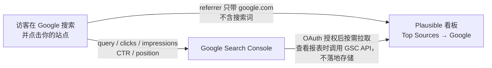

import { Meta } from '@storybook/addon-docs/blocks';

<Meta id="search-console" title="API 与集成/集成/Search Console" name="Docs" />

# Search Console

看板能告诉你「有多少访客来自 Google」，但说不出「他们搜了什么」——2012 年起 Google 不再把搜索词放进 referrer，Top Sources 里的 Google 因此只是一个没有下钻细节的数字。Google Search Console（GSC）是 Google 自己保存的搜索词记录：哪些 query 让你的站点出现在结果里、被点击了多少次、展示量、点击率（CTR）和平均排名。**Search Console 集成**用一次 OAuth 授权把这份数据接进看板：授权后，点 Top Sources 里的 Google 就能下钻出搜索词报表，补上搜索来源缺失的那一半细节。

接入方式本身也是隐私模型的一部分：站点上不放任何 Google 代码，Plausible 也不存储搜索词数据——它只保存你的授权信息和所选属性，每次你打开报表时实时调用 GSC API 拉取。这意味着断开授权数据立刻消失、重连即恢复，且这份数据天然不受 Plausible 侧备份与迁移的影响。



| 关键事实 | 取值 |
| --- | --- |
| 功能归属 | 云端与 CE 均可用；CE 需先自建 Google OAuth 客户端（见「CE 自托管接入」） |
| 带来什么 | Top Sources 里 Google 来源的搜索词报表：query、clicks、impressions、CTR、position |
| 数据模型 | 查看报表时实时拉取 GSC API；Plausible 不存储搜索词数据，只保留授权与所选属性 |
| 前置条件 | 站点已在 GSC 验证（域名属性或 URL 前缀属性均可） |
| 配置入口 | 站点设置 → Integrations → Google Search Console Integration 模块 |
| 报表位置 | 看板 Top Sources 报表 → 点 Google 下钻 |
| 数据延迟 | 约 24–36 小时（GSC 本身如此）；看数据先回拨两天 |
| 解除方式 | 同一模块 Unlink Google account；搜索词立即消失，重连即恢复 |
| 账号上限 | 一个 Google 账号 50 个有效 token，接入第 51 个站点会顶掉最早接入的站点 |

## 接入流程

前提条件先确认：**站点已在 Google Search Console 验证**。域名属性（domain property）或 URL 前缀属性（URL prefix property）都可以，验证方式用 HTML 标签或 DNS 记录均可。没验证就没有任何属性可选，这是接入失败的第一大原因。

云端（以及已配好 OAuth 的 CE）的接入步骤：

1. 打开站点设置，进入左侧 **Integrations**，找到 **Google Search Console Integration** 模块；本地实例的同一入口是 `http://localhost:8000/test.local/settings/integrations`。
2. 点 **Continue with Google** 进入 Google OAuth 流程，选择要授权的 Google 账号（Plausible 只用账号的邮箱地址来识别它）。
3. 授权页勾选 **"View Search Console data for your verified sites"** 授权项——不勾这一项，Google 不会给出任何属性的访问权，回来下拉框就是空的。
4. 回到 Plausible，从下拉框选择要接入的属性（域名属性带 `sc-domain:` 前缀），点 **Save** 完成。

三条边界：

- **站点代码零改动**：集成只发生在 Plausible 服务端与 GSC API 之间，跟踪脚本和页面都不需要动。
- **数据不落地**：Plausible 只保存授权信息和所选属性，搜索词数据每次查看时实时拉取；官方对隐私的表述是 "requires no Google code to be placed on your site"。
- **授权可核对可吊销**：随时可在 Google 账号的「Apps with access to your account」页面看到并撤销 Plausible 的访问权。

## 看板中的搜索词

接入后，搜索词出现在看板 **Top Sources** 报表的 Sources 标签下：点击 **Google** 即下钻出搜索词列表（Top Sources 报表本身的结构见 [看板导览](?path=/docs/dashboard-tour--docs)）。列表按词给出 clicks，点报表右上角展开图标可同时看到每个词的 **impressions、CTR、position**。报表跟随看板筛选器——按页面、国家或设备过滤后，看到的就是该切片的搜索词（筛选器用法见 [筛选与细分](?path=/docs/filtering-segments--docs)）。

读这份报表前必须知道的三条口径：

- **延迟约 24–36 小时**：这是 GSC 本身的延迟，不是集成问题——官方原文 "Search query data isn't live. It's delayed by approximately 24-36 hours even on Google Search Console itself."。今天和昨天的词基本不全，想看完整数据把日期回拨两天。
- **只显示至少有一次点击的词**：只有展示没有点击的 query 不会出现，报表天然偏向「真正带来流量的词」。
- **Google 重度采样**：官方原文 "Google samples its keyword data heavily."，所以各关键词的访客数加总**不等于** Top Sources 里 Google 来源的总访客数——这是采样口径差异，不是采集丢失；Plausible 显示的就是 GSC 返回的同一批数据。

## CE 自托管接入

云端那套 OAuth 客户端身份不能给各自独立部署的实例用，所以 CE 要多一段准备：**在 Google Cloud 建自己的 OAuth 客户端**，把客户端 ID 和密钥配成环境变量。没配这两个变量时，Integrations 模块的位置显示的是一条配置警告而不是 **Continue with Google** 按钮——CE wiki 原文：看到警告就说明没设置 `GOOGLE_CLIENT_ID` 和 `GOOGLE_CLIENT_SECRET`。环境变量的通用配置方法见 [配置](?path=/docs/ce-configuration--docs)，本课只列这两个变量本身。

完整步骤（以 CE wiki 的 Google Integration 页为准）：

1. **建项目**：打开 Google Cloud Console，选择或创建一个项目。注意 Google 有时会把当前项目切回 "default"，后续每步都确认还停在选定的项目上。
2. **配同意屏**：进入 **APIs & Services → OAuth consent screen**，类型选 **External**（Internal 要求付费 Google Workspace）；填应用名、域名和联系方式；scopes 一步直接跳过；把自己（以及将来要操作接入的账号）加为 **test user**。
3. **建 OAuth 客户端**：进入 **Credentials → + Create credentials → OAuth client ID**，应用类型选 **Web application**；回调地址填 `<BASE_URL>/auth/google/callback`——本地实例即 `http://localhost:8000/auth/google/callback`，生产实例把 `BASE_URL` 换成实际对外地址。
4. **写环境变量并重启**：

```bash
echo "GOOGLE_CLIENT_ID=...apps.googleusercontent.com" >> .env
echo "GOOGLE_CLIENT_SECRET=GOCSPX-..." >> .env
docker compose up -d
```

5. **启用 API**：在 Google Cloud 搜索并启用 **Google Search Console API**。
6. **验证站点**：在 GSC 完成站点验证（若还没做），域名属性类型即可。
7. **回 Plausible 连接**：站点设置 → Integrations，按「接入流程」走 OAuth；登录的 Google 账号必须在第 2 步的 test user 列表里——应用处于 testing 模式时，列表外的账号无法完成授权。

本地实例的入口观察路径：默认 compose 不带这两个变量，打开 `http://localhost:8000/test.local/settings/integrations`，Google Search Console Integration 模块位置显示的是警告而不是按钮；配好变量重启后同一位置出现 **Continue with Google**。「按钮出现与否」与「变量配置与否」一一对应，这就是 CE 侧最直观的可见性核对点。

一条边界：同一套 OAuth 客户端也是导入 GA 历史数据的前提（需在 Google Cloud 额外启用四个 Analytics API），接入细节属于 [导入 GA 数据](?path=/docs/ga-import--docs)，本课不展开。

## 断开与重连

断开在同一模块操作：点 **Unlink Google account**。因为 Plausible 不存储搜索词数据，断开后搜索词报表**立即**从看板消失；其他报表（包括 Top Sources 里的 Google 来源数字）不受影响。重连就是再走一遍「接入流程」选回同一个属性，报表原样恢复——断开来去不留痕迹。

连接失效的三种真实场景，处理方式都是重连：

- **手动 Unlink**：自己或团队成员在设置页点的断开。
- **50 token 上限**：Google 对一个账号最多保留 50 个有效授权 token——接入第 51 个站点时，最早接入的站点被顶掉断开。站点数量多就把站点分摊到多个 Google 账号。
- **"Invalid Grant" 报错**：Google 侧授权已失效——授权被吊销、账号过期或长期不活跃、改过 Google 密码。报表忽然报错时在站点设置重连一次即可，顺带可在 Google 账号的「Apps with access to your account」核对授权状态。

## 常见问题

- OAuth 走完了，属性下拉框却是空的。
  按序核对两个原因：站点根本没在 GSC 验证（先去 GSC 完成域名属性或 URL 前缀属性的验证）；OAuth 授权页没勾选 "View Search Console data for your verified sites"（在模块里 Unlink 后重新授权，这次勾上）。官方确认权限未勾选时 Google 不会给出任何属性的访问权。
- 搜索词报表没数据，或最近一两天的词明显不全。
  先回拨日期：GSC 数据本身延迟约 24–36 小时，今天和昨天基本不全，两天前的日期才是完整数据。排除延迟后仍全空，核对所选属性是否对应这个站点（域名属性带 `sc-domain:` 前缀），以及目标时段内站点是否真有来自 Google 的点击。
- 各搜索词的访客数加总，与 Top Sources 里 Google 来源的总访客数对不上。
  Google 对关键词数据重度采样，两边口径本来就不同；Plausible 显示的是 GSC 返回的同一批数据，不是集成丢了量。要总量看 Top Sources 的 Google 行，要词明细看搜索词报表，两个读数各司其职。
- 本地 CE 的 Integrations 里找不到连接按钮，只有一条警告。
  未配置 `GOOGLE_CLIENT_ID` / `GOOGLE_CLIENT_SECRET`。按「CE 自托管接入」建好 OAuth 客户端、写入 `.env`、`docker compose up -d` 重启后，警告位置即变为 Continue with Google 按钮；仍不出现则确认变量写进了 compose 实际读取的 `.env`，且回调地址与 `BASE_URL` 一致。
- 报表一直正常，忽然报 "Invalid Grant"。
  Google 侧授权失效：授权被手动吊销、账号过期或停用、改过 Google 密码。在站点设置的同一模块重新连接即可恢复，无需重建站点或属性。

## 总结回顾

摘要：

2012 年起 Google 不再在 referrer 里携带搜索词，看板只能看到「来自 Google」而看不到「搜了什么」；Search Console 集成用一次 OAuth 授权补上这一半：站点设置 Integrations 里走 Google 授权、勾选 "View Search Console data for your verified sites"、选择已验证的 GSC 属性（域名属性带 `sc-domain:` 前缀）保存后，Top Sources 里的 Google 就能下钻出 query / clicks / impressions / CTR / position 报表，且跟随看板筛选器按页面、国家、设备切片。数据模型是按需实时拉取 GSC API、不落地存储，所以断开 Unlink 即消失、重连即恢复。CE 侧因为 OAuth 客户端身份跟部署走，必须在 Google Cloud 自建 OAuth 客户端并配置 `GOOGLE_CLIENT_ID` / `GOOGLE_CLIENT_SECRET`，否则模块位置只有警告没有按钮。读数守住三条口径：GSC 本身延迟约 24–36 小时、只显示有点击的词、重度采样导致词级加总不等于来源总量；连接失效记住三个场景：手动 Unlink、单账号 50 token 上限顶掉最早站点、Invalid Grant（授权吊销 / 账号失效 / 改密码），处理统一是重连。

一句话：

> 集成解决的不是「有没有 Google 流量」，而是「他们搜了什么」——授权一次，Top Sources 里的 Google 就从一个数字变成一张搜索词报表；报表没数据时先把日期回拨两天，再怀疑配置。

知识要点：

- 为什么 Plausible 默认看不到搜索词？GSC 集成补上的是什么数据，数据模型（拉取时机、存储边界）是什么？
- 云端接入的前提条件和完整步骤是什么？OAuth 授权页必须勾选哪一项，不勾会怎样？
- 搜索词报表在看板的哪个位置，每个词有哪些指标，如何配合筛选器按页面 / 国家 / 设备切片？
- 读数的三条口径——延迟、点击门槛、采样——分别是什么含义，各自如何影响解读？
- CE 接入比云端多出哪些步骤？两个环境变量叫什么，未配置时界面上看到什么？
- 断开后看板表现如何？50 token 上限和 Invalid Grant 各自的成因与处理方式是什么？

## 参考资料

- [Google Search Console integration（官方文档：接入流程、报表位置、数据延迟与采样口径、断开与故障排查）](https://plausible.io/docs/google-search-console-integration)
- [plausible/community-edition Wiki：Google Integration（CE 自建 OAuth 客户端全流程、GOOGLE_CLIENT_ID / GOOGLE_CLIENT_SECRET、回调地址格式、启用 Search Console API）](https://github.com/plausible/community-edition/wiki/Google-Integration)
