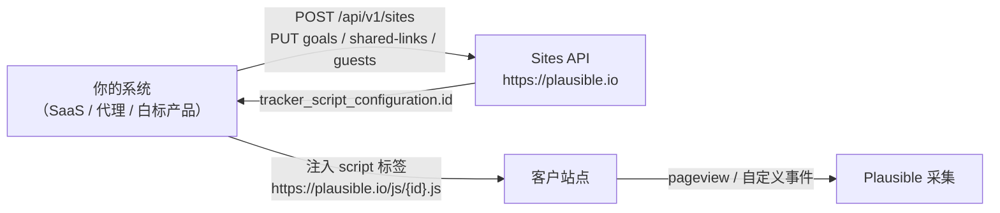

import { Meta } from '@storybook/addon-docs/blocks';

<Meta id="sites-api" title="API 与集成/数据接口/Sites API" name="Docs" />

# Sites API

Stats API 回答「数据怎么读出来」，**Sites API（官方称 Site provisioning API）回答的是另一个问题：站点本身怎么批量建出来**。手工在界面上点 Add site 适合三五个站点；当你给每个客户开一间「统计分店」——SaaS 平台给每个客户站点配一套分析、代理机构代管几百个站点、白标（white-label）产品把 Plausible 看板嵌进自己的产品——就需要用 API 把「建站、配脚本开关、预置目标、发分享链接、邀访客」这一串动作写进自动化流程。Sites API 就是这条 provisioning 流水线的程序化入口。

Sites API 是**云端专属功能**：官方要求 Enterprise 计划，Community Edition 没有实现——官方 README 的 cloud/CE 对照表原文写明 "Premium features (marketing funnels, ecommerce revenue goals, SSO and sites API) are not available"。源码层面同样可证：`/api/v1/sites` 整段路由包在 `on_ee` 编译块内、控制器源码放在 EE 专属的 `extra/` 目录，CE 构建不包含这些路由（本地实例的行为见「常见问题」）。因此本课无法在本地实例实测，证据形态改为两类可核对来源并逐条对应：**官方参考页的请求/响应示例**（结构与字段名照录）与 **plausible/analytics 源码**（路由注册、权限 scope、错误分支与消息文本）。动手验证需要云端 Enterprise 账号。



端点速查（基址均为 `https://plausible.io`，`:site_id` 就是站点域名；R = 只读 scope `sites:read:*`，W = 写入 scope `sites:provision:*`，来自源码路由定义）：

| 方法与路径 | 用途 | 权限 |
| --- | --- | --- |
| `GET /api/v1/sites` | 列出可访问的站点 | R |
| `GET /api/v1/sites/teams` | 列出团队，含 `api_available` 标记 | R |
| `POST /api/v1/sites` | 创建站点 | W |
| `GET /api/v1/sites/:site_id` | 取单个站点详情（含 tracker 配置与脚本 ID） | R |
| `PUT /api/v1/sites/:site_id` | 改域名和/或 tracker 脚本配置 | W |
| `DELETE /api/v1/sites/:site_id` | 删除站点及其全部数据 | W |
| `PUT /api/v1/sites/shared-links` | 按名查找或创建分享链接（幂等） | W |
| `GET /api/v1/sites/goals` | 列出站点目标 | R |
| `PUT /api/v1/sites/goals` | 按类型和值查找或创建目标（幂等） | W |
| `DELETE /api/v1/sites/goals/:goal_id` | 删除目标 | W |
| `GET /api/v1/sites/custom-props` | 列出站点自定义属性 | R |
| `PUT /api/v1/sites/custom-props` | 创建自定义属性（幂等） | W |
| `DELETE /api/v1/sites/custom-props/:property` | 删除自定义属性 | W |
| `GET /api/v1/sites/guests` | 列出站点访客与待接受邀请 | R |
| `PUT /api/v1/sites/guests` | 邀请访客（幂等） | W |
| `DELETE /api/v1/sites/guests/:email` | 移除访客或撤回邀请 | W |

## 认证

与 [Stats API](?path=/docs/stats-api--docs) 同一体系：每个请求带 `Authorization: Bearer <key>`，key 在账户设置里创建、只完整显示一次。这里只讲 Sites API 特有的三条规则，创建路径与角色限制的细节见 Stats API 课的「认证」一节。

- **建 key 时选类型**：Settings → API Keys → New API Key，类型选 **Sites API**（CE 的建 key 界面没有这一项）。官方说明 Enterprise 计划的 key 需联系官方开通；角色限制（owner / admin / editor / billing 可建 key）与 Stats API key 相同。
- **key 绑定创建时所选团队**：key 的作用域是建它时右上角菜单选中的那个团队，只能管理该团队拥有的站点——不含其他团队的站点，也不含 key 主人仅以 Guest Viewer / Guest Editor 身份客串的站点。key 主人离开或被移出团队后，这把 key 立即失去对该团队站点的访问。
- **只读端点可用 Stats API key**：官方明确列出，list sites / teams / goals / custom properties / guests 与 get site by domain 这些 GET 端点，在任何包含 Stats API 的计划上用普通 Stats API key 也能调。写入端点（建站点、改配置、管目标和访客）才要求 Sites API key——与源码里的 scope 划分一致：GET 走 `sites:read:*`，其余走 `sites:provision:*`。

provisioning 脚本的第一件事建议是调 `GET /api/v1/sites/teams`：响应里每个团队带 `api_available` 布尔标记，先确认目标团队已开通 API，再开始批量建站，避免在第一个 POST 上才撞墙。

```json
{
  "teams": [
    { "id": "4d3dae3b-2a44-4aaa-baac-6bb55234a435", "name": "My Personal Sites", "api_available": false },
    { "id": "ef828bca-8a1b-49f6-b829-dee1c9f7d628", "name": "Some Team", "api_available": true }
  ],
  "meta": { "after": null, "before": null, "limit": 100 }
}
```

## 站点管理

五个端点共享同一个站点对象模型：`domain`（全局唯一的域名，即 `:site_id`）、`timezone`（IANA 时区名）、`custom_properties`（属性白名单）、`tracker_script_configuration`（tracker 开关与脚本 ID）。创建、更新、查询单个站点的响应都是这个对象的完整快照——拿到响应即拿到现状，不需要再补一次 GET。

### 创建站点

`POST /api/v1/sites` 是 provisioning 的起点：

```bash
curl -X POST https://plausible.io/api/v1/sites \
  -H "Authorization: Bearer ${TOKEN}" \
  -H "Content-Type: application/json" \
  -d '{
    "domain": "test-domain.com",
    "timezone": "Europe/London",
    "tracker_script_configuration": {
      "file_downloads": true,
      "form_submissions": true,
      "outbound_links": true
    }
  }'
```

官方响应示例（注意 `tracker_script_configuration.id`，它就是后面装脚本的钥匙）：

```json
{
  "domain": "test-domain.com",
  "timezone": "Europe/London",
  "custom_properties": [],
  "tracker_script_configuration": {
    "id": "pa-1iQepzD1J73BaHey2csUp",
    "installation_type": null,
    "track_404_pages": false,
    "hash_based_routing": false,
    "outbound_links": true,
    "file_downloads": true,
    "revenue_tracking": false,
    "tagged_events": false,
    "form_submissions": true,
    "pageview_props": false
  }
}
```

请求体参数与默认值：

| 参数 | 必填 | 缺省 | 说明 |
| --- | --- | --- | --- |
| `domain` | 是 | — | 全局唯一；域名已被任何账号占用时请求失败 |
| `timezone` | 否 | `Etc/UTC` | IANA 时区名，决定看板与统计的日期边界 |
| `team_id` | 否 | key 主人的 "My Personal Sites" 团队 | 站点挂到哪个团队下 |
| `tracker_script_configuration` | 否 | 默认配置 | 可只给部分开关，未给的取默认值（见「tracker 脚本配置」） |

### 查询与分页

`GET /api/v1/sites` 列出 key 可访问的全部站点；`GET /api/v1/sites/:site_id` 取单个站点完整快照。列表端点统一走**游标分页**：query 参数 `after` / `before` / `limit`（默认 100），响应固定带 `meta`：

```json
{
  "sites": [
    { "domain": "test-domain1.com", "timezone": "Europe/London" },
    { "domain": "test-domain2.com", "timezone": "Europe/London" }
  ],
  "meta": { "after": null, "before": null, "limit": 100 }
}
```

两条规则照录官方：翻页时把上一页响应的 `after`（或 `before`）值原样带回下一次请求；`meta` 中 `after` / `before` 为 `null` 表示该方向没有更多页。**翻页期间 `limit` 必须保持不变**——要么一直用默认值，要么每次显式传同一个值。另外 `GET /api/v1/sites` 接受 `team_id` 参数收窄到单个团队；不传时列出全部可访问站点，含通过 guest 身份客串的站点。

### 更新站点

`PUT /api/v1/sites/:site_id` 可改域名、可改 tracker 配置，也可两者同改：

```bash
curl -X PUT https://plausible.io/api/v1/sites/test-domain.com \
  -H "Authorization: Bearer ${TOKEN}" \
  -H "Content-Type: application/json" \
  -d '{
    "domain": "new-test-domain.com",
    "tracker_script_configuration": {
      "form_submissions": true
    }
  }'
```

三条边界：

- **部分更新语义**：官方文字说明 `tracker_script_configuration` 中未指定的开关保持当前值（与创建时「未指定取默认值」不同）。但注意官方示例自身前后矛盾——它的创建示例开了 `outbound_links` / `file_downloads`，更新示例只传 `form_submissions` 后响应里这两个开关却回到了 `false`。无法判定是示例笔误还是实际行为，**稳妥做法是更新时给出完整的开关清单**，不依赖「保持当前值」。
- **空请求体报错**：两个可改项一个都不给时返回 400，源码中的消息文本为 `Payload must contain at least one of the parameters 'domain', 'tracker_script_configuration'`。
- **改域名仍受全局唯一约束**：目标域名已被占用时失败（400，changeset 校验错误）。

### 删除站点

`DELETE /api/v1/sites/:site_id` 删除站点及其全部数据与配置：

```json
{ "deleted": "true" }
```

两条硬约束照录官方：**API key 必须属于站点 owner**（团队成员的 key 不够）；数据彻底删除**最长需要 48 小时**，期间不能用同一域名重新注册。自动化里「删了马上重建同名站点」的测试套路在这里会撞墙，要么换域名，要么等。

### tracker 脚本配置

`tracker_script_configuration` 是把「自动追踪」开关打包进 provisioning 的载体——各开关的行为含义见 [自动追踪](?path=/docs/automatic-tracking--docs)，这里只列字段与默认值。全部可选，创建时未指定的取默认值：

| 字段 | 默认 | 作用 |
| --- | --- | --- |
| `installation_type` | `null` | 安装方式标记：`"wordpress"` / `"manual"` / `"gtm"` / `null` |
| `track_404_pages` | `false` | 追踪 404 页面访问 |
| `hash_based_routing` | `false` | 追踪 hash 路由变化 |
| `outbound_links` | `false` | 追踪出站链接点击 |
| `file_downloads` | `false` | 追踪文件下载 |
| `revenue_tracking` | `false` | 启用收入追踪 |
| `tagged_events` | `false` | 启用 tagged events |
| `form_submissions` | `false` | 追踪表单提交 |
| `pageview_props` | `false` | 启用 pageview 自定义属性 |

配置里的 `id` 字段是闭环的最后一环：官方说明「This ID can be used to request the tracker script for this site from the URL `https://plausible.io/js/{id}.js`」。即创建站点后，你的系统把

```html
<script defer data-domain="test-domain.com" src="https://plausible.io/js/pa-1iQepzD1J73BaHey2csUp.js"></script>
```

注入客户站点模板，该脚本按建站时给的开关组合自动启用对应追踪能力——建站与装脚本全程不需要人打开 Plausible 界面。

## Shared Links

`PUT /api/v1/sites/shared-links` 按 `site_id` + `name` **查找或创建**一条分享链接（分享链接本身的可见性模型见 [分享与嵌入](?path=/docs/sharing-embedding--docs)）：

```bash
curl -X PUT https://plausible.io/api/v1/sites/shared-links \
  -H "Authorization: Bearer ${TOKEN}" \
  -H "Content-Type: application/json" \
  -d '{ "site_id": "test-domain.com", "name": "Wordpress" }'
```

```json
{ "name": "Wordpress", "url": "https://plausible.io/share/site.com?auth=<random>" }
```

两个参数都必填。端点是**幂等的 find-or-create**：同名链接已存在时不报错、直接返回既有链接——provisioning 脚本可以放心重跑，不用先查存在性。返回的 `url` 就是可分发或可嵌入的看板地址（官方文档将其与 embed dashboard 功能关联）。

## Goals

目标的概念与口径见 [目标与转化](?path=/docs/goals-conversions--docs)；Sites API 提供的是目标的程序化管理——典型用途是给每个新建站点预置同一组目标（如 `Signup`、`Visit /register`）。

列出目标（`site_id` 必填 query 参数，缺失时返回 400 ``Parameter `site_id` is required to list goals``）：

```bash
curl -X GET "https://plausible.io/api/v1/sites/goals?site_id=test-domain.com" \
  -H "Authorization: Bearer ${TOKEN}"
```

官方响应示例——一条事件目标、一条页面目标，注意两类目标各自的字段填法：

```json
{
  "goals": [
    {
      "id": "1",
      "goal_type": "event",
      "display_name": "Signup",
      "event_name": "Signup",
      "page_path": null,
      "custom_props": { "country": "Estonia" }
    },
    {
      "id": "2",
      "goal_type": "page",
      "display_name": "Visit /register",
      "event_name": null,
      "page_path": "/register",
      "custom_props": {}
    }
  ],
  "meta": { "after": null, "before": null, "limit": 100 }
}
```

创建同样是**幂等的 find-or-create**（`PUT /api/v1/sites/goals`），已存在同类型同值的目标时不报错：

| 参数 | 条件 | 说明 |
| --- | --- | --- |
| `site_id` | 必填 | 站点域名 |
| `goal_type` | 必填 | 只接受 `event` 或 `page` |
| `event_name` | `goal_type=event` 时必填 | 事件名 |
| `page_path` | `goal_type=page` 时必填 | 页面路径，**支持通配符** |
| `display_name` | 可选 | 看板与 Stats API 中的显示名；缺省时事件目标取 `event_name`，页面目标取 `Visit {page_path}` |
| `custom_props` | 可选 | 属性键值对 map，把目标限定到带特定属性值的事件 |

创建响应回写目标对象并补上服务端生成的 `id` 与补全后的 `display_name`（如 `{ "domain": "test-domain.com", "id": "1", "display_name": "Signup", "goal_type": "event", "event_name": "Signup", "page_path": null }`）。删除用 `DELETE /api/v1/sites/goals/:goal_id`，请求体带 `site_id`，成功返回 `{ "deleted": "true" }`；官方要求 key 属于站点 owner。

## 自定义属性与访客

两个小家族共享同一套「list / 幂等 PUT / delete」形状，放一起记。

**自定义属性**管理站点级属性白名单（属性机制本身见 [自定义属性](?path=/docs/custom-properties--docs)）：

- `GET /api/v1/sites/custom-props?site_id=...` 返回 `{ "custom_properties": [ { "property": "author" }, { "property": "title" } ] }`。
- `PUT /api/v1/sites/custom-props` 幂等创建，官方示例用表单字段提交（`-F 'site_id=test-domain.com' -F 'property=title'`），成功返回 `{ "created": true }`。
- `DELETE /api/v1/sites/custom-props/:property` 删除，返回 `{ "deleted": true }`。源码路由里这一段是通配符匹配（`custom-props/*property`），因为属性名本身可以含 `/`。

**访客**管理站点级的 Guest 成员与邀请（角色与可见性模型见 [团队与站点管理](?path=/docs/team-sites--docs)）：

- `GET /api/v1/sites/guests?site_id=...` 列出访客，每人三个字段：`email`、`role`（`viewer` / `editor`）、`status`（`accepted` / `invited`），带游标分页 `meta`。
- `PUT /api/v1/sites/guests` 幂等邀请：body 为 `site_id`、`email`、`role`（必填，只接受 `editor` 或 `viewer`）；已存在的成员或待接受邀请不报错。响应如 `{ "email": "alice@example.com", "role": "viewer", "status": "invited" }`。
- `DELETE /api/v1/sites/guests/:email` 移除成员或撤回邀请，**不删除对方的 Plausible 账号**。

## 自动化场景

把全部端点串起来，一个典型的 SaaS provisioning 流程长这样（白标分析是官方文档点名的落地场景）：

1. **前置检查**：`GET /api/v1/sites/teams`，确认目标团队 `api_available: true`。
2. **建站**：客户在你的平台绑定域名 → `POST /api/v1/sites`（传 `domain`、`timezone`、需要的 tracker 开关）。先 `GET /api/v1/sites/:site_id` 判存在性——创建端点**不幂等**，域名全局唯一，重复创建会失败，这与下面各资源的 find-or-create 语义不同。
3. **装脚本**：从响应取 `tracker_script_configuration.id`，把 `https://plausible.io/js/{id}.js` 的 script 标签渲染进客户站点模板。
4. **预置配置**：`PUT /api/v1/sites/goals` 批量建标准目标、`PUT /api/v1/sites/custom-props` 注册属性白名单——幂等，脚本重跑不产生重复。
5. **交付看板**：`PUT /api/v1/sites/shared-links` 生成分享链接嵌入你的后台；`PUT /api/v1/sites/guests` 把客户邀成 `viewer`。
6. **对账**：定期 `GET /api/v1/sites` 翻页全量比对（`limit` 固定、`after` 翻页直到 `null`），清退已流失客户的站点用 `DELETE`（注意 48 小时删除窗口）。

## 错误与限制

官方参考页没有给出 Sites API 专属的错误码表与限流数字；下列条目来自源码控制器的错误分支（消息文本逐字照录），错误响应与 Stats API 同为 `{"error": "..."}` 形状：

| 状态码 | 场景 | 消息文本 |
| --- | --- | --- |
| 400 | 列目标缺 `site_id` | ``Parameter `site_id` is required to list goals`` |
| 400 | 更新站点但空请求体 | `Payload must contain at least one of the parameters 'domain', 'tracker_script_configuration'` |
| 400 | key 主人属于多个团队且创建时没传 `team_id` | `You must select a team with 'team_id' parameter.` |
| 400 | changeset 校验失败（域名被占用、tracker 配置非法等） | 逐字段校验错误 |
| 402 | 超出订阅的站点数上限 | `Your account has reached the limit of N sites. To unlock more sites, please upgrade your subscription.` |
| 403 | 无权向所选团队加站点 | `You can't add sites to the selected team.` |
| 404 | 站点不存在或无权访问 | `Site could not be found` |

另有两条文档明确的限制：删除站点要求 key 属于站点 owner；删除完成后 48 小时内同域名不可重建。

## 常见问题

- 对本地 CE 实例调 `GET http://localhost:8000/api/v1/sites` 会怎样？
  返回 404 而不是 401/403——CE 里这条路由根本不存在。源码中 `/api/v1/sites` 整段路由包在 `on_ee` 编译块内、控制器位于 EE 专属的 `extra/` 目录，CE 构建时两者都被排除，未匹配的 API 路径落入 Phoenix 的 no-route 处理。这与 Stats API 的 401 语义不同：不是「没权限」，是「没这功能」。验证方式：启动本地实例（见 [本地实例](?path=/docs/local-instance--docs)）后用任意 Bearer key 调一次即可复现 404。

- 一把 Sites API key 到底能管哪些站点？
  只能是 key 创建时所选团队**拥有**的站点。两类站点管不了：其他团队的站点，以及你仅以 Guest Viewer / Guest Editor 身份客串的站点。只读端点（各 list 与 get site）可放宽到用 Stats API key；写入端点必须 Sites API key。key 主人退出团队，key 对该团队即刻失效。

- provisioning 脚本重跑一次，会不会重复建站点、目标、分享链接？
  目标、分享链接、自定义属性、访客邀请四类 PUT 都是幂等的 find-or-create，重跑安全；但 `POST /api/v1/sites` 不幂等——域名全局唯一，重复创建直接失败，建站前先 `GET /api/v1/sites/:site_id` 判一次存在性。

- 删除站点后立刻用同一域名重建，为什么失败？
  官方说明彻底删除全部数据最长需要 48 小时，期间该域名仍被占用。自动化测试需要「删了重建」时换用新域名，不要原地复用。

## 总结回顾

摘要：

Sites API 是站点 provisioning 的程序化入口，面向 SaaS、代理与白标场景，云端 Enterprise 专属，CE 不实现（README 对照表与 `on_ee` 路由双重可证）。认证与 Stats API 同体系，但 key 绑定创建时所选团队、只管该团队拥有的站点，只读端点放宽到 Stats API key，写入端点要求 Sites API key（源码 scope：`sites:read:*` / `sites:provision:*`）。站点管理五端点共享 `domain` / `timezone` / `custom_properties` / `tracker_script_configuration` 对象模型：创建时 `domain` 全局唯一必填、`timezone` 缺省 `Etc/UTC`、tracker 开关缺省全 `false`，响应中的脚本 ID 拼成 `https://plausible.io/js/{id}.js` 即完成装脚本闭环；更新是部分更新但官方示例与文字说明矛盾，稳妥做法是给出完整开关清单；删除要求 owner key 且有 48 小时窗口。shared links、goals、custom-props、guests 四家族的写入端点都是幂等 find-or-create，重跑安全，唯独建站不幂等需先查存在性。列表端点统一游标分页，`limit` 翻页期间必须恒定。错误为 `{"error": ...}` 形状，源码可证 400/402/403/404 的具体场景与消息文本。

一句话：

> Sites API 把「开一间统计分店」的全套动作——建站、配脚本、预置目标、发链接、邀访客——压缩成一组幂等友好的 REST 端点，让 SaaS 给每个客户站点自动配上完整统计，全程无需打开 Plausible 界面。

知识要点：

- Sites API 解决什么问题？为什么它是云端专属，CE 调用时返回什么、为什么？
- Sites API key 的作用域是什么？哪些端点可以用 Stats API key 调？
- 创建站点的必填参数与各项默认值是什么？`tracker_script_configuration.id` 拿来做什么用？
- 更新站点的部分更新语义是什么？官方示例的矛盾在哪里，稳妥做法是什么？
- 哪些写入端点是幂等的 find-or-create？建站为什么不在这个行列，重跑脚本怎么写才安全？
- 游标分页的 `after` / `before` / `limit` 规则是什么？
- 删除站点的两条硬约束是什么？

## 参考资料

- [Plausible Sites API reference（官方文档：全部端点、请求/响应示例、tracker 脚本配置与分页规则的主要依据）](https://plausible.io/docs/sites-api)
- [plausible/analytics 源码（README 的 cloud/CE 对照表；`router.ex` 中 `on_ee` 包裹的 `/api/v1/sites` 路由与 scope 划分；`extra/` 下 ExternalSitesController 错误分支与消息文本的事实来源）](https://github.com/plausible/analytics)
- [White-label web analytics（官方：Sites API 的典型落地场景说明）](https://plausible.io/white-label-web-analytics)
