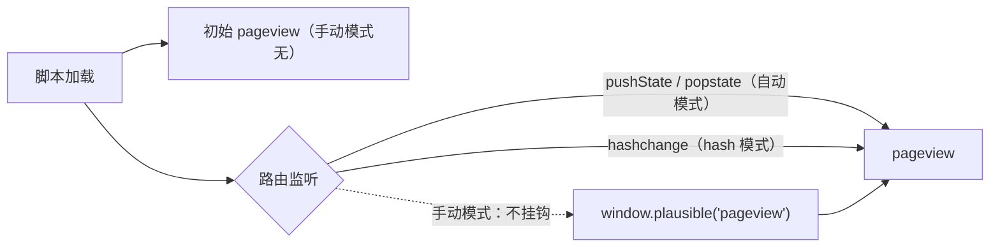

import { Canvas, Controls, Meta } from '@storybook/addon-docs/blocks';
import * as SpaTracking from './spa-tracking.stories';

<Meta of={SpaTracking} name="Docs" />

# SPA 路由

单页应用（SPA）切换页面时不重新加载文档，浏览器不会发起新请求，pageview 也就失去了「每次换页自动来一次」的天然来源。Plausible 的做法是让脚本挂钩路由事件：默认脚本包装 `history.pushState` 并监听 `popstate`，所以 pushState 类路由（React Router、Vue Router 等）开箱即用；hash 路由要换 `script.hash.js` 变体；想完全自控上报时机就用 `script.manual.js`。本课讲清三种模式各自监听什么、什么时候会计数、什么时候会漏报或双计数。

读完本课你应能预测：给定一种路由形态该选哪个脚本变体；一次路由切换会不会发出 `/api/event` 请求；看板里 URL 不对或计数翻倍时该改哪里。

三种模式的全貌（变体组合规则与 `.local` 的作用见 [接入脚本](?path=/docs/script-setup--docs)）：

| 模式 | 脚本变体（经典写法） | 新版 init 选项 | 路由监听 | 初始 pageview | 适用路由形态 |
| --- | --- | --- | --- | --- | --- |
| 自动（默认） | `script.js` | `autoCapturePageviews: true`（默认值） | 包装 `history.pushState` + 监听 `popstate` | 有 | pushState 路由（React Router、Vue Router 等） |
| hash | `script.hash.js` | `hashBasedRouting: true` | 仅监听 `hashchange` | 有 | hash 路由（用 `#/path` 区分页面） |
| 手动 | `script.manual.js` | `autoCapturePageviews: false` | 无 | 无 | 任意路由形态，上报时机完全自控 |

## 快速上手

最小闭环：判断路由形态 → 贴对应片段 → 切换路由并在 Network 面板核对 `/api/event` 请求。前提：本地实例运行中且已创建站点 `test.local`（见 [本地实例](?path=/docs/local-instance--docs)）；测试页跑在 localhost，所以片段带 `.local`，线上站点去掉它。

1. 地址栏路径是普通路径（`/products/1`），路由切换不改 `#` —— pushState 路由，标准片段即可，无需任何额外配置：

   ```html
   <script defer data-domain="test.local" src="http://localhost:8000/js/script.local.js"></script>
   ```

2. 地址栏靠 `#` 后的部分区分页面（`/#/cart`）—— hash 路由，只改脚本文件名：

   ```html
   <script defer data-domain="test.local" src="http://localhost:8000/js/script.hash.local.js"></script>
   ```

   新版站点片段（`plausible.init()` 写法）的等价改法是 `plausible.init({ hashBasedRouting: true })`；两种写法的关系见 [接入脚本](?path=/docs/script-setup--docs) 的常见问题。

3. 在应用里切换几次路由：Network 面板中每次导航都出现一条 POST `/api/event`、状态 202，请求体 `u` 字段随路由变化；看板 Top Pages 出现这些虚拟路径。默认脚本下 hash 导航不发出请求，这正是下一节要对比的行为。

## 采集模式

三种模式共用同一条上报链路（`fetch` POST `/api/event`，载荷含 `n`/`u`/`d`），差别只在「谁触发 pageview」：自动与 hash 模式在脚本加载后先报一次初始 pageview，再各自挂钩一种路由事件；手动模式两者都不做，只提供 `window.plausible('pageview')` 入口。



下面的实例在当前 Docs 页里模拟一个微型 SPA：「pushState 导航」「hash 导航」两个按钮真实改写本页地址（`history.pushState` 与 `location.hash`），「脚本模式」切换实际注入的脚本变体，拦截 fetch 得到的真实载荷（`n`/`u` 字段）显示在读数里。运行条件与快速上手相同。

注意一个有意保留的沙箱行为：脚本装入的挂钩（pushState 包装、hashchange 监听）没有卸载入口，切换模式后仍然生效，读数「本页已装入挂钩」会如实标出，重载页面即可复位。离开本页时范例会用 `history.replaceState` 复位地址——replaceState 恰好是 tracker 从不挂钩的 API，所以复位本身不会产生上报。

<Canvas of={SpaTracking.Interactive} />
<Controls of={SpaTracking.Interactive} />

| 读者操作 | 可观察证据 |
| --- | --- |
| 保持自动模式，点「pushState 导航」 | 「已上报 pageview」+1，「最近载荷」的 `u` 变为 `/products/N`，「当前虚拟路由」同步变化 |
| 自动模式下点「hash 导航」 | 计数不变——默认脚本不听 `hashchange` |
| 切到 hash 模式 | 加载完成即 +1（初始 pageview 仍在）；再点「hash 导航」计数 +1，`u` 带上 `#/xxx` |
| hash 模式下点「pushState 导航」 | 计数不变——hash 变体不挂钩 `pushState` |
| 切到手动模式，两种导航按钮各点一次 | 计数始终为 0；点「手动上报 pageview」才 +1 |
| 自动模式下点「手动上报 pageview」 | 计数额外 +1——每次调用都计一次，与自动采集叠加即双计数 |
| 玩过自动模式后再切手动模式，点「pushState 导航」 | 仍然 +1；「本页已装入挂钩」显示 `pushState + popstate`——挂钩不随切换移除，重载页面复位 |
| 打开 Show code | 看到微型 SPA 与三模式注入的完整实现 `example.ts` |

每次成功上报后，看板 `http://localhost:8000/test.local` 的 realtime 读数同步 +1，可与页内读数互相印证。读数里的 `u` 省略了源（origin），事件中的 `u` 字段始终是完整 URL。

### 自动采集

默认脚本的 SPA 支持来自两处挂钩（事实来源：tracker 源码 `autocapture.js` 与编译产物）：

- 包装 `history.pushState`：先调用原函数完成导航，再触发一次 pageview 判断。框架路由（React Router、Vue Router 等）最终都走这个 API，所以官方称这类站点「无需额外配置」。
- 监听 `popstate`：浏览器前进/后退同样补报。

两条重要边界：

- `history.replaceState` 从不被挂钩——用它更新地址不会产生 pageview。这也是上方实例敢用它复位地址的原因。
- SPA 导航有同路径去重：导航后的 `location.pathname` 与上一次相同就跳过。页内 Tab 切换这类「调了 pushState 但没换路径」的动作不会重复计数；反过来，只改 query（`?tab=2`）的导航也会被一并跳过，需要统计这类导航时改用手动模式。

初始 pageview 的时机：文档可见时加载即报；页面处于 hidden/prerender 状态时等到 `visibilitychange` 可见再报；从 bfcache 恢复（`pageshow` 且 `persisted`）时再补报一次。

### hash 路由

hash 导航只改 `#` 后的部分，`location.pathname` 不变、不触发 `pushState`，默认脚本又从不监听 `hashchange`——所以 hash 路由站点用默认脚本时，除首次加载外一个 pageview 都收不到。

换 `script.hash.js`（或新版写法 `plausible.init({ hashBasedRouting: true })`）后行为改变：

- 只监听 `hashchange`，不再挂钩 `pushState`/`popstate`（编译产物中该分支整体替换，两者互斥）。
- 上报的 `u` 是完整 `location.href`，`#` 后的路径随之进入看板 Top Pages；载荷额外带 `h: 1` 标记 hash 来源。
- 不做同路径去重：hash 路由下 `pathname` 恒定，去重会吞掉所有导航。代价是任何 hash 变化都会计数，包括页内锚点跳转——该模式的前提就是站点把所有页面位置都放在 `#/` 之后。

上方实例中切到 hash 模式后点「hash 导航」，`u` 从 `/products/N` 变为带 `#/cart` 的形态，即为该行为的直接证据。

### 手动控制

`script.manual.js`（或新版写法 `plausible.init({ autoCapturePageviews: false })`）不装任何挂钩、不发初始 pageview，上报完全由代码触发：

```js
// 路由切换后上报一次 pageview，URL 取当前页面地址
window.plausible('pageview');

// 用 u 选项覆盖上报地址（u 与 url 等价，同时给出时 u 优先——tracker 源码 track.js）
window.plausible('pageview', { u: 'https://example.com/custom-location' });
```

要点：

- 每次调用都计为一个独立 pageview，同一页面重复调用会重复计数——官方原文是「Every script call with 'pageview' results in a separate pageview being counted even if called on the same page」。
- 典型接法是在路由器的导航钩子里调用（如 Vue Router 的 `afterEach`、React 中监听路由变化的 effect），这样上报时机与路由提交严格对齐。
- 脚本加载完成前调用会进入队列桩，加载后自动补发（队列模式见 [接入脚本](?path=/docs/script-setup--docs)）；`window.plausible` 同时也是自定义事件入口（见 [自定义事件](?path=/docs/custom-events--docs)）。
- 构建工具管理的项目可以改用 npm 包 `@plausible-analytics/tracker`：`init({ domain, autoCapturePageviews, hashBasedRouting })` 与 `track('pageview')` 是同一能力的程序化入口，框架工程中的接线细节见 [框架与平台集成](?path=/docs/integrations--docs)。

## 常见问题

- hash 路由切换了页面，看板却一直没有新 pageview。
  默认脚本不监听 `hashchange`。把脚本文件名换成 `script.hash.js`（新版写法则在 `plausible.init` 中加 `hashBasedRouting: true`）。验证方式：切换 hash 后 Network 面板应出现 POST `/api/event`，请求体 `u` 含 `#` 后的路径。

- 改成手动上报后每个页面计了两次。
  自动采集没有真正关闭：页面里仍加载着默认脚本，或 `init` 时忘了设 `autoCapturePageviews: false`。手动调用与自动采集叠加，每次导航计两次。处理：只保留 manual 变体（或补上该选项），并确认整页只有一个跟踪片段——Next.js 与 Gatsby 有官方记录的 async 脚本双载 bug，同样会导致双计数。

- 路由切换有上报，但看板 Top Pages 里的地址不是想要的（想报规范化地址或虚拟页名）。
  自动模式没有覆盖地址的入口，改用手动模式并传 `u` 选项：`window.plausible('pageview', { u: 'https://example.com/custom-location' })`（`url` 等价，`u` 优先）。常用于屏蔽 query 差异、聚合动态路径。

- 路由确实切换了（pushState），但没有产生 pageview。
  先确认导航后 `location.pathname` 是否真的变了：自动模式对同路径导航去重，只改 query 的切换会被跳过。再确认路由库用的不是 `replaceState`——它从不被挂钩。两种情况的出路都是手动模式。

## 总结回顾

摘要：

SPA 不换页，pageview 只能来自脚本对路由事件的挂钩。默认脚本包装 `history.pushState` 并监听 `popstate`，pushState 路由开箱即用，同路径导航去重、`replaceState` 不触发；hash 路由换 `script.hash.js`（或 `hashBasedRouting: true`），改听 `hashchange`、不去重、载荷带 `h: 1`；`script.manual.js`（或 `autoCapturePageviews: false`）不装任何挂钩，由 `window.plausible('pageview')` 完全自控，并可用 `u` 选项覆盖上报地址。选模式只看路由形态；漏报多源于模式与路由不匹配，双计数多源于自动采集未关闭或片段重复加载。

一句话：

> SPA 的 pageview 不来自「换页」，而来自脚本挂钩的路由事件——pushState 路由用默认脚本，hash 路由用 hash 变体，其余一切交给 manual 自己报。

知识要点：

- 默认脚本挂钩了哪些 API？`replaceState` 会触发上报吗？
- 同路径的 SPA 导航为什么只计一次？只改 query 的导航会怎样？
- hash 路由为什么默认不计数？换哪个变体或选项，计数口径有什么变化？
- 手动模式如何上报、如何覆盖 URL？双计数最常见的原因是什么？
- npm 包 `@plausible-analytics/tracker` 中对应自动 / hash / 手动行为的 `init` 选项分别是什么？

## 参考资料

- [Single-page application support（官方文档：pushState 路由开箱即用与框架注意事项）](https://plausible.io/docs/spa-support)
- [Hash-based routing（官方文档：`hashBasedRouting` 开启方式）](https://plausible.io/docs/hash-based-routing)
- [Script extensions and enhanced measurement（官方文档：manual 变体与「每次调用都计数」的原文）](https://plausible.io/docs/script-extensions)
- [Custom page locations（官方文档：手动上报时覆盖页面地址）](https://plausible.io/docs/custom-locations)
- [plausible/analytics：tracker 源码（autocapture.js 的挂钩点与去重、track.js 的 u/url 优先级、npm 包 README 的事实来源）](https://github.com/plausible/analytics)
