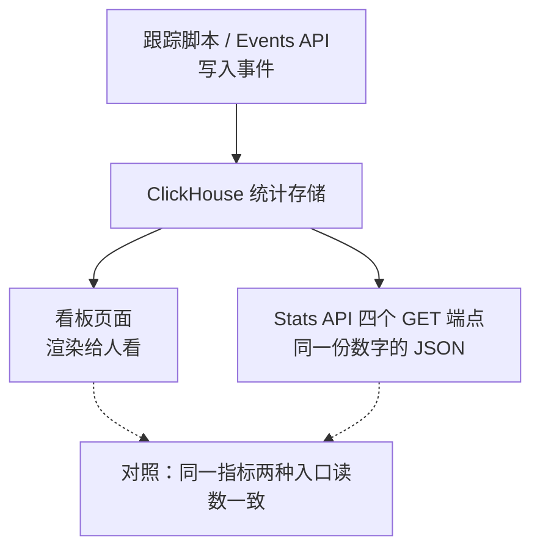

import { Meta } from '@storybook/addon-docs/blocks';

<Meta id="stats-api" title="API 与集成/数据接口/Stats API" name="Docs" />

# Stats API

看板上的每个数字都有出处，也都有出口。**Stats API 是看板读数的程序化出口**：同一份统计数据，看板渲染成图表给人看，Stats API 以 JSON 返回给程序——定时报表、阈值告警、自建仪表盘、数据管道都从这里取数。它与 [Events API](?path=/docs/events-api--docs) 方向相反：Events API 写入事件，Stats API 读出聚合结果，一读一写构成完整的数据回路。

本课讲清 v1 接口的完整体系：认证、四个只读端点、公共参数与取值、filters 语法、错误与限流。全部命令以本地实例 `http://localhost:8000` 为基址给出（站点 `test.local`，数据由前面课程产生），读者实例运行时原样执行即可复现。指标的统计口径与看板完全一致，定义见 [看板导览](?path=/docs/dashboard-tour--docs)，本课不重复。



端点速查（CE v3.2.1 路由实测存在，均只需 `Authorization` 头）：

| 端点 | 回答的问题 | 对应看板位置 | 必要参数 |
| --- | --- | --- | --- |
| `GET /api/v1/stats/realtime/visitors` | 现在站上有几个人 | 右上角 Current visitors | `site_id` |
| `GET /api/v1/stats/aggregate` | 一段时间的总读数 | 顶部指标行 | `site_id` |
| `GET /api/v1/stats/timeseries` | 指标随时间的曲线 | 趋势图 | `site_id` |
| `GET /api/v1/stats/breakdown` | 按某维度拆开的排行 | 各报表区块 | `site_id`、`property` |

另有 `GET /api/health` 健康检查，无需鉴权。官方文档现在主推新一代 `POST /api/v2/query`（单端点、JSON 请求体、多维 breakdown），v1 标记为 legacy 但继续受支持；CE v3.2.1 两代路由并存。本课以 v1 为准——它的四个端点与看板区块一一对应，是重建看板读数最直接的接口。

## 快速上手

最小闭环：创建一把 API key → 用一条 aggregate 查询拿到与看板一致的 JSON。前提：本地实例运行中（见 [本地实例](?path=/docs/local-instance--docs)），站点 `test.local` 已创建并有数据。

1. 创建 key：打开 `http://localhost:8000/settings/api-keys`（点右上角账户名 → Settings → API Keys），点 **New API Key**，填个名字（如 `cli`），类型保持 **Stats API**（CE 只有这一种；Sites API 是云端能力），保存。**key 只在创建成功后完整显示一次**，立即复制；丢失只能撤销重建。
2. 查最近 7 天的汇总读数：

   ```bash
   export API_KEY=<刚复制的 key>

   curl -s "http://localhost:8000/api/v1/stats/aggregate?site_id=test.local&period=7d&metrics=visitors,visits,pageviews,bounce_rate,visit_duration" \
     -H "Authorization: Bearer $API_KEY"
   ```

   预期响应（形状固定，数值取决于你累积的测试数据）：

   ```json
   {
     "results": {
       "bounce_rate": { "value": 100.0 },
       "pageviews": { "value": 6 },
       "visit_duration": { "value": 0.0 },
       "visitors": { "value": 1 },
       "visits": { "value": 2 }
     }
   }
   ```

3. 对照：打开看板 `http://localhost:8000/test.local?period=7d`，顶部指标行与 JSON 逐项相等——Unique visitors ↔ `visitors`、Total visits ↔ `visits`、Total pageviews ↔ `pageviews`、Bounce rate ↔ `bounce_rate`、Visit duration ↔ `visit_duration`。这就是本课的核心事实：**API 与看板同库同口径，只是换了出口**。

## 认证

所有端点都走同一条规则：请求头带 `Authorization: Bearer <key>`。v1 全是 GET，没有请求体。

- **key 的归属与权限**：key 归属创建时所在团队，能读该团队下你有权访问的站点；owner / admin / editor / billing 角色可以建 key，viewer 与 guest 不能（以官方文档为准）。key 长期有效，权限是完整的统计只读，泄露后在建 key 的同一页面撤销重建。
- **云端要求 HTTPS**，未加密的请求直接失败；本地 CE 用 `http://localhost:8000` 即可。
- **401 有两种形态**，注意区分（消息文本来自 CE v3.2.1 源码）：

  ```bash
  curl -i "http://localhost:8000/api/v1/stats/aggregate?site_id=test.local"   # 不带 key
  ```

  ```
  HTTP/1.1 401 Unauthorized
  {"error":"Missing API key. Please use a valid Plausible API key as a Bearer Token."}
  ```

  而 key 拼错、key 已撤销、**或 `site_id` 指向不存在/无权访问的站点**，返回的是同一条：

  ```
  HTTP/1.1 401 Unauthorized
  {"error":"Invalid API key or site ID. Please make sure you're using a valid API key with access to the site you've requested."}
  ```

  API 故意不区分「key 错」和「站点错」，避免向未授权调用者泄露站点是否存在——排查时两边都要核对。

## 端点家族

四个端点是同一查询引擎的四种投影：aggregate 是顶部指标行、timeseries 是趋势图、breakdown 是报表区块、realtime 是右上角绿数字。时间范围（`period` / `date`）与 `filters` 在后三者之间通用，学会一套参数即可游走全部端点。

### realtime/visitors

最近 5 分钟内加载过页面的去重人数，对应看板右上角 Current visitors。与看板读数一样不受筛选影响——端点也只接受 `site_id` 一个参数。

```bash
curl -s "http://localhost:8000/api/v1/stats/realtime/visitors?site_id=test.local" \
  -H "Authorization: Bearer $API_KEY"
```

预期响应是一个**裸数字**，不是对象：

```json
1
```

本地验证：先在浏览器打开测试页制造一次访问，5 分钟内调用返回 ≥ 1；无人访问时返回 `0`。

### aggregate

一段时间窗口内的汇总指标，对应顶部指标行。响应形状固定：`results` 下每个指标一个对象，`value` 是读数。快速上手已给出基本形态；`compare=previous_period` 会给每个指标追加与上一等长周期的对比：

```bash
curl -s "http://localhost:8000/api/v1/stats/aggregate?site_id=test.local&period=30d&metrics=visitors,pageviews&compare=previous_period" \
  -H "Authorization: Bearer $API_KEY"
```

```json
{
  "results": {
    "pageviews": { "value": 12, "change": 100, "comparison_value": 6 },
    "visitors": { "value": 2, "change": 100, "comparison_value": 1 }
  }
}
```

`comparison_value` 是上一周期的原始值，`change` 是百分比变化；上一周期为 0 时比率类指标（如 bounce_rate）的 `change` 可能为 `null`。这对应看板按 **X** 开启 Previous period 对比后指标卡上的箭头百分比（见 [看板导览](?path=/docs/dashboard-tour--docs)）。

### timeseries

同一指标按时间桶排开，对应趋势图。响应是数组，每桶一行：`{"date": 桶标签, "<metric>": 值}`。

```bash
curl -s "http://localhost:8000/api/v1/stats/timeseries?site_id=test.local&period=7d&metrics=visitors" \
  -H "Authorization: Bearer $API_KEY"
```

```json
{
  "results": [
    { "date": "2026-10-06", "visitors": 0 },
    { "date": "2026-10-07", "visitors": 1 },
    { "date": "2026-10-08", "visitors": 0 }
  ]
}
```

两条边界（来自 CE v3.2.1 测试套件核实的行为）：

- **分桶粒度**：`interval` 可显式给 `day` 或 `month`；缺省时 6mo / 12mo 按月、其余按天；`period=day` 时按小时分桶，桶标签形如 `"2026-10-13 15:00:00"`。
- **空桶不省略**：无数据的桶照样返回，`visitors` 为 0、`bounce_rate` 为 0、`visit_duration` 为 `null`——没有会话就没有时长可言。画折线图前不需要自己补零，但要把 `null` 处理好。

### breakdown

按一个维度把指标拆成排行，对应 Top Sources、Top Pages、Locations 等报表区块。`property` 必填，且一次只能拆一个维度：

```bash
curl -s "http://localhost:8000/api/v1/stats/breakdown?site_id=test.local&period=7d&property=visit:source&metrics=visitors,bounce_rate,visit_duration" \
  -H "Authorization: Bearer $API_KEY"
```

```json
{
  "results": [
    { "source": "Direct / None", "visitors": 1, "bounce_rate": 100.0, "visit_duration": 0.0 }
  ]
}
```

- **行键名取 property 的最后一段**：`visit:source` → `source`、`event:page` → `page`、`event:goal` → `goal`、`event:props:file` → `file`。
- **分页**：`limit` 默认 100、最大 1000；`page` 从 1 开始。看板区块默认只显示 9 行、DETAILS 弹层看全量，API 的 `limit` / `page` 就是同一份排行的程序化分页。
- **按目标拆分**对应 Goal Conversions 区块（转化口径见 [目标与转化](?path=/docs/goals-conversions--docs)）：

  ```bash
  curl -s "http://localhost:8000/api/v1/stats/breakdown?site_id=test.local&period=7d&property=event:goal&metrics=visitors,events,conversion_rate" \
    -H "Authorization: Bearer $API_KEY"
  ```

  ```json
  {
    "results": [
      { "goal": "Signup", "visitors": 1, "events": 1, "conversion_rate": 100.0 }
    ]
  }
  ```

  pageview 目标的 `goal` 值形如 `"Visit /register"`（`Visit ` 前缀加路径）。
- `event:hostname` 只能用于 filters，不能做 breakdown 的 property，否则 400。

## 参数与取值

公共参数速查（realtime/visitors 只接受 `site_id`）：

| 参数 | 适用端点 | 缺省 | 说明 |
| --- | --- | --- | --- |
| `site_id` | 全部 | 必填 | 站点登记的域名，逐字符匹配——是 `test.local`，不是 `localhost:8000` |
| `period` | aggregate / timeseries / breakdown | `30d` | 取值见下表 |
| `date` | 同上 | 今天（站点时区） | ISO-8601；`period=custom` 时给两个日期 `2026-09-01,2026-09-30`，含首尾 |
| `metrics` | 同上 | `visitors` | 逗号分隔；同一指标重复出现会 400（`Metrics cannot be queried multiple times.`） |
| `filters` | 同上 | 无 | 见「filters 语法」 |
| `compare` | aggregate | 关 | 唯一取值 `previous_period` |
| `interval` | timeseries | 按 period 推导 | `day` 或 `month` |
| `limit` / `page` | breakdown | 100 / 1 | `limit` 最大 1000 |
| `with_imported` | aggregate / timeseries / breakdown | `false` | 是否并入从 GA 导入的历史数据 |

`period` 取值与语义——**所有日期边界都按站点设置里的时区计算**，不是 UTC，也不是调用者时区：

| period | 窗口 |
| --- | --- |
| `day` | `date` 指定的那一天 |
| `7d` / `30d` | 截至昨天的最近 7 / 30 个完整自然日——**不含进行中的今天** |
| `month` | `date` 所在的自然月 |
| `6mo` / `12mo` | 截至上月末的最近 6 / 12 个完整自然月——**不含进行中的当月** |
| `custom` | `date=起,止`，含首尾两天 |

「滚动窗口不含今天」与看板时间选择器是同一条规则（见 [看板导览](?path=/docs/dashboard-tour--docs)）。

`metrics` 合法值（口径定义见 [看板导览](?path=/docs/dashboard-tour--docs)）：

| metric | 组合约束 |
| --- | --- |
| `visitors`、`visits`、`pageviews`、`events` | 无（`events` = pageviews + 自定义事件总数） |
| `bounce_rate`、`visit_duration` | 会话指标：不能配 `event:name` / `event:goal` / `event:props:*` 的过滤或 breakdown；`event:page` 可以 |
| `views_per_visit` | 会话指标，且不能用于 breakdown |
| `conversion_rate` | 必须有 goal 上下文：`event:goal` 过滤或 `event:goal` breakdown |
| `time_on_page` | 必须有 page 上下文：`event:page` 过滤或 `event:page` breakdown |

维度（breakdown 的 `property` 与 filters 共用同一套名字）：

| 前缀 | 成员 |
| --- | --- |
| `event:` | `event:page`（filters 中支持 `*` 通配）、`event:goal`、`event:hostname`（仅 filters）、`event:props:<属性键>`（属性键需已加入站点 Custom Properties 白名单，见 [自定义属性](?path=/docs/custom-properties--docs)） |
| `visit:` | `source`、`referrer`、`entry_page`、`exit_page`、`utm_source`、`utm_medium`、`utm_campaign`、`utm_content`、`utm_term`、`device`、`browser`、`browser_version`、`os`、`os_version`、`country`、`region`、`city` |

地理维度的取值是代码而非名称：`visit:country` 是 ISO 3166-1 alpha-2（如 `US`、`DE`），`visit:region` 是 ISO 3166-2（如 `US-CA`），`visit:city` 是 GeoName ID——filters 里要写 `visit:country==DE` 而不是国名。官方 v1 文档未列出、但 CE v3.2.1 源码另接受 `event:name` 与 `visit:channel`。

## filters 语法

v1 的 `filters` 是一个字符串：比较算子（`==` / `!=`）、组合符（`|` 同条件内 OR、`;` 条件间 AND）、通配符 `*`，覆盖看板筛选的日常形态：

| 写法 | 含义 | 例子 |
| --- | --- | --- |
| `==` | 等于 | `visit:source==Twitter` |
| `!=` | 不等于 | `visit:country!=DE` |
| `\|` | 值列表，OR | `visit:source==Twitter\|github.com` |
| `;` | 条件连接，AND | `event:page==/blog;visit:country==DE` |
| `*` | 通配（限 `event:page` 与 pageview goal） | `event:page==/blog*` |

规则与边界：

- 值里含字面 `|` 时用 `\|` 转义（如 `visit:utm_campaign==spring\|one`）。
- `!=` 一次只能排除一个值；通配符不与 `|` 列表混用；goal 不支持 `!=`。
- **goal 过滤的值**：自定义事件写事件名（`event:goal==Signup`），pageview 目标写 `Visit /路径`。goal 必须已在站点设置注册，否则 400（`The goal ... is not configured for this site.`）——与事件上报「先注册再计数」同一条规则，见 [自定义事件](?path=/docs/custom-events--docs)。
- **URL 编码**：`==`、`/`、空格、`|` 直接拼进 URL 容易出错，稳妥写法是 curl 的 `-G --data-urlencode`：

  ```bash
  curl -s -G "http://localhost:8000/api/v1/stats/aggregate" \
    --data-urlencode "site_id=test.local" \
    --data-urlencode "period=7d" \
    --data-urlencode "metrics=visitors" \
    --data-urlencode "filters=event:page==/test-page.html" \
    -H "Authorization: Bearer $API_KEY"
  ```

  ```json
  { "results": { "visitors": { "value": 1 } } }
  ```

与看板筛选的对应关系：看板上点击一个条目 = filters 加一条 `==`；看板的「多条件 AND」= `;`；「同一条件多选 OR」= `|`。看板的 contains 匹配在 v1 没有对应算子，用 `*` 通配近似（`event:page==/blog*` ≈ 路径以 `/blog` 开头）；新一代 v2 接口才有完整的 contains、正则与 or / not 嵌套（其数组语法与看板的对应表见 [筛选与细分](?path=/docs/filtering-segments--docs)）。

验证方法：把 `filters=visit:source==newsletter` 的 aggregate 读数，与看板上点击 Top Sources 里 `newsletter` 之后的顶部读数对照，两者一致（产生来源数据的玩法见 [看板导览](?path=/docs/dashboard-tour--docs)）。

## 错误与限流

错误响应统一为 JSON：`{"error": "人类可读的消息"}`，配标准状态码：

| 状态码 | 何时出现 | 典型消息（CE v3.2.1 源码） |
| --- | --- | --- |
| 400 | 参数缺失或非法：缺 `site_id`、`period` / `date` / `interval` 取值非法、metric 不认识、metric×维度组合非法、goal 未注册、`limit` 越界 | `Missing site ID. Please provide the required site_id parameter with your request.` |
| 401 | 缺 key；key 无效或 `site_id` 无效（同一消息，见「认证」） | `Missing API key...` / `Invalid API key or site ID...` |
| 402 | 云端：订阅不含该功能或站点欠费锁定；CE 无订阅体系，正常不会遇到 | `The account that owns this API key does not have access to ...` |
| 429 | 超出 rate limit | `Too many API requests. Your API key is limited to ... requests per hour.` |

限流：官方文档公布**云端默认每 key 600 请求/小时**，需要更高额度联系官方。CE 的事实不同——v3.2.1 源码中自建实例默认 1,000,000 请求/小时（`on_ee(do: 600, else: 1_000_000)`），常规报表轮询远够不着这个上限。

## 常见问题

- 调用返回 401。
  先看消息：`Missing API key` 是 header 没带或 scheme 写错（必须是 `Authorization: Bearer <key>`）；`Invalid API key or site ID` 故意不区分 key 错与站点错——逐字符核对 `site_id`（站点登记的域名，不带协议不带端口），再核对 key 本身；key 只完整显示一次，怀疑泄露或拼错就在 Settings → API Keys 撤销重建。

- 400，消息是 `Metric conversion_rate can only be queried in a goal breakdown or with a goal filter` 或 `Session metric bounce_rate cannot be queried when using a filter on event:goal`。
  这不是语法错误，是组合约束：`conversion_rate` 需要 goal 上下文、`time_on_page` 需要 page 上下文、会话指标（`visits` / `bounce_rate` / `visit_duration` / `views_per_visit`）不能配 `event:name` / `event:goal` / `event:props:*` 过滤或 breakdown。按消息指的方向补上 goal / page 条件，或把会话指标换成 `visitors` / `pageviews` / `events`。

- `period=7d` / `30d` 查不到今天的数据，`period=6mo` 不含当月。
  口径如此：滚动窗口按**站点时区**截到昨天 / 上月末，进行中的周期仍在累积。要含今天，用 `period=day&date=<今天>`（站点时区）或 `period=custom`。跨时区调用时尤其注意：UTC 晚上 8 点查 UTC+8 站点的 `period=day`，取到的是站点时区「今天」的读数，不是调用者所在时区的今天。

- 按 goal 过滤直接 400 `The goal Signup is not configured for this site.`。
  goal 要先在站点设置里注册（Goal 不回溯注册前的数据，见 [自定义事件](?path=/docs/custom-events--docs)）；pageview 目标的过滤值是 `Visit /路径`，不是裸路径。

## 总结回顾

摘要：

Stats API 是把看板读数程序化取出的只读接口，与 Events API 一读一写。认证是账号设置里创建的 Bearer key（只完整显示一次；key 错与站点错共用一条 401 消息）。四个 GET 端点是同一查询引擎的四种投影：`realtime/visitors` 是当前在线人数（返回裸数字）、`aggregate` 是顶部指标行（每指标一个 `value`，`compare=previous_period` 追加 `change` 与 `comparison_value`）、`timeseries` 是趋势图（按天 / 月分桶，`period=day` 按小时，空桶不省略）、`breakdown` 是报表区块（`property` 必填且唯一，`limit` ≤ 1000 分页，行键名取 property 末段）。`site_id` / `period` / `date` / `metrics` / `filters` 在端点间通用；所有日期边界按站点时区，`7d` / `30d` 不含今天、`6mo` / `12mo` 不含当月。九个 metrics 里 `conversion_rate` 需要 goal 上下文、`time_on_page` 需要 page 上下文、会话指标不能配 event 级过滤；filters 是 `==` / `!=` / `|` / `;` / `*` 的字符串语法，与看板点选一一对应。错误统一 `{"error": 消息}` 配 400 / 401 / 402 / 429；限流云端默认 600 请求/小时，CE 默认 1,000,000。

一句话：

> Stats API 的四个端点就是看板的四个区块——realtime 是绿数字、aggregate 是顶部指标、timeseries 是趋势图、breakdown 是报表排行；同库同口径，只是换成 JSON。

知识要点：

- 四个端点各自对应看板的哪个位置？哪些参数在端点间通用？
- API key 在哪里创建、为什么只显示一次？401 的两种消息分别是什么，为什么不区分 key 错和 `site_id` 错？
- `period=7d` / `30d` / `month` / `6mo` 的窗口边界分别怎么算，与站点时区是什么关系？
- metrics 有哪些合法值？`conversion_rate`、`time_on_page` 和会话指标各有什么组合约束？
- filters 字符串的比较算子与组合符分别是什么语义？`event:goal==Visit /register` 是什么场景？
- 错误响应的统一形状是什么？云端与 CE 的限流默认值各是多少？

## 参考资料

- [Plausible Stats API v1 reference（官方文档：四个端点、参数、metrics、filters 语法、限流的主要依据）](https://plausible.io/docs/stats-api-v1)
- [Plausible Stats API（官方文档：新一代 v2 查询接口 POST /api/v2/query 与 API key 创建说明）](https://plausible.io/docs/stats-api)
- [plausible/analytics v3.2.1 源码（CE 路由、`{"error": ...}` 形状与状态码、401/429 消息文本、period 窗口语义、限流默认值的事实来源）](https://github.com/plausible/analytics)
