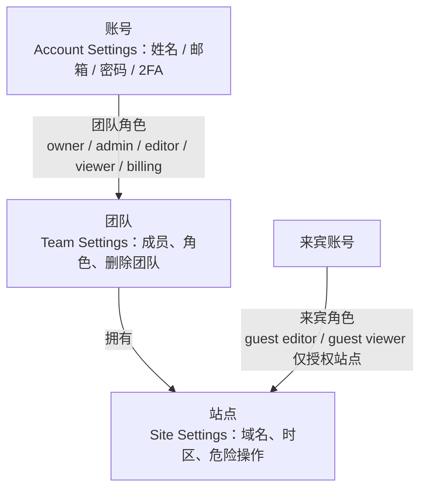

import { Meta } from '@storybook/addon-docs/blocks';

<Meta id="team-sites" title="看板与协作/团队与站点管理" name="Docs" />

# 团队与站点管理

Plausible 的协作围绕两个问题展开：谁能看什么（看板可见性），谁能改什么（站点与团队配置）。答案由两层授权决定——**团队角色**在团队维度授予，对该团队名下所有站点生效；**来宾角色**在单个站点维度授予，访客、客户、外包只开一个站点时用它。账号层面的设置（姓名、邮箱、密码、2FA）只管自己，不影响任何站点数据。

本课的角色与权限语义以官方 users-roles 文档为准，并与 CE v3.2.1 源码（`plausible/analytics`）核对；操作路径以本地实例（http://localhost:8000，站点 `test.local`，搭建见 [本地实例](?path=/docs/local-instance--docs)）为准，正文给出的路径均在 CE v3.2.1 的路由中核实存在。

| 角色 | 看看板 | 改站点设置 | 管理成员 | 管理站点 | 订阅/账单 | 强制 2FA / SSO | 删除团队 | 创建 API key |
| --- | --- | --- | --- | --- | --- | --- | --- | --- |
| Owner | 全部 | ✓ | ✓（含授予 owner） | ✓ | ✓ | ✓ | ✓ | ✓（自己的） |
| Admin | 全部 | ✓ | ✓（不能授予或修改 owner） | ✓ | ✗ | ✗ | ✗ | ✓（自己的） |
| Editor | 全部 | ✓ | ✗ | ✗ | ✗ | ✗ | ✗ | ✓（自己的） |
| Viewer | 全部 | ✗ | ✗ | ✗ | ✗ | ✗ | ✗ | ✗ |
| Billing | ✗ | ✗ | ✗ | ✗ | ✓（订阅、支付、发票） | ✗ | ✗ | ✓（自己的） |
| Guest Editor | 仅被授权站点 | 仅被授权站点 | ✗ | ✗ | ✗ | ✗ | ✗ | ✗ |
| Guest Viewer | 仅被授权站点 | ✗ | ✗ | ✗ | ✗ | ✗ | ✗ | ✗ |

矩阵按官方 users-roles 文档整理；其中 Billing 与 SSO 属于云端订阅体系：CE 没有订阅与账单，SSO 在 CE 源码中不编译，本地实例用不到这两列（CE 的角色枚举里仍保留了 `:billing`，但没有对应的套餐管理界面）。API key 归属于创建时选中的团队，跨团队查询需要分别在对应团队下建 key。

## 角色与权限

两层授权在 CE 源码里有直接对应：团队角色是 `Plausible.Teams.Membership` 的枚举 `[:guest, :viewer, :editor, :admin, :owner, :billing]`（`lib/plausible/teams/membership.ex`）；来宾是挂在团队成员之下、按站点生效的 `guest_memberships`（`lib/plausible/teams/guest_membership.ex`），角色只有 `[:viewer, :editor]` 两种。

### 团队角色

- **Owner**：管理团队、站点、自己的 API key、强制 2FA、SSO 与订阅，也是唯一能删除团队的角色。只有 owner 能授予 owner 角色或修改其他 owner。官方建议至少保留两名 owner，避免唯一 owner 失联后团队无人可管。
- **Admin**：管理团队成员、站点和自己的 API key；不能把自己或他人提升为 owner。
- **Editor**：查看全部看板、修改站点设置、管理自己的 API key；不碰成员与账单。
- **Viewer**：只能查看团队名下站点的看板，且不能创建 API key——只读角色的最小授权。
- **Billing**：管理订阅、支付、发票和自己的 API key；不参与看板与站点配置。

角色变更与成员移除由 owner 或 admin 执行，入口在 Team Settings → General 的 Team members 区块（本地路径 http://localhost:8000/settings/team/general ）。

删除团队是 owner 专属的危险操作（Team Settings → Danger Zone，路由 `/settings/team/delete`）：会连同团队名下所有站点的看板和已采集统计一起删除，不可恢复。

### 站点来宾

来宾用于「只给某一个人看某一个站点」的场景，典型对象是客户或外包：

- **Guest Editor**：获得该站点的看板访问权，并可管理该站点设置。
- **Guest Viewer**：仅获得该站点的看板访问权。

来宾看不到团队的其他站点，也不能创建 API key。来宾的添加、改角色和移除由站点所属团队的 owner 或 admin 操作，入口在站点设置的 People 页（见下文「邀请成员」）。

云端套餐按唯一邮箱计算成员名额：团队成员 + 各站点来宾 + 待接受的邀请都计入；邮件报表的纯收件人和共享链接访问者不占名额。CE 没有套餐限制，本地协作不受人数约束。

## 邀请成员

### 邀请流程

1. 团队成员：右上角账号菜单 → Team Settings → General，在 Team members 区块邀请，填邮箱并选角色。
2. 站点来宾：站点看板左上角站点名 → Site Settings → People（本地 http://localhost:8000/test.local/settings/people ）→ Invite new guest，选 guest editor 或 guest viewer。
3. 系统向该邮箱发送邀请邮件；被邀请人必须用被邀请的那个邮箱注册或登录，然后接受邀请（接受路由 `/settings/team/invitations/:invitation_id/accept` 与 `/sites/invitations/:invitation_id/accept`）。
4. 邀请 48 小时过期；接受前在管理页显示为待处理邀请，可撤销后重发。

### CE：邀请邮件依赖 SMTP

CE 上邀请流程有一个云端没有的硬性前提——邮件必须发得出去：

- CE 默认注册策略是 `DISABLE_REGISTRATION=invite_only`：新用户只能凭邀请邮件里的链接注册（路由 `/register/invitation/:invitation_id`），邮件不到，人就进不来。
- CE 默认邮件适配器是 `Bamboo.Mua` 直连投递：不配置 SMTP 中继时，实例尝试直接朝收件方 MX 投递，要求出向 25 端口可达且发信域名有正确的 SPF/DKIM 记录，否则邮件进垃圾箱或根本发不出去。
- 配 SMTP 使用 `SMTP_HOST_ADDR` / `SMTP_HOST_PORT` / `SMTP_USER_NAME` / `SMTP_USER_PWD` / `MAILER_EMAIL` 等环境变量，完整变量表见 [配置](?path=/docs/ce-configuration--docs) 与 CE wiki。

表现上要注意：邀请提交后界面一切正常、邀请显示为待处理，问题只暴露在对方的收件箱里——排查时先看服务端日志，不要先怀疑邀请流程本身。

## 站点设置

站点设置按站点独立生效。入口有两个：看板左上角站点名下拉里的 Site Settings；或站点列表（`/sites`）里悬停站点行点设置图标。CE v3.2.1 的站点设置侧栏包含 General、Goals、Properties、Email reports、People、Visibility、Imports/exports、Shields、Integrations 与 Danger zone（Funnels 为云端专属）。Goals 与 Properties 见 [目标与转化](?path=/docs/goals-conversions--docs)，Visibility 与共享链接见 [分享与嵌入](?path=/docs/sharing-embedding--docs)，Email reports 见 [邮件与 Slack 报表](?path=/docs/email-slack-reports--docs)；本课展开 General 与 Danger zone。

### General：域名与时区

General 页（本地 http://localhost:8000/test.local/settings/general ）管两个基本项：

- **Site domain**：站点标识，上报数据按它归组——页面脚本携带的域名必须与这里一致，数据才进这个站点。
- **Reporting timezone**：报表按此时区划分「今天」，跨时区团队的日报口径由它决定。

### 变更域名

改域名不丢历史数据，这是官方文档的明确承诺（"You won't lose any of your historical stats in this process"）。在 General 页 Site domain 旁点 Change，填入新域名（去掉 `https://` 和 `www.`）即可，真正的工作量在上报侧和已有链接：

- **72 小时过渡窗口**：新旧两个域名的上报都计入该站点；之后旧域名的上报被拒绝。
- **脚本侧动作取决于接入方式**：新版 snippet（含 `plausible.init`，含 GTM 模板）无需改动；WordPress 插件要在插件设置里改域名；NPM 包要更新 `init()` 参数；旧式 snippet 要改 `data-domain`。本地手册的示例页面用的正是旧式 snippet（`data-domain="test.local"`，见 [接入脚本](?path=/docs/script-setup--docs)），改域名必须同步改页面。
- **Stats API 与链接**：用旧域名的 API 请求会失败；看板书签和共享链接立即失效，官方明确没有旧地址到新地址的自动跳转。

### 危险操作

Danger zone 页（本地 http://localhost:8000/test.local/settings/danger-zone ）有三项，均已在 CE v3.2.1 模板中核对了确认文案：

- **Transfer site ownership**：把站点所有权转给另一个账号，统计随站点走。
- **Reset stats**：清空全部统计数据但保留站点配置（目标、共享链接等），确认弹窗原文 "Resetting the stats cannot be reversed."。
- **Delete site**：永久删除该站点的全部统计与设置，确认弹窗原文 "Deleting the site data cannot be reversed."。

两个清空类操作都不可恢复，执行前先到站点 Settings → Imports/exports 导出 CSV 备份（导出细节见 [数据导出](?path=/docs/data-export--docs)）。

## 多站点管理

- **添加站点**：站点列表页 http://localhost:8000/sites 点 Add website（路由 `/sites/new`），流程与本地实例课创建首个站点相同：填域名、选报表时区，创建后获得跟踪代码片段。
- **站点列表**：`/sites` 列出当前团队名下全部站点，悬停站点行出现设置入口。
- **站点间切换**：看板左上角站点名下拉，直接在站点间跳转。
- **可见性**：团队成员按角色看到团队名下所有站点；来宾只看到被授权的那一个。
- **数量上限**：站点数上限是云端套餐概念；CE 无订阅体系，本地实例不受此限。

## 账号设置

右上角账号名 → Account Settings（http://localhost:8000/settings ）。这一区只管自己的账号，不影响站点数据。

- **Preferences**（`/settings/preferences`）：修改姓名；看板主题（light / dark / system）。
- **Security**（`/settings/security`）：修改邮箱（需输入密码确认，变更生效前可取消）；修改密码；两步验证 2FA——用 authenticator 应用的 TOTP 验证码，启用时发放 recovery codes；登录管理——查看活动会话并远程注销，不活跃会话 14 天自动过期。
- **API keys**（`/settings/api-keys`）：Stats API 密钥的创建与吊销；viewer 和来宾没有此入口，key 归属于创建时选中的团队。
- **Danger zone**（`/settings/danger-zone`）：永久删除账号及其关联数据。

CE 差异集中在 SSO：SSO 的全部路由在源码中以 `on_ee` 条件编译（`lib/plausible_web/router.ex`），CE 没有 SSO 界面。CE 的账号安全就是「密码 + 2FA」两件事；团队级还可以由 owner 在 Team Settings → General 强制所有成员启用 2FA（`force_2fa` 开关），不开 2FA 的成员将被挡在团队数据之外。

## 常见问题

- 邀请了成员，对方一直收不到邀请邮件
  CE 上基本是 SMTP 没配好：默认 `Bamboo.Mua` 直连投递，缺少 SPF/DKIM 或出向 25 端口不通时邮件发不出去或进垃圾箱，而 CE 默认 `invite_only`，没有邀请邮件新用户就无法注册。先 `docker compose logs -f plausible` 看投递报错，再按 [配置](?path=/docs/ce-configuration--docs) 配好 `SMTP_HOST_*` 系列变量后撤销原邀请并重发；同时确认邀请是否已超过 48 小时有效期，过期需重新邀请。
- 站点改了域名，历史数据会丢吗
  不会，官方明确改域名不丢历史统计，且新旧域名有 72 小时并行计数的过渡窗口。真正要做的是改上报侧：旧式 snippet 更新 `data-domain`，WordPress 插件和 NPM 包各自更新域名配置；Stats API 请求和看板书签、共享链接也要换新域名——旧链接没有自动跳转，立即失效。
- 删除站点能恢复吗
  不能。Danger zone 的 Delete site 永久删除该站点全部统计与设置，确认弹窗原文即 "cannot be reversed"。删除前先到 Settings → Imports/exports 导出 CSV 备份；如果只想清空数据但保留目标、共享链接等配置，用 Reset stats 而不是 Delete site。

## 总结回顾

摘要：

Plausible 的协作权限分两层：团队角色（owner / admin / editor / viewer / billing）管整个团队名下所有站点，来宾角色（guest editor / guest viewer）只对单个站点生效；owner 独有订阅、SSO、强制 2FA 与删除团队的权限，viewer 与来宾不能创建 API key。邀请通过邮件完成、48 小时过期，被邀请人须用被邀请邮箱注册或登录后接受；CE 默认 `invite_only` 且邮件依赖 SMTP，未配置 SMTP 时邀请流程实际断在发信这一步。站点设置按站点独立：General 管域名与报表时区；改域名不丢历史数据、有 72 小时并行计数过渡，但上报脚本、Stats API 和各类链接要同步换新域名；Danger zone 的 Reset stats 与 Delete site 均不可逆。多站点在 `/sites` 添加、列表管理、看板左上角切换；账号设置管自己的姓名、邮箱、密码、2FA 与会话，CE 没有 SSO。

一句话：

> 授权分两层——团队角色决定「整队能做什么」，来宾角色只开单个站点；CE 上协作的唯一硬性前提是配好 SMTP，否则邀请邮件发不出去，`invite_only` 的实例就永远只有一个人。

知识要点：

- 五种团队角色与两种来宾角色各自的权限边界是什么？为什么官方建议至少保留两名 owner？
- viewer 和 editor 的差别在哪？哪些角色不能创建 API key？
- 邀请团队成员和站点来宾的完整流程分别是什么？CE 未配置 SMTP 时邀请会卡在哪一步、为什么？
- 站点 General 设置有哪些项？改域名对历史数据、上报脚本、Stats API 和共享链接各有什么影响？
- Danger zone 三项操作各自的作用是什么？哪些不可逆？
- 账号设置里安全相关的项有哪些？CE 与云端在 SSO 上的差异是什么？

## 参考资料

- [官方文档：Users and roles（角色定义、权限、邀请与名额计数）](https://plausible.io/docs/users-roles)
- [官方文档：Website settings（站点设置各区入口）](https://plausible.io/docs/website-settings)
- [官方文档：Change domain name（改域名对数据、脚本、API 与链接的影响）](https://plausible.io/docs/change-domain-name)
- [官方文档：Account settings（偏好、安全、API key、删除账号）](https://plausible.io/docs/account-settings)
- [CE wiki：Configuration（SMTP 环境变量、invite_only 默认与邮件依赖）](https://github.com/plausible/community-edition/wiki/configuration)
- [plausible/analytics v3.2.1 源码（角色枚举 teams/membership.ex、设置路由 router.ex、`on_ee` 限定的 SSO）](https://github.com/plausible/analytics/tree/v3.2.1)
